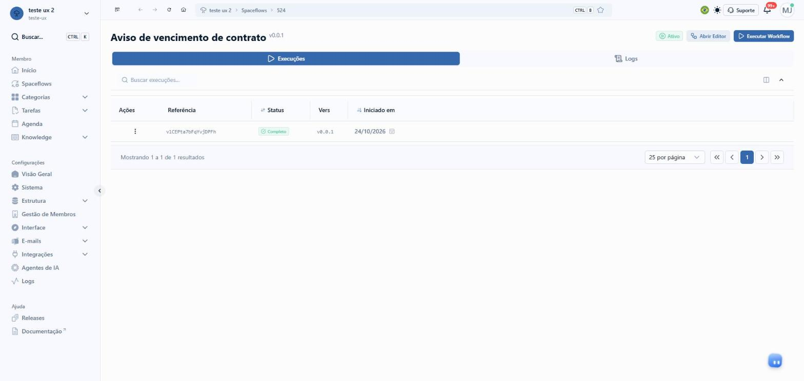
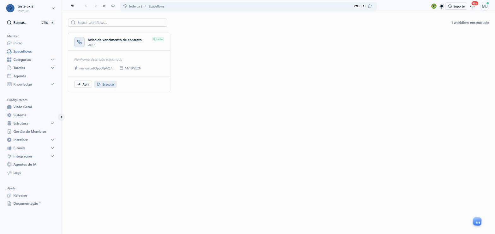

# Central de execuções do Spaceflow

## A demanda, como veio

> o enspace tem um sistema de workflows chamado spaceflow.
>
> hoje o spaceflow tem uma tela de execuçoes por fluxo. voce consegue ver todas as execuçoes daquele fluxo, um historico.
>
> ao clicar em uma execuçao especifica, voce ve os dados dela, os dados dos nós executados etc.
>
> pode abrir a tela pra testar se precisar.
>
> contudo, tem um problema que os usuarioa sempre relatam:
> nao é possível ver dados (dash) das execuçoes de modo geral, ex: quantas no total falharam ate hoje, quantas estao em andamento etc
> e nao consigo acompanhar TUDO o que ta acontecendo nos meus workflows.
>
> esse segundo ponto é a parte mais grave do problema.
>
> imagine que pra montar um fluxo de operaçao completo sejam necessários 38 fluxos que, de alguma forma, se interligam, do tipo: toda vez que um contrato é criado, um andamento é registrado. Isso é um fluxo. E ha outro fluxo que começa toda vez que um andamento é criado. E outro que começa toda vez que um andamento é editado, e ele é sempre editado por esse sgeundo fluxo que dispara qudno um andamento é criado...
>
> nesse caso, os usuarios precisavam ter uma tela global de acompanhamento ed workflows em execuçao pra conseguir acompanhar uma operaçao inteira, com dados e visoes que façam sentido e que ajudem o usuario a entender como os fluxos dele estao se integrando (pro user que nao é o configurador/tecnico, mesmo leigo, ser capaz de entender e buscar, por exemplo: o contrato x está rodando por quais fluxos aqui?), dentre outras necessidades nessas telas completas de gestao.
>
> antes de mais nada, pesquise MUITO /deep-research como outros sistemas de workflows (n8n e outros) fazem pra dar essa gestao global de fluxos e veja o que pode fazer sentido pro enspace.
>
> com base no que pesquisar, sugira.  se eu validar voce aplica

- **Tela em jogo:** Spaceflows (menu do membro, `/workspaces/<ws>/workflows`) e a tela de um fluxo, com as abas
  Execuções e Logs (`/workspaces/<ws>/workflows/<id>`). A proposta acrescenta uma visão de todos os fluxos juntos.
- **Sucesso:** qualquer membro, técnico ou não, vê numa tela o que está rodando, o que falhou e o que precisa de
  ação em todos os fluxos, e encontra, a partir de um item (o contrato X), por quais fluxos ele passou e em que ordem.

## O que a pesquisa de UX já dizia

Procurei no `enspace-ux-research` (`temas/README.md`, as auditorias dos 6 temas e o `UX_REPORT.md`) por execução,
monitoramento, Spaceflow e workflow. Não há auditoria de execuções nem de acompanhamento de fluxos. O que há é vizinho:

- **`temas/plataforma`:** a persona leiga não entende o rótulo "Spaceflows" no menu. Fora do escopo (é a casca).
- **S3-F5 (`temas/configuracoes-do-sistema`):** a cobrança fala em "en-credits" sem unidade; o wireframe propõe
  mostrar "≈ N execuções". Serve de lembrete: número solto sem unidade não ajuda o leigo.

Os protótipos `spaceflow` (configuração dos nós) e `protecoes-do-spaceflow` (limites, ciclos e status novos) são da
mesma família. A central reaproveita os status e o aviso de ciclo das proteções, sem redesenhar.

## O Spaceflow hoje (develop, 24/10/2026)

Workspace de exploração, 1 fluxo ("Aviso de vencimento de contrato", gatilho Manual), executado 1 vez pela tela.
Nenhum preparo por API.

### O caminho

1. Menu do membro › **Spaceflows** (`/workspaces/<ws>/workflows`): cartões com nome, versão, status em inglês cru
   ("active"), gatilho em texto técnico (`manual::wf-...::create`), data, botões **Abrir** e **Executar**. Busca
   "Buscar workflows...". Não há número de execuções nem de falhas no cartão.
2. **Abrir** (`/workspaces/<ws>/workflows/524`): título, versão, selo Ativo, **Abrir Editor**, **Executar Workflow**,
   abas **Execuções** e **Logs**.
3. Aba Execuções: busca "Buscar execuções...", colunas Ações, Referência, Status, Vers, Iniciado em; paginação
   "25 por página". Menu da linha: **Ver Detalhes** e **Abrir Execução**.
4. **Abrir Execução** (`/workspaces/<ws>/workflows/524/executions/15223`): abas Fluxo de Execução (canvas com o
   caminho executado, duração, "2/2 nós executados"), Detalhes (Referência, Versão, Criado em, Atualizado em, Status,
   Entrada e Saída em JSON cru), Comentários e Logs.

Sem evidência visual da aba Detalhes: o JSON de Entrada mostra nome e e-mail da pessoa que executou, e este
repositório é público. O conteúdo está transcrito abaixo, sem o dado pessoal.

### O que o produto já guarda e nenhuma tela mostra

| Peça | Onde | O que serve para a central |
|---|---|---|
| `parent` (id da execução) | schema `WorkflowExecution` do SDK | ligar a execução filha à mãe (nó Iniciar Fluxo) |
| `item` (id do item) | schema `WorkflowExecution`; opção `link_item` ("Vincular o item à execução") no Início | responder "o contrato X passou por quais fluxos" |
| `title` | schema `WorkflowExecution`; "Título da execução" no Início | nome legível da execução no lugar da referência aleatória |
| `triggered_by` | JSON de Entrada da execução | quem disparou (membro) |
| `workflow_timeline.lineage` | JSON de Entrada da execução, vazio (`[]`) na execução manual | a cadeia de fluxos que levou a esta execução; o que preenche é pergunta para o time |
| `GET /workflows/executions` e `/workflows/executions/count` | client HTTP do SDK, no bundle do front | lista e contagem de execuções de todos os fluxos |
| `GET /workflows/metrics` (`workspaceMetrics`, com `startDate` e `endDate`) | client HTTP do SDK; resposta `Record<string, number>` | os números do painel; as chaves não estão tipadas |
| `POST /workflows/nodes/:id/retry` | client HTTP do SDK | reexecutar um nó que falhou |

Status do schema: `working`, `completed`, `error` e `deleted`. Nenhum diz "esperando pessoa", "esperando tempo" ou
"na fila"; as proteções propõem os de fila.

Não deu para chamar as rotas globais: o `API_TOKEN` de develop responde 403 no workspace de exploração e no
`enspace-releases`, e o classificador de permissões barra a leitura do token da sessão do Chrome. O formato da
resposta de `/workflows/metrics` fica como pergunta para o time.

### Onde trava

- Para saber quantas execuções falharam no workspace, a pessoa abre fluxo por fluxo e conta. Com 38 fluxos são 38
  telas, sem total.
- A lista de execuções não diz o que disparou a execução (membro, item, outro fluxo, timer) nem qual item ela tocou.
- A execução não leva à execução que a causou nem às que ela causou. A cadeia "contrato criado › andamento criado ›
  andamento editado" existe só na cabeça de quem configurou.
- A partir do item, nada mostra os fluxos que rodaram nele.
- O detalhe da execução fala JSON (Entrada e Saída); o leigo não lê.
- O nó Iniciar Fluxo "não herda dados do fluxo pai" (doc do en-docs). A maior parte das cadeias reais nem passa por
  ele: o fluxo A grava um item e o evento do item dispara o fluxo B.

## Pesquisa

Relatório completo: [`pesquisa/reports/Gestão global de execuções de fluxos.md`](pesquisa/reports/Gestão%20global%20de%20execuções%20de%20fluxos.md),
com as notas em `pesquisa/research_notes/`.

## A casca da tela, item por item

Partiu da casca do `protecoes-do-spaceflow` (mesmo menu e mesma barra do topo), conferida em 24/10/2026 na lista de
Spaceflows do menu do membro, na tela do fluxo 524 e na tela de um item do workspace de exploração. O que muda entre
as telas é só o item ativo: Spaceflows no menu do membro, ou Categorias aberto com a categoria do item.

| Parte | Como é no develop | No protótipo |
|---|---|---|
| Menu lateral | Workspace no topo, Buscar com Ctrl K; Membro (Início, Spaceflows, Categorias, Tarefas, Agenda, Knowledge); Configurações (Visão Geral, Sistema, Estrutura, Gestão de Membros, Interface, E-mails, Integrações, Agentes de IA, Logs); Ajuda (Releases, Documentação) | igual; as categorias abertas são as 13 do workspace fictício do mock |
| Barra do topo | Recolher, voltar, avançar, recarregar, início; trilha a partir do workspace; Ctrl B e estrela; idioma, tema, Suporte, sino, avatar | igual |
| Lista de Spaceflows | Busca "Buscar workflows..."; cartões com nome, versão, status cru ("active"), gatilho técnico, data, Abrir e Executar | igual em "Como é hoje"; na proposta, a lista ganha as abas Visão geral, Execuções, Mapa da operação e Fluxos |
| Tela do fluxo | Título, versão, selo Ativo, Abrir Editor, Executar Workflow; abas Execuções e Logs | igual; a aba Execuções usa a mesma lista da central, filtrada pelo fluxo |
| Detalhe da execução | Abas Fluxo de Execução (canvas com o caminho), Detalhes (JSON de Entrada e Saída), Comentários e Logs | igual em "Como é hoje"; na proposta, título legível, faixa da cadeia, falha em palavras e aba Cadeia |
| Tela do item | Painel esquerdo (referência, categoria, identificação, origem, histórico); abas Visão Geral, Comentários, Logs de Auditoria, Tarefas, Anexos, Emails Automáticos, Mail Box, Notas, Campos; rodapé "Sair sem salvar" e "Salvar" | igual, mais a aba Fluxos depois de Tarefas |
