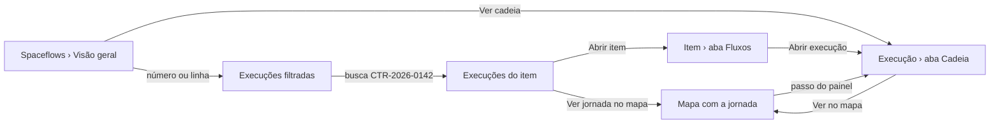

# Decisões: Central de execuções do Spaceflow

## A proposta em 1 parágrafo

A lista de Spaceflows do menu do membro ganha 4 abas: **Visão geral**, **Execuções**, **Mapa da operação** e
**Fluxos** (os cartões de hoje, agrupados por operação). A Visão geral abre no que pede ação: 5 números do período
(Rodando agora, Esperando, Com erro, Paradas pela plataforma, Concluídas), cada um levando à lista filtrada, e o
bloco "Precisa de atenção", com 1 linha por fluxo com problema, a causa em palavras e o reprocessamento em lote.
Execuções é a lista de todos os fluxos, com a busca por item: "CTR-2026-0142 passou por 8 fluxos em 8 execuções".
A execução ganha a aba **Cadeia** (o que a causou e o que ela causou, em cascata), o item ganha a aba **Fluxos**, e
o mapa desenha a operação inteira, com a jornada de um item por cima. Tudo que depende da cadeia (a execução que
causou a seguinte e o item raiz) aparece só com o backend da fase 2; o andaime mostra a fase 1, com o que o produto
já guarda.

## A jornada

## Rodada 1 · 2026-10-26

- **Pedido (literal):** "validado, pode prototipar a proposta inteira (lista global, números, precisa de atenção,
  cadeia, busca por item, aba no item e mapa)"
- **Mudou:**
  - pasta nova `central-de-execucoes`, com a casca copiada do `protecoes-do-spaceflow` e conferida no develop;
  - Visão geral: período (últimas 24 horas ou últimos 7 dias) comparado ao anterior, 5 números clicáveis, "Precisa de
    atenção" com estado do problema (Precisa de revisão, Resolvido, Ignorado, Adiado) e "Reprocessar falhas" com a
    prévia dos itens afetados, barras empilhadas por dia, "Fluxos com mais falhas" e a saúde de cada operação;
  - Execuções: 1 lista para os 38 fluxos, com Status (ícone, palavra e motivo), Item, Disparada por, Duração e
    Cadeia; filtros por grupo de status, fluxo, operação e origem; "Só a origem de cada cadeia"; visões salvas; a
    busca acha o item e troca a lista pelas execuções dele, com a frase de resumo e a chave "Incluir os itens criados
    pela cadeia";
  - detalhe da execução: título pelo nome do fluxo, faixa "Passo 11 de 23 na cadeia do CTR-2026-0139", "Causada por",
    "Ir para a origem", a falha em palavras com "Reprocessar a partir deste nó", aba Cadeia em cascata e a aba
    Detalhes com campos rotulados, "O que gravou" e o JSON atrás de "Ver dados técnicos";
  - tela do item: aba Fluxos com a frase "Agora", 5 números da jornada, "Só este item" ou "Com a cadeia" e a linha do
    tempo agrupada por cadeia;
  - mapa da operação: eventos de item entre os fluxos, ligação configurada tracejada e observada contínua com a
    contagem, aviso de ciclo, painel lateral do fluxo ou do evento, e a jornada de um item com os passos numerados;
  - aba Fluxos: os cartões de hoje agrupados por operação, com o gatilho em palavras e os números de 7 dias.
- **Fronteira:** muda o conteúdo da tela de Spaceflows (as 4 abas), o detalhe da execução (faixa, falha em palavras,
  aba Cadeia, Detalhes legível) e a tela do item (aba Fluxos). Não muda a casca, o editor do fluxo, o canvas da
  execução, as abas Comentários e Logs, nem as outras abas do item.
- **Fora desta rodada:** os Avisos da operação (bloco 8 do relatório). Ela listou 7 blocos e os avisos não estavam;
  eles partem dos Avisos ao dono do `protecoes-do-spaceflow`.
- **Decisões que estavam em aberto** (ela validou o relatório; segui a recomendação):
  - o andaime tem **Backend: Com a cadeia (fase 2)** e **Só o que existe (fase 1)**. Na fase 1 a coluna Cadeia, "Só
    a origem", "Incluir os itens criados pela cadeia" e as ligações observadas do mapa somem, e a aba Cadeia explica
    o dado que falta. Assim o dev vê o que cada fase entrega;
  - 5 grupos de status na tela (Rodando, Esperando, Com erro, Parada pela plataforma, Concluída), com os status das
    proteções dentro deles; `deleted` fica fora dos números (pergunta P7);
  - "Só a origem de cada cadeia" nasce ligado na lista, como no Trigger.dev e no Power Automate. Com ele ligado, o
    filtro de status olha a cadeia inteira: a origem aparece em "Com erro" quando algum passo dela falhou, com "1 com
    erro na cadeia" na coluna;
  - "operação" é um grupo de fluxos com nome ("Gestão de contratos"). Na fase 1 sem backend novo, o grupo pode ser a
    categoria escutada (relatório, bloco 3).
- **Por que assim:**
  - a Visão geral abre no que pede ação e cada número leva à lista filtrada: é o padrão de Camunda, monday.com e Make,
    e o leigo não precisa montar filtro;
  - 1 linha por fluxo em "Precisa de atenção", não por execução: 15 falhas viram 7 problemas com causa e ação;
  - a busca aceita a referência do item e responde em frase, porque o pedido literal é "o contrato x está rodando
    por quais fluxos aqui?";
  - a cascata da cadeia segue o waterfall do Honeycomb: recuo por "causada por", barra no tempo, status com motivo.
    A espera em aberto fica listrada até a borda e não estica a cadeia, e "Do primeiro ao último passo" conta só o que
    aconteceu, igual na tela do item;
  - o mapa vai da esquerda para a direita com o evento de item no meio, como o tópico do Confluent: o leigo lê "o
    fluxo grava o andamento, o andamento editado dispara o próximo";
  - o status nunca depende só da cor: cada grupo tem ícone, palavra e o motivo embaixo, como nas proteções;
  - gráfico de barras empilhadas por dia, sem rosca: a comparação entre dias é o que interessa (NN/g, Inngest).
- **Descartado:**
  - uma coluna Fluxo separada na lista. Motivo: repetia a coluna Execução, que já mostra o nome do fluxo e a operação;
  - abrir o mapa com os 38 fluxos de uma vez. Motivo: ilegível; o mapa abre numa operação e o item filtra a jornada;
  - rosca de status. Motivo: não compara períodos nem dias.
- **Não deu:**
  - chamar `GET /workflows/executions` e `GET /workflows/metrics` no develop. Por quê: o token de develop responde
    403 no workspace de exploração; o formato da resposta fica nas perguntas P5 e P6;
  - print das referências (n8n, Make, Power Automate, Camunda). Por quê: pesquisa documental; as telas pedem conta.
- **Maquete:**
  - 880 execuções de 38 fluxos em 7 dias, geradas no `mocks.ts` por simulação: cada fluxo grava itens e o evento do
    item dispara os fluxos que o escutam, com a cadeia gravada em `input.workflow_timeline.lineage` (campo do schema
    usado como proposta, ver P1);
  - "agora" é fixo em 24/10/2026 16:40; "Atualizar" espera e devolve os mesmos dados;
  - reprocessar, mudar o estado do problema e as visões salvas mexem só na memória; o reload zera;
  - os cenários do andaime: Operação com falhas, Tudo em dia, Acesso parcial, Sem execuções, Carregando e Erro ao
    carregar; os exemplos abrem 3 contratos (com falha, com repetição sem fim, esperando pessoa).
- **Crítica e acessibilidade:**
  - corrigido: com "Só a origem" ligado, o filtro Com erro mostrava 0, porque o erro estava num passo e não na
    origem; o filtro e as contagens passaram a olhar a cadeia;
  - corrigido: "7 concluída" no resumo da busca; a frase passou a ter plural por grupo nos 3 idiomas;
  - corrigido: no mapa, o número do passo cobria o nome do fluxo; foi para a linha de baixo, ao lado da contagem;
  - corrigido: as setas do mapa cresciam com o zoom; passaram a ter tamanho fixo;
  - corrigido: o rótulo do evento cortava em inglês e espanhol ("Contratos: ítem c..."); o nó ficou mais largo e o
    nome inteiro aparece no `title`;
  - corrigido: a aba Cadeia dizia "6 h 10 min" do primeiro ao último passo e a tela do item dizia "1 min"; a espera em
    aberto parou de contar;
  - corrigido: o aviso da execução parada repetia o aviso da aba Cadeia; o aviso do topo passou a nomear o fluxo e o
    item, e o da aba só aparece quando a execução aberta não é a parada. Na fase 1, sem a cadeia, o aviso volta ao
    texto genérico e perde "Ver cadeia";
  - os nós do mapa são botões com `aria-label` (nome, saúde e execuções) e `aria-pressed`; o painel lateral repete
    a jornada como lista, para quem não lê o desenho;
  - as animações de entrada respeitam `prefers-reduced-motion` (`main.css`).
- **CSS próprio:** nenhum (`<style>`, `:deep()` e `!important` não aparecem nos arquivos da pasta).
- **Ver:** https://pernalombr4.github.io/prototipos/central-de-execucoes/ · prints em `evidencias/`:
  - `proposta-01-visao-geral.jpg`: os 5 números e "Precisa de atenção";
  - `proposta-02-execucoes-de-um-item.jpg`: a busca pelo CTR-2026-0142, com as 8 execuções da cadeia;
  - `proposta-03-aba-fluxos-do-item.jpg`: a aba Fluxos do CTR-2026-0139, com a frase "Agora";
  - `proposta-04-cadeia-da-execucao.jpg`: a aba Cadeia da execução parada pela repetição sem fim;
  - `proposta-05-mapa-com-jornada.jpg`: o mapa da operação com a jornada do CTR-2026-0139.

## Perguntas para o time de dev

As 11 perguntas (P1 a P11) estão no relatório, em "Perguntas para o time de dev". As que decidem a fase 2 são P1
(o que preenche `workflow_timeline.lineage`), P2 (quando `parent` é preenchido) e P4 (o ENSPACE grava qual execução
criou ou editou um item?).
