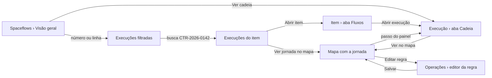

# Decisões: Central de execuções do Spaceflow

## A proposta em 1 parágrafo

A lista de Spaceflows do menu do membro ganha 5 abas: **Visão geral**, **Execuções**, **Mapa da operação**,
**Operações** e **Fluxos** (os cartões de hoje, agrupados por operação). A operação é um grupo de fluxos com nome,
responsável e uma regra lógica que lê a configuração de cada fluxo; quem administra cria, edita e exclui na aba
Operações, e a prévia mostra quais fluxos entram e por quê. A Visão geral abre no que pede ação: 5 números do período
(Rodando agora, Esperando, Com erro, Paradas pela plataforma, Concluídas), cada um levando à lista filtrada, e o
bloco "Precisa de atenção", com 1 linha por fluxo com problema, a causa em palavras e o reprocessamento em lote.
Execuções é a lista de todos os fluxos, com a busca por item: "CTR-2026-0142 passou por 8 fluxos em 8 execuções".
A execução ganha a aba **Cadeia** (o que a causou e o que ela causou, em cascata), o item ganha a aba **Fluxos**, e
o mapa desenha a operação inteira, com a jornada de um item por cima. Tudo que depende da cadeia (a execução que
causou a seguinte e o item raiz) aparece só com o backend da fase 2; o andaime mostra a fase 1, com o que o produto
já guarda.

## A jornada

## Rodada 1 · 2026-10-26

- **Pedido (literal):** "validado, pode prototipar a proposta inteira (lista global, números, precisa de atenção,
  cadeia, busca por item, aba no item e mapa)"
- **Mudou:**
  - pasta nova `central-de-execucoes`, com a casca copiada do `protecoes-do-spaceflow` e conferida no develop;
  - Visão geral: período (últimas 24 horas ou últimos 7 dias) comparado ao anterior, 5 números clicáveis, "Precisa de
    atenção" com estado do problema (Precisa de revisão, Resolvido, Ignorado, Adiado; removido na rodada 3) e
    "Reprocessar falhas" com a
    prévia dos itens afetados, barras empilhadas por dia, "Fluxos com mais falhas" e a saúde de cada operação;
  - Execuções: 1 lista para os 38 fluxos, com Status (ícone, palavra e motivo), Item, Disparada por, Duração e
    Cadeia; filtros por grupo de status, fluxo, operação e origem; "Só a origem de cada cadeia"; visões salvas; a
    busca acha o item e troca a lista pelas execuções dele, com a frase de resumo e a chave "Incluir os itens criados
    pela cadeia";
  - detalhe da execução: título pelo nome do fluxo, faixa "Passo 11 de 23 na cadeia do CTR-2026-0139", "Causada por",
    "Ir para a origem", a falha em palavras com "Reprocessar a partir deste nó", aba Cadeia em cascata e a aba
    Detalhes com campos rotulados, "O que gravou" e o JSON atrás de "Ver dados técnicos";
  - tela do item: aba Fluxos com a frase "Agora", 5 números da jornada, "Só este item" ou "Com a cadeia" e a linha do
    tempo agrupada por cadeia;
  - mapa da operação: eventos de item entre os fluxos, ligação configurada tracejada e observada contínua com a
    contagem, aviso de ciclo, painel lateral do fluxo ou do evento, e a jornada de um item com os passos numerados;
  - aba Fluxos: os cartões de hoje agrupados por operação, com o gatilho em palavras e os números de 7 dias.
- **Fronteira:** muda o conteúdo da tela de Spaceflows (as 4 abas), o detalhe da execução (faixa, falha em palavras,
  aba Cadeia, Detalhes legível) e a tela do item (aba Fluxos). Não muda a casca, o editor do fluxo, o canvas da
  execução, as abas Comentários e Logs, nem as outras abas do item.
- **Fora desta rodada:** os Avisos da operação (bloco 8 do relatório). Ela listou 7 blocos e os avisos não estavam;
  eles partem dos Avisos ao dono do `protecoes-do-spaceflow`.
- **Decisões que estavam em aberto** (ela validou o relatório; segui a recomendação):
  - o andaime tem **Backend: Com a cadeia (fase 2)** e **Só o que existe (fase 1)**. Na fase 1 a coluna Cadeia, "Só
    a origem", "Incluir os itens criados pela cadeia" e as ligações observadas do mapa somem, e a aba Cadeia explica
    o dado que falta. Assim o dev vê o que cada fase entrega;
  - 5 grupos de status na tela (Rodando, Esperando, Com erro, Parada pela plataforma, Concluída), com os status das
    proteções dentro deles; `deleted` fica fora dos números (pergunta P7);
  - "Só a origem de cada cadeia" nasce ligado na lista, como no Trigger.dev e no Power Automate. Com ele ligado, o
    filtro de status olha a cadeia inteira: a origem aparece em "Com erro" quando algum passo dela falhou, com "1 com
    erro na cadeia" na coluna;
  - "operação" é um grupo de fluxos com nome ("Gestão de contratos"). Na fase 1 sem backend novo, o grupo pode ser a
    categoria escutada (relatório, bloco 3).
- **Por que assim:**
  - a Visão geral abre no que pede ação e cada número leva à lista filtrada: é o padrão de Camunda, monday.com e Make,
    e o leigo não precisa montar filtro;
  - 1 linha por fluxo em "Precisa de atenção", não por execução: 15 falhas viram 7 problemas com causa e ação;
  - a busca aceita a referência do item e responde em frase, porque o pedido literal é "o contrato x está rodando
    por quais fluxos aqui?";
  - a cascata da cadeia segue o waterfall do Honeycomb: recuo por "causada por", barra no tempo, status com motivo.
    A espera em aberto fica listrada até a borda e não estica a cadeia, e "Do primeiro ao último passo" conta só o que
    aconteceu, igual na tela do item;
  - o mapa vai da esquerda para a direita com o evento de item no meio, como o tópico do Confluent: o leigo lê "o
    fluxo grava o andamento, o andamento editado dispara o próximo";
  - o status nunca depende só da cor: cada grupo tem ícone, palavra e o motivo embaixo, como nas proteções;
  - gráfico de barras empilhadas por dia, sem rosca: a comparação entre dias é o que interessa (NN/g, Inngest).
- **Descartado:**
  - uma coluna Fluxo separada na lista. Motivo: repetia a coluna Execução, que já mostra o nome do fluxo e a operação;
  - abrir o mapa com os 38 fluxos de uma vez. Motivo: ilegível; o mapa abre numa operação e o item filtra a jornada;
  - rosca de status. Motivo: não compara períodos nem dias.
- **Não deu:**
  - chamar `GET /workflows/executions` e `GET /workflows/metrics` no develop. Por quê: o token de develop responde
    403 no workspace de exploração; o formato da resposta fica nas perguntas P5 e P6;
  - print das referências (n8n, Make, Power Automate, Camunda). Por quê: pesquisa documental; as telas pedem conta.
- **Maquete:**
  - 880 execuções de 38 fluxos em 7 dias, geradas no `mocks.ts` por simulação: cada fluxo grava itens e o evento do
    item dispara os fluxos que o escutam, com a cadeia gravada em `input.workflow_timeline.lineage` (campo do schema
    usado como proposta, ver P1);
  - "agora" é fixo em 24/10/2026 16:40; "Atualizar" espera e devolve os mesmos dados;
  - reprocessar, mudar o estado do problema (removido na rodada 3) e as visões salvas mexem só na memória; o reload zera;
  - os cenários do andaime: Operação com falhas, Tudo em dia, Acesso parcial, Sem execuções, Carregando e Erro ao
    carregar; os exemplos abrem 3 contratos (com falha, com repetição sem fim, esperando pessoa).
- **Crítica e acessibilidade:**
  - corrigido: com "Só a origem" ligado, o filtro Com erro mostrava 0, porque o erro estava num passo e não na
    origem; o filtro e as contagens passaram a olhar a cadeia;
  - corrigido: "7 concluída" no resumo da busca; a frase passou a ter plural por grupo nos 3 idiomas;
  - corrigido: no mapa, o número do passo cobria o nome do fluxo; foi para a linha de baixo, ao lado da contagem;
  - corrigido: as setas do mapa cresciam com o zoom; passaram a ter tamanho fixo;
  - corrigido: o rótulo do evento cortava em inglês e espanhol ("Contratos: ítem c..."); o nó ficou mais largo e o
    nome inteiro aparece no `title`;
  - corrigido: a aba Cadeia dizia "6 h 10 min" do primeiro ao último passo e a tela do item dizia "1 min"; a espera em
    aberto parou de contar;
  - corrigido: o aviso da execução parada repetia o aviso da aba Cadeia; o aviso do topo passou a nomear o fluxo e o
    item, e o da aba só aparece quando a execução aberta não é a parada. Na fase 1, sem a cadeia, o aviso volta ao
    texto genérico e perde "Ver cadeia";
  - os nós do mapa são botões com `aria-label` (nome, saúde e execuções) e `aria-pressed`; o painel lateral repete
    a jornada como lista, para quem não lê o desenho;
  - as animações de entrada respeitam `prefers-reduced-motion` (`main.css`).
- **CSS próprio:** nenhum (`<style>`, `:deep()` e `!important` não aparecem nos arquivos da pasta).
- **Ver:** https://pernalombr4.github.io/prototipos/central-de-execucoes/ · prints em `evidencias/`:
  - `proposta-01-visao-geral.jpg`: os 5 números e "Precisa de atenção";
  - `proposta-02-execucoes-de-um-item.jpg`: a busca pelo CTR-2026-0142, com as 8 execuções da cadeia;
  - `proposta-03-aba-fluxos-do-item.jpg`: a aba Fluxos do CTR-2026-0139, com a frase "Agora";
  - `proposta-04-cadeia-da-execucao.jpg`: a aba Cadeia da execução parada pela repetição sem fim;
  - `proposta-05-mapa-com-jornada.jpg`: o mapa da operação com a jornada do CTR-2026-0139.

## Rodada 2 · 2026-10-26

- **Pedido (literal):** "como o usuario define o que é uma operaçao? ha esse conceito, mas nao sabemos como as
  entidades estao se relacionando ali / tem que ter crud pra fazer sentido, isso mostrado no sistema mesmo / hoje os
  agrupamentos estao na tela mas nao tem como isso ser 100% automatico. nao faz sentido. só se estivéssemos usando ia
  por tras. e nao pode ser. tem que ser programatico. regra logica."
- **Mudou:**
  - a operação deixou de ser um campo fixo de cada fluxo no `mocks.ts` e virou entidade própria em `operacoes.ts`:
    nome, descrição, responsável e regra;
  - a regra tem 3 partes:
    - as categorias da operação;
    - 2 critérios, que se ligam e desligam: "o gatilho dele é um evento destas categorias" e "ele cria, edita ou
      exclui itens destas categorias";
    - 2 listas de exceção: "Sempre incluir" (o fluxo que a regra não alcança) e "Nunca incluir" (vence o "Sempre
      incluir");
  - aba nova **Operações**: 1 linha por operação, com a regra em palavras, os fluxos, o responsável, as execuções do
    período e a saúde; "Ver no mapa", "Editar" e, no menu da linha, "Excluir" com confirmação;
  - quando algum fluxo fica fora de toda regra, um aviso no topo da aba lista os nomes, com "Nova operação";
  - editor em painel lateral, com a regra à esquerda e a prévia ao vivo à direita:
    - cada fluxo que entra mostra o motivo ("Gatilho: Contrato criado", "Grava: Andamento criado", "Incluído à mão")
      e as outras operações em que também está, com "Tirar";
    - "Ligados, mas fora da operação": o fluxo de fora que grava o evento que dispara um de dentro, ou escuta o que
      um de dentro grava, com "Incluir";
    - "Fora por exceção", com "Desfazer";
    - validação: nome obrigatório e único, e a regra precisa alcançar ao menos 1 fluxo;
  - o mapa ganhou "Editar regra" ao lado da escolha da operação; a Visão geral ganhou "Gerenciar operações";
  - mapa, Visão geral, filtro de operação da lista, cabeçalho da execução e cartões da aba Fluxos passaram a calcular a
    operação pela regra. Fluxo fora de toda regra vai para o grupo "Sem operação" nos cartões.
- **Fronteira:** muda a origem do agrupamento e ganha a aba Operações com o editor. Não muda a casca, as outras abas
  nem o desenho do mapa.
- **Por que assim:**
  - a regra lê só o que o fluxo já tem configurado (o gatilho e os nós que gravam item). Com a mesma configuração, o
    resultado é o mesmo: não há IA nem inferência pelas execuções, como ela pediu;
  - a categoria é a peça que o membro já conhece: a operação "Gestão de contratos" é o que acontece com contratos,
    andamentos, documentos, aditivos e pagamentos;
  - a prévia com o motivo de cada fluxo responde "como as entidades estão se relacionando": quem dispara quem, e por
    qual evento, antes de salvar;
  - as 2 listas de exceção existem porque a regra não alcança tudo. Nos dados do protótipo, 3 fluxos agendados que
    não gravam item (Aviso de vencimento de contrato, Relatório semanal de compras e Lembrete de documentos
    pendentes) só entram pelo "Sempre incluir";
  - um fluxo pode estar em 2 operações (Programar pagamentos está em "Gestão de contratos" e numa operação
    "Cobrança", se alguém a criar). A prévia avisa com "Também em";
  - "Ligados, mas fora" mostra o que a regra deixou de fora e que faria o mapa mostrar a cadeia pela metade.
- **Descartado:**
  - o agrupamento automático da rodada 1 (a categoria escutada decidia o grupo). Motivo: o usuário não via nem mudava
    a regra;
  - sugerir a operação por IA ou pelas execuções observadas. Motivo: ela pediu regra lógica e programática;
  - montar a operação escolhendo fluxo por fluxo, sem regra. Motivo: o fluxo novo de contratos ficaria fora até
    alguém lembrar de incluir; com a regra, ele entra sozinho porque grava ou escuta uma categoria da operação;
  - uma árvore de condições (E/OU) na regra. Motivo: 2 critérios e 2 listas de exceção cobrem os 38 fluxos; construtor
    de blocos reprovado no `construtor-de-expressoes`.
- **Maquete:**
  - as 4 operações iniciais reproduzem os grupos da rodada 1 (14, 9, 8 e 7 fluxos), cada uma com os 2 critérios
    ligados; contratos, compras e admissão têm 1 fluxo em "Sempre incluir";
  - criar, editar e excluir mexem na lista em memória; "Reiniciar" e o reload voltam às 4.
- **Crítica e acessibilidade:**
  - corrigido: a regra em palavras saía com espaço antes do ponto ("Pagamentos . 1 fluxo"); a frase passou a ser
    montada inteira;
  - corrigido: em espanhol, o nome do responsável quebrava a coluna da linha; a coluna ficou mais larga;
  - corrigido: a prévia contava as categorias que os fluxos tocavam fora da regra; passou a contar só as da operação;
  - a prévia tem `aria-live` no resumo e cada "Tirar" e "Incluir" tem `aria-label` com o nome do fluxo;
  - o detector de seta marcou o print `r2-06` em (1565, 92): é a seta da barra de rolagem nativa do painel no tema
    escuro, não o ponteiro. Todo print do editor no escuro tem a mesma barra.
- **CSS próprio:** nenhum.
- **Ver:** prints em `evidencias/`:
  - `r2-01-operacoes.jpg`: a aba Operações com as 4 operações e a regra de cada uma;
  - `r2-02-editor-regra.jpg`: uma operação nova com a categoria Pagamentos, os 2 fluxos que entram, o "Também em" e os
    4 ligados de fora;
  - `r2-03-ligados-fora.jpg`: "Gestão de contratos" só pelo gatilho, com os 3 fluxos ligados que ficaram fora;
  - `r2-04-excluir.jpg`: a confirmação de exclusão, que diz que os fluxos continuam rodando;
  - `r2-05-sem-operacao.jpg`: o aviso dos 8 fluxos que nenhuma regra alcança;
  - `r2-06-editor-escuro-es.jpg`: o editor no tema escuro, em espanhol.

## Rodada 3 · 2026-10-26

- **Pedido (literal):** "mas se nao reconhecer a ligaçao ou nao tiver ctz da regra o usuario deve poder ajustar" e
  "pode tirar isso que copiou do hubspot. esse campo pode sumir. o resto concordo, pode aplicar"
- **Mudou:**
  - Visão geral: saiu o estado do problema (Precisa de revisão, Resolvido, Ignorado, Adiado) e não entrou nada no
    lugar. A linha some de "Precisa de atenção" quando as falhas do fluxo são reprocessadas;
  - o mapa continua desenhado pelo ENSPACE, pela configuração de cada fluxo (gatilho e nós que gravam item) e, na
    fase 2, pelas execuções. O que ele não consegue garantir vira uma ligação a conferir, de 4 tipos:
    - **possível**: o nó que grava fica depois de uma condição ("Contrato ainda sem aviso?"). Linha pontilhada com
      "?". Ações: Confirmar ou Descartar;
    - **fora da configuração** (fase 2): as execuções gravaram um evento que a configuração não mostra. Selo "? N".
      Ação: Confirmar;
    - **categoria por campo**: o nó grava na categoria que um campo indica (Renovação automática, nó "Criar item",
      campo "Tipo de renovação"). Ações: Ligar a um fluxo ou Não liga a esta operação;
    - **chamada externa**: o fluxo começa por webhook e nenhum fluxo da operação aparece antes dele. Ações: Indicar o
      fluxo de origem ou Vem de fora do ENSPACE;
  - botão "Conferir ligações (N)" na barra do mapa, em amarelo enquanto houver pendência, e um ícone de aviso no fluxo
    que tem pendência;
  - painel "Ligações a conferir": as pendências com as ações e, embaixo, "Ajustes feitos", com Desfazer em cada ajuste
    e Remover na ligação manual;
  - ligação manual: modal "Ligar fluxos" com De, Para (só fluxos da operação), como o destino começa (pelo evento do
    gatilho ou por chamada direta) e Motivo obrigatório. No mapa, linha tracejada azul com o selo "manual". Na fase 2,
    o painel diz se as execuções confirmam a ligação ou se nenhuma execução do período a confirma;
  - no painel do fluxo: a seção "Ligações deste fluxo" e o botão "Ligar a um fluxo";
  - na fase 2, a ligação possível que as execuções gravaram se confirma sozinha. O descarte também cede: se as
    execuções gravaram, a ligação volta ao desenho e o ajuste avisa quantas vezes.
- **Fronteira:** muda o mapa (ligações incertas, conferência, ligação manual) e a "Precisa de atenção" da Visão
  geral (sem o estado). Não muda a casca, a regra da operação, a lista de execuções nem a cadeia.
- **Por que assim:**
  - o desenho continua automático, como ela concordou: o ajuste é a exceção e cobre só o que a configuração não diz;
  - cada tipo de incerteza tem a sua ação, porque a pergunta muda: "isso acontece?", "de onde vem?", "para onde vai?";
  - o ajuste muda só o desenho. Não mexe no fluxo nem na regra da operação, e se desfaz;
  - o motivo obrigatório na ligação manual explica a linha para quem abrir o mapa depois;
  - a execução vence a declaração: o que gravou aparece, mesmo descartado, e a ligação manual sem execução avisa.
- **Descartado:**
  - o estado do problema, copiado do HubSpot. Motivo: ela pediu para tirar;
  - a resolução automática da linha e o "Silenciar", propostos no lugar do estado. Motivo: ela pediu que o campo
    sumisse, sem substituto;
  - desenhar a operação à mão, ligando fluxo por fluxo. Motivo: ela concordou com o desenho automático, com ajuste
    só onde ele não tem certeza.
- **Maquete:**
  - ligações possíveis: Notificar responsável do andamento, Recalcular prazo do andamento e Programar pagamentos em
    contratos, e 1 fluxo em compras e 1 em admissão;
  - categoria por campo: Renovação automática, que entrou em "Sempre incluir" de Gestão de contratos;
  - chamada externa: Registrar assinatura em contratos, ligada à mão a Enviar para assinatura no teste; em
    atendimento, Registrar interação do cliente;
  - os ajustes ficam em memória (`ligacoes.ts`); "Reiniciar" e o reload zeram.
- **Crítica e acessibilidade:**
  - corrigido: o "Ajustar zoom" do mapa tinha o mesmo nome da função que grava o ajuste; Confirmar mostrava o aviso e
    não gravava, e o zoom virava "NaN%". A função do zoom virou `caberNaTela`;
  - corrigido: a dica do mapa colava "1 ligação descartada" na frase anterior, sem espaço;
  - corrigido: "Ligar fluxos" ficava desabilitado sem dizer o que faltava. O botão passou a validar e cada campo vazio
    mostra o erro; De e Para ganharam "Escolha o fluxo";
  - corrigido: a lista De oferecia o próprio fluxo de destino;
  - o ícone de aviso no fluxo entra no `aria-label` do nó; cada ação da pendência é botão com texto;
  - a ligação manual entre fluxos vizinhos fica curta no desenho: o selo "manual" aparece, o tracejado quase não.
- **CSS próprio:** nenhum.
- **Ver:** prints em `evidencias/`:
  - `r3-01-conferir-ligacoes.jpg`: Gestão de contratos na fase 1, com as ligações possíveis pontilhadas e o painel
    "Ligações a conferir";
  - `r3-02-ligar-fluxos-modal.jpg`: o modal "Ligar fluxos" de Enviar para assinatura até Registrar assinatura, por
    chamada direta, com o motivo;
  - `r3-03-ligacao-manual-no-mapa.jpg`: a ligação manual no mapa, com o selo, e o painel do fluxo com "Ligações deste
    fluxo";
  - `r3-04-vem-de-fora-escuro-en.jpg`: Atendimento ao cliente sem pendências depois de "Vem de fora do ENSPACE", no
    tema escuro, em inglês;
  - `r3-05-visao-geral-sem-estado.jpg`: "Precisa de atenção" sem o estado, com 6 linhas depois de reprocessar Enviar
    para assinatura.

## Perguntas para o time de dev

As 11 perguntas (P1 a P11) estão no relatório, em "Perguntas para o time de dev". As que decidem a fase 2 são P1
(o que preenche `workflow_timeline.lineage`), P2 (quando `parent` é preenchido) e P4 (o ENSPACE grava qual execução
criou ou editou um item?).

A rodada 2 acrescenta:

- **P12.** A operação vira entidade do workspace? Onde fica guardada, quem pode criar e editar (só administrador ou
  também o responsável), e a regra é avaliada no backend a cada mudança de fluxo ou na tela, a cada leitura? A regra
  precisa do gatilho e das categorias que os nós de cada fluxo gravam, que é a P9.

A rodada 3 acrescenta:

- **P13.** O backend consegue ler, da definição do fluxo, se o nó que grava item fica depois de uma condição e se a
  categoria do "Criar item" vem de um campo? Sem isso, toda gravação parece certa e a conferência não acha as
  ligações possíveis.
- **P14.** Onde ficam os ajustes de ligação (confirmada, descartada, vem de fora, manual com motivo), quem pode
  fazer e se eles valem para todos os membros do workspace.
