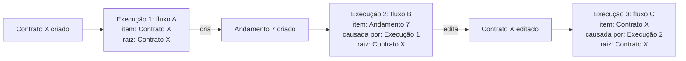

# Gestão global de execuções: o item liga a cadeia de fluxos

O mercado resolve 2 das 3 partes do pedido, e nenhum produto resolve a terceira. Números agregados e lista global de execuções são padrão em 2026: monday.com, HubSpot, n8n, Make, Power Automate, Workato, Temporal e Inngest mostram total, falhas e execuções em andamento, com clique para a lista filtrada. A busca por entidade de negócio aparece em 3 formas: chave declarada por quem monta o fluxo (n8n, Workato, Temporal, Camunda), busca no conteúdo das execuções (Make, Inngest) e linha do tempo na tela do próprio registro (Pipefy, monday.com, HubSpot). Seguir uma operação inteira de fluxos encadeados não aparece em nenhum dos mais de 30 produtos pesquisados quando o encadeamento é implícito: o fluxo A grava um registro e o evento desse registro dispara o fluxo B. É o caso das operações do ENSPACE, com até 38 fluxos ligados por eventos de item. Os concorrentes ligam só a chamada explícita (subfluxo), e mesmo assim 1 salto por vez. O Spaceflow tem uma vantagem que eles não têm: o gatilho e o registro moram na mesma plataforma, e o schema `WorkflowExecution` já traz `item`, `parent` e `workflow_timeline.lineage`. A recomendação é começar pela lista global e pela busca "por onde o contrato X passou", que as rotas atuais sustentam em parte, e pedir ao time de dev que grave a causa entre execuções no momento do disparo, o que transforma a lista em cadeia.

## O Spaceflow hoje: lista por fluxo e campos que nenhuma tela lê

Medição do coordenador em develop, em 2026-10-24.

**O que a pessoa vê:**
- a lista de execuções existe só dentro de cada fluxo: Spaceflows › um fluxo › abas **Execuções** e **Logs**;
  - colunas: Ações, Referência, Status, Versão, Iniciado em;
  - busca "Buscar execuções...";
  - menu da linha: "Ver Detalhes" e "Abrir Execução";
- o detalhe da execução tem 4 abas:
  - **Fluxo de Execução**: canvas com o caminho executado, a duração e o contador "2/2 nós executados";
  - **Detalhes**: Referência, Versão, Criado em, Atualizado em, Status, e Entrada e Saída em JSON cru;
  - **Comentários** e **Logs**.

**O que o backend já tem e nenhuma tela usa:**

| Peça | O que é | Uso possível na visão global |
|---|---|---|
| Status `working`, `completed`, `error`, `deleted` | enum do schema `WorkflowExecution` no SDK | contadores e filtro por status |
| `item` | id do item ligado à execução | busca "por onde o item passou" |
| opção `link_item` do nó inicial | "Vincular o item à execução" | garante o `item` na execução |
| `parent` | id de outra execução | cadeia pai e filho |
| `title`, `workflow`, `stopped_at`, `input`, `output` | campos da execução | título legível, fluxo, duração, resultado |
| `triggered_by` no JSON de entrada | o membro que disparou | filtro "disparadas por" |
| `workflow_timeline: { lineage: [] }` no JSON de entrada | vazio na execução manual; o que preenche é desconhecido | candidata natural para a cadeia |
| GET /workflows/executions | lista de todos os fluxos | lista global |
| GET /workflows/executions/count | contagem | números do topo |
| GET /workflows/metrics (`workspaceMetrics`, `startDate`, `endDate`, resposta `Record<string, number>`) | métricas do workspace; chaves desconhecidas | painel de números |
| GET /workflows/:id/metrics | métricas por fluxo | tabela de fluxos ordenada por falhas |
| POST /workflows/nodes/:id/retry | reprocessa um nó | reprocessar a partir da lista |

O front do SDK já chama as rotas globais. O coordenador não conseguiu chamá-las: o token de API devolve 403 no workspace de exploração. Filtros, paginação e formato de resposta dessas rotas seguem sem medição.

**Como as operações se encadeiam:**
- o nó **Iniciar Fluxo** dispara outro fluxo e, pela documentação, o fluxo filho não herda dados do pai;
- a maior parte das cadeias reais é implícita: o fluxo A cria ou edita um item, e um evento de item dispara o fluxo B;
- uma operação chega a 38 fluxos ligados assim.

**O pedido dos usuários** (resumo literal do coordenador): eles não veem dados agregados (quantas falharam até agora, quantas estão rodando) e, o mais grave, não conseguem acompanhar tudo o que acontece entre os fluxos. Quem não é técnico precisa entender como os fluxos se integram e buscar, por exemplo, "o contrato x está rodando por quais fluxos?".

**O que já foi decidido no protótipo `protecoes-do-spaceflow`** (proteções do Spaceflow, aprovado neste repositório): a aba Proteções define limite de volume, execuções ao mesmo tempo, "Repetição sem fim" (parar a cadeia quando um fluxo dispara a si mesmo) e Avisos ao dono. A aba Execuções ganha os status **Na fila**, **Ignorada**, **Retida** e **Interrompida**, cada um com o motivo escrito, e a faixa "Fluxo pausado pela proteção". A visão global reaproveita esses status e esses avisos; ela não os redefine.

## Como cada produto resolve

Cada entrada descreve o caminho na tela, o que serve para o ENSPACE e o que não serve, com o motivo.

### Ferramentas de trabalho, CRM e BPM: a linha do tempo do registro chega mais perto

#### Notion

- **Como resolve:**
  - as automações de banco de dados aparecem só por banco (ícone ⚡ ou Automations no menu do banco), com Edit, Pause e Delete;
  - a ajuda não descreve lista do workspace nem histórico de execuções das automações de banco ([Notion: Database automations](https://www.notion.com/help/database-automations));
  - "Database automations can't be triggered by other automations": uma automação que cria página em outro banco não dispara as automações desse banco ([mesma fonte](https://www.notion.com/help/database-automations));
  - automação que falha depois de ter funcionado fica pausada, e uma notificação leva até ela; em algumas falhas (fórmula, webhook) a página admite que a pessoa pode não ser avisada ([mesma fonte](https://www.notion.com/help/database-automations));
  - os Custom Agents, produto separado lançado no Notion 3.3 em fevereiro de 2026, têm a aba **Activity** com cada execução, o gatilho, as ações e os erros, e a aba **Insights** ([Notion: Custom Agents](https://www.notion.com/help/custom-agent)).
- **Serve para o ENSPACE:**
  - a aba Activity dos agentes: gatilho, ações e erros em 1 linha por execução, legível para quem não é técnico;
  - a pausa com notificação depois de erro, que o protótipo de proteções já adota.
- **Não serve:**
  - o bloqueio total de encadeamento. Motivo: as operações do ENSPACE dependem de fluxo que dispara fluxo por evento de item; bloquear quebra os 38 fluxos;
  - a ausência de visão global. Motivo: é o problema que o pedido descreve.

#### Twenty CRM

- **Como resolve:**
  - a visão **Workflow Runs** na barra lateral lista as execuções de todos os fluxos, com filtro por status, fluxo e data; cada fluxo também tem o painel **Runs** no editor ([Twenty: Workflow runs](https://docs.twenty.com/user-guide/workflows/capabilities/workflow-runs));
  - status documentados: Running, Completed, Failed, Waiting (parada num Delay ou num Form); o código tem mais 3: Enqueued, Stopping, Stopped ([workflow-run.workspace-entity.ts](https://raw.githubusercontent.com/twentyhq/twenty/main/packages/twenty-server/src/modules/workflow/common/standard-objects/workflow-run.workspace-entity.ts));
  - a execução é um objeto padrão do CRM, com os comandos Retry, Stop, See workflow e See version ([twenty-front, comandos de workflow-runs](https://github.com/twentyhq/twenty/tree/main/packages/twenty-front/src/modules/command-menu-item/engine-command/record/single-record/workflow-runs/components));
  - o registro de negócio guarda o ator `createdBy` e `updatedBy`, com a origem WORKFLOW ([actor.composite-type.ts](https://github.com/twentyhq/twenty/blob/main/packages/twenty-shared/src/types/composite-types/actor.composite-type.ts));
  - a execução não tem relação com o registro que a disparou nem campo de execução pai: os dados do gatilho ficam dentro de `state` ([workflow-run.workspace-entity.ts](https://raw.githubusercontent.com/twentyhq/twenty/main/packages/twenty-server/src/modules/workflow/common/standard-objects/workflow-run.workspace-entity.ts));
  - não há painel de saúde nem contadores documentados.
- **Serve para o ENSPACE:**
  - a lista global com 3 filtros (status, fluxo, data): é o mínimo que o Spaceflow não tem;
  - tratar a execução como um registro numa tabela, com os mesmos filtros e ordenação de uma tabela de itens;
  - o ator "alterado pelo fluxo X" no histórico do registro.
- **Não serve:**
  - o modelo de dados sem ligação entre execução e registro. Motivo: impede a busca por contrato; o Spaceflow já tem `item` e não deve repetir esse modelo;
  - a falta de execução pai. Motivo: sem ela, não há cadeia.

#### ClickUp

- **Como resolve:**
  - avatar do workspace > Automations > aba **Activity**, agrupada por data de execução, cobrindo Automations e Autopilot Agents ([ClickUp: View your Automations and Autopilot Agents activity](https://help.clickup.com/hc/en-us/articles/30953763592087-View-your-Automations-and-Autopilot-Agents-activity));
  - filtros: Location (Space, Folder, Subfolder, List), Date run e Status;
  - colunas: Time run, Name, Edit, Location, **Trigger** (a tarefa que disparou), **Run By** (a pessoa que disparou), Status e Report bug;
  - status com definição escrita: Pending, Failed, **Skipped** ("os critérios não estavam disponíveis", com exemplo) e Success;
  - a automação que falha mais de 5 vezes em 1 semana com o mesmo erro é desligada, e o criador recebe e-mail (ou o dono do workspace, se o criador saiu) ([mesma fonte](https://help.clickup.com/hc/en-us/articles/30953763592087-View-your-Automations-and-Autopilot-Agents-activity));
  - o pedido "Manage Automations across the entire Workspace from a single place" existe desde 2020-08-21, tem cerca de 2.400 votos e segue como "future"; em 2026-01-16 a equipe escreveu que redesenha a experiência, sem data ([ClickUp feedback](https://feedback.clickup.com/feature-requests/p/manage-automations-across-the-entire-workspace-from-a-single-place)).
- **Serve para o ENSPACE:**
  - as colunas Trigger e Run By: equivalem a `item` e `triggered_by`, que o Spaceflow já grava;
  - o status Skipped com definição: separa "rodou e não tinha o que fazer" de "quebrou";
  - o desligamento depois de erros repetidos com aviso ao criador e ao dono do workspace, que reforça o desenho do protótipo de proteções.
- **Não serve:**
  - o histórico agrupado só por data, sem contadores. Motivo: não responde "quantas falharam até agora";
  - a ausência de cadeia. Motivo: o pedido de 2020 mostra que nem a lista global de gestão está pronta.

#### monday.com

- **Como resolve:**
  - o **Autopilot hub** reúne automações, integrações e workflows da conta toda, com 4 abas: Health, Usage, Workflows e Connections ([monday.com: The Autopilot hub](https://support.monday.com/hc/en-us/articles/28738092924562-The-Autopilot-hub));
  - aba **Health**: o que roda, o que falha e por quê; prioridade pela importância de negócio de cada automação; tabela com descrição, dono, hora da última falha, quadro e uma classificação da causa feita por IA; filtros por dono e por quadro;
  - aba **Usage**: ações usadas contra o limite do plano, contadores de automações ativas, criadores e quadros, gráfico diário e download em CSV;
  - o hub não pede permissão especial, e quadros privados ficam ocultos para quem não os vê;
  - por quadro: Automate > Manage > **Run history**, com status em andamento, falha ou sucesso, filtros e retenção de 10 dias; embaixo da falha aparece em vermelho uma sugestão de como corrigir ([monday.com: Automation Run history](https://support.monday.com/hc/en-us/articles/360017254600-Automation-Run-history));
  - por item: abrir o item > Activity Log > **Automation activity**; no log do quadro, o avatar da automação leva direto à automação que fez a mudança ([mesma fonte](https://support.monday.com/hc/en-us/articles/360017254600-Automation-Run-history));
  - cada automação pode receber uma importância, e a aba Health ordena as falhas por ela.
- **Serve para o ENSPACE:**
  - a aba Health como tela de triagem: o que falha, dono, última falha, onde, causa em linguagem simples, com link para corrigir;
  - a importância definida pelo usuário: um sinal barato que ordena a lista de falhas para quem não é técnico;
  - o histórico de automações na tela do item e o avatar que leva à automação responsável.
- **Não serve:**
  - a aba Usage centrada em ações faturadas. Motivo: o pedido é acompanhar a operação, não o consumo do plano;
  - a retenção de 10 dias. Motivo: uma operação de contrato dura semanas.

#### Pipefy

- **Como resolve:**
  - por pipe: **Automation Logs** ao lado de "Create new automation", com status do gatilho, automações que funcionaram ou falharam, data e hora e filtros; dentro de uma regra, os logs dos últimos 3 meses. O recurso está em Beta, para admins, em todos os planos ([Pipefy: Automation logs](https://help.pipefy.com/en/articles/9186536-automation-logs));
  - a API tem `automationLogsByRepo` (todas as automações de um pipe), com o id e o título do card em cada execução ([Pipefy developers](https://developers.pipefy.com/reference/automation-logs-by-repo));
  - por card: abrir o card > aba Activities > **View timeline**, lançado em 2026-06-12 ([Pipefy: card timeline](https://help.pipefy.com/en/articles/15445139-how-to-view-a-card-s-activities-on-a-timeline); [anúncio](https://community.pipefy.com/product-updates/card-timeline-see-everything-that-happened-in-a-card-from-start-to-finish-5278));
    - cabeçalho com Card duration, Phases visited, **Automated activities** (% feito por automação), Handoffs e Bottleneck;
    - cada evento diz o que aconteceu, quando e quem fez: um usuário, uma automação ou um AI Agent;
    - os eventos ficam ancorados nas fases por onde o card passou;
    - casos de uso escritos em linguagem de negócio: "um campo não foi preenchido embora uma automação devesse preenchê-lo";
  - **Automation Alerts via Webhook** (junho de 2026): 1 webhook por pipe para cada execução, com nome da automação, gatilho, ação, status, duração, card e causa da falha ([Pipefy Community](https://community.pipefy.com/product-updates/automation-alerts-via-webhook-real-time-notifications-for-every-automation-execution-5329));
  - o log de configuração escreve frases: "Changed the trigger of "Send approval email" from ..." ([Pipefy: Activities for pipes and cards](https://help.pipefy.com/en/articles/15062678-audit-logs-for-pipes-and-cards));
  - não há painel de automações da empresa inteira na tela; o webhook é o caminho que o Pipefy sugere para isso.
- **Serve para o ENSPACE:**
  - a linha do tempo do card é a referência mais próxima de "o contrato X passou por quais fluxos": cronológica, com autoria por evento e um cabeçalho de números;
  - o percentual de atividades automáticas e o gargalo no cabeçalho;
  - frases em vez de JSON no histórico de configuração.
- **Não serve:**
  - a linha do tempo limitada a 1 card. Motivo: a documentação não mostra como seguir para o card que a automação criou, e no ENSPACE o fluxo B quase sempre age sobre outro item (o andamento do contrato);
  - os logs por pipe e em Beta. Motivo: continuam sem visão da empresa inteira.

#### HubSpot

- **Como resolve:**
  - Automation > Workflows > aba **Health** (Professional e Enterprise): "Workflows needing review", fluxos sem inscrição há 90 dias e sugestões de revisão ([HubSpot: Monitor your workflow health](https://knowledge.hubspot.com/workflows/monitor-your-workflow-health));
  - **Review automation issues** abre uma caixa de problemas de todas as ferramentas de automação; cada problema vira Fixed, Ignored ou Deferred, com nota; um problema Fixed que volta reaparece como "Needs review"; cada problema lista os registros afetados ([HubSpot: Troubleshoot automation issues](https://knowledge.hubspot.com/workflows/troubleshoot-common-automation-issues));
  - por fluxo: abas Action logs (com coluna **Diagnose**), Enrollment history e Performance; logs de ação por 90 dias ([HubSpot: workflow details page](https://knowledge.hubspot.com/workflows/understand-your-workflow-details-page));
  - no contato: a seção **Workflow memberships** no painel direito ([HubSpot: Manually enroll records](https://knowledge.hubspot.com/workflows/manually-enroll-objects-into-workflows));
  - no editor: a aba **Connections** lista o que o fluxo usa (listas, propriedades, outros fluxos) e quem o referencia ([HubSpot: View workflow connections](https://knowledge.hubspot.com/workflows/view-workflow-connections));
  - aviso quando o fluxo passa a "Needs review", só no Enterprise.
- **Serve para o ENSPACE:**
  - o ciclo de vida do problema (Precisa de revisão, Resolvido, Ignorado, Adiado): impede que a lista de falhas vire ruído permanente;
  - os fluxos de que o registro participa, na tela do registro;
  - a aba Connections como lista estática de dependências.
- **Não serve:**
  - o histórico do registro dentro de cada fluxo. Motivo: a pessoa precisa saber o fluxo antes de buscar o registro, o inverso do pedido.

#### Salesforce

- **Como resolve:**
  - o app Automation Lightning, aba **Monitor** (Spring '25): execuções com falha e pausadas, com o motivo da falha; "Open" depura e "Resume" retoma ([Salesforce release notes](https://help.salesforce.com/s/articleView?language=en_US&id=release-notes.rn_automate_ala_monitor_all_failed_and_paused_flow_interviews_from_the_automation_lightning_app.htm&release=254&type=5));
  - o **Flow Trigger Explorer**: escolher um objeto e ver todos os fluxos que rodam ao criar, editar ou excluir, agrupados pela fase de execução, com a ordem editável ([Trailhead: Meet Flow Trigger Explorer](https://trailhead.salesforce.com/content/learn/modules/record-triggered-flows/meet-flow-trigger-explorer));
  - não há componente padrão na página do registro que liste os fluxos que rodaram nele.
- **Serve para o ENSPACE:**
  - o painel "fluxos que reagem a esta categoria", em ordem e por evento: explica a integração sem rodar nada;
  - a lista central de falhas e pausadas com retomar.
- **Não serve:**
  - o Monitor só com falhas. Motivo: não mostra totais nem o que está rodando, as 2 perguntas do pedido.

#### Jira Automation

- **Como resolve:**
  - **Performance insights** por espaço e da instância inteira: contagem de execuções, duração média e total, por status ([Atlassian: View performance insights](https://support.atlassian.com/cloud-automation/docs/view-performance-insights-for-automation-rules/));
  - **Audit log** da organização (Enterprise): Date, Flow, Status, Duration, Operations, por 90 dias ([Atlassian Administration](https://support.atlassian.com/organization-administration/docs/manage-automation-rules-in-atlassian-administration));
  - no ticket: painel Automation > **Recent rule runs**, com as últimas 8 execuções e sem filtro ([Atlassian KB](https://support.atlassian.com/jira/kb/how-to-display-the-recently-executed-list-of-automations-against-an-individual-jira-issue));
  - status próprios: Successful, No actions, Some errors, **Loop**, Throttled ([Atlassian: Troubleshoot automation rules](https://confluence.atlassian.com/automation/troubleshoot-automation-rules-1141480666.html));
  - a cadeia para depois de 10 regras disparando regras, com o status Loop; "Allow flow trigger" nasce desligado; o pedido AUTO-1917, aberto desde 2025-06-23, reclama que a mensagem não diz qual ticket causou o loop ([Jira AUTO-1917](https://jira.atlassian.com/browse/AUTO-1917));
  - "Notify on error" manda e-mail ao dono da regra; um pedido reclama que o e-mail não diz o motivo ([AUTO-194](https://jira.atlassian.com/browse/AUTO-194)).
- **Serve para o ENSPACE:**
  - o status Loop separado de erro, que o protótipo de proteções já cobre com "Interrompida";
  - a lição do AUTO-1917: a parada de cadeia precisa dizer qual item e qual fluxo a causaram.
- **Não serve:**
  - o limite de 8 execuções no ticket. Motivo: uma operação de 38 fluxos passa disso num único contrato;
  - o limite fixo de 10 saltos. Motivo: usuários de Jira batem nele em cadeias legítimas ([Atlassian Community](https://community.atlassian.com/forums/Automation-questions/Rule-Triggering-another-Rule-Need-to-Exceed-Loop-Limit/qaa-p/2780103)); com 38 fluxos, a cadeia legítima é longa.

#### Airtable, ServiceNow e Bizagi

- **Como resolvem:**
  - Airtable: histórico por automação, reexecução de falhas, indicadores "Running slowly" e "Paused by Airtable" na lista da base; aviso de falha para até 10 assinantes ([Airtable: Managing automations](https://support.airtable.com/docs/managing-airtable-automations));
  - ServiceNow: aba Operations do Workflow Studio com as execuções; no detalhe, "Open Current Record" abre o registro que disparou, e o fluxo pai lista os subfluxos em linha, cada um expansível ([ServiceNow: Flow execution details](https://www.servicenow.com/docs/r/build-workflows/workflow-studio/flow-execution-details.html));
  - Bizagi: **Graphic Query** mostra o diagrama do processo com a atividade atual em verde, e o botão "Path" destaca o caminho que o caso percorreu ([Bizagi: Graphic Query](https://help.bizagi.com/platform/en/graphic_query.htm)).
- **Serve para o ENSPACE:**
  - os assinantes do aviso (Airtable): o aviso não depende de 1 dono que pode sair da empresa;
  - os subfluxos em linha dentro da execução pai (ServiceNow);
  - o caminho do caso sobre o diagrama (Bizagi): o canvas "Fluxo de Execução" do Spaceflow já faz isso para 1 fluxo e pode fazer para a cadeia.
- **Não serve:**
  - nenhum deles liga execuções encadeadas por evento de registro. Motivo: o caso do ENSPACE fica de fora.

### Plataformas de automação no-code: números agregados sim, cadeia só por subfluxo

#### n8n

- **Como resolve:**
  - Overview > aba **Executions**: execuções de todos os fluxos que a pessoa acessa; filtros Workflows, Status (Failed, Running, Success, Waiting), Execution start e **Saved custom data** ([n8n: View all executions](https://docs.n8n.io/build/understand-workflows/understand-executions/view-all-executions.md));
  - reprocessar a falha pelo menu da linha: "Retry with currently saved workflow" ou "Retry with original workflow"; cada reprocessamento cria outra execução ([mesma fonte](https://docs.n8n.io/build/understand-workflows/understand-executions/view-all-executions.md));
  - **Insights**: faixa de resumo em todos os planos; painel completo nos planos pagos, com execuções de produção, falhas, taxa de falha, tempo poupado e tempo médio, e uma tabela por fluxo; janela padrão de 7 dias comparada à anterior; execuções de subfluxo e manuais ficam fora dos totais ([n8n: Insights](https://docs.n8n.io/insights/));
  - **custom executions data**: quem monta o fluxo grava até 10 pares chave e valor por execução, e a lista filtra por eles (planos pagos) ([n8n: Custom executions data](https://docs.n8n.io/workflows/executions/custom-executions-data/));
  - o nó Execute Sub-workflow mostra "View sub-execution", e a execução filha leva de volta à pai ([n8n: Sub-workflows](https://docs.n8n.io/flow-logic/subworkflows/));
  - o alerta é um fluxo de erro: um fluxo que começa com **Error Trigger**, escolhido nas configurações de cada fluxo ([n8n: Error handling](https://docs.n8n.io/flow-logic/error-handling/)).
- **Serve para o ENSPACE:**
  - a lista global com 4 filtros e o reprocessar na linha;
  - a faixa de resumo em todos os planos, com o painel completo à parte;
  - excluir execuções filhas dos totais, para que 1 evento de negócio não conte 38 vezes.
- **Não serve:**
  - a chave de negócio declarada à mão em cada fluxo. Motivo: exige configuração técnica em cada um dos 38 fluxos e não vale para o passado; o Spaceflow já tem o `item`;
  - o alerta montado como fluxo de erro. Motivo: quem não é técnico precisa de aviso sem montar nada.

#### Zapier

- **Como resolve:**
  - **Zap history** (zapier.com/app/history), abas Zap runs e Task usage; filtros Date, Zap name, apps, folder, Zap owner e Zap status; reexecutar falhas; excluir em lote; dados por 60 dias ([Zapier: Zap history](https://help.zapier.com/hc/en-us/articles/8496291148685-View-and-manage-your-Zap-history));
  - a busca encontra Zaps e versões, não valores dentro das execuções;
  - **Analytics dashboard** (só Enterprise): taxa de execuções concluídas sem erro, alertas, uso, e o relatório "Zap workflows with the highest error rates" ([Zapier: Analytics dashboard](https://help.zapier.com/hc/en-us/articles/25444544607373/));
  - página **Alerts** (Enterprise, beta): todos os erros num lugar, com prioridade por fluxo ([Zapier: Track all your Zap errors](https://help.zapier.com/hc/en-us/articles/25444267052557-Track-all-your-Zap-errors-in-one-place-beta));
  - Sub-Zaps ligam a execução pai à filha ([Zapier: Sub-Zap app](https://help.zapier.com/hc/en-us/articles/32283713627533));
  - **Canvas** é um diagrama desenhado à mão, sem dependência detectada ([Zapier blog: Canvas](https://zapier.com/blog/zapier-canvas-guide/));
  - o loop tem página de ajuda e solução manual: desligar os Zaps, olhar o histórico, criar um campo "Processed by Zap" ([Zapier: loops](https://help.zapier.com/hc/en-us/articles/8496232045453)).
- **Serve para o ENSPACE:**
  - os filtros visíveis como botões removíveis;
  - a frequência do aviso de erro: imediato, imediato com resumo de hora em hora, só resumo, nunca ([Zapier: notifications](https://help.zapier.com/hc/en-us/articles/8496277613325)).
- **Não serve:**
  - o mapa desenhado à mão. Motivo: com 38 fluxos, um desenho manual desatualiza no primeiro ajuste;
  - painéis só no Enterprise. Motivo: o pedido vem do usuário comum.

#### Make

- **Como resolve:**
  - histórico só por cenário: aba **History**, com colunas de data, Run name (personalizável), status Success, Warning ou Error, duração, operações e **Source run**; botão **Explain error** com IA ([Make: Scenario history](https://help.make.com/scenario-history.md));
  - **busca da organização** (Ctrl+K), aba Runs: encontra execuções pelo nome ou por "values within run data, such as an email address or order ID", em todos os cenários e equipes; planos Pro e acima; artigo de 2026-08-10 ([Make: Search for scenarios and scenario runs](https://help.make.com/search-for-scenarios-and-scenario-runs.md));
  - **Analytics dashboard** (Enterprise): operações, erros, taxa de erro e execuções da organização, com tendência e tabela por cenário ([Make: Analytics dashboard](https://help.make.com/analytics-dashboard.md));
  - **Call a scenario**: a execução filha liga à pai, e os cenários da cadeia ganham a aba **Relation tree** (página de 2026-03-04) ([Make: Subscenarios](https://help.make.com/subscenarios.md));
  - **Make Grid**: mapa gerado sozinho, sem configuração, com linhas de gatilho e linhas de dados em cores diferentes, busca dentro dos cenários, camadas de consumo dos últimos 30 dias e o quadro **Need your attention**, que localiza o problema no mapa ([Make: Explore Make Grid](https://help.make.com/explore-make-grid.md));
  - erros seguidos desligam o agendamento do cenário ([Make: errors and warnings](https://help.make.com/Introduction-to-errors-and-warnings.md)).
- **Serve para o ENSPACE:**
  - a busca única por um valor de negócio em todos os fluxos: é a resposta mais direta a "onde está o contrato X" entre os iPaaS;
  - o Make Grid: mapa automático, 2 tipos de ligação (gatilho e dado), "precisa de atenção" posicionado no mapa;
  - o Run name personalizável, que equivale ao `title` da execução.
- **Não serve:**
  - a busca por texto em todo o conteúdo das execuções. Motivo: é cara de indexar e acha a palavra, não o registro; o `item` resolve com um filtro exato;
  - o mapa só estático com números de 30 dias. Motivo: mostra o que pode acontecer, não qual execução causou qual.

#### Power Automate

- **Como resolve:**
  - **Automation center** > Monitor > Runs: execuções de todos os fluxos em lista hierárquica, com a execução filha dentro da pai, "para acompanhar a automação inteira do início ao fim"; abas Overview, Run history e Current desktop flow runs com atualização automática ([Microsoft Learn: Automation center](https://learn.microsoft.com/en-us/power-automate/automation-center-overview));
  - aba **Overview**: fluxos com execuções, total de execuções, taxa de erro, tendência de erros, execuções por status, principais falhas e **Recommendations**; os números contam só a execução de topo por padrão;
  - página **Errors**: erros mais comuns e tendência por erro, por fluxo e por máquina;
  - **Process map** (Premium): o fluxo principal e todos os filhos num diagrama; a visão **Runs** destaca o caminho de 1 execução com status por passo; a visão **Overview** mostra todos os caminhos possíveis; limite de 100 execuções filhas e 50 níveis ([Microsoft Learn: Process map](https://learn.microsoft.com/en-us/power-automate/automation-center-process-map));
  - o hub declara 4 públicos: quem monta, quem opera, o centro de excelência e o analista de negócio; o **Copilot** responde "quantos fluxos rodaram ontem";
  - aviso por falha corrigível e um **resumo semanal** de falhas ([Microsoft Learn: flow failure notifications](https://learn.microsoft.com/en-us/power-automate/understand-flow-failure-notifications)).
- **Serve para o ENSPACE:**
  - a lista hierárquica, com contagem pela execução raiz: é o desenho para 1 evento que gera muitas execuções;
  - o process map com as 2 visões (todos os caminhos e o caminho de 1 execução);
  - o resumo semanal de falhas para quem não acompanha a tela todo dia.
- **Não serve:**
  - a hierarquia que só cobre chamada explícita de fluxo filho. Motivo: no ENSPACE a cadeia é por evento de item;
  - o histórico que leva até 1 hora para aparecer. Motivo: quem opera um contrato precisa ver o que está rodando agora.

#### Workato

- **Como resolve:**
  - lista de jobs só por receita: aba **Jobs**, status Completed, Failed, Processing, Paused e Aborted, exportação em CSV ([Workato: Recipe jobs](https://docs.workato.com/recipes/jobs.html));
  - **job report**: até 10 colunas personalizadas por receita, montadas com dados do fluxo, sem efeito retroativo; a comunidade reclama que esses valores não têm filtro ([Workato community](https://systematic.workato.com/t5/workato-pros-discussion-board/customizing-job-reports-empty/m-p/5564));
  - **Operations hub dashboard**: gráfico de jobs concluídos e com falha, janela padrão de 7 dias; tabela de receitas ordenada por falhas; o clique numa contagem abre a aba Jobs da receita com o filtro de data aplicado ([Workato: Operations hub dashboard](https://docs.workato.com/features/admin-dashboard.html));
  - a execução filha mostra o id da pai como texto; o suporte disse que uma tela de "job dentro de job" não estava no plano ([Workato community thread](https://support.workato.com/support/discussions/topics/1000089462));
  - o conector **RecipeOps** dispara um fluxo quando um job falha ([Workato: Job failed trigger](https://docs.workato.com/connectors/recipeops/triggers/new-failed-job)).
- **Serve para o ENSPACE:**
  - a tabela de fluxos ordenada por falhas, com o clique que leva o filtro junto para a lista.
- **Não serve:**
  - o id do pai como texto. Motivo: a pessoa copia o id para a URL; a ligação precisa ser clicável.

#### Outros iPaaS: Pipedream, Windmill, Activepieces, Retool e Tray

- **Como resolvem:**
  - Pipedream: **Event History** global com filtro de status, período e fluxo, e reexecutar ou excluir em lote ([Pipedream: Event History](https://pipedream.com/docs/workflows/event-history.md));
  - Windmill: menu **Runs** do workspace com gráfico de sucesso e falha, busca em argumentos e resultados, rótulos por execução, e cancelar ou reexecutar todas as execuções que batem com o filtro; **Copy public link** compartilha 1 execução ([Windmill: Jobs runs](https://www.windmill.dev/docs/core_concepts/monitor_past_and_future_runs.md));
  - Activepieces: Dashboard > Runs, reexecutar a partir do passo que falhou e em lote ([Activepieces: debugging runs](https://www.activepieces.com/docs/flows/debugging-runs));
  - Retool: histórico só por fluxo; o monitoramento entre fluxos vai para Sentry ou Datadog ([Retool: Workflow run logs](https://docs.retool.com/workflows/concepts/logs));
  - Tray: eventos de execução enviados para ferramenta externa, sem painel próprio ([Tray: Log Streaming](https://tray.ai/documentation/platform/enterprise-core/logs-debugging/log-streaming)).
- **Serve para o ENSPACE:**
  - a ação em lote sobre "tudo o que bate com o filtro" (Windmill, Pipedream), para reprocessar as falhas de 1 incidente;
  - o link compartilhável de 1 execução.
- **Não serve:**
  - mandar o monitoramento para ferramenta externa (Retool, Tray). Motivo: o usuário do ENSPACE não é técnico e não tem Datadog.

### Motores para desenvolvedores: chave de negócio e pai e filho maduros, sem visão de negócio

#### Temporal

- **Como resolve:**
  - página **Workflows**: todas as execuções do namespace, com filtro por status, id, tipo, início, fim e atributos de busca ([Temporal Web UI](https://docs.temporal.io/web-ui));
  - contagem por status com atualização ao vivo, desde 2023-10-30 ([Temporal changelog](https://temporal.io/change-log/ui-server-v2-20-0));
  - **Saved Views**: até 20 visões por pessoa, com URL para compartilhar;
  - **Search Attributes**: chaves de negócio gravadas pelo código, com limites por tipo ([Temporal Search Attributes](https://docs.temporal.io/search-attribute));
  - aba **Relationships**: a árvore inteira de pai e filhos;
  - **User Metadata**: um resumo legível escrito por quem programa, mostrado na tela;
  - visão pronta **Task Failures**: execuções em andamento com 5 falhas seguidas de tarefa.
- **Serve para o ENSPACE:**
  - a contagem por status no topo da lista, ao vivo;
  - as visões salvas com link, que permitem "a minha operação" sem criar objeto novo;
  - a árvore de relações e o resumo legível por execução (o `title`).
- **Não serve:**
  - a linguagem de consulta e os atributos declarados em código. Motivo: público técnico.

#### Camunda 8 (Operate e Optimize)

- **Como resolve:**
  - **Operate**: tabela de instâncias com filtros Process Name, Version, **Parent Process Instance Key**, **Business ID** e filtros por variável (os 2 últimos novos na 8.10) ([Camunda: Filter process instances](https://docs.camunda.io/docs/next/components/operate/userguide/filter-process-instances/));
  - reprocessar e cancelar em lote sobre uma seleção ([Camunda: batch operations](https://docs.camunda.io/docs/components/operate/userguide/selections-operations/));
  - o painel inicial lista só processos com instâncias rodando ou com incidente; quem não tem nada ativo some ([Camunda: Operate navigation](https://docs.camunda.io/docs/components/operate/userguide/basic-operate-navigation/));
  - na chamada de subprocesso, "View all" filtra a lista pela instância pai;
  - **Optimize**, escrito para usuário de negócio: coleções de até 10 processos, painéis com dono do processo, metas de tempo e qualidade em verde ou vermelho, link para quem não tem acesso ao Optimize e alerta por e-mail ([Camunda: Optimize process dashboards](https://docs.camunda.io/docs/components/optimize/userguide/process-dashboards/); [Improve processes with Optimize](https://docs.camunda.io/docs/guides/improve-processes-with-optimize/)).
- **Serve para o ENSPACE:**
  - o painel que mostra só o que tem atividade ou problema: com 38 fluxos, a tela abre no que pede ação;
  - o filtro "pela instância pai";
  - o Optimize: dono da operação, meta e 1 estado, em vez de 38 status.
- **Não serve:**
  - o Business ID que chegou só na 8.10 e é atribuído por API. Motivo: no ENSPACE a chave existe desde o gatilho (o item).

#### Apache Airflow 3

- **Como resolve:**
  - a Home mostra a saúde dos componentes, atalhos para Failed Dags e Running Dags e as taxas de sucesso no período ([Airflow UI](https://airflow.apache.org/docs/apache-airflow/stable/ui.html));
  - **Assets**: cada conjunto de dados mostra quem o produz e quem o consome, e o grafo mostra os eventos recentes com as execuções que eles dispararam;
  - **Required Actions** lista as ações humanas pendentes de todos os fluxos ([Astronomer: human in the loop](https://www.astronomer.io/docs/learn/airflow-3/airflow-human-in-the-loop)).
- **Serve para o ENSPACE:**
  - o grafo "quem produz e quem consome" um dado: no ENSPACE, o dado é a categoria com o evento (Contrato criado);
  - a lista central de esperas por pessoa, que equivale ao "Esperando tarefa" do protótipo de proteções.
- **Não serve:**
  - a grade de tarefas por execução. Motivo: tela de engenharia.

#### Prefect

- **Como resolve:**
  - cada evento tem `follows`, o id do evento anterior na mesma cadeia causal, preenchido sozinho, e `related`, os recursos ligados ([Prefect: events](https://docs.prefect.io/v3/concepts/events));
  - **Automations** disparam por mudança de estado, por limite de métrica e pela **ausência** de um evento esperado, por exemplo uma execução parada em Running por mais de 30 minutos ([Prefect: automations triggers](https://docs.prefect.io/v3/automate/events/automations-triggers)).
- **Serve para o ENSPACE:**
  - o `follows` gravado sozinho: é o desenho de "causada por" que a cadeia implícita do Spaceflow precisa;
  - o alerta por ausência: "esta execução está parada há mais tempo que o normal".
- **Não serve:**
  - a documentação lida não mostra uma tela que desenhe a cadeia inteira. Motivo: o dado existe, a visão de negócio não.

#### Dagster

- **Como resolve:**
  - página **Runs** com filtro por job, id, status e tag; **Overview** com execuções, agendamentos e sensores de todos os locais ([Dagster webserver](https://dagster.io/docs/guides/operate/webserver));
  - **Global asset lineage**: dependências entre todos os ativos;
  - saúde do ativo em 4 níveis: Healthy, Warning, Degraded, Unknown; o alerta dispara 1 vez na mudança de nível ([Dagster: asset health](https://docs.dagster.io/guides/observe/asset-health-status); [Dagster alerts](https://docs.dagster.io/guides/labs/observability-update/alerts)).
- **Serve para o ENSPACE:**
  - a saúde em 4 níveis por operação, legível para quem não é técnico;
  - o alerta só na mudança de estado, que evita 38 e-mails quando a cadeia inteira falha.
- **Não serve:**
  - a linhagem centrada em ativos de dados. Motivo: o ENSPACE pensa em itens e fluxos.

#### AWS Step Functions

- **Como resolve:**
  - a listagem de execuções exige a máquina de estados; não há lista da conta inteira ([AWS: ListExecutions](https://docs.aws.amazon.com/step-functions/latest/apireference/API_ListExecutions.html));
  - o detalhe tem link para a máquina pai, visão em grafo ou tabela, e o botão **Recover** (redrive das falhas dos últimos 14 dias) ([AWS: execution details](https://docs.aws.amazon.com/step-functions/latest/dg/concepts-view-execution-details.html));
  - o X-Ray monta o mapa dos serviços a partir dos traces ([AWS: Step Functions X-Ray](https://docs.aws.amazon.com/step-functions/latest/dg/concepts-xray-tracing.html)).
- **Serve para o ENSPACE:**
  - nada novo: é o modelo "lista por fluxo" que o Spaceflow tem hoje.
- **Não serve:**
  - a lista por máquina de estados. Motivo: é o caso mais fraco da pesquisa, igual ao Spaceflow atual.

#### Inngest

- **Como resolve:**
  - página **Runs** com as execuções de todos os apps, filtro de status, período e app, e busca em CEL sobre os dados do evento ([Inngest: inspecting runs](https://www.inngest.com/docs/platform/monitor/inspecting-function-runs));
  - **Events**: abrir um evento mostra o conteúdo e **as funções que ele disparou**;
  - métricas: execuções por status, as 6 funções que mais falham, vazão e **Backlog** (execuções esperando) ([Inngest: observability metrics](https://www.inngest.com/docs/platform/monitor/observability-metrics));
  - **Replay** reexecuta as falhas de um período com nome de incidente e aviso de efeito repetido ([Inngest: Replay](https://www.inngest.com/docs/platform/replay)); o cancelamento em lote mostra antes quantas execuções o cancelamento afeta ([Inngest: bulk cancellation](https://www.inngest.com/docs/platform/manage/bulk-cancellation)).
- **Serve para o ENSPACE:**
  - a página do evento com as funções disparadas: no ENSPACE, "o item Andamento criado disparou os fluxos B e C";
  - o ranking das que mais falham e a contagem de espera;
  - o lote com prévia da quantidade afetada.
- **Não serve:**
  - a busca em CEL. Motivo: linguagem de programação.

#### Trigger.dev

- **Como resolve:**
  - a tabela de Runs mostra só as execuções raiz por padrão; "Show child runs" mostra as filhas ([Trigger.dev: new run filters](https://trigger.dev/changelog/new-run-filters));
  - links "Jump to root or parent run", com os atalhos P e T ([Trigger.dev changelog](https://trigger.dev/changelog/jump-to-root-or-parent-run));
  - até 10 tags por execução, filtráveis; as tags não passam para a execução filha, e quem programa precisa copiar à mão ([Trigger.dev: tags](https://trigger.dev/docs/tags));
  - 13 status agrupados por funções como isQueued, isExecuting, isWaiting e isFailed ([Trigger.dev: runs](https://trigger.dev/docs/runs)).
- **Serve para o ENSPACE:**
  - a lista que mostra a raiz por padrão: 1 linha por contrato, não 38;
  - o salto para a raiz e para o pai;
  - os status em poucos grupos para quem não é técnico.
- **Não serve:**
  - a chave que não passa para a filha. Motivo: é o erro que a cadeia do ENSPACE precisa evitar.

#### Conductor e Hatchet

- **Como resolvem:**
  - Conductor: filtro por **Correlation id** com vários valores, busca em texto livre e o parâmetro `topLevelOnly` que esconde subfluxos ([Conductor: searching workflows](https://docs.conductor-oss.org/devguide/how-tos/Workflows/searching-workflows.html));
  - Hatchet: metadados chave e valor que passam do pai para os filhos e do evento para a execução ([Hatchet: additional metadata](https://docs.hatchet.run/home/additional-metadata)).
- **Serve para o ENSPACE:**
  - a propagação automática da chave pela cadeia (Hatchet): é a regra que faz "o contrato X" valer também para o andamento criado pelo fluxo A.
- **Não serve:**
  - o id de correlação escolhido por quem programa. Motivo: público técnico.

### Mineração de processos e observabilidade: o caso e o trace mostram a jornada

#### Mineração de processos (Celonis e Power Automate Process Mining)

- **Como resolvem:**
  - o **Case ID** representa a instância do processo e "is often the object that the process acts on" (pedido, paciente, solicitação), presente em todas as atividades ([Microsoft Learn: Process Mining](https://learn.microsoft.com/en-us/power-automate/process-mining-processes-and-data));
  - o **Variant Explorer** do Celonis agrupa os casos pelo caminho percorrido e mostra a frequência de cada caminho ([Celonis: Process Components](https://docs.celonis.com/en/process-components.html));
  - o **Process Explorer** abre só com as atividades e ligações mais frequentes ([Celonis blog](https://celonis.com/blog/celonis-ems-process-explorer-and-variant-explore-whats-the-difference));
  - o **Multi-object Process Explorer** desenha vários objetos ligados (pedido, entrega, fatura) num diagrama só, com cor por objeto ([Celonis: Multi-object Process Explorer](https://docs.celonis.com/en/multi-object-process-explorer.html); [Object-centric process mining](https://docs.celonis.com/en/object-centric-process-mining.html)).
- **Serve para o ENSPACE:**
  - o item como caso: o contrato é o objeto sobre o qual a operação age;
  - os vários objetos num diagrama: contrato e andamento aparecem juntos na mesma operação;
  - abrir só o caminho mais frequente, para não mostrar os 38 fluxos de uma vez.
- **Não serve:**
  - a análise feita depois, sobre um log extraído. Motivo: o pedido é acompanhar a operação em andamento; a variante de caminhos fica para uma fase de análise.

#### Mapas de dependência (Datadog, AWS X-Ray, Grafana Tempo, Confluent)

- **Como resolvem:**
  - Datadog Service Map: grafo montado sozinho com os dados que a ferramenta já coleta; a borda do nó fica vermelha ou amarela por 1 estado de saúde; clicar no nó isola o nó com quem chama e quem é chamado ([Datadog: Service Map](https://docs.datadoghq.com/tracing/services/services_map/));
  - X-Ray: clicar no nó ou na ligação abre um painel com números, e "View traces" abre a lista filtrada; verde para sucesso, vermelho para falha, roxo para limite ([AWS X-Ray: trace map](https://docs.aws.amazon.com/xray/latest/devguide/xray-console-servicemap.html));
  - Tempo: cada ligação carrega total de chamadas, falhas e tempo ([Grafana Tempo: service graphs](https://grafana.com/docs/tempo/latest/metrics-from-traces/service_graphs/));
  - Confluent Stream Lineage: o tópico fica entre quem produz e quem consome; a ligação mais grossa carrega mais volume; 24 nós parecidos ou mais viram 1 nó de grupo; a janela de tempo é o controle principal ([Confluent: Stream Lineage](https://docs.confluent.io/cloud/current/stream-governance/stream-lineage.html));
  - ferramentas de linhagem abrem com profundidade 2 em volta do nó escolhido ([OpenMetadata: lineage](https://docs.open-metadata.org/v1.13.x/how-to-guides/admin-guide/preferences/lineage)).
- **Serve para o ENSPACE:**
  - o evento de item como nó do meio, como o tópico do Confluent: "Contrato criado" entre o fluxo que cria e os fluxos que escutam;
  - o contrato de clique: nó, painel com saúde e números, botão para a lista de execuções filtrada, que reaproveita a lista que já existe;
  - foco em 1 fluxo com profundidade 1 ou 2, agrupamento e busca, para 38 nós ficarem legíveis.
- **Não serve:**
  - o mapa só com ligações observadas. Motivo: o usuário do ENSPACE precisa entender a integração antes de rodar, então o mapa também mostra as ligações configuradas;
  - nenhuma fonte testou mapa de serviços com usuário não técnico. Motivo: o desenho precisa de teste com o público do ENSPACE.

#### Tracing (OpenTelemetry e Honeycomb)

- **Como resolvem:**
  - o OpenTelemetry propaga o contexto com o dado, e o **span link** liga uma operação a outra em trace separado, com sentido causal; o exemplo da documentação é uma operação que enfileira uma continuação assíncrona ([OpenTelemetry: traces](https://opentelemetry.io/docs/concepts/signals/traces/));
  - o Honeycomb desenha a cascata (waterfall): 1 linha por passo, tempo no eixo horizontal, recuo para "causado por"; um resumo no topo acha os passos longos e com erro; um aviso marca o trace incompleto ([Honeycomb: trace waterfall](https://docs.honeycomb.io/reference/honeycomb-ui/query/trace-waterfall)).
- **Serve para o ENSPACE:**
  - o span link é o modelo exato da cadeia implícita: a execução B "foi causada por" a execução A, embora seja outra árvore;
  - a cascata para 1 cadeia, com a linha do erro destacada e o aviso de cadeia incompleta.
- **Não serve:**
  - os termos trace e span. Motivo: vocabulário de engenharia.

#### Painel para quem não é técnico (NN/g, Google SRE, Carbon, Dynatrace)

- **O que dizem:**
  - painel operacional é 1 página lida de relance, para agir rápido; cor reforça o que outro canal já diz; evitar pizza, rosca e medidor ([NN/g, 2017-06-18](https://www.nngroup.com/articles/dashboards-preattentive/));
  - os 4 sinais de ouro: volume, erros, tempo e saturação; todo número precisa levar a uma ação ([Google SRE book, 2016](https://sre.google/sre-book/monitoring-distributed-systems/));
  - status com forma, cor e palavra ([Carbon: status indicator](https://www.carbondesignsystem.com/patterns/status-indicator-pattern); [Dynatrace: status and health](https://developer.dynatrace.com/design/patterns/status-and-health/)).
- **Serve para o ENSPACE:**
  - os sinais traduzidos: execuções iniciadas no período, com erro, rodando ou paradas além do normal, e duração;
  - barras ordenadas por falha em vez de rosca de status;
  - o selo de status com ícone e texto, como o protótipo de proteções já decidiu.
- **Não serve:**
  - nenhuma dessas fontes testou o painel com donos de automação no-code. Motivo: são regras gerais.

## O padrão que todos seguem

| Convenção | Quem faz | Para o Spaceflow |
|---|---|---|
| 1 lista global com filtro por fluxo, status e período | n8n, Zapier, Twenty, ClickUp, Temporal, Inngest, Trigger.dev, Dagster, Pipedream, Windmill | ponto de partida; falta hoje |
| Reprocessar a partir da lista | n8n, Zapier, Activepieces, Camunda, Inngest, Step Functions | a rota de retry por nó já existe |
| Números no topo, cada um leva à lista filtrada | n8n, Workato, Make, Power Automate, Temporal, X-Ray | as rotas de métricas e contagem já existem |
| Janela padrão de 7 dias comparada à anterior | n8n, Workato, Power Automate | padrão inicial do painel |
| Tabela de fluxos ordenada por falhas | Workato, Make, Inngest, Zapier, monday.com | a rota de métricas por fluxo sustenta |
| Status em 5 grupos: esperando começar, rodando, esperando algo, concluída, falhou | Trigger.dev, Temporal, Twenty, ClickUp | encaixa os status do protótipo de proteções |
| "Sem ação" ou "pulada" separada de erro | ClickUp (Skipped), Jira (No actions) | equivale à "Ignorada" das proteções |
| Espera com motivo | Twenty (Delay ou Form), Trigger.dev (Waiting) | "Esperando tarefa" das proteções |
| Chave de negócio na execução | n8n, Workato, Temporal, Camunda, Trigger.dev, Make (busca) | o `item` já existe |
| Pai e filho ligados só na chamada explícita, filhas escondidas por padrão | n8n, Zapier, Make, Power Automate, Temporal, Trigger.dev, Conductor | o `parent` já existe; a cadeia implícita fica fora em todos |
| Aviso ao dono, com substituto e sem repetição | ClickUp, Airtable, Jira, Dagster, Zapier | os Avisos das proteções |
| Pausa depois de erros repetidos | ClickUp, Make, Notion, Airtable | já decidido nas proteções |
| Mapa gerado sozinho, foco em 1 nó, clique leva à lista | Datadog, X-Ray, Make Grid, Confluent | mapa da operação |
| Painel abre no que pede ação | Camunda, monday.com Health, Make "Need your attention" | "Precisa de atenção" |
| A visão global respeita a permissão de cada fluxo | monday.com, n8n, Power Automate | mesma regra |
| Painel completo só no plano mais caro | Zapier, Make, n8n (resumo em todos), HubSpot | o resumo em todos os planos diferencia |

## O que nenhum deles faz

1. **Ligar execuções encadeadas por evento de registro.**
   - Todos os produtos ligam pai e filho só na chamada explícita de subfluxo.
   - O caso "o fluxo A grava o item e o evento do item dispara o fluxo B" não tem ligação em nenhum dos produtos pesquisados ([Make: Subscenarios](https://help.make.com/subscenarios.md); [Microsoft Learn: Process map](https://learn.microsoft.com/en-us/power-automate/automation-center-process-map); [Twenty source](https://raw.githubusercontent.com/twentyhq/twenty/main/packages/twenty-server/src/modules/workflow/common/standard-objects/workflow-run.workspace-entity.ts)).
   - O Prefect grava a causa entre eventos (`follows`), mas não desenha a cadeia de negócio ([Prefect: events](https://docs.prefect.io/v3/concepts/events)).
   - É a forma das operações do ENSPACE.
2. **Mostrar, na tela do registro, a cadeia inteira que ele disparou.**
   - Pipefy, monday.com, HubSpot e Jira mostram o que aconteceu com aquele registro.
   - Nenhum segue para o registro que a automação criou (o andamento do contrato) e para os fluxos que ele disparou.
3. **Herdar o registro raiz ao longo da cadeia.**
   - Hatchet propaga metadados só em chamada explícita ([Hatchet](https://docs.hatchet.run/home/additional-metadata)); Trigger.dev nem isso ([Trigger.dev: tags](https://trigger.dev/docs/tags)).
   - O Celonis junta objetos ligados, mas numa análise feita depois ([Celonis](https://docs.celonis.com/en/multi-object-process-explorer.html)).
4. **Avisar o ciclo pela configuração, antes de rodar.**
   - Jira, Zapier e Salesforce só percebem o loop quando ele acontece ([Jira AUTO-1917](https://jira.atlassian.com/browse/AUTO-1917); [Zapier: loops](https://help.zapier.com/hc/en-us/articles/8496232045453)).
   - O protótipo de proteções já propõe o aviso de ciclo no nó; o mapa da operação pode mostrar o mesmo aviso na ligação.
5. **Tratar a operação como objeto de negócio em ferramenta no-code.**
   - Optimize (Camunda) dá dono, meta e 1 estado para processos desenhados em BPMN.
   - O process map (Power Automate) agrupa pai e filhos, só por chamada explícita e no plano Premium.
   - Nenhum agrupa fluxos independentes, ligados por evento, numa "operação" com nome e dono.
6. **Juntar mapa configurado e mapa observado numa ferramenta para não técnicos.**
   - Os catálogos mostram o que foi declarado; as ferramentas de observabilidade mostram o que aconteceu; ambos para engenheiros.

O motivo comum: nesses produtos, o gatilho e o dado moram em sistemas diferentes (o Zapier não é dono do registro do CRM). No ENSPACE, o mesmo backend grava o item e dispara o fluxo seguinte. Gravar a causa nesse momento custa pouco; reconstruir depois exige mineração de processos.

## O que faz sentido para o Spaceflow

### Os blocos, do mais ao menos valioso para seguir a operação inteira

O critério da ordem é o problema mais grave do pedido: acompanhar uma operação de até 38 fluxos e responder "o contrato X está rodando por quais fluxos?".

| # | Bloco | O que responde | O backend já tem | Precisa de backend novo |
|---|---|---|---|---|
| 1 | Cadeia da execução ("causada por" e raiz) | por que esta execução começou e o que ela disparou | `parent`; `workflow_timeline.lineage` (vazio hoje) | gravar a execução que causou o disparo por evento de item, e o item raiz |
| 2 | Busca "por onde o item passou" | o contrato X passou por quais fluxos | `item`, opção `link_item`, GET /workflows/executions | filtro por item, se a rota não tiver; para o andamento criado pelo fluxo A, o bloco 1 |
| 3 | Mapa da operação | como os 38 fluxos se integram | a definição de cada fluxo (gatilho e nós), se for legível pela API | "operação" como grupo com nome; ligações observadas dependem do bloco 1 |
| 4 | Lista global de execuções | tudo o que rodou, com filtros | GET /workflows/executions, `triggered_by`, `title` | confirmar filtros; "só raízes" depende do bloco 1 |
| 5 | Números no topo | quantas falharam, quantas rodam agora | GET /workflows/metrics, /count, /workflows/:id/metrics | conhecer as chaves; contar os status novos das proteções |
| 6 | Precisa de atenção | o que pede ação agora | status `error`, POST /workflows/nodes/:id/retry | estado do problema (Resolvido, Ignorado, Adiado) e reprocessar em lote |
| 7 | Aba de fluxos na tela do item | o mesmo que o bloco 2, onde a pessoa já trabalha | o mesmo do bloco 2 | gravar o fluxo como autor da mudança no histórico do item, se ainda não grava |
| 8 | Avisos da operação | quem fica sabendo da falha | Avisos ao dono do protótipo de proteções | aviso 1 vez por mudança de estado, assinantes e resumo diário |

O bloco 1 fica em primeiro, embora não seja o primeiro a entregar: sem ele, os blocos 2 e 3 só cobrem o primeiro salto da cadeia.

### Bloco 1: a cadeia da execução

- **O que é:** cada execução disparada por evento de item guarda a execução que gravou aquele item e o item raiz da cadeia.
- **Por que primeiro:**
  - transforma 38 listas soltas em 1 cadeia;
  - é o que nenhum concorrente faz (ver "O que nenhum deles faz", itens 1 a 3);
  - o OpenTelemetry trata o mesmo caso com o span link, uma ligação causal entre árvores separadas ([OpenTelemetry](https://opentelemetry.io/docs/concepts/signals/traces/)).
- **Como fica na tela:**
  - no detalhe da execução, uma aba nova "Cadeia": a cascata (waterfall) do Honeycomb, 1 linha por execução, recuo por "causada por", status, duração e o item de cada uma;
  - no topo da aba, "Ir para a origem" e "Ir para a anterior", como o Trigger.dev;
  - o aviso "cadeia incompleta" quando uma execução da cadeia foi apagada ou ainda não terminou, como o Honeycomb;
  - a parada pela proteção "Repetição sem fim" aparece na cadeia com o status Interrompida e o nome do item e do fluxo que repetiram (lição do Jira AUTO-1917).
- **Modelo proposto** (a confirmar com o time de dev):

- **2 chaves:** a cadeia (qual execução causou qual) e o item raiz (o contrato). O fluxo B age sobre o andamento, não sobre o contrato; sem a raiz herdada, a busca pelo contrato perde o fluxo B.

### Bloco 2: "por onde o item passou"

- **O que é:** um campo de busca na lista global que aceita a referência ou o título do item e devolve todas as execuções daquele item, em todos os fluxos.
- **Por que serve:**
  - responde a frase literal do pedido;
  - o filtro é exato, pelo `item`, sem indexar o conteúdo das execuções como o Make faz;
  - a frase do resultado nomeia o objeto: "O contrato X passou por 5 fluxos: 4 concluídos, 1 com erro".
- **Primeira versão, com as rotas atuais:** cobre as execuções cujo `item` é o contrato (gatilho direto no contrato).
- **Versão completa, com o bloco 1:** cobre também as execuções sobre itens criados pela cadeia, agrupadas pela raiz.
- **Risco:** se o `item` só é gravado com `link_item` ligado, fluxos antigos não aparecem. É a pergunta P3.

### Bloco 3: o mapa da operação

- **O que é:** um grafo da esquerda para a direita, com fluxos e eventos de item como nós.
  - nó de fluxo: nome, selo de saúde (forma, cor e palavra), execuções no período;
  - nó de evento: categoria com o evento ("Contrato criado", "Andamento editado"), no meio entre quem grava e quem escuta, como o tópico do Confluent;
  - ligação configurada: tracejada, derivada do gatilho e dos nós que criam ou editam itens;
  - ligação observada: contínua, com a contagem de execuções do período (precisa do bloco 1).
- **Legibilidade com 38 fluxos:**
  - abre com 1 fluxo ou 1 evento em foco e profundidade 2 (Datadog, OpenMetadata);
  - agrupa por operação ou pela categoria escutada (Datadog, EventCatalog);
  - busca pelo nome do fluxo e pelo item;
  - com um item escolhido, desenha só os fluxos por onde ele passou: o mapa vira a jornada do contrato.
- **Clique:** nó > painel lateral com saúde e números > "Ver execuções", que abre a lista global filtrada (X-Ray).
- **Ciclo:** a ligação que fecha um ciclo recebe o mesmo aviso de ciclo do protótipo de proteções, com "Ver no editor".
- **"Operação":** um grupo de fluxos com nome e dono ("Onboarding de contrato"). Sem backend novo, a primeira versão pode agrupar pela categoria; o grupo com nome e dono precisa de um campo ou de uma etiqueta no fluxo.

### Blocos 4 e 5: a lista global e os números no topo

- **Lista global** (Spaceflows › Execuções, ao lado da lista de fluxos):
  - colunas: Título da execução (`title`), Fluxo, Item, Status com motivo, Disparada por, Iniciada em, Duração, Cadeia;
  - filtros como botões removíveis: Fluxo, Status, Período, Item, Disparada por;
  - mostra só as raízes por padrão, com "Mostrar execuções encadeadas" (Trigger.dev, Power Automate), quando o bloco 1 existir;
  - visões salvas com link para compartilhar (Temporal), por exemplo "Falhas da operação de contratos";
  - o menu da linha mantém "Ver Detalhes" e "Abrir Execução" e ganha "Reprocessar".
- **Números no topo:**
  - Em execução agora, Na fila, Esperando pessoa, Com erro, Concluídas, todos no período escolhido;
  - janela padrão de 7 dias, comparada aos 7 anteriores;
  - cada número abre a lista com o filtro aplicado (SRE, X-Ray);
  - abaixo, barras "Fluxos com mais falhas" em vez de rosca de status (NN/g, Inngest).
- **Status para quem não é técnico:** os status do SDK e os do protótipo de proteções, em 5 grupos na tela:

| Grupo na tela | Status | Origem |
|---|---|---|
| Rodando | `working` | SDK |
| Esperando | Esperando tarefa, Na fila, Retida | protótipo de proteções |
| Concluída | `completed` | SDK |
| Com erro | `error` | SDK |
| Parada pela plataforma | Interrompida, Ignorada | protótipo de proteções |

O `deleted` fica fora dos contadores até o time de dev explicar o que ele significa (pergunta P7).

### Blocos 6, 7 e 8: atenção, tela do item e avisos

- **Precisa de atenção:**
  - 1 linha por fluxo com problema, não por execução: fluxo, dono, quantas falharam, última falha, item da última falha, causa em linguagem simples (monday.com Health);
  - estado do problema: Precisa de revisão, Resolvido, Ignorado, Adiado; o Resolvido que volta reabre (HubSpot);
  - "Reprocessar as falhas deste fluxo" com prévia da quantidade afetada e aviso de efeito repetido (Inngest);
  - abre vazio quando nada pede ação, com a frase "Nenhum fluxo com problema nos últimos 7 dias".
- **Aba de fluxos na tela do item:**
  - lista as execuções do item e, com o bloco 1, as da cadeia que ele iniciou;
  - cabeçalho com números, como o Pipefy: fluxos percorridos, execuções com erro, duração total;
  - o histórico do item mostra "alterado pelo fluxo X", com link para a execução (Twenty, monday.com).
- **Avisos:**
  - partem dos Avisos ao dono do protótipo de proteções;
  - 1 aviso por mudança de estado da operação, não 1 por execução (Dagster);
  - assinantes além do dono, e o dono do workspace quando o dono do fluxo sai (Airtable, ClickUp);
  - resumo diário ou semanal para quem não abre a tela todo dia (Power Automate, Zapier);
  - o aviso diz o motivo e o item, não só "1 fluxo falhou" (lição do Jira AUTO-194).

### Regra para todos os blocos: texto para quem não é técnico

- o `title` da execução aparece no lugar do id, e quem monta o fluxo pode defini-lo (Temporal User Metadata, Make Run name);
- a Entrada e a Saída aparecem como lista de campos com rótulo; o JSON cru fica num botão "Ver dados técnicos";
- todo status tem ícone, palavra e o motivo escrito embaixo, como o protótipo de proteções já decidiu;
- a frase nomeia o objeto de negócio: "O contrato X está no fluxo Assinatura, esperando a tarefa de Ana".

### Por onde começar

| Fase | Blocos | Depende de |
|---|---|---|
| 1, com as rotas atuais | 4 (lista global sem "só raízes"), 5, 2 (gatilho direto), 7 (sem a cadeia) | respostas P3, P5 e P6 |
| 1, se a definição dos fluxos for legível | 3 só com ligações configuradas, agrupado por categoria | resposta P9 |
| 2, com backend novo | 1, 2 completo, 3 com ligações observadas, "só raízes" na lista | respostas P1, P2 e P4 |
| 3 | 6 com estado do problema e lote, 8, operação com nome e dono | backend de avisos e de grupo |

### Perguntas para o time de dev

| # | Pergunta | Por que importa |
|---|---|---|
| P1 | O que preenche `workflow_timeline.lineage`? Em quais gatilhos, e em que formato? | pode ser a cadeia pronta; vazio na execução manual |
| P2 | Quando `parent` é preenchido: só pelo nó Iniciar Fluxo, ou também quando a execução nasce de um evento de item gravado por outra execução? | define se o bloco 1 exige backend novo |
| P3 | O `item` é gravado sempre que o gatilho é de item, ou só com `link_item` ligado? E nos gatilhos sem item (agendado, webhook, e-mail)? | define o alcance da busca por item |
| P4 | Quando um nó cria ou edita um item, o ENSPACE grava qual execução fez isso (no item, no histórico ou no Log de Auditoria)? | é a peça que liga a execução A à execução B |
| P5 | Quais filtros, ordenação e paginação a GET /workflows/executions aceita (fluxo, status, período, item, `parent`, `triggered_by`, `title`)? Quem vê o quê? Por que o token devolve 403 no workspace de exploração? | define a lista global da fase 1 |
| P6 | Quais chaves voltam em GET /workflows/metrics e /workflows/:id/metrics? Quais filtros a /count aceita? | define os números do topo |
| P7 | O que significa o status `deleted`? Por quanto tempo as execuções ficam guardadas? Quantas execuções por dia gera um workspace com 38 fluxos? | contadores, retenção e desempenho da busca |
| P8 | A POST /workflows/nodes/:id/retry reprocessa o nó na mesma execução ou cria outra? Aceita lote? | reprocessar na lista e no "Precisa de atenção" |
| P9 | A API expõe, por fluxo, o gatilho (categoria e evento) e os nós que criam ou editam itens (com a categoria)? | mapa configurado sem rodar nada |
| P10 | Existe canal de atualização ao vivo (websocket ou SSE) para execuções, ou a tela consulta de tempos em tempos? | "em execução agora" |
| P11 | Os status do protótipo de proteções (Na fila, Ignorada, Retida, Interrompida) entram no mesmo enum de `WorkflowExecution`? | taxonomia única na tela |

### Conclusão

A visão global que o pedido descreve acompanha itens: a pessoa parte do contrato e chega aos fluxos. Os concorrentes organizam tudo pelo fluxo porque o registro de negócio mora fora deles; por isso chegam, no máximo, à linha do tempo de 1 registro (Pipefy) ou a pai e filho por chamada explícita (Power Automate, Make). O Spaceflow grava o item e dispara o fluxo seguinte no mesmo backend, então a pergunta "o contrato X está rodando por quais fluxos?" vira um filtro exato pelo item.

A decisão que define o alcance da proposta cabe ao backend: gravar, no momento do disparo, qual execução causou a seguinte e qual é o item raiz. Com isso, a lista, o mapa, a aba do item e os avisos usam o mesmo dado. Sem isso, cada bloco cobre só o primeiro salto, e a operação de 38 fluxos continua invisível depois do fluxo que tocou o contrato. As perguntas P1, P2 e P4 decidem qual dos 2 cenários o protótipo desenha.
