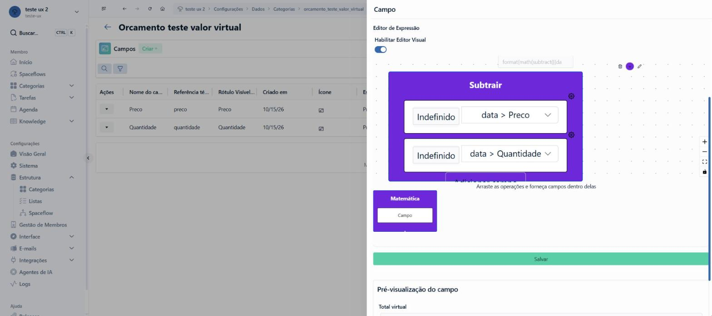
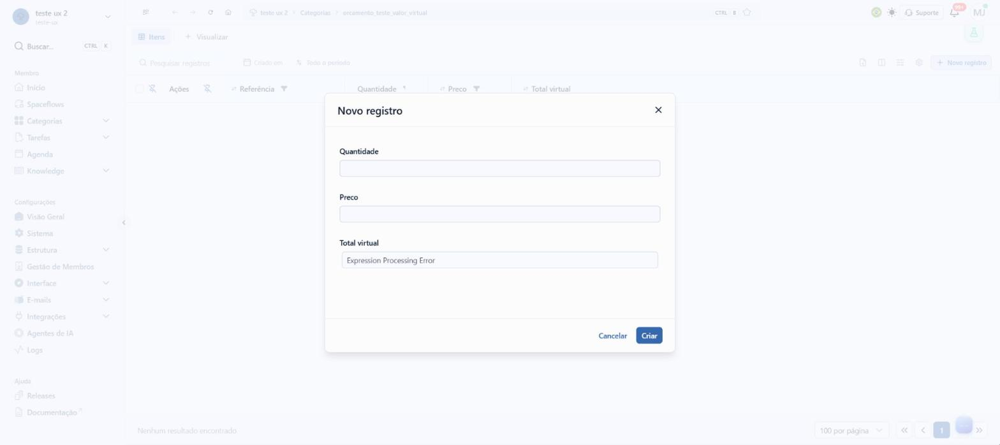
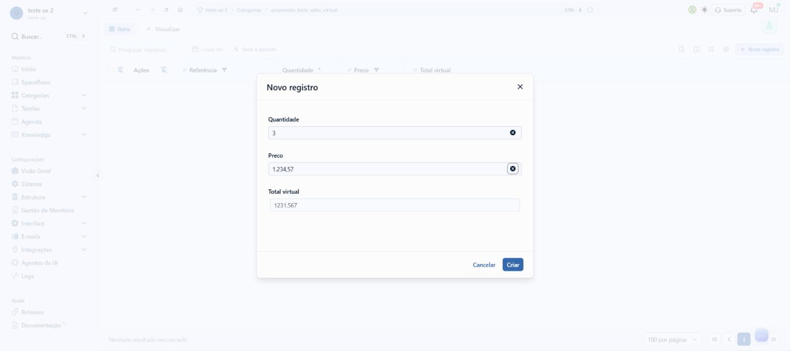

# Construtor de expressões: briefing

## A demanda, como veio

> observe o campo do tipo valor virtual no enspace. ele possui um construtor de variaveis visual que nao funciona. ele monta errado as expressoes. usamos as bibliotecas mathjs, dayjs e handlebars. pro calculo matematico propriamente dito somente mathjs. handlebars é usada em expressoes no enspace quando a gente escreve {{~v2}} no começo da expressao. pra fazer expressoes complexas.
>
> pode olhar en-docs (repo local) pra ver como funciona +/-, mas saiba que tem alguns conteudos que estao errados ali. pra ver o que funciona ou nao voce tem que testar mesmo ou tentar ver pelo backend se der.
>
> hoje a handlebars existe pra gente somente pra fazer if e each. somente condicionais e repetiçao.
>
> nao vai mudar NADA no backend. nao pode mudar.
>
> se quiser sugerir mais tipos de expressao às quais o enspace nao atende hoje, tem que colocar num outro "modo" do prototipo. um só com o que temos hoje, um com novas expressoes possíveis, utilizando as mesmas bibliotecas.
>
> o objetivo é construir um construtor visual de expressoes que seja FUNCIONAL, para aplica-lo a qualquer lugar do enspace que trabalhe com expressoes, mas começando por esse campo.
>
> pra testar ele de verdade, voce nao vai poder se ater ao preview. tem que botar ele num form e esse form tem que trazer, por exemplo... se voce escrever no campo virtual a+b pra ser a expressao dele, os campos a e b devem estar no mesmo form que ele pra testar. resolve em tempo real na tela o calculo.
>
> pense no construtor. pesquise como outros produtos fazem isso. pesquise bem profundamente /deep-research
>
> tenha muito cuidado com o que vai propor porque é uma funcionalidade delicada.

**Tela:** Configurações › Dados › Categorias › *categoria* › Campos › gaveta **Campo** de um "Campo virtual (de
valor dinâmico)" › Configurações Específicas › **Editor de Expressão**. E o modal **Novo registro** da lista da
categoria, onde o campo calcula.

**Sucesso:** quem configura monta a expressão em blocos, vê o resultado num formulário com os campos que ela usa
e grava um texto que o motor de hoje calcula certo, sem tocar no back-end.

## O que a pesquisa de UX já dizia

Procurei no `enspace-ux-research` (`temas/README.md`, os 6 temas e o `UX_REPORT.md`) por "virtual", "expressão",
"expressao", "mathjs" e "handlebars". **Não há nada sobre o Valor Virtual nem sobre expressões.**

## Como investiguei

| O quê | Como |
|---|---|
| A tela e o formulário | Pelo Chrome, no workspace de exploração do develop, em 15/10/2026 |
| O motor que calcula | Lendo o JavaScript que o develop serve: `FieldRenderer-*.js` (função `cI`, que calcula) e `index-*.js` (componente `EnlExpressionEditor`, o construtor) |
| O que funciona e o que não | Rodando a própria função do develop no navegador, com ~110 expressões e dados de teste |
| Versões | mathjs **15.2.0** e Handlebars **4.7.9**, lidas no bundle |

**Preparo:** criei pela tela, no workspace de exploração, a categoria `orcamento_teste_valor_virtual` com 2
campos Número (Quantidade e Preço) e 1 Campo Virtual montado no construtor visual. A categoria ficou lá para
conferência. Nenhum item foi gravado: o Novo registro foi cancelado.

Caminho da tela, sem o host (o repositório é público):
`/workspaces/<exploração>/settings/data/types/orcamento_teste_valor_virtual/fields` e
`/workspaces/<exploração>/types/orcamento_teste_valor_virtual?view=default`.

## O fluxo de hoje, em passos

1. Campos › **Criar** › Nome, Tipo "Campo virtual (de valor dinâmico)".
2. Configurações Específicas › Editor de Expressão, com a chave **Habilitar Editor Visual** ligada.
3. Arrastar o bloco **Matemática** do canto inferior esquerdo para o canvas.
4. Passar o mouse no **+** do bloco e escolher a operação: Somar, Somar Lista, Subtrair, Multiplicar, Dividir.
5. Em cada linha do bloco, escolher o campo numa árvore que mistura metadados do item ("Criado em [Tipo
   inválido]") com os campos, que ficam dentro de um nó "data".
6. **Adicionar campo** para mais operandos; a engrenagem troca o operando por Campo, Operação ou Valor manual.
7. Salvar. A pré-visualização mostra o campo sozinho.

![Construtor vazio: a pré-visualização já mostra "[object Object]"](evidencias/develop-01-construtor-vazio-object-object.jpg)

![A lista de campos mistura metadados com "[Tipo inválido]"; os campos ficam dentro de "data"](evidencias/develop-02-lista-de-campos-tipo-invalido.jpg)

## Onde o construtor de hoje monta errado

Lido no código do `EnlExpressionEditor` e confirmado rodando o motor do develop.

| O construtor faz | O resultado |
|---|---|
| Grava as operações como função: `subtract(a, b, c)`, `divide(a, b, c)` | `subtract` e `divide` do mathjs aceitam só 2 valores: com 3, o campo mostra **0**, sem aviso |
| Aninha operações dentro de operações | Com 3 níveis (`sum(a, divide(b, multiply(c, d)))`), o campo mostra **o texto da expressão** em vez do número |
| Grava o formato com `"type":"EnlNumber"` (o tipo do campo) | O formato só reconhece `"number"`: o resultado sai sem formato (`1231.567` em vez de `1.231,57`) |
| Grava o campo como `{{data.x}}`, sem valor para vazio | Campo vazio deixa a conta incompleta: o formulário novo abre com **Expression Processing Error** |
| "Somar Lista" grava `sumArray(data.lista, lista.coluna)` | O caminho da coluna fica errado e a soma dá **0** (lido no código, não montado na tela) |
| "Valor manual" grava o que se digita | `math(1,5 + 1)` dá "Expression Processing Error": a vírgula vira separador de argumento |
| Guarda um mapa de blocos separado do texto (`operationsMap`) | Expressão escrita à mão não volta para o visual; a chave só esconde um ou outro |
| Pré-visualização do campo sozinho | Mostra "[object Object]" antes de qualquer bloco e não mostra os campos que a conta usa |

## Como o motor de hoje calcula (medido)

A função `cI` do develop faz, nesta ordem:

1. Tira todo `{{~X}}` e guarda X como versão. `v2` compila o texto com o Handlebars; senão, troca cada
   `{{caminho | padrão}}` pelo valor.
2. Troca `sumArray(caminho, coluna)` pela soma da coluna.
3. Acha cada `math(...)` com uma **expressão regular que só aceita 2 níveis de parênteses**, relê com
   `math.parse(...).toString()` e calcula com `math.evaluate`, usando o próprio item como escopo.
4. Acha cada `dayjs(...)` com métodos encadeados e calcula com regras próprias.
5. Acha cada `format(valor, {json})` e formata.

O que isso causa, testado:

| Expressão | Resultado | Por quê |
|---|---|---|
| `math({{data.a}} + {{data.b}})` | certo | |
| `math({{data.a}} + {{data.vazio}})` | "Expression Processing Error" | campo vazio vira nada; o `math.parse` falha fora do `try` |
| `math({{data.vazio \| (0)}} + {{data.a}})` | certo | o padrão `(0)` cobre vazio e `null` |
| `math('{{data.nome}}' + ' X')` e outros erros de cálculo | **0** | o erro dentro do `evaluate` vira 0, sem aviso |
| `math(round(((a + b) * 2) / 3, 2))` | o texto da expressão | 3 níveis de parênteses: a expressão regular não pega |
| `math('{{data.status}}' == 'aprovado')` | 0 | o `==` do mathjs converte texto em número e falha |
| `math(equalText("{{data.status}}", "aprovado"))` | certo | `equalText` compara texto |
| `math(equalText('{{data.nome}}', ...))` com nome `D'Avila` | 0 | o apóstrofo fecha a aspa simples; com aspas duplas funciona |
| `math({{data.a}} ^ 2)` com `a = -3` | -9 | vira `-3 ^ 2`; `({{data.a}}) ^ 2` dá 9 |
| `math(x > 8 ? b > 3 ? 'A' : 'B' : 'C')` | erro | o "então" encadeado precisa de parênteses; o "senão" encadeado não |
| `math(0.1 + 0.2)` | 0.30000000000000004 | o valor gravado no item fica com o erro de ponto flutuante |
| `dayjs({{data.d}}).add(30, 'day')` | a data sem somar | a unidade com aspas não é reconhecida; `add(30, day)` funciona |
| `dayjs(x).add(1, month).format(DD/MM/YYYY)` | só formata, não soma | ao encadear, só o último método recebe argumentos |
| `dayjs({{data.fim}}).diff(dayjs({{data.inicio}}), 'day')` | "NaN, 'day')" | o `diff` não aceita `dayjs(...)` dentro; `diff({{data.inicio}}, day)` funciona |
| `dayjs()` | vazio | `dayjs('')` é data inválida; hoje é `{{$enspace.date.currentDay}}` |
| `math(dayjs(...).diff(...) * 2)` | 0 | `math` roda antes de `dayjs`: data não entra em conta |
| `dayjs(x).format('dddd, DD [de] MMMM')` | "Thursday" | a vírgula corta o argumento, e o dayjs não tem o locale pt-br carregado |
| `{{~v2}}{{#if-condition data.a ">" 50}}A{{else}}B{{/if-condition}}` | vazio | o helper `if-condition` não tem `else` |
| `{{~v2}}{{data.nome}}` com `D'Avila` | `D&#x27;Avila` | o Handlebars troca caracteres por código HTML |
| `{{~v2}}{{#each data.parcelas}}...{{/each}}` | certo, mas não recalcula ao vivo | o formulário só recalcula com campo que aparece como `{{data.x}}` simples |
| `{{~v2}}...{{#if false}}{{data.parcelas}}{{/if}}` | certo e recalcula | a "âncora" faz o formulário enxergar o campo sem mostrar nada |

**Valor Virtual lê outro Valor Virtual:** sim. O formulário calcula os virtuais em cadeia
(`resolvedExpressionsOnForm`). Isso permite "quebrar em passos" hoje, com 2 campos.

## O que o en-docs diz e não acontece

| Página | Diz | Medido |
|---|---|---|
| Expressões | `math({{data.status}} == 'aprovado')` compara texto | dá 0; o certo é `equalText` |
| Expressões | `dayjs({{data.data}}).add(30, 'day')` | não soma; a unidade vai sem aspas |
| Expressões | `dayjs({{data.fim}}).diff(dayjs({{data.inicio}}), 'day')` | "NaN"; o certo é `.diff({{data.inicio}}, day)` |
| Expressões | `dayjs()` é a data atual | sai vazio |
| Expressões | "você pode usar dayjs() dentro de math()" | dá 0: `math` roda antes |
| Expressões | `dayjs(math(...))` não funciona | funciona, porque `math` roda antes |
| Campo Virtual | Editor Visual: Somar, Subtrair... com vários campos | Subtrair e Dividir com 3 valores dão 0 |

Esses pontos ficam para a Mikaela decidir sobre o en-docs. Este agente não escreve lá.

## A casca da tela, item por item

Copiada do develop em 15/10/2026, sem melhoria de passagem (`_CascaDoEnspace.vue`, `_TelaCampos.vue`,
`_TelaItens.vue`):

- menu lateral com Membro (Início, Spaceflows, Categorias, Tarefas, Agenda, Knowledge), Configurações (Visão
  Geral, Sistema, Estrutura com Categorias, Listas e Spaceflow, Gestão de Membros, Interface, E-mails,
  Integrações, Agentes de IA, Logs) e Ajuda (Releases, Documentação);
- barra do topo com voltar, avançar, recarregar, início, trilha com Ctrl B e estrela, idioma, tema, Suporte,
  sino e avatar;
- Campos: título da categoria com voltar, cartão "Campos" com **Criar**, busca, filtro, recarregar e ID; tabela
  com Nome do campo, Referência técnica, Rótulo Visível, Criado em, Tipo de Campo (selo) e Ordenação. O develop
  tem também Ícone, Esquema de cores, Ou e E Condicionais, Espaço Reservado, Ajuda e Instrução: ficaram de fora
  porque não mudam a proposta;
- gaveta **Campo** com as abas Definição, Visual, Regras e Condições, Eventos de Campo e Ajuda; Nome do campo,
  Referência técnica, Rótulo Visível e Tipo de Campo com os textos de ajuda do develop; "Configurações
  Específicas"; **Salvar** verde em linha inteira;
- lista da categoria com Itens e Visualizar, busca, Criado em, Todo o período, ícones e **Novo registro**;
  modal Novo registro com os campos e Cancelar e Criar.

**Achados da casca, deixados como estão:** a gaveta fecha ao clicar fora e perde o que estava no construtor
(no protótipo ela fecha só pelo X, ver DECISOES); o selo de tipo é vermelho para todo tipo de campo.
