# Briefing: Dashboards configuráveis

## 1. A demanda, como veio

> voce deve observar o funcionamento atual do dashboard de itens do enspace. perceba que é dash personalizado a partir
> do que a pessoa configura. se ela tem 10 categorias, com x campos dentro, ela pode cruzar isso aí nos dashes. com
> limitações do enspace ok?
>
> pesquise produtos com dashboards personalizados nesse nivel (a pessoa seleciona o campo, o cruzamento etc),
> basicamente nao sao laminas com a operaçao matematica ja montada. é 100% configuravel pela caracteristica do produto
> de ser 100% personalizavel (com criação de categorias e campos, como o twenty crm).
>
> faça uma /deep-research e me devolva recomendações de como seria um bom dashboard pro enspace e como o mercado tem
> feito dashboards desses tipos (o que deve ser possivel fazer, mais ou menos como é a usabilidade etc)
>
> investigue MUITO BEM os dashboards do enspace, ok? em tela. e voce vai precisar certamente usar /investigar-codigo pra
> ver como é o código dos dashes hoje, quais componentes sao usados, a biblioteca... tudo. e voce vai precisar
> inclusive precisar sugerir uma biblioteca nova, certamente. a que usamos hoje é terrível.
>
> mas é importante sber de onde estamos partindo.
>
> com isso, me entregue a pesquisa e suas sugestoes e com base nisso eu te libero pra prototipar ou indico ajustes
> necessarios na ideia.
>
> e saiba que hoje, se oolhar na documentaçao, vai ver que dashboards sao uma tela personalizada que o user tem que
> configurar um menu e a tela pra ela aparecer. veja tudo o que precisar

## 2. Tela e jornada em jogo

- **Tela:** tipo de tela **Painéis**, rota `/workspaces/<ws>/pages/<slug-da-tela>`.
- **Jornada:** criar a tela (Configurações > Interface > Telas), pôr no menu (Interface > Menus), montar os painéis
  ("Novo Painel") e ler o dashboard.

## 3. O que seria sucesso

Quem configura o workspace monta, sem ajuda, um dashboard que cruza as próprias categorias e campos, vê o gráfico
enquanto configura e chega aos itens por trás de cada número.

## O que a pesquisa de UX já dizia

Tema `construtor-de-telas` do `enspace-ux-research` (auditoria de 2026-09-14 e 2026-09-15):

- **U9 (P2):** "Novo Painel", "Editar Dashboard", "Organizar painéis automaticamente" e "Forçar carregamento" na mesma
  linha. Painel, Dashboard e painéis nomeiam a mesma coisa; "Forçar carregamento" expõe um problema de carga como
  funcionalidade.
- **Painéis funciona, com 4 níveis de aninhamento:** página > modal > aba > modal sobre modal ("Campo de Agrupamento"),
  e 5 abas em 2 níveis.
- **C9:** o Salvar recusa com "campos precisam de revisão: Categoria | Campos de Agrupamento", campos de outra aba, sem
  marca de erro.
- **Dependência escondida:** categoria sem campo deixa o seletor de agrupamento em "Não há dados", sem dizer que falta
  criar campo.
- **Ícones:** lista plana, alfabética e em inglês no modal de painel; nos menus, lista por categoria em português.
- **C1:** o tipo aparece como "Dashboard" num lugar e "Paineis", sem acento, em outro.

Esta demanda chega pelo outro lado (o que o dashboard deveria permitir) e encontra as mesmas fricções de configuração.

## Fase 2: o develop hoje

Workspace de exploração, em 2026-11-11, pelo Chrome. Tudo pela tela; nada preparado por API. Detalhe completo, com o
código e a doc, em [`pesquisa/research_notes/.../enspace_hoje.md`](pesquisa/research_notes/Dashboards%20configuráveis%20para%20o%20ENSPACE/enspace_hoje.md).

### A jornada, em passos

1. Configurações > Interface > **Telas** > Criar > Tipo "Painéis" > Salvar (doc "Telas", seção "Dashboard (Painéis)").
2. Interface > **Menus**: pôr a tela num menu. Sem isso, a tela não aparece para os membros. A tela de Menus travou a
   aba do Chrome nesta sessão; o passo vem da doc.
3. Abrir a tela: cabeçalho com 4 botões e os painéis numa grade.
   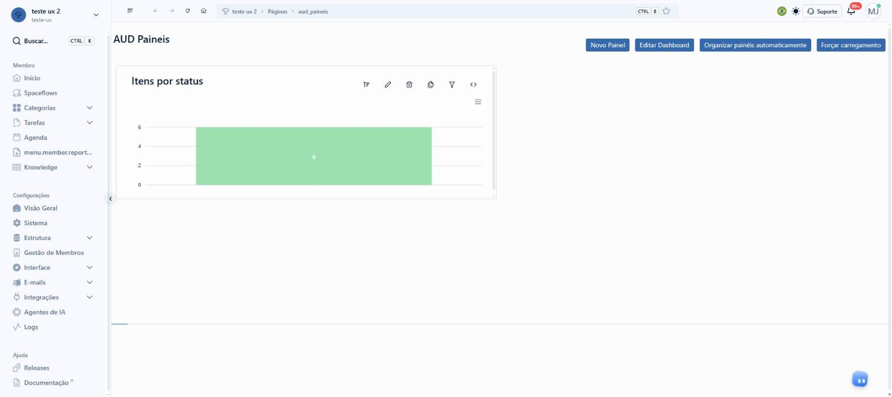
4. **Novo Painel** abre o modal "Dados do painel" | "Formatação": Título, Cor, Ícone (obrigatório) e 3 sub-abas.
   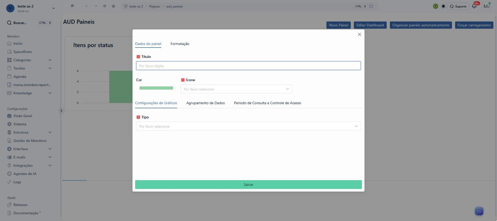
5. "Configurações de Gráficos" > **Tipo**: Barras, Linhas, Pizza, Donut, Área, Funil.
   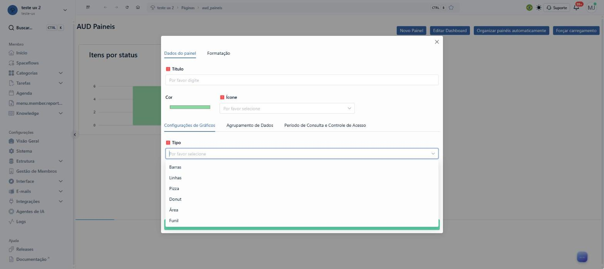
6. "Agrupamento de Dados" > **Categoria**, depois "Campos de Agrupamento" > Adicionar.
   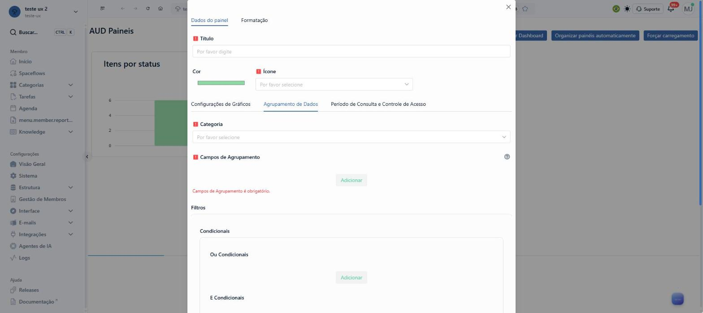
7. O Adicionar abre um **modal sobre o modal** com o seletor "Campo de Agrupamento" e um chip "Indefinido".
   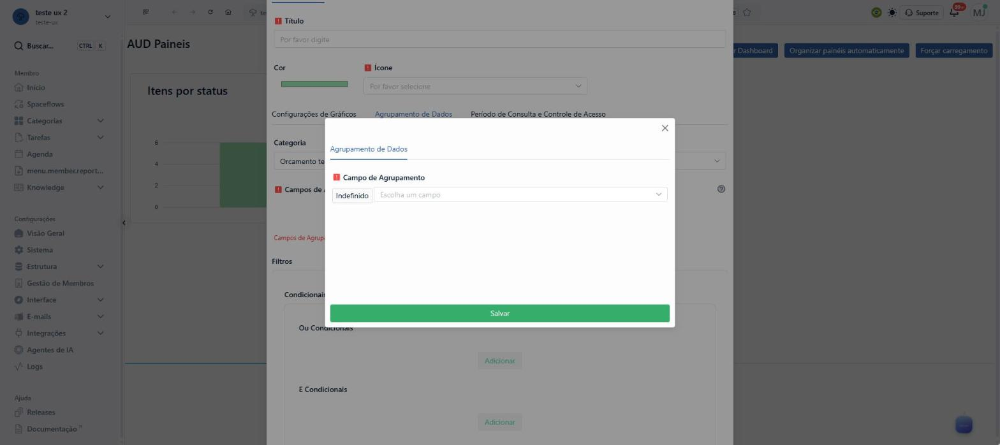
8. A lista mistura campos técnicos ("ID", "reference", "Display", "Rascunho") e esconde os campos criados pela pessoa
   num nó "data".
   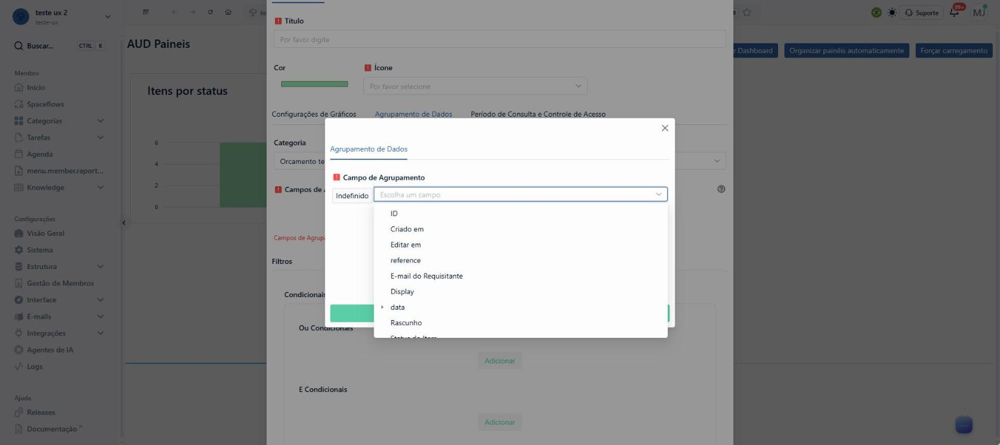
9. O campo escolhido aparece como caminho técnico, "data > Quantidade".
   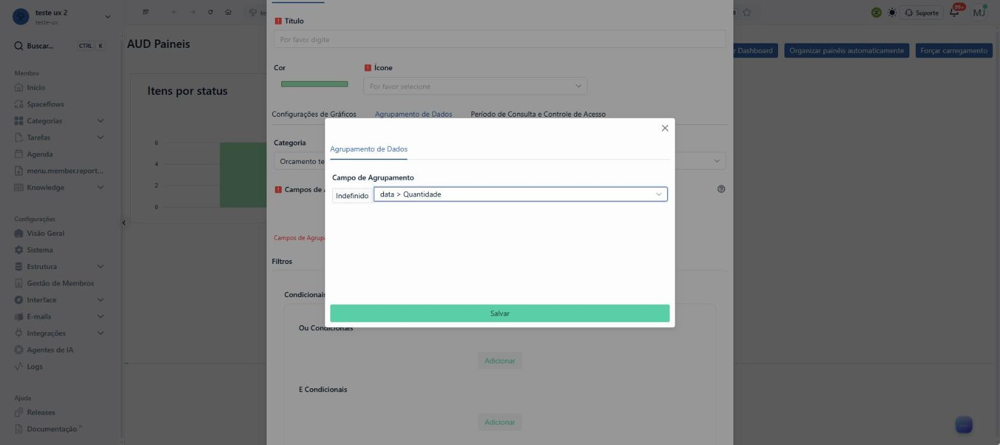
10. **Função**: Contagem, Soma, Média, Mediana, Variância, Contagem Distinta.
    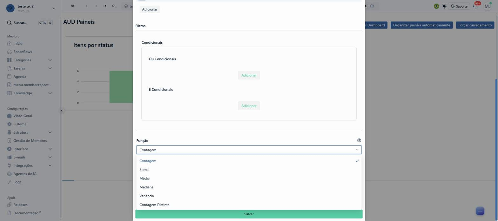
11. Com Soma, o "Campo do eixo Y" aparece no fim do formulário, depois de filtros, coloração e legenda.
    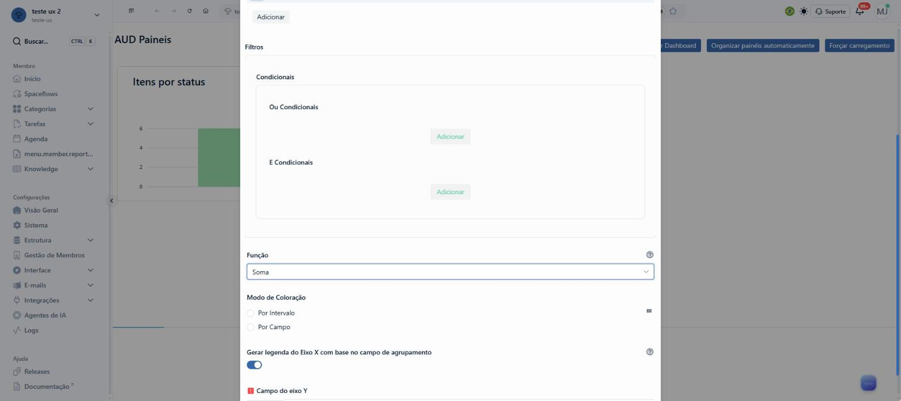
12. A lista do eixo Y marca "[Tipo inválido]" nos campos que não são número, aceita "ID" e recusa o campo virtual
    "Total virtual".
    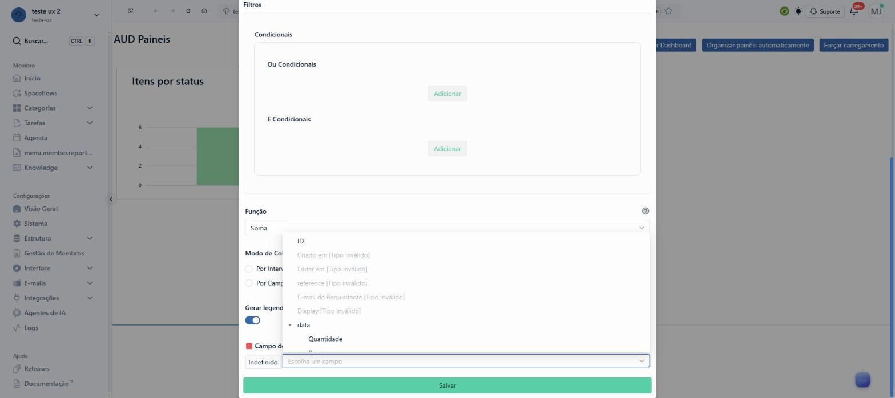
13. "Período de Consulta e Controle de Acesso": campo de data de referência, período relativo com padrão de 2 meses e
    "Grupos Permitidos - visualização".
    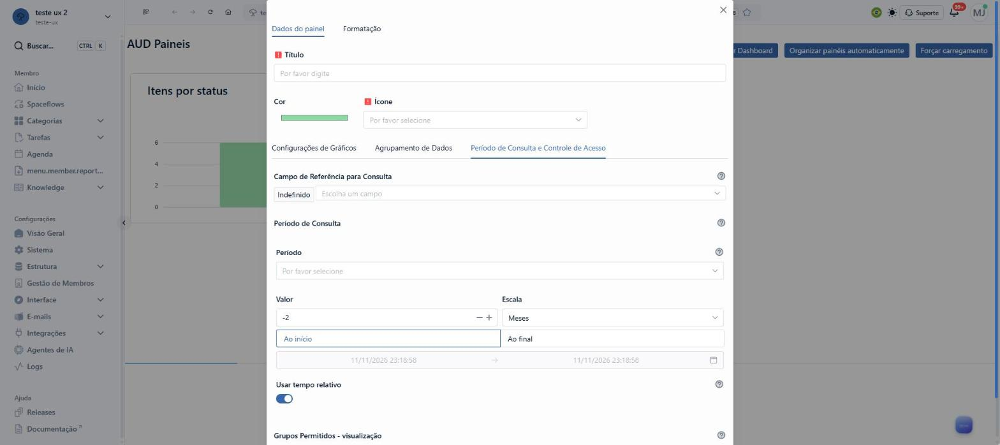
14. "Formatação" tem só o seletor "Eixo".
    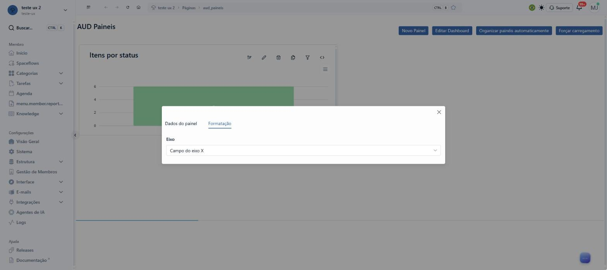
15. Salvar. Não há prévia: o gráfico só aparece depois.

Painel de teste criado: "Preço somado por quantidade" (fica no workspace de exploração).

### O que já existe e funciona

- Gráfico de 1 categoria, com 1 ou mais campos de agrupamento, filtros E/OU, 6 funções e período relativo.
- Grade com arrastar e redimensionar, duplicar painel, recarga automática (padrão 5 min), download SVG, PNG e CSV.
- Cores por intervalo e por valor do campo (barra e funil), ordem crescente ou decrescente no painel.
- Restrição do dashboard e de cada painel a grupos.
- Tema escuro.
  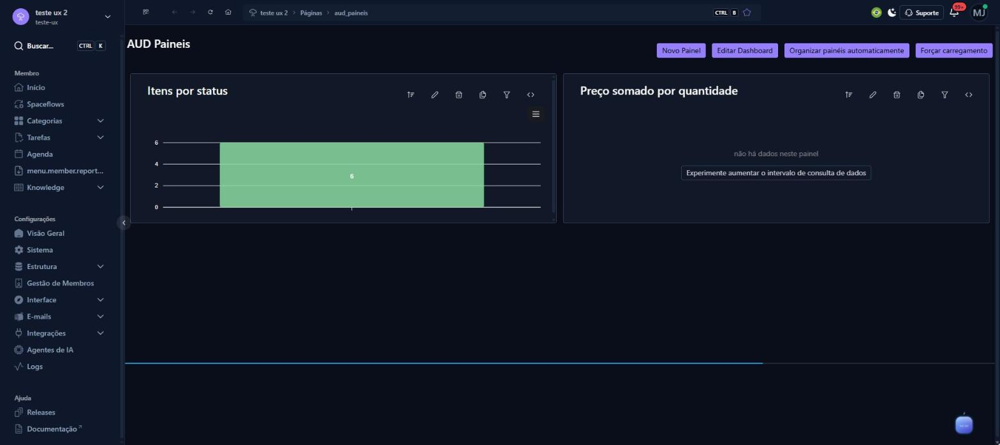

### Onde trava

- **Sem prévia** e com 4 níveis de camada para 1 gráfico.
- **Campos técnicos** na lista e caminho "data > Campo" na tela.
- **Painel vazio sem explicação:** "não há dados neste painel" (padrão de 2 meses); o botão "Experimente aumentar o
  intervalo de consulta de dados" abre o formulário na sub-aba errada.
  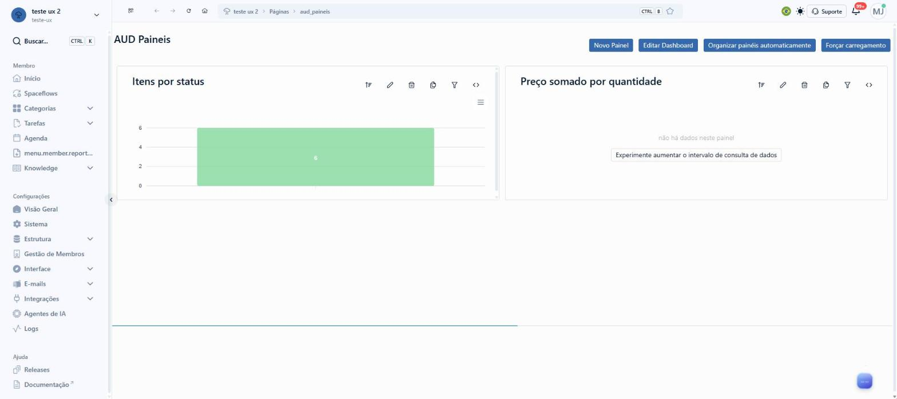
  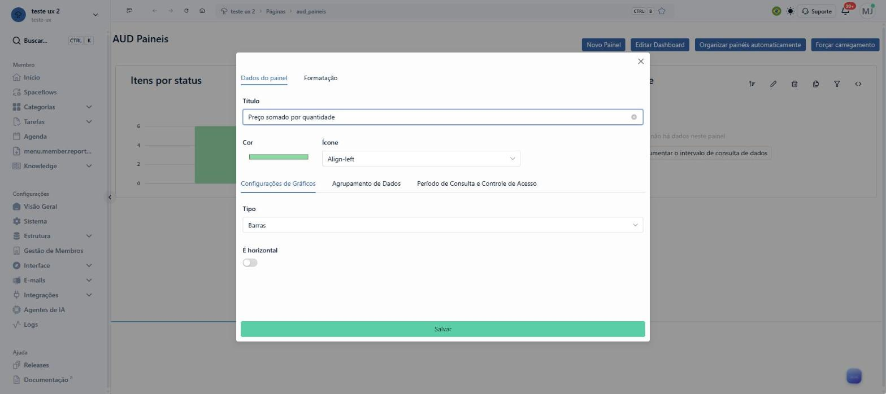
- **Sem filtro do dashboard inteiro.** O filtro local não é gravado e substitui o filtro do painel.
  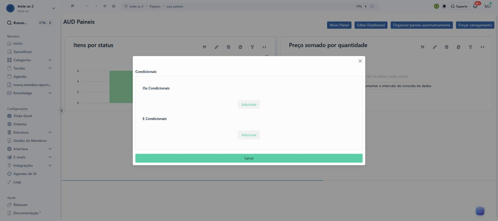
- **Sem drill-down:** clicar no gráfico não leva aos itens.
- **"<>"** mostra ao usuário o JSON do ApexCharts.
  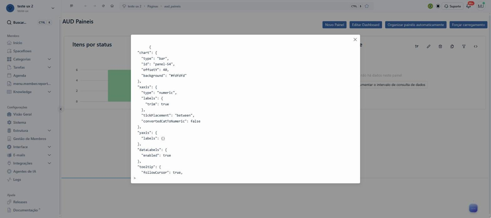
- **"Editar Dashboard"** pede descrição obrigatória e não edita o layout.
  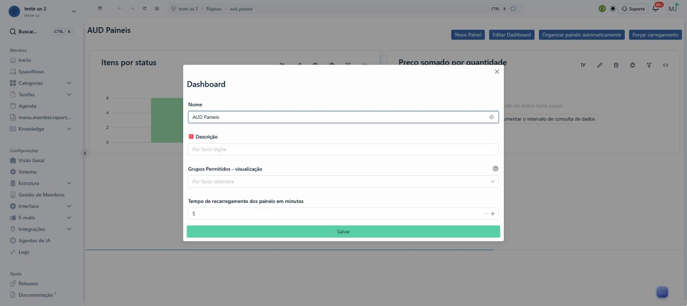
- **Lido no código:** 1 série só (sem empilhado), múltipla seleção agrupada por combinação, relação conta só o 1º
  valor, agregação feita no navegador sobre todos os itens do período, 1 requisição por painel.

### Achados de texto (a casca não muda; ficam registrados)

- "Motrar porcentagem", "curve" sem tradução, "não há dados neste painel" em minúsculas.
- Menu lateral com a chave crua "menu.member.reports.label".
- Trilha com o slug ("Páginas > aud_paineis").

## A casca da tela, item por item

Copiada de `https://develop.enspace.io/workspaces/teste-ux/pages/aud_paineis` em 2026-11-11 (print
`evidencias/01-tela-de-painel-hoje.jpg`). Mora em `_CascaDoEnspace.vue`.

| Parte | Como está no develop e no protótipo |
|---|---|
| Topo do menu | avatar "TE", "teste ux 2", slug "teste-ux" e a seta de troca de workspace |
| Busca | "Buscar..." com o atalho Ctrl K |
| Grupo Membro | Início, Spaceflows, Categorias (expande), Tarefas (expande), Agenda, a chave crua "menu.member.reports.label", Knowledge (expande) |
| Grupo Configurações | Visão Geral, Sistema, Estrutura, Gestão de Membros, Interface, E-mails, Integrações (expandem os que expandem no develop), Agentes de IA, Logs |
| Grupo Ajuda | Releases e Documentação (link externo) |
| Barra do topo | recolher o menu, voltar, avançar, recarregar, início, trilha, atalhos à direita, idioma, tema, Suporte, sino e avatar |
| Trilha | workspace > Dashboards > nome do dashboard (no develop: "Páginas > aud_paineis") |

**A única proposta na casca:** a entrada **Dashboards** no grupo Membro, ativa e com o selo "Novo", no lugar de
cada tela do tipo Painéis entrar no menu à mão por Interface > Menus. A trilha segue a entrada nova.
