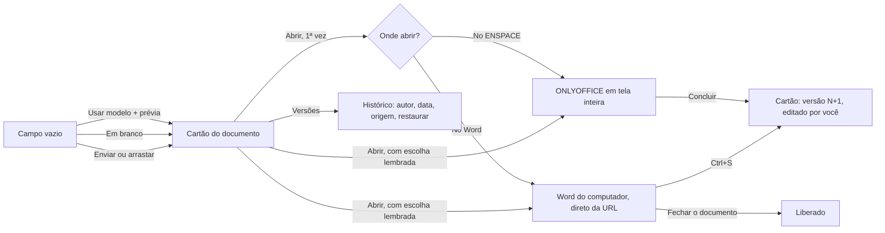

# Decisões: editor de documentos

## A proposta, em 6 pontos

1. **O campo vira um cartão que conta o que acontece com o documento.** Miniatura, nome, versão, quem editou por último e quando, e quem está com ele agora (e onde). Substitui o botão sem contorno "Abrir Documento" e o chip genérico do develop.
2. **O campo vazio é a própria área de começar.** Usar modelo (com prévia preenchida com os dados do item), Em branco e Enviar arquivo, ou arrastar o arquivo para o cartão. Substitui "Subir documento" → gaveta → upload → "Usar modelo" → "Tem certeza?".
3. **Abrir com escolha de editor, perguntada 1 vez.** "No ENSPACE" (ONLYOFFICE) ou "No Microsoft Word". Com "Lembrar minha escolha", o botão passa a dizer o editor ("Abrir no Word"), e a seta ao lado troca.
4. **Word de verdade, direto do item.** O Word do computador abre o arquivo pela URL do ENSPACE (`ms-word:ofe|u|...`), sem baixar. O documento fica reservado para quem abriu; o Ctrl+S grava no item e vira versão; fechar libera.
5. **ONLYOFFICE em tela inteira, com moldura do ENSPACE.** Cabeçalho fixo com item, campo, estado de salvamento sempre visível, quem está editando, Versões ao lado, Baixar, Abrir no Word e Concluir. Esc fecha só o que está por cima.
6. **Configuração do campo em 3 grupos.** Onde abre (ONLYOFFICE, Word, Word para a web como fase 2, editor padrão), como nasce (modelos, em branco, .docx, .pdf) e o que se faz no editor (editar ligado por padrão).

## A jornada

## A limitação técnica, decidida

- **Word instalado (Windows e Mac): caminho principal.** WebDAV com bloqueio + `ms-word:ofe`. Não depende da Microsoft.
- **Saída de emergência (rodada 4):** se o Word não abrir, baixar o arquivo, editar no Word ou onde a pessoa quiser e enviar de volta; o envio vira versão nova e libera a reserva.
- **Word para a web: fase 2**, ligado por padrão no protótipo para a opção aparecer (rodada 5). Cópia no OneDrive pelo Microsoft Graph. O CSPP fica de fora: obriga o Office como editor padrão.
- **Painel do suplemento:** ganha a aba "Documento" (item, campo, versão aberta, mudança não salva, Salvar no ENSPACE, Concluir e liberar). Não abre sozinho na versão da loja: a Microsoft só permite isso em implantação centralizada ou sideload.
- Detalhe e fontes: `PESQUISA.md`, "A limitação técnica".

## Rodada 1 · 2026-10-08
- **Pedido (literal):** "a ideia é permitir que, na interação com o campo, o usuário possa escolher se quer usar o onlyoffice ou o word. e trabalhar no word com o doc dele. [...] prototipe a solução e aproveite para melhorar o VISUAL do campo que hoje é horrível. pode propôr melhorias até no visual da interação com onlyoffice tambem."
- **Pedido (literal, no meio da rodada):** "olha o botao sem contorno algum depois que sobe documento... tem muito detalhe ruim de ux/ui pra voce prestar atençao e resolver com /nuxt-ui"
- **Pedido (literal, no meio da rodada):** "voce tem que fazer o comportamento do prototipo simular o real e funcionar na minha maquina, ok? com arquivo que eu nao tenho salvo aqui. como seria o caso do usuario real"
- **Mudou:** protótipo novo, em `app/pages/editor-de-documentos/`.
- **Mudou:** o "Abrir no Word" chama o Word do computador de verdade, com um .docx que mora no endereço do protótipo (`arquivos/`, gerado por `gerar-arquivos.py`), não no computador de quem abre.
- **Mudou:** cada componente saiu da skill e do MCP `nuxt-ui`: UFileUpload (área de soltar), UFieldGroup + UDropdownMenu (botão com seta), URadioGroup card (escolha do editor), UTimeline (versões), UModal fullscreen (editor), USlideover (visão rápida, versões, configuração). Nenhum CSS próprio.
- **Fronteira:** muda o campo Editor de Documentos (vazio, preenchido, estados), a escolha do editor, a moldura do ONLYOFFICE, o fluxo do Word, o painel do suplemento (aba Documento), as versões, a configuração do campo e a célula do campo na lista. Muda também o aviso "Alterações não salvas" do rodapé da visão rápida, que só aparece com mudança (o documento não passa pelo Salvar do item). Não muda o resto da casca: menu, topo, trilha, abas, lista, trilho de ícones, campos comuns.
- **Descartado:** "Tela cheia" do navegador. Motivo: o editor já nasce em tela inteira dentro do ENSPACE, com contexto.
- **Descartado:** CSPP para o Word para a web. Motivo: obriga o Office como editor padrão e exige aprovação, seguros e coautoria.
- **Descartado:** abrir o painel do suplemento sozinho com o documento. Motivo: a Microsoft não permite para suplemento da loja.
- **Não deu:** salvar de volta no item a partir do Word real. Por quê: exige o endpoint WebDAV, e o protótipo não tem servidor (regra 4). O Word abre o arquivo em leitura, e isso prova o ponto técnico.
- **Não deu:** abrir no Word um arquivo enviado pela pessoa no protótipo. Por quê: ele vive como `blob:` no navegador, que o Word não alcança; o protótipo baixa o arquivo (a saída de emergência).
- **Não deu:** prints das referências. Por quê: a pesquisa foi por leitura de documentação; as URLs estão no `PESQUISA.md`.
- **Não deu:** conferir na tela da Mikaela que o Word abriu. Por quê: o acesso à tela foi recusado; conferi que o arquivo responde no endereço e que o link `ms-word:` é montado com ele.
- **Simulação:** a área do ONLYOFFICE (barra e página desenhadas; dá para digitar e ver o salvamento); a janela do Word, chamada na tela de "simulação do plugin do Word" (cinza, sem identidade da Microsoft; o painel e o salvamento no item são proposta); a geração por modelo, o envio e o salvamento (simulados em memória); a miniatura (linhas, no lugar da imagem da 1ª página); Baixar como PDF; "Como instalar" o suplemento. Nada usa localStorage; recarregar zera tudo.
- **Crítica e acessibilidade:** passada de crítica feita com a skill `design:design-critique`; a de acessibilidade foi feita junto, no mesmo roteiro (contraste, foco, rótulos), sem rodar a skill `design:accessibility-review` à parte.
  - Corrigido: o texto "formatos aceitos" usava `text-dimmed`, baixo contraste; passou a `text-muted`.
  - Corrigido: documento criado em branco mostrava o texto do contrato.
  - Corrigido: a transição do campo travava porque o UFileUpload não tem raiz única.
  - Ficou: o botão Salvar da visão rápida desabilitado se diferencia pouco do habilitado (opacidade padrão do Nuxt UI).
  - Ficou: o "Abrir" do campo e o "Salvar" do rodapé usam a mesma cor primária. A ação do campo precisa de peso; o Salvar só acende com mudança.
  - Ficou: a miniatura tem rótulo de 8 px ("DOCX"); é decorativa (`aria-hidden`), e o tipo também aparece no texto ao lado.
  - Ficou: o andaime quebra em 2 linhas em telas de até 1.600 px; é andaime.
  - A conferir à mão: na automação, o 1º clique logo depois de fechar o editor ou um modal foi ignorado algumas vezes. A janela do Chrome estava em segundo plano em parte dos testes, o que também descarta clique; não deu para separar as 2 causas.
- **Ver:** `http://localhost:3000/editor-de-documentos` · `evidencias/proto-*.jpg`

## Rodada 2 · 2026-10-08
- **Pedido (literal):** "voce tem que deixar explicado no prototipo que o user tem que clicar em \"maquete\" pra ver como seria a aprencia do plugin. nao é maquete, bote \"simulaçao plugin word\" ou algo assim."
- **Mudou:** o botão do modal Abrir no Word passou de "Ver o painel do ENSPACE (maquete)" para "Ver simulação do plugin do Word".
- **Mudou:** o modal explica, depois que o Word abre, que esse botão mostra como o plugin aparece dentro do Word.
- **Mudou:** o cartão do campo reservado ganhou o botão "Simulação do plugin"; "Voltar ao Word" só chama o Word do computador.
- **Mudou:** a dica do andaime diz o caminho até a simulação e aparece em qualquer largura de tela.
- **Mudou:** "maquete" saiu de todo texto de tela (aviso da janela, área do ONLYOFFICE, toasts), nos 3 idiomas; os toasts que estavam fixos em português passaram para o `textos.ts`.
- **Fronteira:** muda só o texto e o acesso à simulação; não muda o fluxo nem a proposta.
- **Ver:** `http://localhost:3000/editor-de-documentos` · `evidencias/proto-03-abrir-no-word.jpg`, `proto-04-painel-do-enspace-no-word.jpg`, `proto-08-cartao-com-simulacao-do-plugin.jpg`

## Rodada 3 · 2026-10-08
- **Pedido (literal):** "voce fez estados diferentes em itens diferentes. deixe os estados como possiveis de mudar na barra de gferramentas do prototipo [...] ou só diminua o número de itens deixando 1 pra cada cenario especifico. essa segunda opçao parece ate melhor"
- **Mudou:** a lista tem 6 contratos, 1 por cenário: sem documento, DOCX com 1 versão, DOCX com 7 versões, PDF, outra pessoa no Word, editando junto no ENSPACE.
- **Mudou:** o andaime ganhou o seletor "Cenário", que abre o contrato daquele cenário e marca qual está aberto.
- **Mudou:** o campo é montado de novo a cada contrato (`:key` por item), para o "Avisar quando liberar" e a criação em andamento não passarem de um contrato para outro.
- **Mudou:** saíram os contratos CTR-0131, CTR-0128 e CTR-0126 e os .docx deles; o CTR-0142 ficou com 1 versão.
- **Fronteira:** muda só o mock e o andaime; não muda o campo, os editores nem a casca.
- **Não deu:** print novo. Por quê: a janela do Chrome estava em segundo plano e o print não sai; conferi os 6 cenários pelo conteúdo da página.
- **Ver:** `http://localhost:3000/editor-de-documentos`

## Rodada 4 · 2026-10-08
- **Pedido (literal):** "nesta parte, se o word nao abrir, a orientaçao simplesmente deve ser de a pessoa baixar, editar no word ou onde quiser, e subir de novo. e aí deve ter o botao de baixar e o de fazer upload ao lado. falta isso"
- **Mudou:** "O Word não abriu?" diz: "Baixe o arquivo, edite no Word ou onde preferir e envie de volta. O arquivo enviado vira uma nova versão deste item."
- **Mudou:** os botões Baixar e Enviar nova versão ficam lado a lado. Baixar baixa o .docx do item de verdade; Enviar nova versão abre o seletor de arquivo (.docx), cria a versão com origem "Arquivo enviado" e libera a reserva.
- **Descartado:** a orientação de usar o painel do suplemento na cópia baixada. Motivo: pedido da rodada; baixar e enviar não depende de plugin nenhum.
- **Fronteira:** muda só a saída de emergência do modal Abrir no Word.
- **Ver:** `http://localhost:3000/editor-de-documentos`, cenário "DOCX, 1 versão", Abrir no Word, "O Word não abriu?"

## Rodada 5 · 2026-10-08
- **Pedido (literal):** "por padrao deixe ativado pra aparecer a opçao do word web tambem. e coloque a barra de ferramentas do prototipo na parte inferior, nao superior como ta hj"
- **Mudou:** a chave "Word para a web (fase 2)" da configuração do campo nasce ligada; a opção aparece na seta do botão Abrir e na pergunta "Onde você quer abrir?".
- **Mudou:** a barra do protótipo (andaime) passou para a parte de baixo da tela.
- **Mudou:** a casca passou a ocupar só a altura que sobra (antes usava a tela inteira e cobria o andaime embaixo); o menu da seta ficou mais largo para não cortar "Microsoft 365".
- **Fronteira:** muda o padrão da configuração e o lugar do andaime; não muda o fluxo.
- **Ver:** `http://localhost:3000/editor-de-documentos` · `evidencias/proto-09-andaime-embaixo.jpg`

## Rodada 6 · 2026-10-08
- **Pedido (literal):** "agora voce deve usar /escrita pra fazer um doc de DEMANDA BASEADA EM REQUISITOS (use template de escrita baseada em requisitos) pra levantar TODOS os requisitos do prototipo pro dev que vai atuar. nao precisa falar em termos de codigo. só um antes x depois e o que voce fez pra alcançar esse depois (a nivel de usabilidade e interface, alem de interaçao funcional), e o que é criaçao de agora (integraçao com plugin, por ex, que esse campo hoje nao tem), quais sao os requisitos funcionais disso."
- **Mudou:** novo `REQUISITOS.md`, no formato do `pastas-do-item/REQUISITOS.md` (o requisito aprovado deste repositório): resumo antes e depois, 14 grupos marcados como Melhoria ou Criação, cada requisito com critério de aceite, e o que fica fora.
- **Fronteira:** muda só a documentação; o protótipo não muda.

## Achados do develop que não são desta demanda
- Abrir a configuração do campo deu "Ocorreu um erro ao carregar os campos aninhados" até clicar em Recarregar.
- Salvar o item gravou "R$ 0" num campo Valor Monetário que estava vazio.
- No workspace de exploração, ativei 4 chaves do campo `vitrine_documento` (categoria `leve`) e subi um .docx fictício num item. Ficaram assim.

## Fechamento · 2026-10-14

- **Pedido (literal):** "editor de documentos tambem ta ja aprovado. pode marcar isso la."
- **Mudou:** status `aprovado` no `definePageMeta` (selo verde no índice) e no README.

## Rodada 7 · 2026-10-21

- **Pedido (literal):** "tem mais um doc de requisito que esse prototipo precisa ter, pq ele vai ser usado pra 2 coisas: * o primeiro pra mudar a aparencia e usabilidade do campo de editor de documento em si, adicionando tudo do word como "em breve" * o outro pra liberar a função do word mesmo. e garanta que no protótipo tambem foi melhorada a usabilidade da criação de variaveis e expressoes, em comparaçao a como funciona hoje"
- **Mudou:** o andaime ganhou o seletor **Fase**:
  - "1. Word em breve": o campo novo com o ONLYOFFICE; as opções do Word aparecem com o selo "Em breve" e desabilitadas na seta do botão, no cabeçalho do editor e na configuração; o cenário "outra pessoa no Word" sai da lista;
  - "2. Word liberado": o protótipo das rodadas 1 a 6.
  - A fase 1 abre por padrão.
- **Mudou:** novo **editor de modelos** (`_EditorDeModelo.vue`), aberto por "Editar modelos" no popover "Usar modelo", na configuração do campo e no andaime. Comparado ao develop:

  | Ponto | Develop hoje | Protótipo |
  |---|---|---|
  | Inserir campo | "#" abre uma lista estreita, cada campo 2 vezes (Formatado e Não formatado); a escolha vai para a área de transferência e a pessoa cola com Ctrl+V | lista lateral com busca, ícone do tipo e valor de exemplo; clicar insere no cursor; 1 chave "Inserir com formatação" no lugar da duplicação |
  | Condição | a ferramenta copia o esqueleto `{{}}{{IF ...}}...{{END-IF}}` e a pessoa digita a expressão | formulário: campo, operador conforme o tipo, valor da lista; "Precisa valer" E ou OU; a frase da regra em português; envolve o texto selecionado; clicar no cabeçalho do bloco edita a condição |
  | Repetição | esqueleto `{{FOR}}` copiado, colunas digitadas à mão | escolhe a lista e marca as colunas |
  | Conferir o resultado | sem prévia | "Prévia com os dados de" um item real da categoria; condição avaliada e linhas repetidas |
  | Marcação | só a marcação, sem outra vista | "Ver a marcação" mostra o que o ENSPACE grava |
  | Erro de digitação | nada avisa | verificação aponta `{{...}}` digitado à mão que não casa com um campo |

- **Mudou:** "Editor padrão" da configuração virou lista (USelect), só na fase 2, conforme a memória do repositório (dropdown em vez de cartões).
- **Mudou:** o `REQUISITOS.md` único deu lugar a 2 documentos, no formato da skill `requisitos`:
  - `REQUISITOS-CAMPO.md` (entrega 1): aparência e usabilidade do campo, Word "Em breve" e editor de modelos (114 requisitos);
  - `REQUISITOS-WORD.md` (entrega 2): liberação do Word, reserva, saída de emergência, plugin e Word para a web (70 requisitos).
- **Simulação:** o editor de modelos guarda os modelos em memória; a prévia usa o `mocks.ts`; a lista "parcelas" é inventada (comentada no mock).
- **Fronteira:** muda o andaime, a fase 1 e o editor de modelos; o fluxo do Word (fase 2) não muda.
- **Ver:** `evidencias/develop-13` a `develop-20` (o editor de modelos do develop) · `evidencias/proto-10` a `proto-15`.
- **No develop:** criei o modelo "Modelo de teste UX" na categoria `leve` do workspace de exploração, para ver o editor de modelos. Ficou lá.
- **Achados do develop, fora da demanda:**
  - o editor de modelos abre com o título "The Enlighten Co." no lugar do nome do modelo;
  - o modelo em branco abre a caixa "Choose TXT options", em inglês, e começa em Courier New 10;
  - o campo Saída sugere campos ao digitar `{{`, mas troca o "_" do nome do campo por espaço.

## Rodada 8 · 2026-10-21

- **Pedido (literal):** "o montador de condiçoes ainda ta um pouco ruim, e de each tambem, eu acredito. pesquise. veja como outros produtos fazem e volte pra sugerir melhorias. pipefy é uma boa pesquisa a fazer, alem de clickup e monday"; depois das sugestões: "isso nao funcionaria no onlyoffice. teria que ser do lado de fora mesmo a montagem. dentro do doc nao da pra puxar variavel alguma. digitar livremente deve ser possível no corpo do doc, sem problemas. outras variantes tipo senao, se... devem ser possiveis. o resto voce decide e pode aplicar no prototipo"
- **Pesquisa:** `PESQUISA.md`, "Condição e repetição no modelo (2026-10-21)".
- **Mudou:** tudo se monta na lateral, fora do documento. O clique no cabeçalho do bloco não edita mais nada; as abas viraram "Condições" e "Repetições", com a lista "Neste modelo", e cada item tem Localizar, Editar e Mais ações.
- **Mudou, condição:**
  - linha com Campo e Condição lado a lado e Valor abaixo, nascendo vazia;
  - "Precisa valer" só com 2 ou mais linhas, e o conectivo repetido em cinza em cada linha;
  - grupo de 1 nível;
  - operadores pelo tipo, com "é" e "não é" de várias opções, "contém", "está vazio", "está preenchido", "é antes de" e "é depois de";
  - "Senão, se…" e "Nos demais casos";
  - resultado ao vivo para o item da prévia e selo "Aparece" ou "Não aparece" na lista;
  - "Tirar a condição e manter o texto";
  - a seleção leva parágrafos inteiros e não corta o bloco vizinho.
- **Mudou, repetição:**
  - formato Tabela, Lista numerada, Lista com marcadores ou Texto corrido;
  - colunas em ordem, com subir e descer;
  - "Numerar as linhas" e "Somar … no fim";
  - filtro com o mesmo montador da condição e ordem crescente ou decrescente;
  - texto da lista vazia e resumo "saem N linhas".
- **Mudou:** a marcação digitada à mão vale quando aponta para um campo que existe, e a prévia mostra o valor dela. A verificação aponta só o que não existe.
- **Decidido por mim:** grupo de 1 nível, "é um destes" no lugar de grupo OU de 1 campo, "Tabela" como formato padrão, a lateral com 28rem.
- **Descartado:** digitar "{" ou "#" dentro do documento para abrir a lista de campos. Motivo: o ONLYOFFICE não deixa puxar variável de dentro do documento.
- **Simulação:** a lista Parcelas e a coluna Situação são inventadas no `mocks.ts`. A marcação de "Senão, se", filtro, ordem, número e total usa JavaScript dentro do IF e do FOR; isso pede confirmação do time técnico (P8 e S3 do `REQUISITOS-CAMPO.md`).
- **Fronteira:** muda a lateral do editor de modelos e os blocos no documento; não muda o campo, o editor no ENSPACE nem a fase 2.
- **Ver:** `evidencias/proto-16` a `proto-19`.

## Rodada 9 · 2026-10-21

- **Pedido (literal):** "esse campo ta confuso. o user realmente precisa disso? ou é só a falta de um campo de texto pra definir que texto é esse de fallback?" (sobre a chave "Nos demais casos, mostrar outro texto")
- **Decidido:** o recurso fica, porque a cláusula padrão de contrato é caso comum ("Fica dispensada a apresentação de garantia"). A chave sai, e nenhum campo de texto entra na lateral: o texto de cada parte é cláusula do documento, com formatação e campos, e só esse caso ficaria fora dele.
- **Mudou:** "Nos demais casos" virou botão ao lado de "Senão, se…" e cria uma parte no montador, igual às outras, com lixeira e a ajuda que diz onde o texto fica. O montador ganhou, abaixo do título, "Aqui se define quando cada texto aparece. O texto de cada parte se escreve no documento, dentro do bloco.".
- **Fronteira:** muda só o fim do montador de condição.
- **Ver:** `evidencias/proto-20-parte-nos-demais-casos.jpg`.

## Rodada 10 · 2026-10-21

- **Pedido (literal):** "agora revise o montador de repetição também, se precisar"
- **Mudou:** o texto da lista vazia saiu do campo da lateral e virou a parte "Se a lista estiver vazia" do bloco, com o texto no documento, como "Nos demais casos" na condição (rodada 9). A parte nasce ligada, tem lixeira, e o botão volta quando ela sai.
- **Mudou:** o montador ganhou a ajuda do topo e 3 seções: "O que repete", "Como aparece" e "Quais linhas saem".
- **Mudou:** "Ordenar por" e o sentido ficam na mesma linha, sem rótulo vazio; as linhas de "Informações de cada linha" têm a mesma altura, com ou sem as setas.
- **Mudou:** com 0 linhas, a tabela inteira (títulos e total) some e fica só o texto da lista vazia; a marcação envolve a tabela num IF, para o documento gerado fazer o mesmo que a prévia.
- **Fronteira:** muda só o montador de repetição e o bloco de repetição.
- **Ver:** `evidencias/proto-21-repeticao-em-secoes-e-lista-vazia.jpg`.

## Rodada 11 · 2026-10-21

- **Pedido (literal):** "e depois disso pode revisar os requisitos (os 2 docs de requisitos) pra eu passar pros devs, primeiro o front e depois as funçoes de word"
- **Como:** 2 leituras independentes, 1 por documento, compararam cada linha com o código e os textos do protótipo e com o checklist da skill `requisitos`.
- **Mudou no protótipo (defeitos achados na revisão):**
  - a chave "Word para a web (fase 2)" virou "Word para a web";
  - na coluna de versões do editor, "Ver" abre a versão em leitura (antes só fechava a coluna);
  - na coluna de versões do editor, Restaurar some com outra pessoa no documento, como no histórico do cartão;
  - "Enviar nova versão" no "O Word não abriu?" recusa o que não é .docx com "A nova versão de um documento editado no Word precisa ser .docx." (antes pedia ".docx ou .pdf");
  - o filtro da repetição mostra "Complete o campo, a condição e o valor de cada linha." com uma linha incompleta.
- **Mudou no `REQUISITOS-CAMPO.md`:** exemplos atualizados para os contratos do protótipo; textos de tela conferidos; lacunas cobertas (Esc, Cancelar, Excluir, estados vazios, modo Prévia, padrões da repetição nova, campo vazio em leitura, PDF sem .docx); linhas com 2 comportamentos separadas; seções do editor de modelos em ordem de leitura; RF030 e RF052 removidos para P10 e P11; perguntas novas P9 a P15.
- **Mudou no `REQUISITOS-WORD.md`:** a tabela de decisão do cartão virou RF155 (o RN108 descrevia tela); RF116 removido para P112; RT102 diz o que a entrega 2 desliga da entrega 1; textos da pergunta, da janela e do Word para a web completados; perguntas novas P109 a P119 e S103.
- **Fronteira:** muda a documentação e 5 detalhes do protótipo; o fluxo não muda.

## Rodada 12 · 2026-10-29

- **Pedido (literal):** "https://be.enspace.io/workspaces/desenvolvimento-enlighten2/types/user_story/USEA7622A3058FE4E1FB62A5F693E8F0 faça o mesmo pra este card tambem, mas nao só no enspace. altere tambem a escrita dos docs no github".
- **Mudou (só os requisitos do campo; o protótipo não mudou):**
  - `REQUISITOS-CAMPO.md` virou o épico `requisitos/epico.md`, em 15 partes, cada uma a tarefa do card: 1. Documento no campo; 2. Editor no ENSPACE; 3. Criar o documento; 4. Versões; 5. Coluna na lista de itens; 6. Salvar do item; 7. Editando junto; 8. Word em breve; 9. Configuração do campo; 10. Editor de modelos e campos; 11. Condições; 12. Grupo, "Senão, se" e "Nos demais casos"; 13. Repetições; 14. Filtro, ordem, numeração e total; 15. Prévia e marcação;
  - os IDs ficaram; saíram as linhas já removidas (RF030, RF052, RF072), o que é padrão de qualidade (RF012, RF094, RF095, RNF002, RS001) e as interfaces que só repetiam o RF (RI001, RI002); a P7, já respondida, saiu de "Em aberto";
  - os requisitos que citavam o ID de outra parte dizem a coisa pelo nome; a RN que vale para mais de 1 parte (RN002, RN005, RN006, RN007) mora no épico;
  - cada requisito ganhou a coluna Relevância (Desejável onde a prioridade é Desejável, Obrigatório no resto: proposta do agente);
  - `REQUISITOS-WORD.md` e o README apontam para o épico.
- **Prints (regra 42):** 143 em `evidencias/requisitos/`, 1 por requisito com tela; 12 sem tela (interface, teclado, tempo, restrição, ou o que não cabe numa imagem só): RF006, RF038, RF063, RF064, RF211, RF233, RF252, RNF001, RI003, RI004, RS002 e RS003. Detector de seta: 0 de 143.
- **Fronteira:** mudam os documentos de requisitos; não muda nenhuma tela.

## Rodada 13 · 2026-10-30

- **Pedido:** "nao é um print por requisito. isso vai ser insano. é um print por grupo de requisito. se, por exemplo, os 5 primeiros requisitos puderem aparecer no mesmo print, ótimo. basta colocar as caixinhas no print com o texto com o ID do requisito pra dar pra compreender." E: "confira se agora que no card a tabela de requisitos é escrita como LISTA, ainda permanece a indicaçao de quais sao necessarios, opcionais, importantes etc".
- **Prints (regra 42, revista):** 96 prints para 143 requisitos com tela, 1 por grupo de requisitos da mesma seção que aparecem na mesma tela; cada requisito tem a sua caixa magenta com o ID ao lado. O `grupos.json` diz o print de cada ID. O maior grupo junta 5 requisitos (o montador de condição: RF065, RF067, RF068, RF204 e RF238). Detector de seta: 0 de 96.
- **Tarefas:** os requisitos de cada grupo ficam juntos na seção, com o print abaixo das caixas; cada caixa leva no fim a prioridade e a relevância ("(prioridade: Essencial; relevância: Obrigatório)").
- **Fronteira:** mudam os prints e o texto das tarefas do card; não muda nenhuma tela nem os documentos de requisitos.
