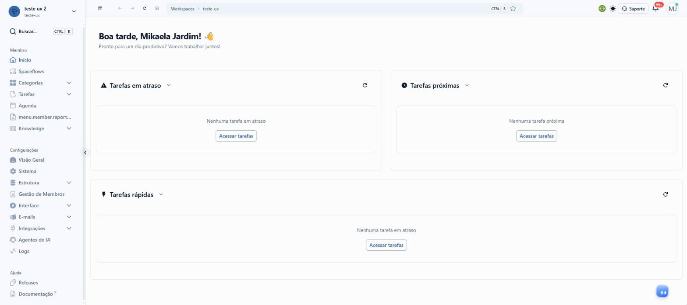
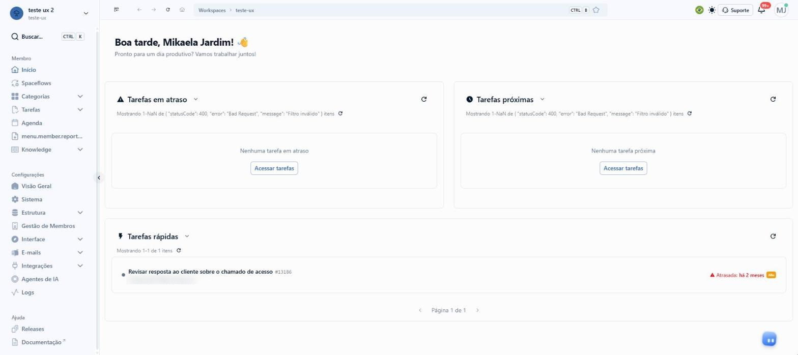

# Briefing: Home

## A demanda, como ela veio

> a home do enspace nao é boa hoje. os usuarios sentem que é muito dura e tem poucos atalhos. é feia, pouco flexível etc.
>
> pode pesquisar quickbooks e hubspot como exemplos. ambos trabalham com widgets pra dar liberdade pro user montar a home.
>
> Monday e clickup são outros excelentes exemplos. pesquise PROFUNDAMENTE. se precisar crie conta de usuario pra explorar.
>
> considere também o enspace atual em develop, a nova tela de dashboard de tarefas etc.
>
> talvez atalho pra criar item e criar tarefa também com botao na home. isso pode ser relevante também. ou no menu lateral. enfim... pesquise e decida como prototipar pro enspace.
>
> /deep-research /product-management:competitive-brief /product-management:synthesize-research

## A tela em jogo

- **Início**, o primeiro item do menu lateral, em `/workspaces/<ws>`. A aba do navegador chama a tela de "Home".
- O botão de criar pedido na demanda pode morar na Home ou no menu lateral. Os 2 entram na proposta.

## O que seria sucesso

Quem abre o workspace vê, na Home que montou, o que precisa fazer hoje e cria uma tarefa ou um item em 1 clique, sem atravessar o menu.

## O que a pesquisa de UX já dizia

Procurei no `enspace-ux-research` (auditoria de UX por persona) antes de desenhar.

- `temas/README.md`: não há tema sobre a Home. Os 6 temas são configurações do sistema, construtor de telas, base de conhecimento, categorias, agenda e plataforma.
- `UX_REPORT.md`: "home", "início" e "tela inicial" só aparecem em 2 fricções vizinhas:
  - **S3-P1 (P2):** a barra do topo usa chaves de tradução como rótulo acessível (`button.home`, `button.back`). O botão da casinha, que leva à Home, não tem nome para o leitor de tela.
  - **S1-F2 (P2):** é sobre a tela inicial da Agenda, não a do workspace.
- O protótipo `menu-lateral` (deste repositório) já propôs um "+" no Início do menu, que cria seção, menu e categoria, e abre item e tarefa como maquete (rodadas 15P a 18). Esta proposta reaproveita a ideia e leva o "+" ao alcance de quem não configura.

**O que isso muda:** não há fricção registrada sobre a Home. O peso da proposta vem da fala dos usuários, trazida pela redatora, e do que o develop mostra abaixo.

## O que o develop faz hoje

Investigado em 11/11/2026, no workspace de exploração, pelo Chrome da usuária.

### A Home

- URL: `https://develop.enspace.io/workspaces/<ws>` (título da aba: "<workspace>/Home").
- De cima para baixo:
  1. Saudação: "Boa tarde, <nome>! 👋" e "Pronto para um dia produtivo? Vamos trabalhar juntos!".
  2. 2 cartões lado a lado: **Tarefas em atraso** e **Tarefas próximas**.
  3. 1 cartão na largura toda: **Tarefas rápidas**.
- Cada cartão tem ícone, título com uma seta para baixo, botão de recarregar, a contagem "Mostrando 1-1 de 1 itens" e a paginação "Página 1 de 1".
- A seta ao lado do título abre um menu com 1 opção só, o próprio título em minúscula ("tarefas em atraso"). Não há outra escolha.
- Cartão vazio: "Nenhuma tarefa em atraso" e o botão "Acessar tarefas".
- Não há como esconder, mover, redimensionar nem acrescentar cartão. A Home é igual para todo membro, e o administrador também não a muda.
- Não há botão de criar na Home, nem atalho para categoria, visualização, formulário ou painel.

### Onde trava

- **O carregamento parece estado vazio.** Nos primeiros segundos os 3 cartões dizem "Nenhuma tarefa em atraso". "Tarefas rápidas" também diz "em atraso". Depois o cartão de Tarefas rápidas troca para a tarefa que existe. Não há esqueleto de carregamento.
- **O erro da API aparece cru na tela.** Em "Tarefas em atraso" e "Tarefas próximas", a contagem mostra `Mostrando 1-NaN de { "statusCode": 400, "error": "Bad Request", "message": "Filtro inválido" } itens`. Abaixo, o cartão diz "Nenhuma tarefa em atraso", que não é verdade: a tarefa atrasada existe e aparece no cartão de baixo.
- **A Home só fala de tarefas.** Quem trabalha com itens (pedidos, contratos, chamados) não vê nada do que é dele.

### Quanto custa criar hoje

| Para | Caminho a partir da Home | Cliques |
|---|---|---|
| Criar tarefa rápida | Tarefas > Rápidas > "+ Nova tarefa" > formulário | 3 até o formulário |
| Criar item | Categorias > <categoria> > Todos > "Criar +" > formulário | 4 até o formulário, e a pessoa precisa saber em qual categoria |
| Criar pela busca (Ctrl+K) | "Digite um comando ou busque..." lista só os menus. "criar" e "nova" respondem "No matching data", em inglês | não dá |

O formulário "Nova tarefa" tem: Nome (obrigatório), Data limite, Descrição (texto rico), Responsável, Colaboradores e Prioridade (Baixa, Normal, Alta, Urgente; Normal marcada).

### O que já existe e serve à Home

- **Painel de tarefas** (Tarefas > Painel, `/tasks/dashboard`), já em develop: números do topo (Abertas agora, Concluídas, Criadas, Vencidas, No prazo, Tempo médio de conclusão), Entrada e saída, Abertas por status, Saúde dos prazos, Prioridade, Pontos, Origem e execução, Atividade, Carga por responsável e a lista de vencidas. O protótipo `painel-de-tarefas` desenhou a grade que se arrasta e redimensiona (`UxGradeDePaineis`) e o botão que mostra e esconde painéis. A Home usa a mesma grade e o mesmo jeito de mexer, para o ENSPACE ter 1 padrão só de painel.
- **Visualizações salvas** das categorias (abas como "Pedidos em aberto", "Urgentes da semana", "Meus itens"): é delas que sai o widget de itens.
- **Formulários** de cada categoria, que aparecem no menu dentro da categoria.
- **Favoritos:** a estrela na trilha do topo, com o atalho Ctrl+B.
- **Agenda**, o sino de notificações e a Knowledge.

### De onde vem o dado de cada widget (código)

Leitura de 2026-11-11, só na develop, pela skill `investigar-codigo`. O código mostra o que está na branch, não o que está no ar. Siglas: **F** = `en-space@develop e3a6cd15a`; **B** = `enlighten-api@develop 5587592e8`. Esta tabela entra nos requisitos.

| Widget | Veredito | Fonte | Dados que se cruzam | O que falta |
|---|---|---|---|---|
| Minhas tarefas | reaproveita | o cartão de hoje lê `c-flow-item-tasks/in-charge` e `tasks` (F `src/components/workspace/WorkspaceTasks.vue:46-47`) | programada: `due_date_lt`/`due_date_gte` agora, `work_status_in=waiting,working` (F `WorkspaceTasks.vue:84-111`); rápida: `status_in=pending,working` (F `:122-126`) | só front: as faixas Hoje e Sem prazo (`due_date_null`), e `blocked` na rápida |
| Tarefas que delegei | rápida: reaproveita; programada: não existe | `tasks` tem `creator`, `assigned_to`, `collaborators`, `status`, `due_date`, `node_execution` (B `plugins/en-tasks/models/tasks.settings.json:40-105`) | `creator` = eu, `assigned_to` diferente de mim e preenchido, `status_in=pending,working,blocked`, `node_execution` vazio (tira o que o Spaceflow criou, a mesma regra do analytics, B `plugins/en-tasks/schemas/tasks.ts:363-364`) | front: filtro novo (a tela Tarefas não tem "criadas por mim", F `src/assets/models/tasks.ts:60-121`). A programada não guarda quem criou nem quem delegou como campo (B `api/c-flow-item-tasks/models/c-flow-item-tasks.settings.json:34-158`); quem delegou fica só como e-mail no `task_log` |
| Agenda | reaproveita | a tela Agenda (F `src/pages/workspaces/[workspace]/schedule/index.vue:160-162`) | tarefas das 2 origens, itens pelo campo de data configurado (`c-schedule-configs`) e eventos do Outlook (F `schedule/index.vue:305-377`) | nada no back |
| Itens de uma visualização / Número | existe o dado, falta rota | `c-model-views` com `model` e `filters` (B `plugins/en-workspaces/models/c-model-views.settings.json:15-63`) | ler a visualização pelo id e chamar `ws/types/{slug}/items` e `/items/count` com os filtros dela | rota que devolva itens ou contagem pelo id da visualização (ou o front monta a query; a conversão de `filters` não foi lida) |
| Saúde dos prazos | tarefas: reaproveita; itens: não existe | `POST /ws/tasks/analytics` devolve `overdue`, `dueSoon`, `onTime`, `late` (B `plugins/en-tasks/schemas/tasks.ts:152-158`), já usado em Tarefas > Painel (F `src/pages/workspaces/[workspace]/tasks/dashboard.vue:36-37`) | filtros `only`, `status`, `assigneeId`, `range`, `_where` (B `schemas/tasks.ts:337-384`) | o item não tem prazo nem SLA próprio: só tarefa |
| Gráfico de um painel | reaproveita | `c-dashboard` e `c-dashboard-panel` (B `api/c-dashboard-panel/models/c-dashboard-panel.settings.json:49-62`) | o front busca os itens e agrega (F `src/domain/dashboard/services/DashboardHttpService.ts:98-105`) | o painel está preso a uma tela (`c_screen`): o widget aponta para o painel dessa tela |
| Categorias | lista: reaproveita; "em aberto": falta rota | `typesLegacy`, já em memória (F `src/components/workspace/WorkspaceCategories.vue:23-30`) | contagem: 1 chamada por categoria a `items/count` | contagem agregada por categoria; definir o que é "em aberto" num item |
| Atalhos e Recentes | reaproveita, só no front | localStorage `en-space-favorites`, até 10 (F `src/composables/useFavorites.ts:3-12`), e `en-space-navigation-history`, até 20 páginas (F `src/composables/useNavigationHistory.ts:13-27`) | o caminho da página | não segue a pessoa entre aparelhos; Recentes guarda página, não "item visto" |
| Comunicado | não existe | a chave `workspace_announcements` existe no locale e nada a usa (F `locales/pt-BR.yml:7757`) | | modelo e rota novos |
| Notas | não existe | `c-item-notes` é nota de item (B `api/c-item-notes/models/c-item-notes.settings.json:15-37`) | | modelo novo |
| Resumo do BENI | existe o dado, falta rota | `getTaskSummary` é ferramenta do agente e do MCP (B `plugins/en-tasks/ai/tools/get-task-summary.ts:14-18`) | contagens por status, prioridade e prazo | rota dedicada |
| Guardar a Home | existe o lugar, falta campo | Home padrão: `group-configs.data` (B `api/group-configs/models/group-configs.settings.json:19`), ao lado de `show_types_on_initial_screen`; Home da pessoa: `group-members.meta` (B `api/group-members/models/group-members.settings.json:67`) | administrador = `group-members.type` `full` ou `owner` (B `group-members.settings.json:36-45`) | campo e rota do layout (busca `home_layout`, `home_widgets`, `user_preferences`: 0 nos 2 repositórios) |

Buscas que provam "não existe" em Tarefas que delegei: `delegad`, `criadas por mim`, `created by me`, `delegated`, `assigned by me`, `delegation_history` e `created_by_me` no front e no back, na develop e na principal, mais `branches` e `historico`: 0 que sirva.

### Preparo por API

Nenhum. Toda a investigação aconteceu pela tela.

## A casca da tela, item por item

Copiada de `https://develop.enspace.io/workspaces/<ws>` em 11/11/2026. A base é a casca do `painel-de-tarefas`, conferida de novo no develop.

**Menu lateral**
- Topo: avatar e nome do workspace, slug embaixo, seta para trocar de workspace.
- "Buscar..." com Ctrl K.
- Membro: Início (ativo), Spaceflows, Categorias (expande), Tarefas (expande: Agendadas, Rápidas, Painel), Agenda, `menu.member.reports.label` (a chave de tradução aparece crua; fica como está, é achado), Knowledge (expande).
- Configurações: Visão Geral, Sistema, Estrutura (expande), Gestão de Membros, Interface (expande), E-mails (expande), Integrações (expande), Agentes de IA, Logs.
- Ajuda: Releases, Documentação (abre fora).
- Botão redondo na borda para recolher.

**Barra do topo**
- Recolher menu, voltar, avançar, recarregar, casinha (Home).
- Trilha: "Workspaces > <slug>", com Ctrl B e a estrela.
- Bandeira do idioma, sol (tema), "Suporte", sino com "99+", avatar com a bolinha verde.

**Achados da casca (ficam como estão):**
- `menu.member.reports.label` no menu, sem tradução.
- "No matching data" em inglês na busca.
