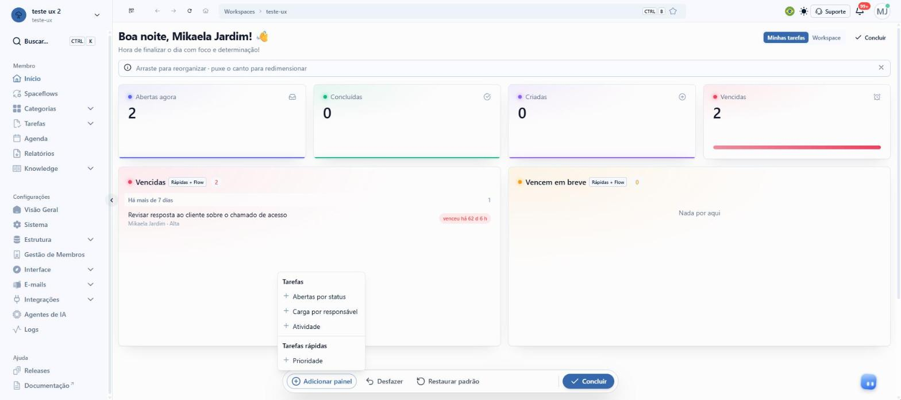
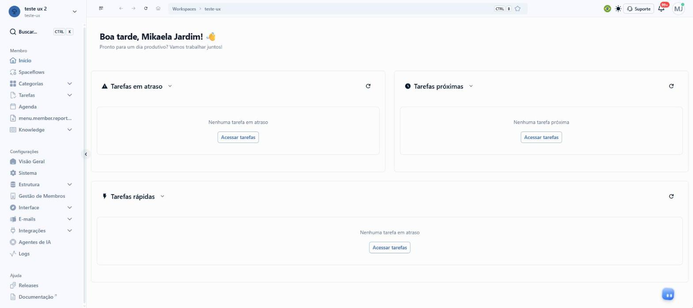
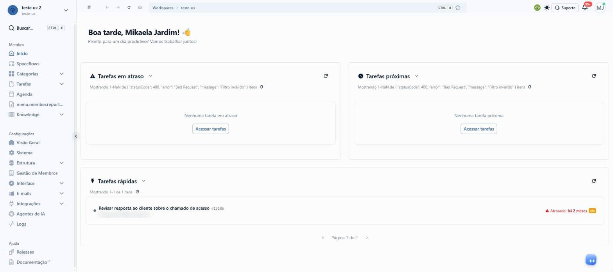

# Briefing: Home

## A demanda, como ela veio

> a home do enspace nao é boa hoje. os usuarios sentem que é muito dura e tem poucos atalhos. é feia, pouco flexível etc.
>
> pode pesquisar quickbooks e hubspot como exemplos. ambos trabalham com widgets pra dar liberdade pro user montar a home.
>
> Monday e clickup são outros excelentes exemplos. pesquise PROFUNDAMENTE. se precisar crie conta de usuario pra explorar.
>
> considere também o enspace atual em develop, a nova tela de dashboard de tarefas etc.
>
> talvez atalho pra criar item e criar tarefa também com botao na home. isso pode ser relevante também. ou no menu lateral. enfim... pesquise e decida como prototipar pro enspace.
>
> /deep-research /product-management:competitive-brief /product-management:synthesize-research

## A tela em jogo

- **Início**, o primeiro item do menu lateral, em `/workspaces/<ws>`. A aba do navegador chama a tela de "Home".
- O botão de criar pedido na demanda pode morar na Home ou no menu lateral. Os 2 entram na proposta.

## O que seria sucesso

Quem abre o workspace vê, na Home que montou, o que precisa fazer hoje e cria uma tarefa ou um item em 1 clique, sem atravessar o menu.

## O que a pesquisa de UX já dizia

Procurei no `enspace-ux-research` (auditoria de UX por persona) antes de desenhar.

- `temas/README.md`: não há tema sobre a Home. Os 6 temas são configurações do sistema, construtor de telas, base de conhecimento, categorias, agenda e plataforma.
- `UX_REPORT.md`: "home", "início" e "tela inicial" só aparecem em 2 fricções vizinhas:
  - **S3-P1 (P2):** a barra do topo usa chaves de tradução como rótulo acessível (`button.home`, `button.back`). O botão da casinha, que leva à Home, não tem nome para o leitor de tela.
  - **S1-F2 (P2):** é sobre a tela inicial da Agenda, não a do workspace.
- O protótipo `menu-lateral` (deste repositório) já propôs um "+" no Início do menu, que cria seção, menu e categoria, e abre item e tarefa como maquete (rodadas 15P a 18). Esta proposta reaproveita a ideia e leva o "+" ao alcance de quem não configura.

**O que isso muda:** não há fricção registrada sobre a Home. O peso da proposta vem da fala dos usuários, trazida pela redatora, e do que o develop mostra abaixo.

## O que o develop faz hoje

### O MVP, widget por widget (rodada 8)

Leitura de 2026-11-24 pela skill `investigar-codigo`. Siglas: **F** = `en-space@develop be2a5d850`; **B** = `enlighten-api@develop b693d8d2b`; **S** = `en-sdk@develop 2dbd22c`. O código mostra a branch, não o que está no ar.

**O item:**

- **Lido no código:** o item guarda quem o criou no campo `user` (B `api/c-items/models/c-items.settings.json:19-22`). A autoria vem de quem está logado na criação (B `plugins/en-types/schemas/items.ts:141`, `plugins/en-types/controllers/items.ts:27`).
- **Lido no código:** a busca de itens já tem o filtro "Meus Itens" (`isOwner`), com o campo `user` igual ao usuário logado (F `src/assets/models/cItems.ts:71-80`; rótulo em `locales/pt-BR.yml:4099-4101`, "Exibe apenas itens dos quais o usuário é o proprietário").
- **Lido no código:** o item não tem campo de responsável nem de prazo. Os campos do modelo são `reference`, `user`, `group`, `status` (`active` ou `inactive`), `type`, `data`, `request_email`, `form_result`, `stage_status`, `last_status_change`, `form`, `mgroups`, `icon`, `ignore_triggers`, `deleted_at`, `last_update`, `counter` e `tag_ids` (B `c-items.settings.json:14-86`). As datas que a pessoa vê ficam em `data`, nos campos que cada categoria cria.
- **Lido no código:** a tela Agenda busca os itens de cada categoria pelo campo de data configurado nela, sem filtro de pessoa (F `src/pages/workspaces/[workspace]/schedule/index.vue:329`), e já desenha o mês (`month-grid`, `:164`).

**A Home, a IA e a disposição:**

- **Lido no código:** a Home de develop monta as lâminas pelo catálogo do Painel de tarefas do SDK (F `src/pages/workspaces/[workspace]/index.vue:112-128`) e guarda a disposição por workspace e pessoa (`useDashboardLayout`, `:130-134`), no navegador (S `packages/ui/src/composables/useDashboardLayout.ts:25`).
- **Lido no código:** a conversa flutuante (F `src/components/ai/AiChatFloat.vue`) é o `EnAiChatsSharedFloat` do SDK, que guarda o agente só por dentro (S `packages/ui/src/components/ai/AiChatsSharedFloat.vue:62`) e não tem prop para abrir com um agente. A página de conversa aceita `?agent=` e `?prompt=` (F `ai/chat/index.vue:23-26`).

| Widget ou recurso | No MVP? | Por quê |
|---|---|---|
| 13 lâminas de tarefas (números, Vencidas, Vencem em breve, status, prioridade, carga, atividade, saúde dos prazos, entrada e saída) | sim | estão no catálogo do Painel de tarefas do SDK, que a Home já usa |
| Minhas tarefas | sim | o cartão `WorkspaceTasks` e as rotas existem ("De onde vem o dado de cada widget") |
| Compromissos do dia | sim | as mesmas fontes da tela Agenda, filtradas para hoje |
| Categorias | sim | `WorkspaceCategories` já mostra nome e descrição |
| Meus itens | sim | o filtro "Meus Itens" da busca de itens |
| Itens criados recentemente | sim | a mesma busca, pela data de criação |
| Agentes de IA | sim | `GET /ai/agents`; o clique abre a página de conversa com `?agent=` |
| Atalhos e Recentes | sim | já ficam no navegador (`useFavorites`, `useNavigationHistory`) |
| "Minhas tarefas · Workspace" só do administrador | sim | só front |
| Home padrão do administrador e selo "Novo" | não | falta o campo do layout no workspace (busca `home_layout`, `home_widgets`, `user_preferences`: 0) |
| Rascunho na conversa do BENI | não | interação nova; a conversa flutuante não recebe agente nem pedido de fora |
| Widget BENI | não | o resumo não tem rota |
| Tarefas que delegei | não | a tarefa agendada não guarda quem delegou |
| Agenda da semana e do mês | não | a tela Agenda já mostra |
| Itens por categoria | não | sem contagem agregada |
| Gráfico de um painel | não | o painel está preso a uma tela |
| Comunicado e Bloco de notas | não | modelo e rota novos |

Na rodada 8 saíram Revisões por IA, Créditos de IA e Falhas dos agentes, a pedido da redatora. As linhas deles na tabela abaixo ficam como registro.

Na rodada 10, o MVP ficou só com Categorias e os widgets de tarefas, a pedido da redatora. As outras linhas "sim" da tabela acima passam para os épicos 2 e 3 dos requisitos (`requisitos/README.md`), que também usam só o que develop já tem.

### A IA do workspace e a categoria (rodada 7)

Leitura de 2026-11-24 pela skill `investigar-codigo`. Siglas: **F** = `en-space@develop be2a5d850`; **B** = `enlighten-api@develop 8669875cf`. O código mostra a branch, não o que está no ar.

| Widget ou dado | O que o código tem | Fonte |
|---|---|---|
| Categorias: descrição | a categoria (ItemType) tem `description`, e o card de categorias de develop já mostra | F `src/components/workspace/WorkspaceCategories.vue:28,103` |
| Categorias: "em aberto" | o item não tem estado de aberto ou fechado; a contagem da rodada 5 não tinha base | sem campo; ver "De onde vem o dado de cada widget" |
| Agentes de IA | o modelo `ai_agent` e a rota `GET /ai/agents` (membro do workspace), que junta os agentes do sistema e os do workspace; cada agente tem `beniTheme` (a cor do BENI) e nenhum campo limita quem usa | B `plugins/en-ai/models/ai_agent.settings.json:13-90`, `plugins/en-ai/config/routes.json:274-287`, `resolver.ts:347` |
| Conversa com um agente | a página de conversa aceita `?agent=` além de `?prompt=` | F `src/pages/workspaces/[workspace]/ai/chat/index.vue:23-26` |
| Revisões por IA | `GET /ai/review/sessions` e `GET /ai/review/stats`; a sessão tem o status `pending`, `in_progress`, `completed` ou `failed` | B `plugins/en-ai/config/routes.json:62-116`, `ai_review_session.settings.json:54-55` |
| Créditos de IA | `GET /ws/financial/wallet` e `GET /ws/financial/wallets/:id/transactions` (membro do workspace) | B `plugins/en-financial/config/routes.json:190-195` |
| Falhas dos agentes | o nó `ai_agent` do Spaceflow; `GET /workflows/nodes` lista as execuções de nó e `POST /workflows/nodes/:id/retry` repete a que falhou | B `plugins/en-workflows/docs/pt-BR/nodes/ai_agent.md` |
| Conversas recentes | `GET /ai/chats` devolve as conversas da própria pessoa | B `plugins/en-ai/controllers/chat.ts:167-179` |
| Propostas do BENI | só a prévia local do editor; não grava e não tem rota | sem rota |
| Uso de IA por pessoa | só no painel admin (en-admin) | sem rota no workspace |

Inconclusivo: se `GET /workflows/nodes` filtra pelo tipo do nó. Sem esse filtro, o widget de falhas traz todas as execuções com erro e separa as de agente no front.

### Spaceflow na Home (rodada 9)

Leitura de 2026-11-24 pela skill `investigar-codigo`. Siglas: **F** = `en-space@develop be2a5d850`; **B** = `enlighten-api@develop b693d8d2b`; **S** = `en-sdk@develop 2dbd22c`. O código mostra a branch, não o que está no ar.

| Widget | Veredito | Fonte | O que falta |
|---|---|---|---|
| Execuções dos fluxos | reaproveita | `GET /workflows/metrics` conta `workflow_executions` por `status` do workspace, com `startDate` e `endDate` sobre `created_at` (B `plugins/en-workflows/services/workflows/metrics.ts:12-34`, rota em `routes/workflows/get.metrics.ts`); o SDK já chama (S `packages/core/src/resources/workflows/index.ts:204`, `packages/vue/src/query/resources/workflows.ts:212`) | só front |
| Falhas nos fluxos | reaproveita | `workflow_executions.status` tem `working`, `completed`, `error`, `canceled` (B `plugins/en-workflows/models/workflow-executions.settings.json:42-46`) e o item (`:62`); a lista de execuções aceita os campos do modelo como filtro, o status entre eles (B `routes/workflows/executions/get.ts`, `schemas/workflow-executions.ts:43,74`); Repetir é `PUT /workflows/nodes/:id/retry`, o mesmo da tela de execução (F `src/composables/entity/useNodeExecutions.ts:17`; a tela de execução pede confirmação antes ("Deseja executar novamente? Tarefas, processos e sub-fluxos podem ser criados novamente.", `executions/[execution].vue:47`)) | o passo que falhou e a mensagem vêm da execução do passo: 1 chamada por execução, ou o front lê a lista de passos da execução aberta |
| Fluxos em andamento | reaproveita | a mesma lista, com `status=working`, ordenada por início; o passo que espera é a execução do passo com `status` `working` (B `plugins/en-workflows/models/node-executions.settings.json:30-34`) | o mesmo da linha acima; "Parado" (mais de 2 dias) é regra de front |
| Só falhas de agente | não existe | o tipo do passo fica no JSON `node` da execução do passo (B `node-executions.settings.json:40-42`), sem coluna para filtrar | rota ou coluna nova. Por isso o widget mostra a falha de qualquer passo |

- **Permissão:** a tela de fluxos pede a permissão `workflows` (F `src/composables/usePermissions.ts:87`). Os 3 widgets seguem a mesma regra.
- **Abrir a execução:** a tela já existe (F `src/pages/workspaces/[workspace]/workflows/[workflow]/executions/[execution].vue`).

### O BENI e o alternador de escopo (rodada 6)

Leitura de 2026-11-24 pela skill `investigar-codigo`, em `en-space@develop be2a5d850`. O código mostra a branch, não o que está no ar.

- **Lido no código:** o alternador "Minhas tarefas · Workspace" da Home não tem trava de papel: o `UTabs` do escopo é desenhado para todo membro (`src/pages/workspaces/[workspace]/index.vue:171`). Mostrar só ao administrador é proposta da rodada 6.
- **Lido no código:** a conversa flutuante do BENI já existe. O `AiChatFloat` (`src/components/ai/AiChatFloat.vue`) fica no fim do cabeçalho do workspace (`src/components/workspace/WorkspaceHeaderEnd.vue:24`) e tem a versão em tela cheia, a página `ai/chat` (`src/pages/workspaces/[workspace]/ai/chat/index.vue`).
- **Lido no código:** a página aceita `?prompt=` para abrir já com um pedido, usado hoje pelo "Ask BENI AI" do construtor de relatórios (`ai/chat/index.vue:23-26`), e pede a permissão `ai.chat` (`:21`). Os créditos de IA passam pelo `useAiWalletGate` (`:28`).
- Para o protótipo: "Criar ▸ Pedir ao BENI" e o botão do widget BENI abrem essa mesma conversa. O caminho existe; o que é novo é o rascunho de item e de tarefa dentro dela.

### A Home em 24/11/2026 (rodada 5)

A redatora avisou que os elementos do Painel de tarefas foram levados para a Home. Lido no código (en-space@develop be2a5d850 e en-sdk@develop 58a81c6, só leitura):

- a Home monta uma lista de lâminas, cada uma com id, tamanho na grade e se aparece de saída: `src/utils/workspaceHome.ts`, `homeEntries`;
- de saída aparecem:
  - 4 cartões de número, cada um com 3 colunas por 4 linhas: abertas, concluídas, criadas e vencidas (`kpi-open`, `kpi-completed`, `kpi-created`, `kpi-overdue`);
  - a fila de prazos (`tasks-due`, a lâmina `dueList` do SDK: Vencidas e Vencem em breve);
  - os cartões de categoria, na largura toda (12 por 8);
  - as comparações (o bloco `WorkspaceComparisons` que já existia);
- ficam escondidas, para ligar: status, prioridade (o recorte por prioridade do `breakdown`), carga por responsável e atividade;
- um alternador "minhas" ou "workspace" decide de quem são as tarefas, e fica guardado no navegador;
- as lâminas vêm do catálogo do Painel de tarefas do SDK (`components/tasks/insights/catalog.ts`): cartões de número (abertas, concluídas, criadas, vencidas, vencem em breve, no prazo, tempo de ciclo), "Entrada e saída", "Abertas por status", "Saúde dos prazos", "Recortes", pontos, origem, atividade, "Carga por responsável", "Tempo por etapa" e "Fila de prazos";
- os status de tarefa são 4: `pending`, `working`, `completed` e `blocked`.

Visto na tela em 24/11/2026, no workspace de exploração, pelo Chrome da usuária:

- no topo, à direita: "Minhas tarefas" e "Workspace" (abas) e o botão "Personalizar";
- abaixo, 4 cartões de número ("Abertas agora", "Concluídas", "Criadas", "Vencidas") e, lado a lado, "Vencidas" e "Vencem em breve", cada lista com o selo "Rápidas + Flow" e as faixas ("Há mais de 7 dias");
- "Personalizar" põe a Home em edição: o aviso "Arraste para reorganizar · puxe o canto para redimensionar" e, embaixo, a barra "Adicionar painel", "Desfazer", "Restaurar padrão" e "Concluir";
- "Adicionar painel" abre um menu curto, sem busca, em 2 grupos: Tarefas ("Abertas por status", "Carga por responsável", "Atividade") e Tarefas rápidas ("Prioridade"). As lâminas que já estão na Home não aparecem nele;
- os cartões de categoria não apareceram neste workspace, que não liga `show_types_on_initial_screen`.

**O que isso muda na proposta:** os widgets de tarefa do protótipo passam a ser essas lâminas, com os nomes e as faixas do SDK, e o alternador fica no topo da Home, como em develop.

### A Home em 11/11/2026

Investigado no workspace de exploração, pelo Chrome da usuária.

- URL: `https://develop.enspace.io/workspaces/<ws>` (título da aba: "<workspace>/Home").
- De cima para baixo:
  1. Saudação: "Boa tarde, <nome>! 👋" e "Pronto para um dia produtivo? Vamos trabalhar juntos!".
  2. 2 cartões lado a lado: **Tarefas em atraso** e **Tarefas próximas**.
  3. 1 cartão na largura toda: **Tarefas rápidas**.
- Cada cartão tem ícone, título com uma seta para baixo, botão de recarregar, a contagem "Mostrando 1-1 de 1 itens" e a paginação "Página 1 de 1".
- A seta ao lado do título abre um menu com 1 opção só, o próprio título em minúscula ("tarefas em atraso"). Não há outra escolha.
- Cartão vazio: "Nenhuma tarefa em atraso" e o botão "Acessar tarefas".
- Não há como esconder, mover, redimensionar nem acrescentar cartão. A Home é igual para todo membro, e o administrador também não a muda.
- Não há botão de criar na Home, nem atalho para categoria, visualização, formulário ou painel.

### Onde trava

- **O carregamento parece estado vazio.** Nos primeiros segundos os 3 cartões dizem "Nenhuma tarefa em atraso". "Tarefas rápidas" também diz "em atraso". Depois o cartão de Tarefas rápidas troca para a tarefa que existe. Não há esqueleto de carregamento.
- **O erro da API aparece cru na tela.** Em "Tarefas em atraso" e "Tarefas próximas", a contagem mostra `Mostrando 1-NaN de { "statusCode": 400, "error": "Bad Request", "message": "Filtro inválido" } itens`. Abaixo, o cartão diz "Nenhuma tarefa em atraso", que não é verdade: a tarefa atrasada existe e aparece no cartão de baixo.
- **A Home só fala de tarefas.** Quem trabalha com itens (pedidos, contratos, chamados) não vê nada do que é dele.

### Quanto custa criar hoje

| Para | Caminho a partir da Home | Cliques |
|---|---|---|
| Criar tarefa rápida | Tarefas > Rápidas > "+ Nova tarefa" > formulário | 3 até o formulário |
| Criar item | Categorias > <categoria> > Todos > "Criar +" > formulário | 4 até o formulário, e a pessoa precisa saber em qual categoria |
| Criar pela busca (Ctrl+K) | "Digite um comando ou busque..." lista só os menus. "criar" e "nova" respondem "No matching data", em inglês | não dá |

O formulário "Nova tarefa" tem: Nome (obrigatório), Data limite, Descrição (texto rico), Responsável, Colaboradores e Prioridade (Baixa, Normal, Alta, Urgente; Normal marcada).

### O que já existe e serve à Home

- **Painel de tarefas** (Tarefas > Painel, `/tasks/dashboard`), já em develop: números do topo (Abertas agora, Concluídas, Criadas, Vencidas, No prazo, Tempo médio de conclusão), Entrada e saída, Abertas por status, Saúde dos prazos, Prioridade, Pontos, Origem e execução, Atividade, Carga por responsável e a lista de vencidas. O protótipo `painel-de-tarefas` desenhou a grade que se arrasta e redimensiona (`UxGradeDePaineis`) e o botão que mostra e esconde painéis. A Home usa a mesma grade e o mesmo jeito de mexer, para o ENSPACE ter 1 padrão só de painel.
- **Visualizações salvas** das categorias (abas como "Pedidos em aberto", "Urgentes da semana", "Meus itens"): é delas que sai o widget de itens.
- **Formulários** de cada categoria, que aparecem no menu dentro da categoria.
- **Favoritos:** a estrela na trilha do topo, com o atalho Ctrl+B.
- **Agenda**, o sino de notificações e a Knowledge.

### De onde vem o dado de cada widget (código)

Leitura de 2026-11-11, só na develop, pela skill `investigar-codigo`. O código mostra o que está na branch, não o que está no ar. Siglas: **F** = `en-space@develop e3a6cd15a`; **B** = `enlighten-api@develop 5587592e8`. Esta tabela entra nos requisitos.

| Widget | Veredito | Fonte | Dados que se cruzam | O que falta |
|---|---|---|---|---|
| Minhas tarefas | reaproveita | o cartão de hoje lê `c-flow-item-tasks/in-charge` e `tasks` (F `src/components/workspace/WorkspaceTasks.vue:46-47`) | programada: `due_date_lt`/`due_date_gte` agora, `work_status_in=waiting,working` (F `WorkspaceTasks.vue:84-111`); rápida: `status_in=pending,working` (F `:122-126`) | só front: as faixas Hoje e Sem prazo (`due_date_null`), e `blocked` na rápida |
| Tarefas que delegei | rápida: reaproveita; programada: não existe | `tasks` tem `creator`, `assigned_to`, `collaborators`, `status`, `due_date`, `node_execution` (B `plugins/en-tasks/models/tasks.settings.json:40-105`) | `creator` = eu, `assigned_to` diferente de mim e preenchido, `status_in=pending,working,blocked`, `node_execution` vazio (tira o que o Spaceflow criou, a mesma regra do analytics, B `plugins/en-tasks/schemas/tasks.ts:363-364`) | front: filtro novo (a tela Tarefas não tem "criadas por mim", F `src/assets/models/tasks.ts:60-121`). A programada não guarda quem criou nem quem delegou como campo (B `api/c-flow-item-tasks/models/c-flow-item-tasks.settings.json:34-158`); quem delegou fica só como e-mail no `task_log` |
| Agenda | reaproveita | a tela Agenda (F `src/pages/workspaces/[workspace]/schedule/index.vue:160-162`) | tarefas das 2 origens, itens pelo campo de data configurado (`c-schedule-configs`) e eventos do Outlook (F `schedule/index.vue:305-377`) | nada no back |
| Itens de uma visualização / Número | existe o dado, falta rota | `c-model-views` com `model` e `filters` (B `plugins/en-workspaces/models/c-model-views.settings.json:15-63`) | ler a visualização pelo id e chamar `ws/types/{slug}/items` e `/items/count` com os filtros dela | rota que devolva itens ou contagem pelo id da visualização (ou o front monta a query; a conversão de `filters` não foi lida) |
| Saúde dos prazos | tarefas: reaproveita; itens: não existe | `POST /ws/tasks/analytics` devolve `overdue`, `dueSoon`, `onTime`, `late` (B `plugins/en-tasks/schemas/tasks.ts:152-158`), já usado em Tarefas > Painel (F `src/pages/workspaces/[workspace]/tasks/dashboard.vue:36-37`) | filtros `only`, `status`, `assigneeId`, `range`, `_where` (B `schemas/tasks.ts:337-384`) | o item não tem prazo nem SLA próprio: só tarefa |
| Gráfico de um painel | reaproveita | `c-dashboard` e `c-dashboard-panel` (B `api/c-dashboard-panel/models/c-dashboard-panel.settings.json:49-62`) | o front busca os itens e agrega (F `src/domain/dashboard/services/DashboardHttpService.ts:98-105`) | o painel está preso a uma tela (`c_screen`): o widget aponta para o painel dessa tela |
| Categorias | lista: reaproveita; "em aberto": falta rota | `typesLegacy`, já em memória (F `src/components/workspace/WorkspaceCategories.vue:23-30`) | contagem: 1 chamada por categoria a `items/count` | contagem agregada por categoria; definir o que é "em aberto" num item |
| Atalhos e Recentes | reaproveita, só no front | localStorage `en-space-favorites`, até 10 (F `src/composables/useFavorites.ts:3-12`), e `en-space-navigation-history`, até 20 páginas (F `src/composables/useNavigationHistory.ts:13-27`) | o caminho da página | não segue a pessoa entre aparelhos; Recentes guarda página, não "item visto" |
| E-mail (rodada 11) | reaproveita o épico 1 do comunicacao-no-workspace | a aba Mensagens da central E-mails, que lista os e-mails dos itens a todo membro, com o filtro "Enviado por" | "Enviado por" = a pessoa, os 5 mais recentes; "Novo e-mail" abre o compositor sem item | nada além do épico de comunicação; o e-mail sem item fica só no Outlook |
| WhatsApp e SMS (rodada 11) | só front | o número digitado; os links `wa.me` e `sms:` e o painel "Enviar SMS" do comunicacao-no-workspace | | nada no back: o ENSPACE não envia nem registra |
| Comunicado | não existe | a chave `workspace_announcements` existe no locale e nada a usa (F `locales/pt-BR.yml:7757`) | | modelo e rota novos |
| Notas | não existe | `c-item-notes` é nota de item (B `api/c-item-notes/models/c-item-notes.settings.json:15-37`) | | modelo novo |
| Resumo do BENI | existe o dado, falta rota | `getTaskSummary` é ferramenta do agente e do MCP (B `plugins/en-tasks/ai/tools/get-task-summary.ts:14-18`) | contagens por status, prioridade e prazo | rota dedicada |
| Guardar a Home | existe o lugar, falta campo | Home padrão: `group-configs.data` (B `api/group-configs/models/group-configs.settings.json:19`), ao lado de `show_types_on_initial_screen`; Home da pessoa: `group-members.meta` (B `api/group-members/models/group-members.settings.json:67`) | administrador = `group-members.type` `full` ou `owner` (B `group-members.settings.json:36-45`) | campo e rota do layout (busca `home_layout`, `home_widgets`, `user_preferences`: 0 nos 2 repositórios) |

Buscas que provam "não existe" em Tarefas que delegei: `delegad`, `criadas por mim`, `created by me`, `delegated`, `assigned by me`, `delegation_history` e `created_by_me` no front e no back, na develop e na principal, mais `branches` e `historico`: 0 que sirva.

### Preparo por API

Nenhum. Toda a investigação aconteceu pela tela.

## A casca da tela, item por item

Copiada de `https://develop.enspace.io/workspaces/<ws>` em 11/11/2026. A base é a casca do `painel-de-tarefas`, conferida de novo no develop.

**Menu lateral**
- Topo: avatar e nome do workspace, slug embaixo, seta para trocar de workspace.
- "Buscar..." com Ctrl K.
- Membro: Início (ativo), Spaceflows, Categorias (expande), Tarefas (expande: Agendadas, Rápidas, Painel), Agenda, `menu.member.reports.label` (a chave de tradução aparece crua; fica como está, é achado), Knowledge (expande).
- Configurações: Visão Geral, Sistema, Estrutura (expande), Gestão de Membros, Interface (expande), E-mails (expande), Integrações (expande), Agentes de IA, Logs.
- Ajuda: Releases, Documentação (abre fora).
- Botão redondo na borda para recolher.

**Barra do topo**
- Recolher menu, voltar, avançar, recarregar, casinha (Home).
- Trilha: "Workspaces > <slug>", com Ctrl B e a estrela.
- Bandeira do idioma, sol (tema), "Suporte", sino com "99+", avatar com a bolinha verde.

**Achados da casca (ficam como estão):**
- `menu.member.reports.label` no menu, sem tradução.
- "No matching data" em inglês na busca.
