# Briefing: Exportações no menu (hoje "Meus Relatórios")

## 1. A demanda, como veio

> ao extrair um relatorio no enspace, aparece uma notificaçao dizendo que é so ir pra tela de my reports
> pra ver o relatorio e baixar la. a notificçao tem um link pra tela e é só clicar. isso é ruim. essa tela
> deveria ser fixa como menu nativo na lateral esquerda. prototipe isso. veja como acontece no enspace, qual
> a jornada. pode ir na tela de tarefas rapidas e extrair um relatorio ali. é um caminho possível. se ele
> baixar direto sem abrir a tela myreports, aí voce baixa um relatorio numa tela nativa de itens.
>
> veja como é em outros produtos, como normalmente se chama essa tela, se podemos deixar ela mais bonita
> (adequando ao novo padrao do enspace, nao inventando algo sem consistencia). veja como sao as telas mais
> novas do enspace pra imaginar como poderia melhorar essa de relatorios. colunas a mais? informações a
> mais? qual aparencia? etc.
>
> mudar pro novo tipo de tabela (que voce ve na nova tela de itens nativa) ja é algo muito importante. e
> poder clicar ali e abrir uma sidebar com os dados estruturados e um botao de download nessa sidebar
> talvez... pense e prototipe
>
> pesquise como outros produtos fazem. traga sugestao desenhada.

## 2. Tela e jornada em jogo

- **Tela:** `Meus Relatórios`, rota `/workspaces/<ws>/myReports`.
- **Jornada:** extrair relatório numa tabela (Tarefas Rápidas ou tabela nova de itens) e chegar ao arquivo.

## 3. O que seria sucesso

Quem extrai um relatório baixa o arquivo sem caçar a tela: o aviso tem o botão de baixar, e a tela está
sempre no menu.

## O que a pesquisa de UX já dizia

Procurei no `enspace-ux-research` (`temas/README.md`, as 6 pastas de tema e o `UX_REPORT.md`) por
"relatório", "report", "exporta", "my reports", "notificação" e "sino". **Nada sobre exportar ou sobre
esta tela.** A única menção vizinha é do tema `construtor-de-telas`: a barra de ações da tela de lista tem
"exportar, colunas, lixeira, contador".

Neste repositório, o protótipo `menu-lateral` (rodada 13 do `DECISOES.md`) já tinha posto
**"Meus relatórios"** como tela nova do menu, na seção `Análise`, com selo "Em breve". Esta demanda
confirma a ideia por outro caminho.

## Fase 2: o develop hoje

Workspace de exploração, em 14/10/2026. Tudo pela tela; nenhum dado preparado por API.

### A jornada, em passos

**Pelas Tarefas Rápidas** (`/workspaces/teste-ux/tasks/quick`):

1. Na barra da lista, clicar no ícone de arquivo (tooltip "Extrair Relatório").
   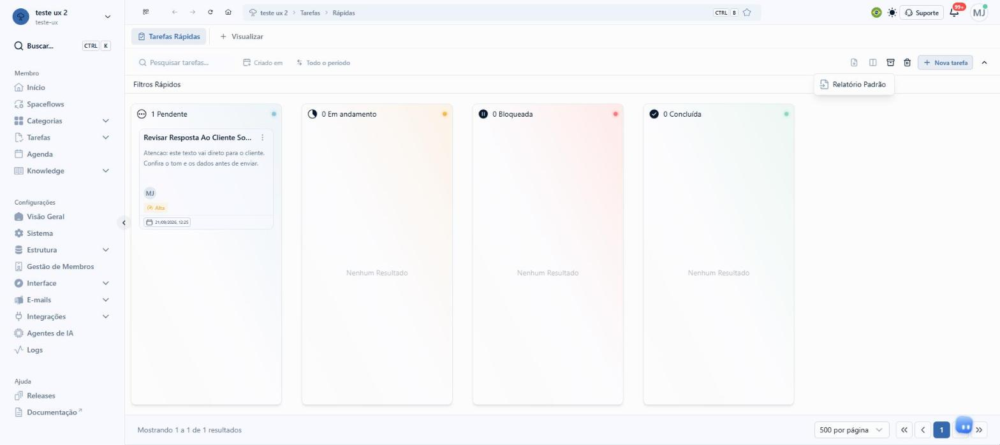
2. Escolher a única opção do menu, **Relatório Padrão**.
3. Abre o modal **Formato de extração**, com 3 botões: Excel, CSV, DBF.
   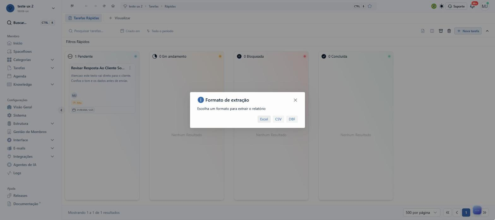
4. Escolher o formato. Aparece um aviso verde no topo: "O relatório está sendo processado e pode ser
   acompanhado acessando **Meus Relatórios Emitidos**. Ao término do processamento, você será notificado
   por e-mail."
   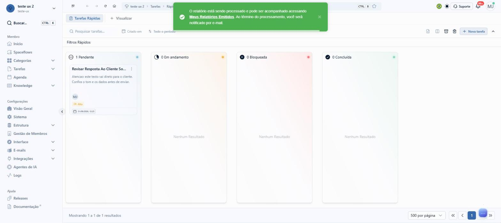
5. O aviso some em cerca de 5 s. 2 tentativas de clicar no link pela extensão chegaram tarde: o aviso já
   tinha sumido.
   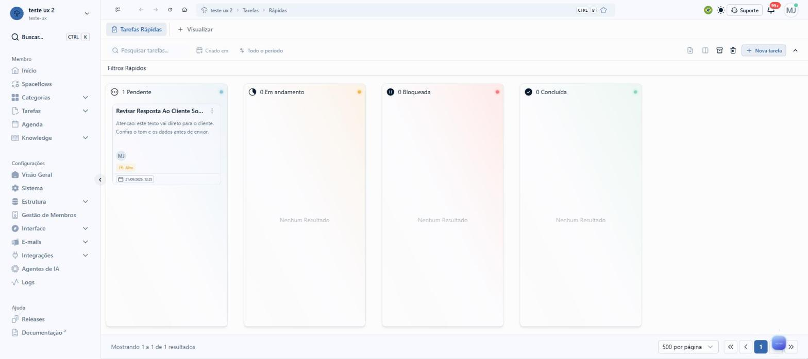
6. Quando o clique chega a tempo, o link **abre outra aba** (`href` absoluto para `/myReports`). O app
   inteiro carrega de novo nessa aba.
7. O sino não recebe aviso de relatório pronto. Os 20 avisos do sino eram de tarefa. O aviso de pronto vai
   só por e-mail.
8. A tela não está no menu lateral, nem no menu da conta. Sem o link, só se chega digitando a URL.

**Pela tabela nova de itens** (`/workspaces/teste-ux/types/leve`): o mesmo caminho, o mesmo menu, o mesmo
modal e o mesmo aviso. Nenhuma das 2 origens baixa direto: as 2 passam por `/myReports`.

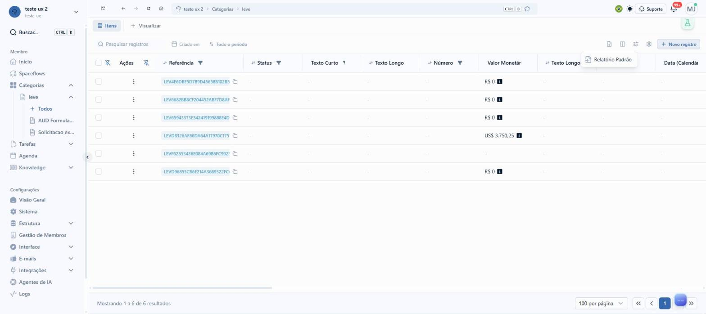
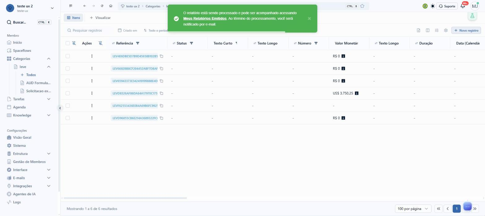

### A tela `/myReports`

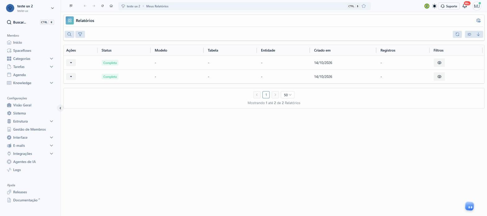

- **Componente:** a tabela antiga (a mesma das telas de configuração), não a tabela nova.
- **Cabeçalho:** ícone de grade, título "Relatórios", engrenagem à direita.
- **Barra:** botões de busca e de filtro; atualizar e ordenação "ID ↓" à direita.
- **Colunas:** Ações, Status, Modelo, Tabela, Entidade, Criado em, Registros, Filtros.
- **Ações** (botão com seta): Deletar, Download, Ver modelo (desabilitado no relatório padrão).
  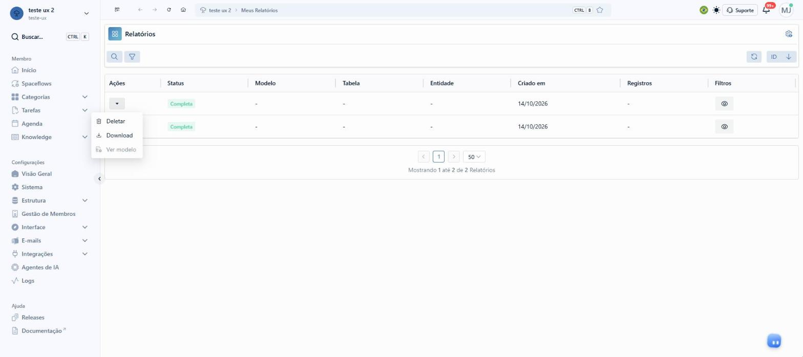
- **Filtros** (olho): modal com 2 abas. "Visualização Personalizada" mostra `Sort | Created_at:DESC`;
  "Visualização Padrão" mostra o JSON cru `{ "_sort": "created_at:DESC" }`.
  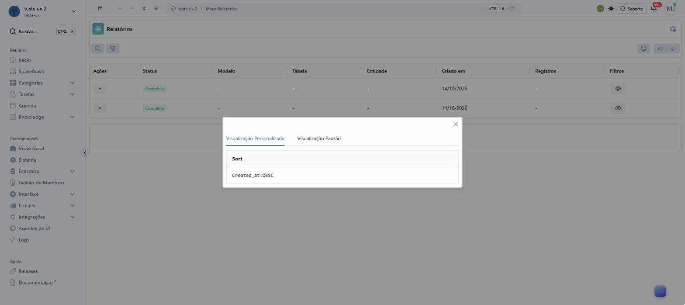
  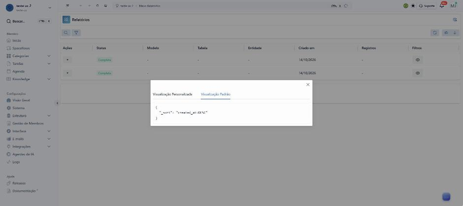
- **Rodapé:** paginação com 50 por página e "Mostrando 1 até 4 de 4 Relatórios".
- **Download:** baixa na hora, com o nome `default_1vo8sbnlud.xlsx`.

### O que a API guarda e a tela não mostra

Resposta de `GET /c-report-requests?__relations=processed_report,report&_sort=id:desc&_limit=50`, lida na
rede da própria tela:

| Campo | Exemplo | Na tela de hoje |
|---|---|---|
| `data.unique_key` | `tasks`, `c_items` | não aparece (Tabela e Entidade ficam "-") |
| `data.type`, `data.form` | `108`, `3235` | não aparece |
| `extraction_format` | `xlsx` | não aparece |
| `filters` | `{ "_sort": "created_at:DESC" }` | só no modal, em JSON |
| `status` | `complete` | "Completa" |
| `created_at`, `updated_at` | 18:20:03 e 18:20:05 | só a data, sem hora |
| `processed_report.size` | `7.31` (KB) | não aparece |
| `processed_report.name` | `default_1vo8sbnlud.xlsx` | só no arquivo baixado |
| `report` | `null` no Relatório Padrão | "-" na coluna Modelo |

A API **não** guarda quantos registros o arquivo tem (Registros fica "-"), o nome da visualização de
origem, as colunas exportadas nem quando o arquivo foi baixado. O protótipo precisa disso e marca como
acréscimo no `mocks.ts` (bloco `proto`).

### Onde trava

| # | Achado | Prova |
|---|---|---|
| 1 | A tela não está no menu. O único caminho é o link do aviso | 05 |
| 2 | O aviso some em cerca de 5 s e leva o link junto | 03, 04 |
| 3 | O link abre outra aba e recarrega o app inteiro | rede da sessão |
| 4 | O aviso de pronto só vai por e-mail. O sino não avisa | sino aberto, sem aviso de relatório |
| 5 | 4 relatórios de 2 origens e 2 formatos aparecem iguais: 5 de 8 colunas com "-" e data sem hora | 11 |
| 6 | 4 nomes para a mesma tela: "Meus Relatórios Emitidos" (aviso), "Meus Relatórios" (trilha), "Relatórios" (título), "My Reports" (aba do navegador) | 03, 05 |
| 7 | Filtros em JSON cru e com a chave técnica `Sort` | 07, 08 |
| 8 | Baixar exige abrir o menu da linha. O menu põe "Deletar" em primeiro, acima de "Download" | 06 |
| 9 | O arquivo baixa com nome sorteado (`default_1vo8sbnlud.xlsx`) | Downloads |
| 10 | Tabela antiga, fora do padrão das telas novas | 05 contra 09 |

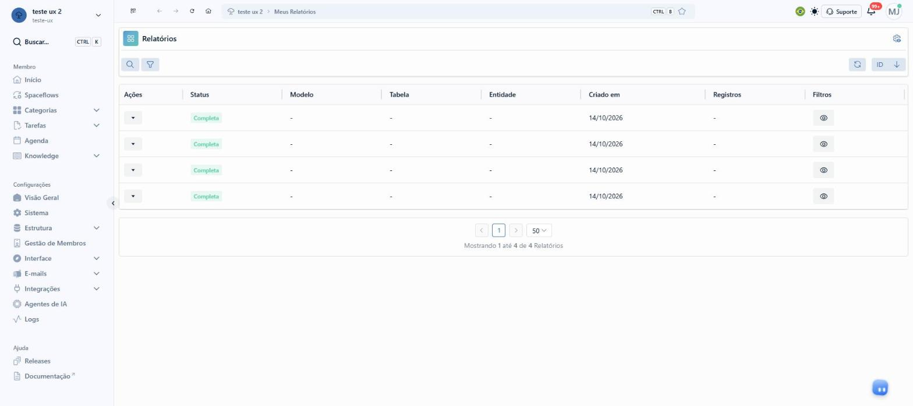

### O que já existe e funciona

- A extração assíncrona: o arquivo fica guardado e baixa de novo quantas vezes for preciso.
- O pedido guarda origem, formato, filtros, ordenação, status, horários e tamanho. Mostrar esse dado não
  pede back-end novo; só o número de registros, a visualização e as colunas pedem.
- A tabela nova de itens (`EnTable`), com a barra de busca e período e a faixa "Filtros Rápidos".
- O painel de visualização rápida do item, que abre à direita sobre a tabela.
  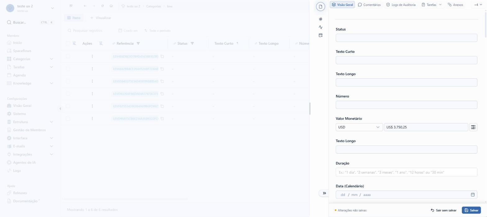

### Fora do assunto, visto de passagem

- O painel do item abriu com "Alterações não salvas" sem nenhuma edição; fechar a aba pediu confirmação.
- Abrir `/myReports` direto pela barra de endereço levou à tela de login; o botão "Acessar plataforma"
  voltou sem senha.

## A casca da tela, item por item

Copiada de `/myReports` e `/types/leve` em 14/10/2026.

| Parte | Como está no develop |
|---|---|
| Topo do menu | Avatar do workspace, nome, slug e chevron |
| Busca | "Buscar..." com `CTRL K` |
| Membro | Início, Spaceflows, Categorias (chevron), Tarefas (chevron), Agenda, Knowledge (chevron) |
| Configurações | Visão Geral, Sistema, Estrutura (chevron), Gestão de Membros, Interface (chevron), E-mails (chevron), Integrações (chevron), Agentes de IA, Logs |
| Ajuda | Releases, Documentação (seta de link externo) |
| Barra do topo | Recolher menu, voltar, avançar, recarregar, início, trilha com `CTRL B` e estrela, bandeira, tema, Suporte, sino com "99+", avatar |
| Tabela nova de itens | Aba "Itens" e "+ Visualizar"; busca "Pesquisar registros", "Criado em", "Todo o período"; ícones Extrair Relatório, colunas, filtros, engrenagem; "+ Novo registro"; rodapé "Mostrando 1 a 6 de 6 resultados" e "100 por página" |

Diferença desde a cópia do `painel-de-tarefas` (30/09/2026): **Integrações** ganhou chevron, e
Credenciais não aparece no menu deste workspace.
