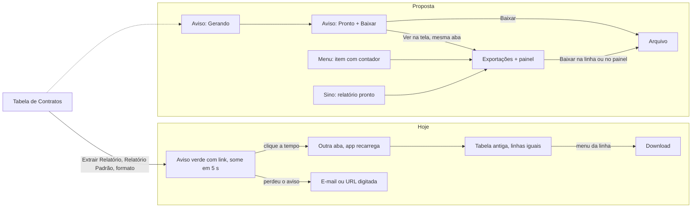

# Decisões: Exportações no menu

## Rodada 1 · 2026-10-14

- **Pedido (literal):** a demanda inteira está no `BRIEFING.md`, seção 1.
- **Fronteira:** muda o menu lateral (1 item novo), o aviso depois de escolher o formato, o sino (aviso de
  pronto) e a tela `/myReports` inteira. Não muda a tabela de itens, o ícone "Extrair Relatório", o menu
  "Relatório Padrão" nem o modal "Formato de extração".

### O que a proposta faz

1. **A tela vira destino nativo do menu**, na seção Membro, entre Agenda e Knowledge.
   - O item mostra o estado: ícone girando enquanto há relatório na fila ou gerando, e um número com os
     prontos que a pessoa ainda não abriu. Com o menu recolhido, um ponto no ícone.
   - Ao abrir a tela, o número zera.
2. **O aviso acompanha a geração** em vez de sumir com o link.
   - Começa como "Gerando o relatório de Contratos", com o caminho para a tela.
   - Termina como "Relatório pronto", com o número de registros, o botão **Baixar** e o caminho para a tela.
   - O caminho abre na mesma aba. Hoje abre outra aba e recarrega o app.
3. **O sino guarda o pronto e o falhou.** Quem fechou o aviso acha no sino; o clique abre a tela com o
   painel do relatório.
4. **A tela passa para a tabela nova**, com a anatomia da tabela nova de itens.
   - Aba, busca, período "Criado em", filtros de Status, Origem e Formato, colunas, e a faixa "Filtros
     Rápidos" (Todos, Gerando, Prontos, Falharam, Não baixados), a mesma das Tarefas Rápidas.
   - Colunas: Relatório (origem e visualização), Status, Modelo, Formato, Registros, Filtros, Tamanho,
     Criado em (com hora). Relatório, Status e Criado em não se escondem.
   - **Baixar na própria linha**, sem abrir menu. No relatório que falhou, **Tentar de novo**.
   - Ponto azul ao lado do nome = pronto e nunca baixado.
   - Seleção em massa: baixar (vira .zip) e excluir, com Desfazer.
5. **Clique na linha abre o painel de detalhes**, à direita, com a lista atrás.
   - Topo: status, nome do arquivo e o botão **Baixar XLSX · 61 KB**, mais Extrair de novo e Mais ações.
   - Resumo: origem (link para a tela de origem), visualização, modelo, formato, registros, tamanho, pedido
     em, pronto em (com o tempo que levou), quantas vezes baixou.
   - Filtros aplicados em frase ("Status é Vigente"), no lugar do JSON de hoje, e a ordenação.
   - Colunas que foram para o arquivo.
   - Histórico: pedido, gerado, cada download.
6. **Nome do arquivo legível:** `contratos_vencendo-em-30-dias_2026-10-14-1520.xlsx`, no lugar de
   `default_1vo8sbnlud.xlsx`.

### Por que no menu principal, contra o mercado

O mercado põe a tela em Configurações (HubSpot, ClickUp, Linear). No ENSPACE não serve: nenhuma exportação
baixa direto, então **todo** relatório passa pela tela, e quem exporta é o membro. A posição entre Agenda e
Knowledge junta a tela às outras telas pessoais.

O protótipo `menu-lateral` pôs "Meus relatórios" numa seção `Análise` recolhida. Aqui o item fica solto
porque o menu de hoje não tem essa seção; se o `menu-lateral` for aprovado, o item muda de lugar sem mudar
de comportamento.

### Nome da tela

Recomendação: **Exportações** (motivo na `PESQUISA.md`). O andaime alterna com **Meus relatórios** para
comparar na tela. O botão de origem continua "Extrair Relatório": trocar para "Exportar" mexe na casca e é
pergunta, não proposta desta rodada.

### Componentes

- **Do SDK:** `EnTable` na tela de exportações e na tabela de Contratos, com `columnSizing` para as
  larguras de partida e uma coluna `baixar` sem rótulo (a coluna de ações tem 40 px fixos).
- **Do Nuxt UI:** `USlideover` (painel), `UDropdownMenu` (filtros, colunas, ações), `UBadge`, `UProgress`,
  `UTooltip`, `UEmpty`, `UAlert`, `UPopover` (sino), `UModal` (formato), `useToast` com `update` (o aviso
  que muda de "gerando" para "pronto").
- **Nenhum componente novo** em `app/components/ux/`.
- **Sem CSS próprio:** nenhum `<style>`, `:deep()` nem `!important`.

### Maquete

- O download não baixa arquivo: mostra o aviso "Baixando <nome>" e registra o download no histórico.
- "Copiar link" e "Abrir na origem" (fora de Contratos) só mostram o aviso.
- A geração é simulada: um relatório por vez, cerca de 3 s, com progresso sorteado.
- "Tentar de novo" sempre dá certo.
- Só Contratos leva à jornada de extrair; as outras categorias do menu não abrem.
- O e-mail de pronto continua existindo no produto e não aparece no protótipo.

### O que o back-end precisaria guardar

O `mocks.ts` marca no bloco `proto` o que a resposta de `/c-report-requests` não tem hoje:

| Campo | Para quê |
|---|---|
| Registros no arquivo | Coluna Registros (hoje "-") |
| Nome da visualização de origem | Segunda linha da coluna Relatório |
| Colunas exportadas | Seção do painel |
| Filtros em frase | Coluna Filtros e painel (pode sair de `filters` + schema da categoria) |
| Quando baixou | Ponto de "não baixado", filtro "Não baixados", histórico |
| Progresso e mensagem de erro | Status "Gerando 64%" e o motivo da falha |

### Perguntas para a Mikaela

1. **Nome:** Exportações ou Meus relatórios?
2. **O botão "Extrair Relatório"** passa a "Exportar", para casar com o nome? É mudança na casca.
3. **Expiração:** o arquivo vale para sempre? O mercado expira entre 1 h e 30 dias. Se expirar, a linha
   ganha o status "Expirado" e "Extrair de novo" vira a ação principal.
4. **Administrador vê as exportações de todos?** O HubSpot faz assim. Seria uma segunda aba na tela.
5. **Modal de formato:** fica como está? Ele pede 2 cliques a mais (menu com 1 opção, depois o modal) e não
   lembra o último formato. Ficou fora da fronteira.

### A jornada, antes e depois

### Crítica e acessibilidade

Rodei a skill `design:design-critique` sobre os prints. A skill `design:accessibility-review` não rodou em
separado; os pontos de acessibilidade abaixo saíram da mesma crítica.

- **Corrigido:** o painel só abria com clique do mouse na linha. Entrou "Ver detalhes" no menu ⋮, o caminho
  de quem usa o teclado.
- **Corrigido:** o Baixar não aparecia: a coluna de ações do `EnTable` tem 40 px fixos e só cabe o menu.
  Baixar ganhou coluna própria, sem rótulo, com `aria-label` e tooltip.
- **Corrigido:** o nome da origem cortava em 12 letras. As colunas ganharam largura de partida
  (`columnSizing`).
- **Sem correção:** a linha aberta no painel não fica marcada na tabela. O `EnTable` não aceita classe por
  linha. Pedido ao SDK: `rowClass` ou `activeRow`.
- **Sem correção:** o ponto de "não baixado" tem 6 px. Tem `aria-label` e o filtro "Não baixados" cobre quem
  não enxerga o ponto.
- **Sem correção:** o aviso aparece no canto inferior direito, como todo aviso do Nuxt UI neste repositório;
  no develop o aviso de hoje aparece no topo. A posição é do `UApp`, fora da pasta do protótipo.
- **Conferido:** claro e escuro, PT, EN e ES. Em espanhol os rótulos cabem na barra e nos Filtros Rápidos.

### Não deu

- **Print do tema escuro.** O detector de ponteiro (`detectar_seta_mouse.py`) marca a seta da barra de
  rolagem do Chrome no escuro como ponteiro, nas 3 tentativas (com e sem o painel aberto). O print ficou
  fora, sem recorte; o escuro foi conferido na tela.
- **Checagem de tipos.** O `vue-tsc` não está instalado no repositório. A tela rodou no `pnpm dev` sem erro
  no console além dos avisos de hidratação dos ícones de ordenação do `EnTable`, os mesmos do
  `painel-de-tarefas`.
- **`pnpm generate`.** Não rodei: o servidor de desenvolvimento de outra sessão usa a mesma pasta `.nuxt`.
- **Print das referências.** As fontes são páginas de ajuda; ClickUp e monday bloquearam a leitura (403).

### Ver

- `http://localhost:3000/meus-relatorios`
- [A tela](evidencias/proposta-01-tela-de-exportacoes.jpg) ·
  [o painel](evidencias/proposta-02-painel-do-relatorio.jpg) ·
  [aviso gerando](evidencias/proposta-03-aviso-gerando.jpg) ·
  [aviso pronto e menu](evidencias/proposta-04-aviso-pronto-e-menu.jpg) ·
  [o sino](evidencias/proposta-05-sino.jpg) ·
  [do sino ao painel](evidencias/proposta-06-do-sino-ao-painel.jpg) ·
  [nome alternativo e menu da linha](evidencias/proposta-07-nome-alternativo-e-menu-da-linha.jpg)

## Rodada 2 · 2026-10-14

- **Pedido (literal):** "pode tirar da tela os filtros rápidos. nao faz sentido isso." / "no print ai,
  colocar um botao pra ir pra uma categoria especifica nao tem srentido. só o aviso já ta ok." / ""Não deu
  para carregar seus relatórios" na mensagem de rro é um texto HORROROSO tambem."
- **Mudou:** a faixa "Filtros Rápidos" saiu da tela. O filtro de Status da barra cobre Gerando, Pronto e
  Falhou. O ponto ao lado do nome continua marcando o relatório nunca baixado.
- **Mudou:** o estado vazio fica só com o aviso; o botão "Ir para Contratos" saiu.
- **Mudou:** as mensagens de erro passam a dizer o que houve, em registro formal:

| Onde | Antes | Agora |
|---|---|---|
| Erro ao carregar a tela | Não deu para carregar seus relatórios | Erro ao carregar os relatórios |
| Descrição do erro | Seus arquivos continuam guardados. Tente de novo em instantes. | Os arquivos continuam salvos. Tente novamente em alguns instantes. |
| Painel do relatório que falhou | Não deu para gerar este relatório | Erro ao gerar o relatório |
| Aviso de falha | O relatório falhou | Erro ao gerar o relatório |
| Texto do aviso de falha | Não deu para gerar o relatório de Contratos. O motivo está em Exportações. | O relatório de Contratos não foi gerado. O motivo está em Exportações. |
| Sino | O relatório de Contratos falhou | Erro ao gerar o relatório de Contratos |
| Botões | Tentar de novo, Extrair de novo | Tentar novamente, Extrair novamente |

- **Mudou:** o estado de erro ganhou a mesma largura do estado vazio; antes a moldura ia de ponta a ponta.
- **Ver:** `/meus-relatorios` · `evidencias/rodada2-01-sem-filtros-rapidos.jpg`,
  `evidencias/rodada2-02-vazio-so-o-aviso.jpg`, `evidencias/rodada2-03-erro-ao-carregar.jpg`

## Rodada 3 · 2026-10-14

- **Pedido (literal):** "aqui só dá pra trazer o nome do relatório e talvez a descri~çao que o usuario deu pra
  ele. nao esse modo como voce botou, do tipo "atrasadas"... enfim" / "e sse o user passar o mouse em
  "filtros" pra ver melhor, nao deve ser um tooltip, e sim um popover pro cara conseguir detalhar sem precisar
  abrir a sidebar."
- **Mudou:** a coluna **Relatório** mostra o nome do relatório e, embaixo, a descrição que quem criou deu.
  - Nome: o do modelo do construtor de relatórios da categoria, ou "Relatório Padrão".
  - Descrição: só quando o modelo tem uma. "Relatório Padrão" e "Fornecedores sem avaliação" aparecem só com o
    nome.
  - O nome da visualização ("Atrasadas") saiu da tabela. Continua no painel, no Resumo.
- **Mudou:** a categoria ou lista de onde o relatório saiu ganhou a coluna **Origem**, com o ícone, e dá para
  ordenar por ela. A coluna **Modelo** saiu: o nome do relatório já é o modelo.
- **Mudou:** "2 filtros" abre um **popover ao passar o mouse**, no lugar do tooltip: cada filtro em frase, a
  ordenação e o link "Ver todos os detalhes", que abre o painel.
- **Mudou:** o painel mostra no topo o nome do relatório e a descrição. O nome do arquivo usa a origem e o
  nome do modelo: `contratos_vencimentos-do-mes_2026-10-14-1520.xlsx`.
- **Dado:** a descrição do modelo é suposição do protótipo (`report.description` no `mocks.ts`). O nome existe
  no develop; falta conferir se o construtor de relatórios guarda uma descrição.
- **Componente:** `UPopover` com `mode="hover"` (é o `HoverCard` do Reka UI), atraso de 150 ms para abrir e
  120 ms para fechar.
- **Sem evidência visual do popover:** ele só fica aberto com o ponteiro em cima, e a regra de captura não
  aceita o ponteiro no print. Conferido na tela.
- **Ver:** `/meus-relatorios` · `evidencias/rodada3-01-nome-e-descricao.jpg`,
  `evidencias/rodada3-02-painel-com-nome.jpg`

## Rodada 4 · 2026-10-14

- **Pedido (literal):** "nao precisa ter histórico nos dados do relatorio. isso nao faz sentido. pode tirar e
  commitar de novo." / "pode deixar ele na pagina de prototipos marcado nao como em revisao, mas como um dos
  prototipos já prontos!"
- **Mudou:** a seção Histórico saiu do painel do relatório. O painel termina nas colunas do arquivo; a linha
  "Baixado" do Resumo continua.
- **Mudou:** o protótipo passa a **aprovado**, no card do índice (`definePageMeta`) e no `README.md`.
- **Ver:** `/meus-relatorios` · `evidencias/rodada4-01-painel-sem-historico.jpg`

## Rodada 5 · 2026-10-19

- **Pedido (literal):** "os 3 pontos do menu de açao sempre vem no inicio, logo à direita do checkbox / e a opçao
  de download deve estar dentro dsse menu, nao solta na tabela. ajuste isso"
- **Mudou:** o menu da linha (3 pontos) passa à primeira coluna, logo depois do checkbox. O slot `#actions` do
  `EnTable` só desenha a coluna no fim, então o menu virou uma coluna de dados (`acoes`, sem rótulo, 48 px), fixa
  no seletor de colunas.
- **Mudou:** a coluna solta de Baixar saiu da tabela. **Baixar** é o primeiro item do menu quando o relatório está
  pronto; quando falhou, o primeiro item é **Tentar novamente** (e Extrair novamente sai, para não repetir a ação).
- **Fronteira:** muda a posição do menu e onde fica o Baixar da linha; não muda o painel do relatório nem a barra
  da seleção em massa, que continua com Baixar.
- **Ver:** `/meus-relatorios` · `evidencias/rodada5-01-menu-depois-do-checkbox.jpg`, `rodada5-02-baixar-no-menu.jpg`

## Rodada 6 · 2026-10-19

- **Pedido (literal):** "veja se esse popup de filtros, na coluna de filtros, é sustentavel pra se tivermos 20
  filtros. vai truncar e botar scroll? como vai ficar? / e pode tirar esses pontinhos rosa de alguns itens da
  tabela. nao vao ajudar em nada o user."
- **Medido antes:** com 20 filtros, o popover crescia sem limite, abria para cima e saía da tela (o título
  sumia), não rolava, e o valor longo quebrava para baixo da etiqueta.
- **Mudou (popover):**
  - Altura máxima (24rem ou 70% da tela) e lista que rola por dentro; cabem cerca de 10 filtros à vista.
  - O título mostra a quantidade ("Filtros aplicados 20").
  - Cada filtro ocupa 1 linha: o campo trunca em 160 px, a condição fica inteira e o valor trunca; o texto
    completo aparece no `title`.
  - A ordenação e o "Ver todos os detalhes" ficam fixos embaixo, fora da rolagem.
  - `collisionPadding` de 12 px mantém o popover dentro da tela.
- **Mudou (painel):** os filtros passam a 2 colunas, como o Resumo: o campo à esquerda e a condição inteira à
  direita, quebrando na própria coluna. O título também mostra a quantidade. O painel é o lugar de ler tudo,
  então nada trunca lá.
- **Mudou:** saíram os pontinhos de "não baixado" ao lado do nome do relatório. A linha "Baixado" do Resumo,
  no painel, continua.
- **Maquete:** "Contratos para auditoria" ganhou 20 filtros no `mocks.ts`, para provar o volume.
- **Ver:** `/meus-relatorios` · `evidencias/rodada6-01-popover-com-20-filtros.jpg`,
  `rodada6-02-painel-com-20-filtros.jpg`

