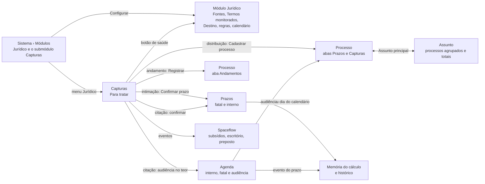

# Decisões: Módulo Jurídico

## A proposta em 1 parágrafo

O módulo Jurídico é feito de submódulos, ligados um a um em Configurações › Sistema › Módulos. O primeiro é
**Capturas**, que cobre captura e prazo. Ligar Capturas pede a categoria que guarda os processos e a ligação de 6
campos, cada um com a chave nativa (número CNJ, tribunal, órgão, polo, responsável e o opcional assunto principal); o
campo que falta é criado e os ligados ficam travados.
Ligado, ele acrescenta o menu **Jurídico** (Capturas e Prazos) e as abas Capturas e Andamentos ao processo. A caixa **Capturas** recebe intimação, citação, distribuição de ação nova e andamento, vindos do
DJEN, do Domicílio Judicial Eletrônico, dos robôs ENSPACE que o cliente já contrata (portais, andamentos, distribuição)
e do fornecedor de recortes do cliente. Cada captura diz de onde veio, qual termo casou e quando chegou, com o hash do
DJEN como prova. A mesma comunicação vinda de 2 fontes fica numa linha só; a vinda por 2 meios mostra as 2 datas e qual
vale. Da caixa, a intimação vira prazo calculado (memória do cálculo, revisão humana). A citação tem visualização
própria, ordenada pelo que vence antes: pede confirmação em 3 dias úteis, cadastra o processo com os dados da
distribuição e a petição inicial, lê a audiência no teor e escolhe de onde conta a resposta (da citação, da audiência de
conciliação, na audiência do Juizado ou até a audiência trabalhista). A audiência vai para a Agenda, sem cálculo. A
distribuição vira processo ou sai como homônimo, e o andamento entra na linha do tempo do processo, um a um ou em lote.
Cada passo entrega um evento ao Spaceflow, de onde partem subsídios, escritório externo e preposto, que continuam
configuração. A página do módulo ganha Fontes (estado e histórico de execuções de cada fonte), Termos monitorados,
Destino e Eventos.
Provisão e Casos de uso, das rodadas 1 e 2, ficam no código e saem da tela até serem liberados (`submodulos.ts`).
O processo é um assunto do tipo processo: herda os campos de assunto no mesmo item. O campo opcional Assunto principal
agrupa processos num item da categoria **Assuntos**, que mostra os processos dele e a soma do valor e do estimado.

## A jornada

## Rodada 1 · 2026-10-26

- **Pedido (literal):** "faça um prototipo de um modulo juridico pro enspace a partir do que está pesquisado ali. mas
  cuidado: deve haver diferença entre modulo e caso de uso. se ele simplesmente for um caso de uso e nao trouxer ganho
  como modulo, nao ha funcionalidades a criar. apenas uma configuraçao do enspace a salvar e permitir ser replicada."
- **O critério** (detalhe no `BRIEFING.md`): uma área vira funcionalidade do módulo só quando as 3 condições valem
  juntas:
  - produz um resultado com efeito jurídico;
  - a configuração de hoje não produz esse resultado certo;
  - o motor é igual para todo cliente, e só o dado muda por país.
  Das 12 linhas da triagem, 3 passam (prazo, intimação, provisão), 7 são caso de uso e 2 são plataforma (sigilo e o
  formulário anônimo do canal de denúncias). O andaime abre a triagem no botão "Módulo ou caso de uso".
- **Mudou:**
  - Sistema › Módulos: ajuda em cada módulo, "Jurídico" com acento e o botão **Configurar** quando o Jurídico está
    salvo como ligado;
  - menu do membro: **Jurídico**, com Intimações (e o número para revisar), Prazos e Provisão, só com o módulo ligado;
  - Intimações: abas Para revisar, Confirmadas e Descartadas; filtro de origem; busca; o teor, o processo ligado pelo
    número CNJ e o cartão do prazo com regra sugerida, responsável, prazo fatal, prazo interno e a memória do cálculo;
    "Confirmar prazo" cria a tarefa; "Descartar" pede o motivo; a comunicação do Domicílio não lida avisa que abrir o
    teor registra a ciência e pede confirmação; intimação sem processo no workspace e sem regra sugerida têm bloco
    próprio;
  - Prazos: o `EnTable` com filtros por faixa (Prazo interno vencido, Vencem hoje, Até sexta-feira, Próximos,
    Cumpridos), Meus prazos ou Todos, marca de "Recalculado" e o painel com a memória do cálculo e o histórico;
  - Provisão: data-base em aberto e as fechadas; cartões por risco contra a data-base anterior; movimentação
    (constituição, reversão, atualização monetária, saldo); tabela com o risco e o valor de antes; motivo obrigatório
    em cada mudança; "Fechar a data-base" bloqueado enquanto falta motivo; "Exportar para o auditor";
  - processo: "Próximo prazo" passa de data digitada a prazo calculado; abas Prazos, Intimações e Risco e provisão;
    a mudança de risco avisa que entra na data-base em aberto;
  - página Módulo Jurídico: Geral (país do pacote, prazo interno em dias úteis, revisão humana obrigatória), Regras de
    prazo, Calendário forense por tribunal (adicionar e remover suspensão recalcula os prazos em aberto), Captura (DJEN
    e Domicílio), Provisão e Casos de uso.
- **Fronteira:** muda o cartão Módulos, o menu do membro (só com o módulo ligado), as 3 telas novas, a página do módulo
  e a tela do item de Processos (o campo "Próximo prazo" e as 3 abas novas). Não muda a casca, as outras abas de
  Sistema, a tabela de itens, as outras abas do item nem a galeria de casos de uso.
- **Por que assim:**
  - o prazo é a tarefa que já existe, com vencimento no prazo interno: o módulo calcula a data, não cria um objeto novo
    de tarefa. Agenda, sino e Home continuam funcionando;
  - a fila de revisão vem do Legal One e da regra do mercado de que a IA sugere e a pessoa confirma: "Revisão humana
    obrigatória" nasce ligada;
  - a memória do cálculo responde a pergunta que o advogado faz a qualquer sistema de prazo ("por que dia 17?") e é o
    item 2 de "O que nenhum deles faz";
  - DJEN e Domicílio contam diferente (publicação no 1º dia útil depois da disponibilização; ciência na abertura ou
    tácita em 10 dias corridos). A memória mostra o passo da origem, porque a origem muda o prazo;
  - o calendário forense é por tribunal e não se mistura com o calendário do workspace: é a correção de S3-F3 para o
    jurídico, sem mexer no calendário de plataforma;
  - o prazo fatal vence às 23:59 no fuso do tribunal ("horário de Manaus" no TJAM), porque a tarefa de hoje calcula em
    UTC e mostra o dia anterior;
  - a provisão é foto por data-base, só acréscimo, como o período travado do Legal Tracker; o motivo antes de fechar
    vem da requisição de prognóstico do Projuris;
  - os casos de uso ficam listados dentro da página do módulo, com o selo "Usa o módulo", "Só configuração" ou "Pede
    recurso da plataforma": quem liga o módulo vê na hora o que ele não traz;
  - tabelas pelo `EnTable` do SDK (Prazos, Provisão, Regras, Calendário, Processos); o resto pelo Nuxt UI.
- **Descartado:**
  - telas para contratos, procurações, societário, consultivo, pagamentos e marcas. Motivo: a configuração de hoje
    resolve; seriam caso de uso pintado de módulo, o que o pedido proíbe;
  - prazo como objeto novo, fora da tarefa. Motivo: perderia Agenda, sino, Home e as Tarefas Programadas;
  - calcular o prazo sem revisão (direto na captura). Motivo: nenhum produto de referência faz, e o erro tem efeito
    jurídico;
  - pacote EUA nesta rodada. Motivo: o motor é o mesmo; o pacote é dado (regras e calendário). Aparece como "Em
    preparação" no país do pacote;
  - accrual de pagamentos jurídicos. Motivo: só vira módulo se o financeiro pedir trava por período; a pesquisa deixa
    como caso de uso no Brasil.
- **Não deu:**
  - ver o efeito do módulo `en-legal` na tela do develop. Por quê: ligar e salvar não muda nada; a chave não aparece
    nos 226 scripts carregados (`BRIEFING.md`, passo 5);
  - print das referências. Por quê: pesquisa documental; os produtos jurídicos pedem conta.
- **Maquete:**
  - "agora" fixo: segunda-feira, 26/10/2026, 10:00. Todos os prazos se calculam a partir desse dia;
  - o motor (`prazos.ts`) calcula de verdade: dias úteis, feriados nacionais de 2026, feriados do tribunal, suspensões
    e recesso de 20/12 a 20/01. Os feriados dos tribunais estaduais e do trabalho são exemplo, marcados na fonte; os da
    Justiça Federal vêm da Lei 5.010/1966;
  - 20 processos, 14 intimações, 7 prazos e 3 datas-base fechadas, em memória; confirmar, descartar, cumprir,
    suspender, mudar risco e fechar data-base mexem no array, e o reload zera;
  - a regra sugerida vem do mock, não de leitura do teor; a captura, a credencial do Domicílio, "Ver na galeria",
    "Criar processo", "Vincular a um processo" e "Exportar para o auditor" não fazem nada além do aviso;
  - Sistema › Módulos: Correção Monetária nasce ligada no workspace fictício, porque a provisão usa a atualização;
  - a lista de Processos é um `EnTable` simplificado, só como porta para o processo;
  - os cenários do andaime: Dia normal, Nada para revisar, Captura do Domicílio parada e Carregando; a versão "Sem o
    módulo (hoje)" abre o PROC-0312 com a data digitada errada (16/11; o cálculo dá 17/11).
- **Crítica e acessibilidade** (revisão própria na verificação, em Chrome headless a 1440 × 900, nos 2 temas e nos 3
  idiomas; as skills `design:design-critique` e `design:accessibility-review` não rodaram nesta rodada):
  - corrigido: prazo fatal hoje com prazo interno vencido caía em "Prazo interno vencido"; passou para "Vencem hoje",
    e o selo "Vencido" continua na coluna Interno;
  - corrigido: o selo "Prazo interno vencido" cortava na coluna; virou "Vencido";
  - corrigido: o `EnTable` escreve um travessão quando a célula fica vazia (`formatValue` do SDK); as células sem
    valor passaram a ter um elemento vazio. O travessão é do SDK e aparece no produto: fica como pergunta P7;
  - corrigido: as 12 abas do processo encolhiam até "Pr..."; passaram a ter a largura do rótulo, com rolagem lateral;
  - corrigido: o campo de motivo da Provisão passava da borda; a tela ficou mais larga e o campo, menor;
  - corrigido: processo sem prazo e com intimação para revisar não dizia nada; ganhou o botão "Para revisar" com o
    número;
  - sem correção: em espanhol, "Notificaciones judiciales" corta no menu lateral. A largura do menu é cópia do
    develop (regra 37);
  - o prazo nunca depende só da cor: a faixa tem nome, o selo tem palavra e o dia tem a semana ao lado;
  - os filtros Meus prazos e Todos são `radiogroup` com `aria-checked`; os botões de ícone têm `aria-label`;
  - as animações de entrada respeitam `prefers-reduced-motion` (`main.css`).
- **CSS próprio:** nenhum (`<style>`, `:deep()` e `!important` não aparecem nos arquivos da pasta).
- **Ver:** https://pernalombr4.github.io/prototipos/modulo-juridico/ · prints em `evidencias/`:
  - `proposta-01-intimacao-com-prazo.jpg`: a intimação do PROC-0312 com o prazo fatal de 17/11 e a memória;
  - `proposta-02-prazos.jpg`: a lista de prazos com as faixas;
  - `proposta-03-suspensao.jpg`: adicionar a suspensão de 30/10 no TJMG;
  - `proposta-04-memoria-e-historico.jpg`: o prazo do PROC-0318 recalculado de 05/11 para 06/11, com o motivo;
  - `proposta-05-provisao.jpg`: a data-base em aberto, a movimentação e os 3 motivos que faltam;
  - `proposta-06-sistema-modulos.jpg`: o cartão Módulos com a ajuda e o botão Configurar;
  - `proposta-07-casos-de-uso.jpg`: as 8 áreas e como cada uma chega;
  - `proposta-08-triagem.jpg`: a triagem módulo ou caso de uso, no andaime;
  - `hoje-01-processo-com-data-digitada.jpg`: o PROC-0312 sem o módulo, com 16/11 digitado (o cálculo dá 17/11).

## Rodada 2 · 2026-10-26

- **Pedido (literal):** "calma. sem modulo entao tem somente intimaçoes, prazos e provisoes? os prazos nao deveriam
  aparecer numa agenda? ou 2 visoes: lista ou calendario pra pessoa escolher. e esteja atento ao fato de que as telas nao
  podem ser radicalmente diferentes do restante do enspace pra usarmos os mesmos componentes: mesma tabela, mesmo kanban,
  mesmo sistema de filtros etc. senao vai ficar esquizofrenico. cuidado com isso, tem que manter a consistencia com as
  proprias telas de categoria que ja existem hoje dentre outras."
- **Resposta à pergunta:** no pacote Brasil, o módulo tem 3 funcionalidades. A releitura do relatório de 2026-10-24
  (Recomendação 1 e tabela 3) não acrescenta nenhuma:
  - correção com séries de índices versionadas: já é o módulo Correção Monetária; a melhoria é dele;
  - trilha só de acréscimo, sigilo, barreira e temporalidade: plataforma, valem para todo workspace;
  - conta fiduciária (IOLTA) e fatura LEDES: pacote EUA, perfil escritório. Ficam para o 1º cliente jurídico nos EUA
    (Recomendação 2);
  - zona cinza, para decidir (P8): andamentos pelo DataJud, custas e depósitos judiciais, audiências.
- **Mudou:**
  - Intimações, Prazos, Provisão e a lista de Processos usam a barra da listagem de registros de toda categoria
    (`_BarraDaLista.vue`, cópia do develop): visualizações em botão com "+ Visualizar", Pesquisar, período, os ícones
    Exportar, Colunas, Filtros e Configurações; e o `EnTable` com seleção, menu de ações por linha e paginação;
  - Intimações: saiu a caixa de entrada com lista e detalhe lado a lado. Para revisar, Confirmadas e Descartadas são 3
    visualizações que o módulo instala. O filtro de origem saiu: a origem virou coluna e passa pelo filtro padrão. A
    revisão abre num painel à direita, como o painel da tarefa em Tarefas, com Descartar e Confirmar prazo no rodapé;
  - Prazos: 3 visualizações, Em aberto (tabela), Calendário (a grade da Agenda) e Cumpridos (tabela). Saíram os chips de
    faixa e o "Meus prazos / Todos"; a faixa virou a coluna Situação;
  - Agenda: com o módulo ligado, cada prazo aparece em 2 dias, no interno e no fatal, ao lado das audiências e reuniões.
    Clicar no prazo abre o mesmo painel da tela de Prazos;
  - Provisão: a data-base ocupa o lugar de "Criado em" e "Todo o período"; os cartões e a movimentação viraram uma faixa
    de resumo acima da tabela; "Só o que mudou" e "Exportar para o auditor" foram para a barra.
- **Fronteira:** muda o conteúdo das 3 telas do módulo, a lista de Processos (que era simplificada) e os eventos de prazo
  na Agenda. Não muda a barra da lista, o `EnTable`, a grade da Agenda, a casca, a página do módulo nem a tela do
  processo.
- **Por que assim:**
  - a regra da redatora: mesma tabela, mesmo filtro, mesma troca de visão. O módulo instala visualizações, como um caso
    de uso instala numa categoria, e não ganha controle próprio;
  - lista ou calendário é escolha de visualização, como Itens e Quadro na categoria;
  - o calendário é a grade da Agenda, não um componente novo. O Nuxt UI e o SDK não têm calendário de eventos;
  - o prazo já é tarefa: aparecer na Agenda é o que se espera de toda tarefa com data.
- **Descartado:**
  - Quadro (kanban) em Prazos. Motivo: a coluna seria a situação, que o motor calcula; arrastar um prazo de "Interno
    vencido" para "Próximo" não muda a data;
  - Quadro em Intimações. Motivo: arrastar para Confirmadas pularia a revisão;
  - cartões de painel na Provisão. Motivo: a listagem de categoria não tem cartão. Painel com gráfico é tela da
    Interface (Telas), se o cliente quiser.
- **Não deu:**
  - abrir o seletor de Visualização da Agenda no develop. Por quê: a janela do Chrome estava oculta e o menu não abre. A
    leitura de 26/10 confirma Hoje, Período anterior, Período seguinte, Visualização (abre em "Dia"), Data, Dia Útil e
    Dia Não Útil; a grade do mês vem da cópia de 05/10 (`comunicacao-no-workspace`);
  - o funil de filtro no cabeçalho de cada coluna, que a listagem do develop tem. Por quê: o `EnTable` do SDK não tem.
    O ícone Filtros da barra fica como entrada (P11).
- **Maquete:** "+ Visualizar", Exportar, Colunas, Filtros, Configurações e Novo registro mostram só o aviso; a Agenda só
  tem a visualização Mês; a seleção de linhas não tem ação em lote; o evento comum da Agenda não abre o modal "Evento".
- **Crítica e acessibilidade** (revisão própria em Chrome headless, em português e espanhol; as skills
  `design:design-critique` e `design:accessibility-review` não rodaram):
  - corrigido: o evento da Agenda colava a hora no título ("09:00Reunião");
  - corrigido: o rótulo do prazo no calendário cortava a referência do processo; a referência veio antes do ato;
  - os botões de visualização têm `aria-pressed`; o prazo no calendário diz "Interno" ou "Fatal" por extenso, além da
    cor.
- **CSS próprio:** nenhum.
- **Ver:** prints em `evidencias/` (os 4 primeiros substituem os da rodada 1):
  - `proposta-01-intimacao-com-prazo.jpg`: a lista de Intimações com a revisão do PROC-0312 no painel;
  - `proposta-02-prazos.jpg`: Prazos na visualização Em aberto;
  - `proposta-04-memoria-e-historico.jpg`: o PROC-0318 recalculado, aberto pela lista;
  - `proposta-05-provisao.jpg`: a Provisão na barra da lista, com a faixa de resumo;
  - `proposta-09-prazos-calendario.jpg`: Prazos na visualização Calendário;
  - `proposta-10-agenda-com-prazos.jpg`: a Agenda com prazos, audiências e reuniões.

## Rodada 3 · 2026-10-26

- **Pedido (literal):** "acredito que o módulo do enspace juridico, primeiro falando só em brasil, precisa ter
  "submodulos" a serem ativados. o primeiro deles é o de capturas. e capturas precisa tratar capturas + prazos. vamos nos
  ater a esse escopo primeiro (nao precisa deletar nada que botou ali, só ocultar por enquanto e vamos liberando aos
  poucos construindo o prototipo) primeiro faça um submodulo pra dar conta de TUDO o que seja preciso em capturas,
  sabendo que hoje ja temos uma automaçao de capturas que os clientes contratam. se precisar pesquisa /deep-research
  sobre capturas em sistemas (softwares) juridicos"
- **Pesquisa:** pesquisa profunda sobre captura em softwares jurídicos brasileiros
  ([relatório](pesquisa/reports/Captura%20em%20softwares%20jur%C3%ADdicos.md)), resumida em `PESQUISA.md`, "Rodada 3". O
  serviço de captura de hoje está no `BRIEFING.md`, "A captura que os clientes contratam hoje".
- **Oculto, sem apagar** (`submodulos.ts`, objeto `LIBERADO`):
  - Provisão: o item do menu, a aba do processo, o aviso de risco na visão geral e a aba da página do módulo;
  - Casos de uso: a aba da página do módulo e o andaime "Módulo ou caso de uso";
  - para liberar, troque a chave para `true`. O código e os textos das rodadas 1 e 2 continuam no repositório.
- **Mudou:**
  - Sistema › Módulos: com o Jurídico ligado, aparece a lista **Submódulos**, hoje só com Capturas, com interruptor e
    Configurar. Sem submódulo ligado, o menu Jurídico some;
  - Jurídico › Intimações virou **Capturas**:
    - 4 tipos: intimação, citação, distribuição e andamento;
    - visualizações Para tratar, Distribuições, Andamentos, Tratadas e Descartadas;
    - colunas Recebida em, Tipo, Origem, Processo, Termo, Prazo ou situação e Responsável;
    - na barra, o botão de saúde ("1 fonte com problema") abre as 6 fontes e leva à página delas;
    - seleção em lote: Atribuir a, Registrar andamentos (só andamento) e Descartar;
  - o painel da captura muda por tipo:
    - intimação vinda por 2 meios: as 2 datas, o prazo fatal por cada uma, a data que entra no cálculo e o aviso do
      Tema 1.180;
    - citação no Domicílio: "Confirmar até", o modal da confirmação e o prazo contado depois do 5º dia útil (2 passos
      novos na memória do cálculo);
    - intimação no portal: ciência tácita em 10 dias corridos e o modal para abrir o teor;
    - distribuição: os dados da ação nova, "Cadastrar processo" (o item nasce em Processos) e "Não é da empresa", que
      descarta como homônimo e oferece a exceção no termo;
    - andamento: "Registrar no processo";
    - sem processo: vincular a um processo existente ou cadastrar;
    - em todos, "Dados da captura": recebida em, fonte, termo, id na fonte, hash e certidão do DJEN, outras fontes;
  - página do módulo: a aba Captura deu lugar a **Fontes**, **Termos monitorados** e **Destino**. A leitura do
    Domicílio passou para o painel da fonte Domicílio;
  - tela do processo: a aba Intimações virou Capturas e mostra também os andamentos e as capturas vinculadas à mão.
- **Fronteira:** muda a caixa, a página do módulo, o cartão Módulos e a aba do processo. Não muda a barra da lista, o
  `EnTable`, a casca, Prazos, a Agenda nem o motor de prazo, que só ganhou a regra da citação.
- **Por que assim:**
  - submódulo é linha no cartão Módulos: o mesmo gesto de hoje (interruptor e Salvar), sem tela nova de instalação;
  - a caixa continua sendo a listagem de categoria (regra da rodada 2). Tipo e situação são colunas; o recorte é
    visualização;
  - o robô ENSPACE aparece como fonte, ao lado das oficiais: o cliente vê o serviço que paga e quando ele falhou;
  - o histórico de execuções mostra "Sem resultado": prova que a captura rodou num dia sem publicação. Nenhum produto
    pesquisado mostra isso;
  - 2 meios: a regra padrão é a data oficial com aviso, porque é o que a Res. CNJ 569/2024 manda. Contar pela data mais
    cedo fica como opção enquanto o Tema 1.180 não é julgado;
  - o homônimo vira exceção no termo no momento do descarte, para a próxima captura igual não chegar.
- **Descartado:**
  - tela própria de instalação do submódulo, como a de integração. Motivo: há 1 submódulo só, e o cartão Módulos já tem
    Configurar;
  - cartões para escolher a regra de duplicidade e o tipo da fonte. Motivo: escolha em configuração é `USelect` com
    ajuda por opção;
  - quadro (kanban) na caixa. Motivo: arrastar para Tratadas pularia a conferência, como na rodada 2;
  - IA que classifica e grava o prazo sozinha. Motivo: o relatório recomenda sugestão com confirmação, e a regra
    sugerida pelo teor já cobre isso.
- **Não deu:**
  - abrir a Triagem do develop nesta rodada. Por quê: a rodada ficou no desenho da caixa. A Triagem aparece pelos
    chamados e pela auditoria de UX (C3, U2), não pela tela;
  - ler a API dos fornecedores de recortes. Por quê: o relatório registra que ela só sai sob pedido;
  - o `nuxi typecheck`. Por quê: o projeto não tem o `vue-tsc`. O comportamento foi conferido no navegador.
- **Maquete:** "Criar processo" na intimação sem processo, a certidão do DJEN, o recibo do dia, "Revisar a credencial",
  a renovação do certificado e "Adicionar fonte" mostram só o aviso. O interruptor "Registrar direto os andamentos"
  grava, mas a caixa não muda com ele.
- **Testado** (navegador do app e Chrome headless, em português e espanhol):
  - confirmar a citação 903 dá início em 05/11 e fatal em 26/11, com Finados fora da contagem do 5º dia útil;
  - cadastrar a distribuição 920 cria o processo, e o painel passa a mostrá-lo;
  - descartar a 922 como homônimo e aceitar a exceção acrescenta "1 exceção" ao termo;
  - desligar Capturas e salvar tira o menu Jurídico; religar devolve;
  - no cenário "captura do Domicílio parada", a caixa mostra o alerta e "2 fontes com problema".
- **Crítica e acessibilidade** (revisão própria; as skills `design:design-critique` e `design:accessibility-review`
  não rodaram):
  - corrigido: o processo cadastrado não aparecia no painel, porque o mapa de processos do `mocks.ts` não é reativo. O
    vínculo agora fica no estado;
  - corrigido: o botão "Ver execuções" cortava o texto na tabela de fontes. Ele virou ícone com tooltip e `aria-label`,
    como o botão de renovar o certificado;
  - corrigido: o histórico do Domicílio mostrava a mensagem de falha do DJEN.
- **CSS próprio:** nenhum.
- **Ver:** prints em `evidencias/`, prefixo `r3-`:
  - `r3-01-caixa-capturas.jpg`: a caixa na visualização Para tratar;
  - `r3-02-dois-meios.jpg`: a intimação vinda pelo DJEN e pelo portal;
  - `r3-03-citacao.jpg`: a citação do Domicílio com "Confirmar até";
  - `r3-04-distribuicao.jpg`: a ação nova com os dados da distribuição;
  - `r3-05-saude-das-fontes.jpg`: o botão de saúde aberto;
  - `r3-06-andamentos-em-lote.jpg`: andamentos selecionados e a faixa de ações em lote;
  - `r3-07-fontes.jpg`: as 6 fontes da captura;
  - `r3-08-fonte-portais.jpg`: o painel dos portais, com o certificado vencido;
  - `r3-09-termos.jpg`: Termos monitorados;
  - `r3-10-destino.jpg`: Destino;
  - `r3-11-submodulos.jpg`: o cartão Módulos com o submódulo Capturas;
  - `r3-12-erro-captura.jpg`: a caixa com a captura do Domicílio parada;
  - `r3-13-fonte-domicilio-parada.jpg`: o painel da fonte Domicílio parada;
  - `r3-14-es-dois-meios.jpg`: o painel dos 2 meios em espanhol.

## Rodada 4 · 2026-10-26

- **Pedido (literal):** "sua recomendaçao faz todo sentido --- no mais, pode fechar o escopo do submódulo de capturas
  e lidar com ]esses pontos que trouxe tambem de recomendaçao". Os pontos e as 2 perguntas que vieram antes estão no
  `BRIEFING.md`, "Rodada 4".
- **Pesquisa:** sem pesquisa nova. As regras de contagem vêm da lei: CPC, art. 335, I a III, e art. 231, IX; CPC, art.
  246, § 1º-A; Lei 9.099/1995, art. 30; CLT, art. 847.
- **Mudou:**
  - Capturas: a visualização **Citações**, ordenada pelo que vence antes ("Confirmar até" enquanto a citação não foi
    confirmada, depois o prazo fatal);
  - o painel da citação:
    - **Audiência no teor**: tipo, data, hora e local lidos do teor, editáveis, e "Levar a audiência para a Agenda";
    - **Resposta à citação**: "De onde conta a resposta", com 4 marcos e a ajuda de cada um. O marco vem sugerido pelo
      rito e pelo teor;
    - na audiência do Juizado e na trabalhista, "Defesa até" mostra o dia e a hora da audiência, e a memória do cálculo
      ganha o passo "Audiência designada";
    - na audiência de conciliação, a contagem começa no dia útil seguinte à audiência (CPC, art. 335, I), com o aviso do
      acordo e do pedido de cancelamento;
    - a citação de ação nova mostra os dados da distribuição e cadastra o processo. A distribuição da mesma ação avisa
      que o processo já existe e oferece "Registrar no processo";
    - **Documentos da ação**: a petição inicial obtida no tribunal, que vai para os anexos do processo;
    - **Eventos para o Spaceflow**: o que a captura entregou e o fluxo que cada evento disparou;
  - o andamento mostra o tipo do movimento. O andamento que designa audiência leva a audiência para a Agenda;
  - a ação em lote "Registrar andamentos" deixa de fora o andamento com audiência, que pede conferência;
  - Agenda: a audiência registrada entra como os eventos de hoje; o clique abre o processo;
  - processo: a aba **Andamentos** (linha do tempo, com tipo do movimento e "Entrada direta") e a próxima audiência na
    Visão Geral. A aba Capturas fica com intimação, citação e distribuição;
  - Sistema › Módulos: ligar Capturas abre "Ligar o submódulo Capturas", com a categoria dos processos (ou "Criar a
    categoria Processos pelo caso de uso Contencioso") e a ligação dos 5 campos;
  - página do módulo: Destino mostra a categoria ligada e os campos travados, e ganha a linha Audiência; a aba nova
    **Eventos** lista os 5 eventos, os dados que cada um leva, os fluxos que usam cada um e os últimos entregues;
  - a categoria Andamentos saiu do menu.
- **Fronteira:** muda a caixa (visualização Citações e o painel), a Agenda (só os eventos novos), a tela do processo
  (aba e linha novas), o cartão Módulos (o modal) e a página do módulo (Destino e Eventos). Não muda a casca, a barra da
  lista, o `EnTable`, Prazos nem a grade da Agenda.
- **Por que assim:**
  - o processo continua item de categoria: as telas de lista, item, filtro e permissão já existem. O submódulo pede a
    categoria e trava os campos de que depende, em vez de criar uma tela própria;
  - a citação é visualização, e não tela: ela é captura, com a mesma barra e o mesmo painel;
  - a regra de contagem depende da audiência, então o painel lê a audiência antes de calcular. O marco é escolha da
    pessoa, sugerida pelo teor, porque a leitura automática erra;
  - o andamento não tem prazo nem dono: é histórico do processo. Como categoria, ele duplicava o processo;
  - subsídios, escritório externo e preposto mudam de empresa para empresa. O submódulo entrega o evento, e o caso de uso
    Contencioso traz o fluxo pronto;
  - o filtro por tipo do movimento fica no fluxo ("quando o movimento for Sentença"), e não num evento por tipo.
- **Descartado:**
  - tela própria de processos e de citações. Motivo: repetiria lista, item e filtro, que a categoria já tem;
  - categoria Andamentos. Motivo: andamento é histórico de um processo, sem ciclo próprio;
  - calcular a data da audiência. Motivo: ela vem do juízo, só se lê;
  - um evento por tipo de movimento. Motivo: 1 evento com o tipo nos dados cobre todos, e o fluxo filtra;
  - a aba Destino ligar cada fonte a outra categoria (o diário administrativo para a propriedade intelectual, por
    exemplo). Motivo: nenhum cliente pediu ainda; a aba fica pronta para receber a escolha por fonte no primeiro.
- **Não deu:**
  - o prazo do recurso da sentença registrada como andamento. Por quê: o prazo nasce da intimação da sentença, que chega
    pelo DJEN e entra como intimação;
  - o `nuxi typecheck`. Por quê: o projeto não tem o `vue-tsc`. O comportamento foi conferido no navegador.
- **Maquete:** "Abrir a petição inicial" e "Criar fluxo no Spaceflow" mostram só o aviso. "Criar a categoria Processos
  pelo caso de uso Contencioso" grava a ligação, mas não cria a categoria.
- **Testado** (Chrome, em português e espanhol):
  - a citação 929: confirmar, cadastrar o processo (PROC-0332), marco "Da audiência de conciliação" sugerido; a
    contestação começa em 26/11 e vence em 17/12, com 08/12 (Dia da Justiça) fora da contagem; a audiência de 25/11
    entra na Agenda;
  - a citação 930 (TRT-15): defesa até 03/12/2026, 09:30, sem contagem;
  - a citação 931 (Juizado): cadastrar o processo dá rito do Juizado e defesa até 19/11/2026, 10:00;
  - o andamento 923: registrar leva a audiência de 18/11 para a Agenda e para a Visão Geral do PROC-0317; a aba
    Andamentos mostra os 3 movimentos;
  - o andamento 932 (sentença) dispara "Avisar a controladoria";
  - ligar Capturas: o polo falta na categoria Processos, e "Ligar Capturas" só libera depois de escolher um campo.
- **Crítica e acessibilidade** (revisão própria; as skills `design:design-critique` e `design:accessibility-review`
  não rodaram):
  - corrigido: o processo cortava em "PROC-" no cabeçalho do painel da citação; o botão "Abrir processo" agora quebra
    para a linha de baixo;
  - corrigido: a lista de campos oferecia um campo já ligado a outro campo do submódulo;
  - corrigido: o modal de confirmação da citação dizia que a resposta conta sempre depois do 5º dia útil.
- **CSS próprio:** nenhum.
- **Ver:** prints em `evidencias/`, prefixo `r4-`:
  - `r4-01-citacao-conta-da-audiencia.jpg`: a citação 929 com a audiência e a resposta contada da conciliação;
  - `r4-02-audiencia-na-agenda.jpg`: a audiência de 25/11 na Agenda;
  - `r4-03-processo-proxima-audiencia.jpg`: a próxima audiência na Visão Geral do processo;
  - `r4-04-aba-andamentos.jpg`: a aba Andamentos;
  - `r4-05-citacao-trabalhista.jpg`: a defesa até a audiência una do TRT-15;
  - `r4-06-citacao-juizado.jpg`: a contestação na audiência do Juizado;
  - `r4-07-ligar-capturas.jpg`: o modal "Ligar o submódulo Capturas";
  - `r4-08-eventos-spaceflow.jpg`: a aba Eventos;
  - `r4-09-destino-categoria.jpg`: Destino com a categoria ligada;
  - `r4-10-es-citacao-trabalhista.jpg`: o painel da citação trabalhista em espanhol.

## Rodada 5 · 2026-10-27

- **Pedido (literal):** "pode fazer a 1". O "1" é a herança com assunto pai opcional, o primeiro dos 3 caminhos da
  resposta; a comparação com a proposta de modelo de dados nativo e as perguntas estão no `BRIEFING.md`, "Rodada 5".
- **Pesquisa:** sem pesquisa nova. O que o protótipo mantém da comparação se apoia no `PESQUISA.md` da rodada 1.
- **Mudou:**
  - o modal "Ligar o submódulo Capturas":
    - um aviso diz que a categoria escolhida passa a ser do tipo Processo, um tipo de Assunto;
    - a grade separa **Campos de processo** (número CNJ, tribunal, órgão julgador, polo) de **Campos de assunto**
      (responsável, assunto principal), com a nota "Valem também para a categoria Assuntos";
    - cada campo mostra a chave nativa (`litigation.br.cnj_number`, `matter.internal_counsel` etc.), com a ajuda "Não
      muda quando o rótulo do campo muda";
    - o campo novo **Assunto principal** (`matter.parent_matter`, relação, opcional) e a opção **Não usar** nos campos
      opcionais;
  - processo, Visão Geral: o campo **Assunto principal** no topo de "Dados do processo", com a escolha do assunto e
    "Abrir o assunto". Só aparece quando o campo está ligado;
  - Categorias › Processos: a coluna **Assunto principal**, também só com o campo ligado;
  - Categorias › **Assuntos**, categoria nova no menu:
    - a lista, com as colunas Processos e Estimado somado;
    - o item, com "Dados do assunto" (`matter.*`) e **Processos deste assunto**: a relação inversa, com o número de
      processos, o valor da causa somado, o estimado somado, o próximo prazo, "Adicionar processo" e "Tirar do assunto".
- **Fronteira:** muda o modal de ligação, a Visão Geral do processo (1 campo), a lista de Processos (1 coluna) e a
  categoria Assuntos (nova). Não muda a casca, a barra da lista, o `EnTable`, a caixa Capturas, Prazos, a Agenda, Destino
  nem Eventos.
- **Por que assim:**
  - no contencioso de massa a unidade é o processo. O processo herda os campos de assunto no mesmo item, e nada se
    configura a mais para quem não agrupa;
  - quem trabalha como o ELM americano agrupa a mesma disputa num assunto: o recurso com outro número, a ação paralela
    noutra vara, a crise com dezenas de ações. O assunto soma os processos dele;
  - o assunto pai é uma relação comum, que o modelo de dados já exige entre quaisquer objetos. Não pede código novo além
    da herança no registro de campos;
  - a chave nativa aparece onde se configura (o modal), e não onde se trabalha (o item).
- **Descartado:**
  - um assunto pai para cada processo. Motivo: dobra o número de itens no contencioso de massa e põe um nível a mais
    entre a pessoa e o processo;
  - uma chave por workspace que centraliza no processo ou no assunto. Motivo: migração nos 2 sentidos, 2 caminhos em
    relatório, filtro, Spaceflow, API e MCP, e a chave nativa mudando de lugar conforme o workspace;
  - mostrar a chave nativa na tela do item. Motivo: serve a quem configura e integra, não a quem trata o processo;
  - nesta rodada, as outras mudanças da comparação (parte contrária e escritório como organização, eventos com a chave
    nativa, comarca, instância e rito no registro). Motivo: fora do pedido; ficam para a próxima.
- **Não deu:** o `vue-tsc` (erro `ERR_PACKAGE_PATH_NOT_EXPORTED`). O comportamento foi conferido no navegador.
- **Maquete:** "Novo registro" em Assuntos mostra só o aviso. A categoria Assuntos já existe no workspace fictício; quem
  a cria (o submódulo, o caso de uso ou a pessoa) é a pergunta P23.
- **Testado** (Chrome, em português, em espanhol e no tema escuro):
  - ASS-0041 mostra 4 processos, R$ 638.800 de valor da causa, R$ 221.000 de estimado e o próximo prazo 29/10/2026;
  - "Adicionar processo": a busca por "Sindicato" não acha nada (o processo já está no assunto); a busca por "Juliana"
    acha o PROC-0314, que entra no assunto, e os totais vão a 5 processos e R$ 313.000;
  - o PROC-0314 passa a mostrar "Reestruturação da logística 2024" em Assunto principal, e "Abrir o assunto" volta ao
    ASS-0041;
  - "Tirar do assunto" no ASS-0042 tira o PROC-0329, e os totais caem para 1 processo;
  - ligar Capturas com "Não usar" no Assunto principal: a coluna some da lista de Processos e o campo some do processo.
- **Crítica e acessibilidade** (revisão própria; as skills `design:design-critique` e `design:accessibility-review`
  não rodaram):
  - corrigido: a tabela do assunto cortava o nome do processo. O tribunal e o número CNJ foram para a 2ª linha da célula;
  - corrigido: o menu "Adicionar processo" ficava com o id do processo escolhido, e agora volta ao rótulo.
- **CSS próprio:** `[&_thead_th:nth-child(2)]:w-2/5` no `EnTable` da tela do assunto. Motivo: o `EnTable` monta a tabela
  com largura fixa e colunas iguais, e o `EnTableColumn` não tem largura (P26).
- **Ver:** prints em `evidencias/`, prefixo `r5-`:
  - `r5-01-assunto-com-processos.jpg`: o ASS-0041 com os 4 processos e os totais;
  - `r5-02-adicionar-processo.jpg`: a busca de "Adicionar processo";
  - `r5-03-processo-com-assunto-principal.jpg`: o PROC-0314 com o Assunto principal;
  - `r5-04-ligacao-com-chaves-nativas.jpg`: o modal com os 2 grupos e as chaves nativas;
  - `r5-05-lista-de-processos.jpg`: a coluna Assunto principal;
  - `r5-06-assuntos-es-escuro.jpg`: a lista de Assuntos em espanhol, no tema escuro;
  - `r5-07-assunto-es-escuro.jpg`: o ASS-0042 em espanhol, no tema escuro.

## Perguntas para o time de dev

- **P1.** Ligar o módulo instala o caso de uso Contencioso junto, ou são 2 gestos? Nenhuma plataforma no-code liga
  comportamento e estrutura num gesto só (PESQUISA.md, item 6).
- **P2.** Onde mora a entrada do cálculo (meio, dia, regra) e o histórico do prazo: em campos novos da tarefa ou numa
  entidade do módulo ligada à tarefa?
- **P3.** Quem mantém as regras e o calendário forense de cada tribunal, e como a versão do pacote chega aos
  workspaces? Feriado local e portaria de suspensão mudam toda semana.
- **P4.** A captura: o DJEN tem API pública; o Domicílio pede credencial por CNPJ. Qual a frequência e onde fica a
  credencial?
- **P5.** O vencimento da tarefa passa a respeitar o fuso do tribunal (23:59 local), ou o módulo guarda o prazo fatal
  à parte e a tarefa continua em UTC?
- **P6.** A foto por data-base é uma tabela só de acréscimo? A correção depois do fechamento entra na data-base seguinte,
  com motivo, ou reabre a fechada?
- **P7.** O `EnTable` escreve um travessão na célula vazia. A regra de texto de interface pede célula vazia sem
  travessão: o SDK pode aceitar um texto de vazio por coluna?
- **P8.** Zona cinza do módulo. Andamentos pelo DataJud: conector sem efeito jurídico próprio (a intimação é o que abre
  prazo). Custas e depósitos judiciais: guia por tribunal e levantamento, "depois" na tabela 3 do relatório. Audiências:
  a data vem do juízo, sem cálculo. A proposta deixa os 3 como caso de uso; algum deles tem regra que a configuração não
  cobre?
- **P9.** A visualização Calendário vira tipo de visualização da plataforma, para qualquer categoria com campo de data,
  ou fica só no módulo?
- **P10.** Na Agenda, o clique num prazo abre o painel do prazo (como no protótipo) ou o modal "Evento" de hoje?
- **P11.** O `EnTable` pode ganhar o funil de filtro no cabeçalho da coluna, como a listagem do develop?
- **P12.** A caixa Capturas substitui a Triagem para o que vem da captura, ou a captura continua criando requisição na
  Triagem e a caixa lê de lá? A user story do Módulo de Triagem está em "To Do".
- **P13.** Onde moram a fonte, a execução e a prova de chegada (hash, id na fonte, hora): numa entidade do submódulo ou
  em campos do item capturado?
- **P14.** O conector do fornecedor de recortes: quem pede o manual da API, que os fornecedores só entregam sob pedido?
- **P15.** A regra de duplicidade padrão é a data oficial, com aviso. Enquanto o STJ não julga o Tema 1.180, a escolha
  vale para o workspace todo ou por tipo de comunicação?
- **P16.** A confirmação da citação no Domicílio e a abertura do teor no portal acontecem pelo ENSPACE, com a credencial
  da empresa, ou o ENSPACE só registra o que a pessoa fez no site oficial?
- **P17.** A cobrança da captura de hoje é por termo, por processo ou por fonte? O limite de termos na tela
  ("N de 10 termos do contrato") supõe cobrança por termo.
- **P18.** A trava dos campos ligados: a plataforma tem como impedir que se apague ou mude o tipo de um campo que um
  módulo usa, ou a trava é só aviso?
- **P19.** Os eventos do submódulo entram no Spaceflow como gatilho novo, ao lado de "item criado" e "campo alterado",
  ou o submódulo grava um item e o fluxo usa o gatilho que já existe?
- **P20.** A petição inicial: o robô de distribuição já baixa o documento, ou só lê os dados da capa? Em processo com
  segredo de justiça, o download pede o certificado da empresa.
- **P21.** A audiência registrada é item da categoria Audiências (caso de uso) ou evento da Agenda sem categoria?
- **P22.** O Object Framework aceita herança, com Litigation estendendo Matter no registro de campos? Sem herança, o
  caminho é a composição 1 para 1 (2 registros que a tela mostra como 1), e toda lista passa a juntar 2 registros.
- **P23.** Quem cria a categoria Assuntos: o submódulo, ao ligar o campo Assunto principal, o caso de uso Contencioso ou
  a pessoa?
- **P24.** O Assunto principal aponta só para itens de Assuntos, ou também para outro processo (o recurso com outro
  número, como nos EUA)?
- **P25.** O registro de campos ganha `litigation.br.rito` e `litigation.br.comarca`? O motor de prazo usa os 2 (regra
  de contagem e feriado municipal), e a proposta de modelo de dados lista tribunal, vara, comarca e instância, sem o rito.
- **P26.** O `EnTableColumn` pode ganhar largura? Hoje o `EnTable` divide a largura por igual entre as colunas.
