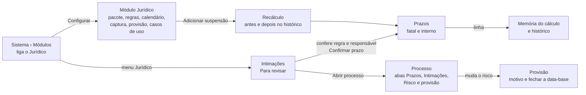

# Decisões: Módulo Jurídico

## A proposta em 1 parágrafo

O módulo Jurídico ganha 3 funcionalidades, todas do contencioso, e nada mais: **Intimações**, **Prazos** e
**Provisão**. Ligado em Configurações › Sistema › Módulos, ele acrescenta o menu **Jurídico** ao membro e 3 abas ao
item da categoria Processos. A intimação capturada do DJEN ou do Domicílio Judicial Eletrônico chega com o prazo já
calculado pela regra do rito e pelo calendário do tribunal; uma pessoa confere a regra e o responsável e confirma, e o
prazo vira a tarefa que já existe, com vencimento no prazo interno. Cada prazo mostra a memória do cálculo (cada passo
com o fundamento e cada dia que não contou, com o motivo e a fonte) e guarda o antes e o depois quando o calendário do
tribunal muda. A provisão fecha o risco e o valor de cada processo por data-base, com motivo para cada mudança, e a
data-base fechada não se edita. O resto do jurídico (contratos, consultivo, procurações, societário, pagamentos,
marcas, denúncias) é caso de uso: configuração salva e replicada pela galeria, listada na página do módulo para mostrar
onde cada área mora.

## A jornada

## Rodada 1 · 2026-10-26

- **Pedido (literal):** "faça um prototipo de um modulo juridico pro enspace a partir do que está pesquisado ali. mas
  cuidado: deve haver diferença entre modulo e caso de uso. se ele simplesmente for um caso de uso e nao trouxer ganho
  como modulo, nao ha funcionalidades a criar. apenas uma configuraçao do enspace a salvar e permitir ser replicada."
- **O critério** (detalhe no `BRIEFING.md`): uma área vira funcionalidade do módulo só quando as 3 condições valem
  juntas:
  - produz um resultado com efeito jurídico;
  - a configuração de hoje não produz esse resultado certo;
  - o motor é igual para todo cliente, e só o dado muda por país.
  Das 12 linhas da triagem, 3 passam (prazo, intimação, provisão), 7 são caso de uso e 2 são plataforma (sigilo e o
  formulário anônimo do canal de denúncias). O andaime abre a triagem no botão "Módulo ou caso de uso".
- **Mudou:**
  - Sistema › Módulos: ajuda em cada módulo, "Jurídico" com acento e o botão **Configurar** quando o Jurídico está
    salvo como ligado;
  - menu do membro: **Jurídico**, com Intimações (e o número para revisar), Prazos e Provisão, só com o módulo ligado;
  - Intimações: abas Para revisar, Confirmadas e Descartadas; filtro de origem; busca; o teor, o processo ligado pelo
    número CNJ e o cartão do prazo com regra sugerida, responsável, prazo fatal, prazo interno e a memória do cálculo;
    "Confirmar prazo" cria a tarefa; "Descartar" pede o motivo; a comunicação do Domicílio não lida avisa que abrir o
    teor registra a ciência e pede confirmação; intimação sem processo no workspace e sem regra sugerida têm bloco
    próprio;
  - Prazos: o `EnTable` com filtros por faixa (Prazo interno vencido, Vencem hoje, Até sexta-feira, Próximos,
    Cumpridos), Meus prazos ou Todos, marca de "Recalculado" e o painel com a memória do cálculo e o histórico;
  - Provisão: data-base em aberto e as fechadas; cartões por risco contra a data-base anterior; movimentação
    (constituição, reversão, atualização monetária, saldo); tabela com o risco e o valor de antes; motivo obrigatório
    em cada mudança; "Fechar a data-base" bloqueado enquanto falta motivo; "Exportar para o auditor";
  - processo: "Próximo prazo" passa de data digitada a prazo calculado; abas Prazos, Intimações e Risco e provisão;
    a mudança de risco avisa que entra na data-base em aberto;
  - página Módulo Jurídico: Geral (país do pacote, prazo interno em dias úteis, revisão humana obrigatória), Regras de
    prazo, Calendário forense por tribunal (adicionar e remover suspensão recalcula os prazos em aberto), Captura (DJEN
    e Domicílio), Provisão e Casos de uso.
- **Fronteira:** muda o cartão Módulos, o menu do membro (só com o módulo ligado), as 3 telas novas, a página do módulo
  e a tela do item de Processos (o campo "Próximo prazo" e as 3 abas novas). Não muda a casca, as outras abas de
  Sistema, a tabela de itens, as outras abas do item nem a galeria de casos de uso.
- **Por que assim:**
  - o prazo é a tarefa que já existe, com vencimento no prazo interno: o módulo calcula a data, não cria um objeto novo
    de tarefa. Agenda, sino e Home continuam funcionando;
  - a fila de revisão vem do Legal One e da regra do mercado de que a IA sugere e a pessoa confirma: "Revisão humana
    obrigatória" nasce ligada;
  - a memória do cálculo responde a pergunta que o advogado faz a qualquer sistema de prazo ("por que dia 17?") e é o
    item 2 de "O que nenhum deles faz";
  - DJEN e Domicílio contam diferente (publicação no 1º dia útil depois da disponibilização; ciência na abertura ou
    tácita em 10 dias corridos). A memória mostra o passo da origem, porque a origem muda o prazo;
  - o calendário forense é por tribunal e não se mistura com o calendário do workspace: é a correção de S3-F3 para o
    jurídico, sem mexer no calendário de plataforma;
  - o prazo fatal vence às 23:59 no fuso do tribunal ("horário de Manaus" no TJAM), porque a tarefa de hoje calcula em
    UTC e mostra o dia anterior;
  - a provisão é foto por data-base, só acréscimo, como o período travado do Legal Tracker; o motivo antes de fechar
    vem da requisição de prognóstico do Projuris;
  - os casos de uso ficam listados dentro da página do módulo, com o selo "Usa o módulo", "Só configuração" ou "Pede
    recurso da plataforma": quem liga o módulo vê na hora o que ele não traz;
  - tabelas pelo `EnTable` do SDK (Prazos, Provisão, Regras, Calendário, Processos); o resto pelo Nuxt UI.
- **Descartado:**
  - telas para contratos, procurações, societário, consultivo, pagamentos e marcas. Motivo: a configuração de hoje
    resolve; seriam caso de uso pintado de módulo, o que o pedido proíbe;
  - prazo como objeto novo, fora da tarefa. Motivo: perderia Agenda, sino, Home e as Tarefas Programadas;
  - calcular o prazo sem revisão (direto na captura). Motivo: nenhum produto de referência faz, e o erro tem efeito
    jurídico;
  - pacote EUA nesta rodada. Motivo: o motor é o mesmo; o pacote é dado (regras e calendário). Aparece como "Em
    preparação" no país do pacote;
  - accrual de pagamentos jurídicos. Motivo: só vira módulo se o financeiro pedir trava por período; a pesquisa deixa
    como caso de uso no Brasil.
- **Não deu:**
  - ver o efeito do módulo `en-legal` na tela do develop. Por quê: ligar e salvar não muda nada; a chave não aparece
    nos 226 scripts carregados (`BRIEFING.md`, passo 5);
  - print das referências. Por quê: pesquisa documental; os produtos jurídicos pedem conta.
- **Maquete:**
  - "agora" fixo: segunda-feira, 26/10/2026, 10:00. Todos os prazos se calculam a partir desse dia;
  - o motor (`prazos.ts`) calcula de verdade: dias úteis, feriados nacionais de 2026, feriados do tribunal, suspensões
    e recesso de 20/12 a 20/01. Os feriados dos tribunais estaduais e do trabalho são exemplo, marcados na fonte; os da
    Justiça Federal vêm da Lei 5.010/1966;
  - 20 processos, 14 intimações, 7 prazos e 3 datas-base fechadas, em memória; confirmar, descartar, cumprir,
    suspender, mudar risco e fechar data-base mexem no array, e o reload zera;
  - a regra sugerida vem do mock, não de leitura do teor; a captura, a credencial do Domicílio, "Ver na galeria",
    "Criar processo", "Vincular a um processo" e "Exportar para o auditor" não fazem nada além do aviso;
  - Sistema › Módulos: Correção Monetária nasce ligada no workspace fictício, porque a provisão usa a atualização;
  - a lista de Processos é um `EnTable` simplificado, só como porta para o processo;
  - os cenários do andaime: Dia normal, Nada para revisar, Captura do Domicílio parada e Carregando; a versão "Sem o
    módulo (hoje)" abre o PROC-0312 com a data digitada errada (16/11; o cálculo dá 17/11).
- **Crítica e acessibilidade** (revisão própria na verificação, em Chrome headless a 1440 × 900, nos 2 temas e nos 3
  idiomas; as skills `design:design-critique` e `design:accessibility-review` não rodaram nesta rodada):
  - corrigido: prazo fatal hoje com prazo interno vencido caía em "Prazo interno vencido"; passou para "Vencem hoje",
    e o selo "Vencido" continua na coluna Interno;
  - corrigido: o selo "Prazo interno vencido" cortava na coluna; virou "Vencido";
  - corrigido: o `EnTable` escreve um travessão quando a célula fica vazia (`formatValue` do SDK); as células sem
    valor passaram a ter um elemento vazio. O travessão é do SDK e aparece no produto: fica como pergunta P7;
  - corrigido: as 12 abas do processo encolhiam até "Pr..."; passaram a ter a largura do rótulo, com rolagem lateral;
  - corrigido: o campo de motivo da Provisão passava da borda; a tela ficou mais larga e o campo, menor;
  - corrigido: processo sem prazo e com intimação para revisar não dizia nada; ganhou o botão "Para revisar" com o
    número;
  - sem correção: em espanhol, "Notificaciones judiciales" corta no menu lateral. A largura do menu é cópia do
    develop (regra 37);
  - o prazo nunca depende só da cor: a faixa tem nome, o selo tem palavra e o dia tem a semana ao lado;
  - os filtros Meus prazos e Todos são `radiogroup` com `aria-checked`; os botões de ícone têm `aria-label`;
  - as animações de entrada respeitam `prefers-reduced-motion` (`main.css`).
- **CSS próprio:** nenhum (`<style>`, `:deep()` e `!important` não aparecem nos arquivos da pasta).
- **Ver:** https://pernalombr4.github.io/prototipos/modulo-juridico/ · prints em `evidencias/`:
  - `proposta-01-intimacao-com-prazo.jpg`: a intimação do PROC-0312 com o prazo fatal de 17/11 e a memória;
  - `proposta-02-prazos.jpg`: a lista de prazos com as faixas;
  - `proposta-03-suspensao.jpg`: adicionar a suspensão de 30/10 no TJMG;
  - `proposta-04-memoria-e-historico.jpg`: o prazo do PROC-0318 recalculado de 05/11 para 06/11, com o motivo;
  - `proposta-05-provisao.jpg`: a data-base em aberto, a movimentação e os 3 motivos que faltam;
  - `proposta-06-sistema-modulos.jpg`: o cartão Módulos com a ajuda e o botão Configurar;
  - `proposta-07-casos-de-uso.jpg`: as 8 áreas e como cada uma chega;
  - `proposta-08-triagem.jpg`: a triagem módulo ou caso de uso, no andaime;
  - `hoje-01-processo-com-data-digitada.jpg`: o PROC-0312 sem o módulo, com 16/11 digitado (o cálculo dá 17/11).

## Perguntas para o time de dev

- **P1.** Ligar o módulo instala o caso de uso Contencioso junto, ou são 2 gestos? Nenhuma plataforma no-code liga
  comportamento e estrutura num gesto só (PESQUISA.md, item 6).
- **P2.** Onde mora a entrada do cálculo (meio, dia, regra) e o histórico do prazo: em campos novos da tarefa ou numa
  entidade do módulo ligada à tarefa?
- **P3.** Quem mantém as regras e o calendário forense de cada tribunal, e como a versão do pacote chega aos
  workspaces? Feriado local e portaria de suspensão mudam toda semana.
- **P4.** A captura: o DJEN tem API pública; o Domicílio pede credencial por CNPJ. Qual a frequência e onde fica a
  credencial?
- **P5.** O vencimento da tarefa passa a respeitar o fuso do tribunal (23:59 local), ou o módulo guarda o prazo fatal
  à parte e a tarefa continua em UTC?
- **P6.** A foto por data-base é uma tabela só de acréscimo? A correção depois do fechamento entra na data-base seguinte,
  com motivo, ou reabre a fechada?
- **P7.** O `EnTable` escreve um travessão na célula vazia. A regra de texto de interface pede célula vazia sem
  travessão: o SDK pode aceitar um texto de vazio por coluna?
