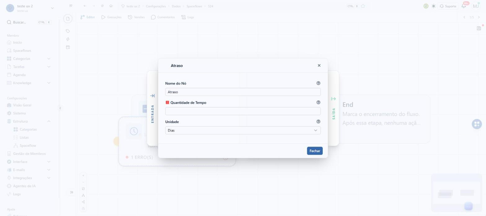
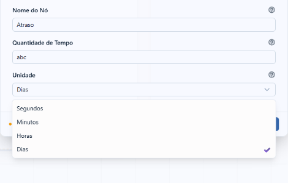
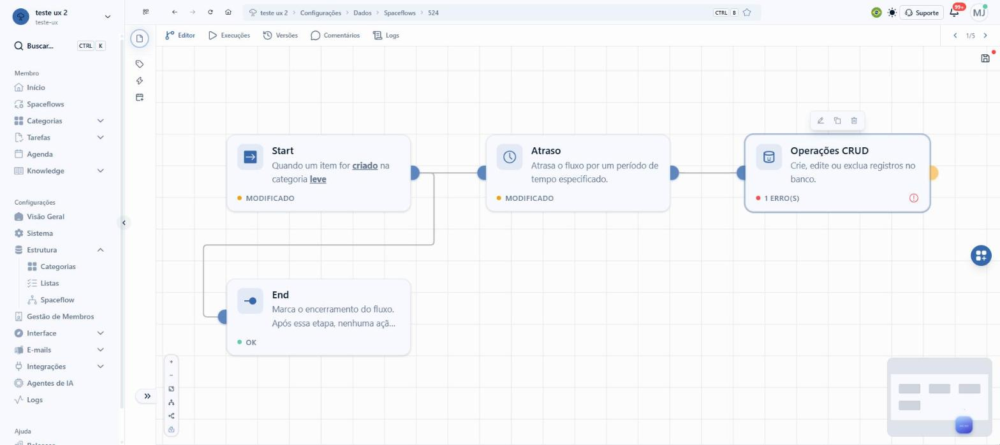
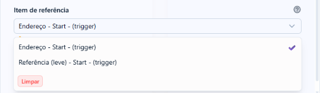

# Nó de Atraso com data de referência

## A demanda, como veio

> no spaceflow temos o nó de delay.
>
> esse nó precisa abarcar o seguinte cenario de cliente:
>
> o cliente tem uma categoria de contratos. toda vez que um contrato for criado precisa disparar um fluxo que tem nó de inicio > delay.
>
> esse delay precisa esperar até 30 dias antes da data de vencimento do contrato. data de vencimento é um campo. -30 dias é o cálculo.
>
> é um calculo deyjs, por tras, mas a interface precisa ser facilitada.
>
> precisa aceitar a variavel e ter uma interface pro cálculo que seja intuitiva, de boa ux.
>
> veja como outros produtos que trabalham com automações desse tipo (n8n, zapier, make...) trabalham com nós de delay, wait e outros similares pra entender se isso é possível e como fazer uma interface boa o suficiente pra um user leigo.
>
> veja como é nosso nó de delay hoje também pra fazer isso funcionar.

- **Tela em jogo:** Configurações › Estrutura › Spaceflow › um fluxo › clique duas vezes no nó **Atraso**.
- **Sucesso:** quem configura escolhe "30 dias antes da Data de vencimento" sem escrever fórmula e vê, antes de
  salvar, em que dia um contrato real vai continuar.

## O que a pesquisa de UX já dizia

Procurei no `enspace-ux-research` (`temas/README.md`, as auditorias dos 6 temas e o `UX_REPORT.md`) por
Spaceflow, delay, atraso, espera e fluxo. Não há auditoria do construtor de fluxos nem do nó de Atraso. O único
ponto vizinho é transversal: a persona leiga não entende o rótulo "Spaceflows" no menu (`temas/plataforma`).
Não muda esta proposta.

## O nó de Atraso hoje (develop, 14/10/2026)

Explorado no workspace de exploração, pela tela, num fluxo criado para o teste (nº 524, "Aviso de vencimento de
contrato"). Nenhum preparo por API.

### O caminho

1. Configurações › Estrutura › Spaceflow › **Novo Workflow** (nome, descrição, ícone) › **Criar**.
2. O editor abre com **Start** ligado a **End**.
3. Clique duas vezes no Start › **Modo de Início**: Ações de Itens › **Categoria de Referência** › **Ação de
   Gatilho**: Criação › **Salvar e fechar**.
4. Botão redondo à direita (**Adicionar Nó**) › **Lógica e Controle** › arrastar **Atraso** para o canvas.
5. Ligar a saída do Start à entrada do Atraso.
6. Clique duas vezes no Atraso: o modal tem 3 campos.



| Campo | Como é |
|---|---|
| Nome do Nó | Texto. Padrão "Atraso" |
| Quantidade de Tempo | Campo de **texto**, obrigatório. Ajuda: "Defina a quantidade de tempo para atrasar a execução do fluxo de trabalho." |
| Unidade | Segundos, Minutos, Horas ou Dias. Padrão Dias |



### O que o nó grava

O schema do SDK (`@be-enlighten/enspace-sdk-schemas`, nó `type: 'delay'`) é:

```ts
data: { label: string, delay: string | number, unit: 'second' | 'minute' | 'hour' | 'day' }
```

`delay` aceita texto. Não há campo de data, de deslocamento, de horário nem de fuso.

### Onde trava

- **Não existe espera até uma data.** O caso do cliente (30 dias antes do vencimento) não se monta com o nó.
  Cada contrato vence num dia diferente; um número fixo de dias não serve.
- **A quantidade aceita qualquer texto.** Digitei "abc" e salvei: o nó ficou "MODIFICADO", sem erro. O único
  erro que o card mostrou antes de ligar as arestas foi "Nenhum alvo conectado". Digitar `{{` também não abre
  nenhuma lista de variáveis.
- **O card não diz quanto espera.** Com o nó configurado, o card continua com o texto genérico "Atrasa o fluxo
  por um período de tempo especificado."



### O que já existe e serve

O nó **Operações CRUD** já escolhe variável de nó anterior numa lista. Em "Item de referência" ela aparece como
`<Campo> - <Nó> - (trigger)`, por exemplo "Endereço - Start - (trigger)". Ao escolher, um aviso amarelo diz:
"Você está usando uma variável como valor. Se o valor for inválido, o resultado será desconsiderado."



A proposta reaproveita esse padrão (a variável vem de uma lista, agrupada pelo nó), com rótulo de gente.

### Achados de passagem

- Arrastar nó da paleta só funciona com arrastar nativo do navegador. Para a exploração, o arraste foi simulado
  por evento; quem usa mouse não percebe.
- O campo "Valor" do CRUD também não abre lista ao digitar `{{`.

## A casca da tela, item por item

Cópia do develop em 14/10/2026, em `_CascaDasConfiguracoes.vue` e `_EditorDoSpaceflow.vue`.

| Parte | O que foi copiado |
|---|---|
| Menu lateral, topo | Workspace com slug, busca com Ctrl K |
| Menu, Membro | Início, Spaceflows, Categorias (chevron), Tarefas (chevron), Agenda, Knowledge (chevron) |
| Menu, Configurações | Visão Geral, Sistema, **Estrutura aberta** (Categorias, Listas, **Spaceflow ativo**), Gestão de Membros, Interface (chevron), E-mails (chevron), Integrações (chevron), Agentes de IA, Logs |
| Menu, Ajuda | Releases, Documentação (abre fora) |
| Barra do topo | Recolher, voltar, avançar, recarregar, início, trilha "workspace › Configurações › Dados › Spaceflows › 524", Ctrl B, estrela, idioma, tema, Suporte, sino, avatar |
| Editor | Botão de detalhes; abas Editor, Execuções, Versões, Comentários, Logs; versões "1/5"; disquete com ponto de alteração |
| Canvas | Trilho da esquerda (etiqueta, raio, calendário), grade, cards com ícone, título, descrição e rodapé de estado, alças de entrada e saída, zoom no canto inferior esquerdo, minimapa, botão redondo Adicionar Nó |
| Modal do nó | ENTRADA à esquerda, SAÍDA à direita, cabeçalho com ícone e X, rodapé com "Modificado", Cancelar e Salvar e fechar (ou só Fechar sem alteração) |

Diferenças: o workspace de exploração não tem "Credenciais" no menu (o protótipo `migracao-de-workspace`
tinha); o canvas é desenho estático com zoom, sem arrastar nó.
