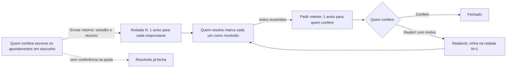

# Decisões: Pasta de apontamentos

**A proposta em uma linha:** um tipo novo de pasta, Apontamentos, que o admin nomeia ("Retorno de testes", "Pendências do contrato"); dentro dela, uma lista de pontos a ajustar, cada um com corpo rico, anexos, responsável, estado e histórico, que quem resolve marca e quem confere aprova ou reabre, em rodadas. A tarefa ganha a mesma lista numa aba fixa.

**Rodada 2, em uma linha:** as rodadas ganham vista própria e o cabeçalho perde o gráfico; a tarefa rápida ganha checklist, subtarefas de 1 nível, dependências e conclusão com motivo; o item ganha o contador da lista de tarefas; a citação com # liga apontamento, tarefa e item.

## Rodada 2 · 2026-11-11

- **Pedido (literal):** "apontamentos então poderia ser uma aba de "aprovaçoes?" alem disso, nao deve ter grafico nenhum no topo. as rodadas são importantes. bastante. poder criar os apontamentos, editar, ver etc tambem." e "conceitos do github que quero que voce implemente no prototipo, dividindo uma visualização do protótipo pra ITENS e outra pra TAREFAS RAPIDAS [...] task list (se cabivel) sub-issue issues (se fizer sentido importar algo disso)". Aprovação: "pode deixar assim em portugues, mas em ingles pode botar issues mesmo se fizer sentido. fora isso pode aplicar!"
- **Fronteira:**
  - muda: o cabeçalho da pasta de apontamentos (sem gráfico), a vista Rodadas, o filtro e o agrupamento por rodada, o detalhe do apontamento (editar, versões, tela cheia, linha do tempo por rodada, citação com #, descarte por duplicado), as seções novas do painel da tarefa (Checklist, Subtarefas, Dependências, Mencionada em), a conclusão com motivo, os contadores do cartão e o contador do campo HTML da Visão Geral;
  - não muda: a casca das 2 telas (copiada do develop), as outras pastas do item, as outras abas da tarefa, Detalhes da tarefa e o editor de texto do campo HTML.

### As 2 visualizações

| Visualização | Onde no produto | O que só existe nela |
|---|---|---|
| Item | Tela do item | A pasta de apontamentos e o contador "2 de 4" do campo HTML com lista de tarefas |
| Tarefa rápida | Tarefas › Rápidas | Checklist, subtarefas, dependências e conclusão com motivo |
| As 2 | | A citação com # e a aba Apontamentos da tarefa |

### Do GitHub para o ENSPACE

| No GitHub | No protótipo | O que mudou para quem não é dev |
|---|---|---|
| Issue | O apontamento | Nome de cada pasta dado pelo admin; estados com nome do cliente; "Resolvido" e "Conferido" no lugar de "closed" |
| Review com "Request changes" | A rodada, com veredito | Ajustes necessários, Aprovado com ressalvas e Aprovado, em vez do jargão de revisão |
| Task list (`- [ ]`) e "2 of 4 tasks" | Checklist da tarefa; contador no campo HTML do item | Seção própria na tarefa, com dono por linha e arrastar; no item, o editor que já existe ganha só o contador |
| Converter linha em issue | "Converter em subtarefa" | A linha convertida se marca sozinha quando a subtarefa é concluída |
| Sub-issue e "Parent issue" | Subtarefa de 1 nível e a trilha "Parte de" | 1 nível só: a subtarefa não tem subtarefas |
| "Blocked by" e "Blocking" | Dependências: Bloqueada por e Bloqueia | O cartão diz por quem a tarefa espera, em texto |
| Referência `#123` e "mentioned this" | Citação com # e a seção "Mencionada em" | O # abre uma busca por nome; ninguém decora número |
| "Close as not planned" e "duplicate" | Conclusão com motivo; descarte "Duplicado de" | A tarefa duplicada aponta para a outra |
| Histórico de edição | Marca "editado" com as versões | Clique na marca mostra o texto anterior |

### Decisões

| Decisão | Motivo |
|---|---|
| O nome continua Apontamentos; em inglês, Issues | "Aprovações" já é outra coisa no produto: os aprovadores da tarefa (`task_approvers`, "Ativar Aprovadores"). A aprovação entrou como veredito da rodada |
| Sem gráfico no cabeçalho; a situação vai numa linha de texto | Pedido literal. A linha diz rodada, desde quando e o último veredito; as contagens ficam nos filtros |
| Vista Rodadas ao lado da Lista | "as rodadas são importantes. bastante". Cada rodada mostra veredito, resumo, quem enviou, o pedido de reteste e o que entrou, voltou, foi resolvido, conferido ou descartado |
| A rodada em preparação aparece só para quem confere, com borda tracejada | É o rascunho do GitHub: só vira rodada quando sai o retorno |
| Filtro por rodada e "Agrupar por rodada" na Lista | Para responder "o que voltou na R2?" sem trocar de vista |
| A seção Resolvidos usa o nome que a pasta dá ao estado ("Corrigidos", "Ajustados") | O cliente lê o nome dele em todo lugar |
| Editar fica visível no topo do detalhe, para quem criou | Pedido literal ("criar, editar, ver"). A marca "editado" guarda as versões |
| Linha do tempo única, agrupada por rodada | Evento, comentário e edição na mesma ordem; o grupo da rodada diz em que volta cada coisa aconteceu |
| Tela cheia e Copiar link no detalhe | Apontamento longo com print pede espaço; o link abre no apontamento |
| Descartar oferece "Não será feito" ou "Duplicado de #n" | O duplicado aponta para o original, sem texto livre |
| Checklist é seção da tarefa, não do editor | A Lista de Tarefas do editor já existe e não tem dono, contador nem ordem. A seção tem os 3 |
| Subtarefa de 1 nível, só na tarefa rápida | É uma tarefa inteira (prazo, responsável, status). Mais de 1 nível vira árvore que ninguém lê no cartão |
| A subtarefa não vira cartão, salvo com "Mostrar subtarefas como cartões" | O quadro continua mostrando o trabalho, não a decomposição. O cartão da mãe conta e abre as subtarefas |
| Concluir pede o motivo e oferece concluir as subtarefas abertas | "Não será feita" e "Duplicada de" deixam de parecer entrega |
| Item sem sub-item | O item já tem pastas e tarefas; um sub-item duplicaria a pasta Tarefas |
| Citação com # vale para tarefa, item e apontamento | Liga o retorno de teste à tarefa que vai corrigir, e a tarefa mostra quem a citou |

### Para o dev

- **Subtarefa pede campo novo:** o modelo `tasks` (`plugins/en-tasks/models/tasks.settings.json`) não tem `parent`. A proposta precisa de `parent` (1 nível) e de uma relação "bloqueada por" entre tarefas.
- **Checklist pede estrutura própria:** a linha tem texto, feito, responsável opcional, ordem e a subtarefa ligada. A Lista de Tarefas do `EnEditor` (TipTap `TaskList`) continua no campo HTML do item; o contador lê as caixas do HTML.
- **Conclusão com motivo:** campo novo na tarefa (concluída, não será feita, duplicada de) e o id da tarefa original.
- **Citação:** a resposta guarda as citações (tipo e id); o citado mostra "Mencionada em" a partir delas. O aviso `comment.mention` serve de modelo.
- Componentes novos: `_VistaDeRodadas.vue`, `_SecoesDaTarefa.vue`, `_CampoComCitacao.vue`, `_VisaoGeralDoItem.vue`; regras da tarefa em `tarefas.ts`, da citação em `citacao.ts`.
- **CSS próprio:** nenhum novo. A linha vertical das rodadas e a borda tracejada da rodada em preparação são classes do Tailwind.

- **Descartado:** "Aprovações" como nome da pasta. Motivo: colide com os aprovadores da tarefa.
- **Descartado:** etiquetas, milestone, reações, comentário fixado e tipos de issue do GitHub. Motivo: não resolvem o retorno de teste e somam jargão.
- **Descartado:** sub-item. Motivo: o item já se divide em pastas e tarefas.
- **Maquete:** arrastar a checklist (reordena em memória); "Vincular tarefa existente" (só muda a mãe no mock); a menção não envia aviso; o contador do campo HTML lê o mock, não o HTML. Tudo volta ao mock no recarregar.
- **Crítica e acessibilidade:**
  - a linha da checklist tem botão de arrastar com rótulo e move com as setas do teclado;
  - a caixa da linha ligada a uma subtarefa fica desabilitada, com dica que diz qual subtarefa a marca;
  - a lista de sugestões do # é `listbox` ligada ao campo (`aria-controls`, `aria-expanded`), com setas, Enter e Esc;
  - status da subtarefa e do bloqueio aparecem em ícone e cor, com o nome no rótulo do botão;
  - corrigido nesta rodada: a busca do # lia o texto com 1 letra de atraso; o seletor de bloqueio ficava com o id da tarefa escolhida; o Desfazer quebrava depois de uma resposta com citação;
  - sem correção nesta rodada: no modo de desenvolvimento, o painel da Tarefa rápida leva alguns segundos para abrir sozinho na primeira carga.
- **Ver:** https://pernalombr4.github.io/prototipos/pasta-de-apontamentos/?vista=tarefa · `evidencias/rodada2-tarefa-rapida.jpg`, `evidencias/rodada2-vista-rodadas.jpg`, `evidencias/rodada2-visao-geral-contador.jpg`

## Rodada 1 · 2026-11-11

- **Pedido (literal):** "eu precisava de um tipo de folder ali que eu pudesse nomear como "retorno de teste" e tivesse uma interface interativa nesse sentido. mas nao pode servir só à realidade de produtos, tem que servir pra vários tipos de cliente" e "varios pequenos cards em q a gente poderia dizer "conserta isso", "faz aquilo" (nao cards de kanban, mas uma lista mesmo) colocando imagens, texto, arquivo etc e o dev poderia ir dando check naquilo" e "NAO sao subtarefas".
- **Fronteira:** muda o modal "Nova pasta" (o tipo novo e a configuração dele), a barra de pastas (o contador da pasta nova), o cartão da pasta Tarefas (a linha de apontamentos) e o painel da tarefa (a aba Apontamentos); não muda o resto da tela do item, as outras pastas, as outras abas da tarefa nem o menu.

### A jornada

### Decisões

| Decisão | Motivo |
|---|---|
| Tipo de pasta novo, com o nome que o admin der | O tipo carrega o comportamento; o nome carrega o contexto. "Retorno de testes" e "Pendências do contrato" são a mesma peça |
| O tipo se chama Apontamentos (ES "Puntos de ajuste"; EN "Issues" desde a rodada 2) | "Pendência" já designa outra coisa no produto (tarefa pendente); "issue" e "punch item" são de um ramo só. Ver PESQUISA, "Nome do tipo de pasta" |
| Lista, nunca quadro | Pedido literal. A lista mostra ordem e progresso; o quadro esconde o que está em outra coluna |
| Lista e detalhe lado a lado; em espaço estreito, um depois do outro | Quem confere passa por 12 apontamentos sem fechar e abrir janela. No painel da tarefa e abaixo de 880 px, o detalhe ocupa o lugar da lista, com Voltar |
| Quem resolve não fecha: marca "Resolvido", e quem confere confere ou reabre | Procore, Marker.io e Fieldwire fazem igual. É o que impede o "corrigido" que não foi testado |
| A conferência é opcional, por pasta | Pasta sem conferência: "Resolvido" já fecha. Serve a quem só quer um checklist com dono |
| Estados com significado fixo e nome editável | O relatório e o Spaceflow leem o significado; o cliente lê o nome ("Corrigido", "Ajustado") |
| Rascunho e "Enviar retorno" | O GitHub faz isso na revisão de PR: o dev recebe 1 aviso com a rodada inteira, não 1 por apontamento |
| Rodada (R1, R2) em cada apontamento e no cabeçalho | Substitui o histórico do `.docx`: a rodada guarda veredito, resumo e quem pediu reteste |
| Reabrir e descartar pedem motivo | Sem o motivo, o reaberto vira adivinhação. O motivo entra na conversa do apontamento |
| Print, arquivo e link como anexo, fora do corpo | O corpo fica legível; o anexo ganha contagem na linha, tela cheia para imagem e download para Postman e JSON |
| Modelo do corpo por pasta | Produto escreve Onde, Problema e Correção sugerida; jurídico escreve Cláusula, Como está e Como deve ficar |
| "Colar uma lista" cria rascunhos em lote | Quem testou já tem a lista escrita em outro lugar; 1 linha vira 1 apontamento |
| "Converter em tarefa" é uma saída, no menu do apontamento | Para o ponto que cresceu e pede prazo próprio. O apontamento fica, com a referência à tarefa |
| A tarefa ganha a aba fixa Apontamentos, entre Comentários e Logs | A tarefa não tem pastas (abas fixas no componente). A aba usa a configuração padrão do tipo: conferência ligada, quem confere é quem criou |
| Subtarefa fica fora | O pedido descarta. O apontamento não tem prazo, quadro nem status de tarefa; a subtarefa teria, e duplicaria a pasta Tarefas |
| Andaime com 2 cenários | Prova a pergunta "serve a qualquer cliente?": o cenário jurídico não tem nenhuma palavra de software |

### Para o dev

- Componente novo `_PastaDeApontamentos.vue` serve à pasta do item e à aba da tarefa; a prop `compacto` troca o lado a lado pela sequência.
- O apontamento selecionado vai para o endereço (`?apontamentos-ap=4`): o link de um apontamento abre nele.
- A pasta Tarefas não usa o `EnKanbanBoard`: o `EnKanbanCardConfig` monta selos só a partir de campos de seleção, e a linha "1 de 2 pendentes" muda com a lista.
- CSS próprio: o fundo listrado do rascunho (`bg-[repeating-linear-gradient(...)]` em `_LinhaDoApontamento.vue`). Nenhum `UBadge` ou variante do Nuxt UI marca "só você vê"; a listra diz isso sem texto.

- **Descartado:** subtarefas. Motivo: pedido literal, e a subtarefa traria prazo e status de tarefa para um ponto que só precisa de dono e de check.
- **Descartado:** quadro de apontamentos por estado. Motivo: pedido literal ("nao cards de kanban").
- **Maquete:** Exportar PDF e Copiar link da pasta (só o toast); download de anexo (toast); avisos aos responsáveis (o texto do modal diz quem recebe, nada é enviado); a trava de concluir o item com apontamento pendente (só a opção no modal); Editar, Ocultar e Excluir da barra de pastas; as abas Item, Comentários e Logs da tarefa e as outras pastas do item; o rodapé do painel da tarefa (toast). Tudo volta ao mock no recarregar.
- **Crítica e acessibilidade:**
  - o check da linha é botão com rótulo ("Marcar como resolvido", "Voltar para aberto") e `aria-pressed`; o título da linha é outro botão, e os 2 recebem foco;
  - os filtros usam `aria-pressed`; a barra de progresso tem rótulo de texto ("5 de 11 fechados") e a legenda repete as contagens em texto, sem depender só da cor;
  - o estado do apontamento aparece em selo com ícone e nome, não só na cor da bolinha;
  - sem correção nesta rodada: no painel da tarefa, o detalhe fecha pelo X para voltar à lista; um "Voltar" com texto seria mais claro;
  - sem correção nesta rodada: o seletor de Ícone do modal mostra o nome técnico do ícone ("list-checks"), como faria uma lista sem prévia.
- **Ver:** https://pernalombr4.github.io/prototipos/pasta-de-apontamentos/ · `evidencias/rodada1-pasta-do-item.jpg`
