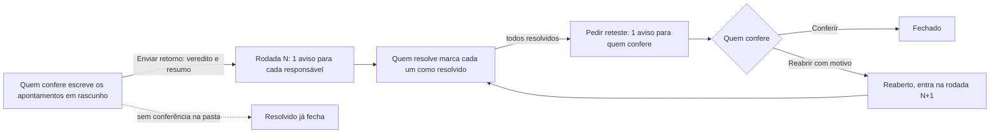

# Decisões: Pasta de apontamentos

**A proposta em uma linha:** um tipo novo de pasta, Apontamentos, que o admin nomeia ("Retorno de testes", "Pendências do contrato"); dentro dela, uma lista de pontos a ajustar, cada um com corpo rico, anexos, responsável, estado e histórico, que quem resolve marca e quem confere aprova ou reabre, em rodadas. A tarefa ganha a mesma lista numa aba fixa.

## Rodada 1 · 2026-11-11

- **Pedido (literal):** "eu precisava de um tipo de folder ali que eu pudesse nomear como "retorno de teste" e tivesse uma interface interativa nesse sentido. mas nao pode servir só à realidade de produtos, tem que servir pra vários tipos de cliente" e "varios pequenos cards em q a gente poderia dizer "conserta isso", "faz aquilo" (nao cards de kanban, mas uma lista mesmo) colocando imagens, texto, arquivo etc e o dev poderia ir dando check naquilo" e "NAO sao subtarefas".
- **Fronteira:** muda o modal "Nova pasta" (o tipo novo e a configuração dele), a barra de pastas (o contador da pasta nova), o cartão da pasta Tarefas (a linha de apontamentos) e o painel da tarefa (a aba Apontamentos); não muda o resto da tela do item, as outras pastas, as outras abas da tarefa nem o menu.

### A jornada

### Decisões

| Decisão | Motivo |
|---|---|
| Tipo de pasta novo, com o nome que o admin der | O tipo carrega o comportamento; o nome carrega o contexto. "Retorno de testes" e "Pendências do contrato" são a mesma peça |
| O tipo se chama Apontamentos (EN "Action items", ES "Puntos de ajuste") | "Pendência" já designa outra coisa no produto (tarefa pendente); "issue" e "punch item" são de um ramo só. Ver PESQUISA, "Nome do tipo de pasta" |
| Lista, nunca quadro | Pedido literal. A lista mostra ordem e progresso; o quadro esconde o que está em outra coluna |
| Lista e detalhe lado a lado; em espaço estreito, um depois do outro | Quem confere passa por 12 apontamentos sem fechar e abrir janela. No painel da tarefa e abaixo de 880 px, o detalhe ocupa o lugar da lista, com Voltar |
| Quem resolve não fecha: marca "Resolvido", e quem confere confere ou reabre | Procore, Marker.io e Fieldwire fazem igual. É o que impede o "corrigido" que não foi testado |
| A conferência é opcional, por pasta | Pasta sem conferência: "Resolvido" já fecha. Serve a quem só quer um checklist com dono |
| Estados com significado fixo e nome editável | O relatório e o Spaceflow leem o significado; o cliente lê o nome ("Corrigido", "Ajustado") |
| Rascunho e "Enviar retorno" | O GitHub faz isso na revisão de PR: o dev recebe 1 aviso com a rodada inteira, não 1 por apontamento |
| Rodada (R1, R2) em cada apontamento e no cabeçalho | Substitui o histórico do `.docx`: a rodada guarda veredito, resumo e quem pediu reteste |
| Reabrir e descartar pedem motivo | Sem o motivo, o reaberto vira adivinhação. O motivo entra na conversa do apontamento |
| Print, arquivo e link como anexo, fora do corpo | O corpo fica legível; o anexo ganha contagem na linha, tela cheia para imagem e download para Postman e JSON |
| Modelo do corpo por pasta | Produto escreve Onde, Problema e Correção sugerida; jurídico escreve Cláusula, Como está e Como deve ficar |
| "Colar uma lista" cria rascunhos em lote | Quem testou já tem a lista escrita em outro lugar; 1 linha vira 1 apontamento |
| "Converter em tarefa" é uma saída, no menu do apontamento | Para o ponto que cresceu e pede prazo próprio. O apontamento fica, com a referência à tarefa |
| A tarefa ganha a aba fixa Apontamentos, entre Comentários e Logs | A tarefa não tem pastas (abas fixas no componente). A aba usa a configuração padrão do tipo: conferência ligada, quem confere é quem criou |
| Subtarefa fica fora | O pedido descarta. O apontamento não tem prazo, quadro nem status de tarefa; a subtarefa teria, e duplicaria a pasta Tarefas |
| Andaime com 2 cenários | Prova a pergunta "serve a qualquer cliente?": o cenário jurídico não tem nenhuma palavra de software |

### Para o dev

- Componente novo `_PastaDeApontamentos.vue` serve à pasta do item e à aba da tarefa; a prop `compacto` troca o lado a lado pela sequência.
- O apontamento selecionado vai para o endereço (`?apontamentos-ap=4`): o link de um apontamento abre nele.
- A pasta Tarefas não usa o `EnKanbanBoard`: o `EnKanbanCardConfig` monta selos só a partir de campos de seleção, e a linha "1 de 2 pendentes" muda com a lista.
- CSS próprio: o fundo listrado do rascunho (`bg-[repeating-linear-gradient(...)]` em `_LinhaDoApontamento.vue`). Nenhum `UBadge` ou variante do Nuxt UI marca "só você vê"; a listra diz isso sem texto.

- **Descartado:** subtarefas. Motivo: pedido literal, e a subtarefa traria prazo e status de tarefa para um ponto que só precisa de dono e de check.
- **Descartado:** quadro de apontamentos por estado. Motivo: pedido literal ("nao cards de kanban").
- **Maquete:** Exportar PDF e Copiar link da pasta (só o toast); download de anexo (toast); avisos aos responsáveis (o texto do modal diz quem recebe, nada é enviado); a trava de concluir o item com apontamento pendente (só a opção no modal); Editar, Ocultar e Excluir da barra de pastas; as abas Item, Comentários e Logs da tarefa e as outras pastas do item; o rodapé do painel da tarefa (toast). Tudo volta ao mock no recarregar.
- **Crítica e acessibilidade:**
  - o check da linha é botão com rótulo ("Marcar como resolvido", "Voltar para aberto") e `aria-pressed`; o título da linha é outro botão, e os 2 recebem foco;
  - os filtros usam `aria-pressed`; a barra de progresso tem rótulo de texto ("5 de 11 fechados") e a legenda repete as contagens em texto, sem depender só da cor;
  - o estado do apontamento aparece em selo com ícone e nome, não só na cor da bolinha;
  - sem correção nesta rodada: no painel da tarefa, o detalhe fecha pelo X para voltar à lista; um "Voltar" com texto seria mais claro;
  - sem correção nesta rodada: o seletor de Ícone do modal mostra o nome técnico do ícone ("list-checks"), como faria uma lista sem prévia.
- **Ver:** https://pernalombr4.github.io/prototipos/pasta-de-apontamentos/ · `evidencias/rodada1-pasta-do-item.jpg`
