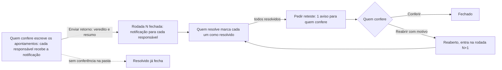

# Decisões: Pasta de apontamentos

**A proposta em uma linha:** um tipo novo de pasta, Apontamentos, com nome fixo e no máximo 1 por categoria; dentro dela, uma lista de pontos a ajustar, cada um com corpo rico, anexos, responsáveis, estado e histórico, que quem resolve marca e quem confere aprova ou reabre, em rodadas. A tarefa ganha a mesma lista numa aba fixa.

**Rodada 2, em uma linha:** as rodadas ganham vista própria e o cabeçalho perde o gráfico; a tarefa rápida ganha checklist, subtarefas de 1 nível, dependências e conclusão com motivo; o item ganha o contador da lista de tarefas; a citação com # liga apontamento, tarefa e item.

## Rodada 5 · 2026-11-12

- **Pedidos (literais):**
  - "voce deve prototipar um estado vazio quando o estado vazio estiver selecionado, nao so pros apontamentos. tem que ficar vazio de subtarefa, vazio de checklist etc. aí a tarefa pode ser bem parecida com o clickup (o modo funcional mesmo), como nos prints"
  - "relacionar itens ou adicionar dependências, é apontar dependencias ou vincular a task a um item ou uma outra task"
  - "as tarefas rapidas do enspace tem um campo de PONTOS da tarefa tambem. voce deve botar ele la. é um campo de número que pode ser usado de diversas formas."
- **Referência:** os 4 prints do ClickUp que a redatora mandou: a lista de ações (Add subtask, Relate items or add dependencies, Create checklist, Attach file), o menu "Relate a Task or Doc" com "This task blocks..." e "This task is blocked by...", a seção Checklists com "Add item" e "Add checklist", e a linha "Add subtask" com os ícones, Cancel e Save.
- **Fronteira:**
  - muda: as seções abaixo de "Detalhes da tarefa" (ações, Subtarefas, Checklists, Relacionamentos, Anexos), o campo Pontos em Detalhes e o estado vazio da tarefa no andaime;
  - não muda: o trilho, as abas, o cabeçalho, os outros campos de Detalhes e o rodapé do painel (cópia do develop), o quadro de Tarefas Rápidas, a aba Apontamentos e o "Concluir tarefa" com motivo.

| Decisão | Motivo |
|---|---|
| "Estado: Vazio" também esvazia a tarefa: as mesmas tarefas-mãe, sem descrição, prazo, pontos, subtarefas, checklists, relacionamentos, anexos e apontamentos | Pedido literal. O que se cria no vazio fica até trocar de estado; voltar ao "Cheio" reabre a mesma tarefa com o conteúdo de exemplo |
| A seção só aparece quando tem conteúdo. Na tarefa vazia, abaixo de Detalhes, fica só o quadro "Esta tarefa ainda não tem subtarefas, checklists, relacionamentos nem anexos." com as 4 ações em lista | É o modo do ClickUp: a tarefa nova não mostra 4 caixas vazias, mostra o que se pode acrescentar |
| Com conteúdo, as 4 ações viram uma fileira de botões com contorno e ícone, logo abaixo de Detalhes | A ação continua no mesmo lugar e não some quando a 1ª seção aparece |
| A subtarefa não mostra "Adicionar subtarefa" | A subtarefa tem 1 nível, desde a rodada 2 |
| Subtarefas: a linha de criação tem o círculo tracejado, o nome, os botões de responsável, data limite, prioridade e pontos, Cancelar e Salvar com o atalho Enter | Pedido literal (o print da linha "Add subtask"). Depois de salvar, a linha fica aberta para a próxima, como no ClickUp; Esc cancela |
| A linha da subtarefa mostra a bandeira (só prioridade alta e urgente), os pontos, a data e o responsável; o cabeçalho soma os pontos das subtarefas | Os pontos servem de soma quando a tarefa se divide; a bandeira normal só ocupa espaço |
| "Vincular tarefa existente" continua, ao lado de "Adicionar subtarefa" | A tarefa solta já criada também vira parte de outra |
| Checklists: a tarefa pode ter várias, cada uma com nome; "Adicionar item" leva o responsável na mesma linha, e "Adicionar checklist" cria outra | Pedido literal (o print da seção Checklists). O jurídico mostra 2: "Assinaturas" e "Depois de assinar" |
| Clicar no nome renomeia; o "..." da checklist tem Renomear e Excluir checklist, com Desfazer | Mesmo comportamento das linhas, que já editam no clique |
| "Relacionar ou adicionar dependência" abre um menu com busca: Vincular a um item, Vincular a outra tarefa e, em Dependência, "Esta tarefa bloqueia..." e "Esta tarefa está bloqueada por..." | Pedido literal: no ENSPACE, relacionar é apontar dependência ou vincular a item ou a outra tarefa. Cada opção abre a busca dela, com voltar |
| A busca de item mostra nome, categoria e referência, de qualquer categoria do workspace | O item vinculado quase nunca é da mesma categoria da tarefa (o bug, a procuração) |
| Tudo cai na seção Relacionamentos: Bloqueada por, Bloqueia, Tarefas relacionadas e Itens vinculados; cada vínculo sai no "x" | Um lugar só para o que liga a tarefa a outra coisa. A antiga seção Dependências entra aqui |
| Tarefa relacionada vale nos 2 sentidos; "Bloqueia" grava na outra tarefa o "Bloqueada por" | Relacionar A com B mostra o vínculo nas 2. Bloquear é a mesma dependência vista do outro lado |
| A busca não oferece a própria tarefa, o que já está ligado do mesmo jeito, nem a própria subtarefa como bloqueio | Evita vínculo repetido e a tarefa que espera a parte dela mesma |
| Clicar no item vinculado avisa que ele abre na tela dele | O protótipo tem 1 item só |
| "Anexar arquivos" abre o seletor do navegador; a seção Anexos mostra nome e tamanho | O ClickUp tem "Attach file" na mesma lista. O arquivo não sai do navegador |
| Pontos é um campo de número em Detalhes, ao lado de Responsável, com o "?" "Número livre da tarefa. A equipe define o uso: esforço, valor, peso ou outra medida." | Pedido literal. O `points` existe na tarefa e o painel do develop não mostra (achado do protótipo tarefas-rapidas) |
| As seções recolhem pela seta do cabeçalho | É o comportamento dos prints do ClickUp |

- **Para o dev:**
  - `points` (número, padrão 0) já existe em `tasks`; falta mostrar e editar no painel e na criação da subtarefa;
  - a tarefa ganha várias checklists com nome (`checklists[]`, cada uma com `linhas[]`), vínculo com outra tarefa nos 2 sentidos, vínculo com itens de qualquer categoria e anexos; nada disso existe no modelo `tasks` lido em 11/11/2026;
  - "Esta tarefa bloqueia X" grava a dependência em X, do mesmo jeito que "X está bloqueada por esta tarefa".
- **Descartado:** as 4 seções sempre à vista com a frase de vazio de cada uma (rodada 2). Motivo: pedido literal, o modo do ClickUp.
- **Ver:** https://pernalombr4.github.io/prototipos/pasta-de-apontamentos/?vista=tarefa&estado=vazio · `evidencias/rodada5-tarefa-vazia.jpg` · `evidencias/rodada5-nova-subtarefa.jpg` · `evidencias/rodada5-relacionar.jpg` · `evidencias/rodada5-tarefa-cheia.jpg` · `evidencias/rodada5-subtarefa-vazia.jpg`

## Rodada 4 · 2026-11-12

- **Pedidos (literais):**
  - "voce mostra a tarefa rapida em sidebar, certo? e o item em tela cheia. tem que mostrar o item no prototipo em sidebar tambem. vai ajudar a entendermos se ta sobrecarregado de elementos ou nao"
  - "o campo de texto do apontamento deve vir vazio (o html) se precisar pode ter só um placeholder ali do tipo "descreva...""
  - "o botao anexar arquivo deve ser "anexar arquivos" no plural"
  - "o campo com nome da pessoa e o do lado não têm título"
  - "o campo de responsável deve ser de seleçao multipla, sendo um campo de responsáveis no plural"
  - "acho que ele deveria ficar como um card resumido, trazendo só a parte de cima (print) e podendo ser expandido ali ou colocado em tela cheia"
  - "ao botar em tela cheia, o modal ta pegando o maximo da altura da tela, tem que limitar um bocado"
  - "no botao "Novo apontamento" nao deve existir no dorpdown dele a iopçao de copiar link da pasta"
  - "o apontamento gerado pro usuario X deve enviar NOTIFICAÇAO pra ele"
  - "a questao do link realmente ta perdida. até aparece no meio dos anexos. ta ilógico. acho que tem que tirar isso do link"
  - "o botao de agrupar por rodada nao precisa. e o "só os meus" deve ter a emsma aparencia de filtros rapidos de outras telas do enspace"
  - "pode tirar a ideia de poder deixar um apontamento em rascunho tambem. desnecessário."
- **Fronteira:**
  - muda: a visualização "Item em: Tela cheia | Painel lateral" no andaime; o formulário do apontamento; o detalhe (cartão resumido e tela cheia); os filtros da lista; o menu do "Novo apontamento"; o sino do topo; o Editar da pasta (sem modelo); o fim do rascunho;
  - não muda: a listagem da categoria e a gaveta do item (cópia do develop), a barra de pastas com o "+N" (cópia do develop), a vista Rodadas, a tarefa rápida.

| Decisão | Motivo |
|---|---|
| "Item em: Painel lateral" abre o item na gaveta da direita, sobre a listagem da categoria, como o develop faz ao clicar numa linha | Pedido literal. A gaveta mede 700 px, de 400 a 1400, com a alça de largura; é nela que se julga se a pasta pesa |
| Na gaveta, a barra de pastas mostra as que cabem e o "+N" com as outras, copiado do develop | É o comportamento real da barra no item aberto em gaveta, sem melhoria de passagem |
| O corpo do apontamento novo começa vazio, com a dica "Descreva o apontamento..." | Pedido literal. Sai o modelo por pasta (Onde, Problema, Correção sugerida) e a opção dele no Editar da pasta |
| No detalhe, corpo vazio mostra "Sem descrição." | Sem a frase, a seção fica em branco e parece erro de carregamento |
| "Anexar arquivos", no plural | Pedido literal. O seletor já aceita vários arquivos |
| Sai o link como anexo e o botão "Adicionar link" | Pedido literal. A gravação ou a página entra como arquivo ou no texto do corpo |
| Responsáveis e Prioridade com rótulo, no formulário e no detalhe | Pedido literal. Sem rótulo, o nome da pessoa não diz o papel dela |
| Responsáveis em seleção múltipla, com busca | Pedido literal. A vez do apontamento pendente é de todos os responsáveis ("A vez é de Bruno Tavares e Caio Mendes"); qualquer um deles marca "Resolvido" |
| Na lista, os responsáveis viram um grupo de avatares (até 3) | Cabe na linha sem quebrar o título |
| No espaço estreito (gaveta e painel da tarefa), o apontamento escolhido vira cartão na própria lista: só o cabeçalho (#, título, estado e de quem é a vez), com a seta para expandir ali e o botão de tela cheia | Pedido literal. A lista continua à vista e o cartão não empurra os outros apontamentos para fora |
| No espaço estreito, nada abre sozinho | Antes, o 1º reaberto abria e escondia a lista na gaveta |
| A tela cheia é um modal de até 72rem por 46rem, mais largo do que alto: o conteúdo à esquerda e a linha do tempo à direita | Pedido literal, com o ClickUp como referência: a tarefa aberta é um modal largo com a atividade numa coluna à parte |
| Sai "Copiar link da pasta" do menu do "Novo apontamento" | Pedido literal. O menu fica com o que cria: "Colar uma lista" e "Exportar PDF" |
| Sai "Agrupar por rodada" | Pedido literal. O filtro de rodada e a vista Rodadas já respondem "o que é da rodada 2" |
| "Só os meus" é um filtro rápido: botão com ícone, neutro e suave quando desligado, primário e sutil quando ligado | Pedido literal. É a marcação da barra de filtros das listagens do ENSPACE (`UButton size="sm"`, `color` e `variant` pelo estado) |
| Atribuir, reabrir e enviar o retorno notificam cada responsável no sino do topo, menos quem fez a ação | Pedido literal. O sino mostra o número das não lidas, a lista com quem fez e o quê, e "Marcar todas como lidas"; clicar abre o apontamento |
| O toast de criar e o de enviar o retorno dizem quem recebeu a notificação | Quem escreve vê na hora que o aviso saiu, sem abrir o sino |
| Sem rascunho: o apontamento nasce aberto e notifica na hora | Pedido literal. O "Enviar retorno" continua, para fechar a rodada com veredito e resumo |
| Para quem confere, o aviso "A rodada N está em preparo" leva ao "Enviar retorno" | Sem o rascunho, é a rodada em preparo que pede o envio |

- **Para o dev:**
  - o apontamento guarda `responsaveis: number[]`; a API de tarefas tem `assigned_to` com 1 só, e o "Converter em tarefa" leva o 1º;
  - 3 notificações novas: apontamento atribuído (ao criar e a quem entra como responsável depois), apontamento reaberto e retorno da rodada enviado (com quantos apontamentos são da pessoa);
  - sai o estado `rascunho` e o modelo do corpo da configuração da pasta;
  - sai o anexo do tipo link: anexo é imagem ou arquivo, em `c-files`;
  - na gaveta, o sino fica sob o painel, como no develop: para ver a notificação, use "Item em: Tela cheia".
- **Descartado:** o link como anexo, o "Agrupar por rodada", o modelo do corpo, o "Copiar link da pasta" e o rascunho. Motivo: pedido literal.
- **Ver:** https://pernalombr4.github.io/prototipos/pasta-de-apontamentos/?abertura=painel&cenario=juridico · `evidencias/hoje-item-no-painel.jpg` · `evidencias/rodada4-cartao-no-painel.jpg` · `evidencias/rodada4-notificacao.jpg`

## Rodada 3 · 2026-11-12

- **Pedido (literal):** "O nome da pasta não será personalizável. Então mesmo no exemplo jurídico o nome da pasta será apontamentos. Arrume isso"
- **Fronteira:**
  - muda: o nome da pasta na barra, no cabeçalho e na citação; o modal "Nova pasta"; o Editar da pasta Apontamentos; os nomes dos cenários no andaime;
  - não muda: o resto da pasta, a tarefa rápida, os nomes editáveis dos estados ("Corrigido", "Ajustado").

| Decisão | Motivo |
|---|---|
| A pasta se chama Apontamentos em todo workspace; em inglês, Issues; em espanhol, Puntos de ajuste | Pedido literal. O nome segue o idioma de quem usa, como as pastas do sistema (Tarefas, Anexos) |
| No máximo 1 pasta Apontamentos por categoria | 2 pastas com o mesmo nome na barra não se distinguem |
| No "Nova pasta", a opção Apontamentos fica desabilitada quando a categoria já tem a pasta, com o aviso de onde configurar | Quem procura o tipo entende por que não pode escolher e acha o caminho |
| Com o tipo Apontamentos, o Nome da Pasta mostra "Apontamentos" travado, com cadeado e a ajuda "O nome da pasta é fixo e acompanha o idioma de cada pessoa." | O campo continua no lugar do develop, sem pedir um nome que não vale |
| A configuração da pasta mora no Editar da própria pasta (seta da aba) | Sem criar outra pasta, o Editar é o único caminho para conferência, responsável, modelo, nomes dos estados e trava |
| A citação guarda só o número ("#3") e a tela escreve "Apontamentos #3" no idioma de quem lê | O nome fixo traduz; o número não muda |
| Os cenários do andaime se chamam Produto e Jurídico | O nome antigo do cenário era o nome da pasta |

- **Para o dev:** a configuração da pasta (JSON em `c_type_views.folders`) perde o nome para o tipo `apontamentos`; o front escreve o nome pelo idioma. O back recusa a 2ª pasta do tipo na mesma categoria.
- **Descartado:** o nome personalizável e as sugestões de nome do modal ("Retorno de testes", "Pendências do contrato"). Motivo: decisão da redatora.
- **Maquete:** criar pasta de outro tipo põe a aba na barra, com o aviso de fora do escopo.
- **Ver:** https://pernalombr4.github.io/prototipos/pasta-de-apontamentos/?cenario=juridico · `evidencias/rodada3-editar-pasta.jpg`

## Rodada 2 · 2026-11-11

- **Pedido (literal):** "apontamentos então poderia ser uma aba de "aprovaçoes?" alem disso, nao deve ter grafico nenhum no topo. as rodadas são importantes. bastante. poder criar os apontamentos, editar, ver etc tambem." e "conceitos do github que quero que voce implemente no prototipo, dividindo uma visualização do protótipo pra ITENS e outra pra TAREFAS RAPIDAS [...] task list (se cabivel) sub-issue issues (se fizer sentido importar algo disso)". Aprovação: "pode deixar assim em portugues, mas em ingles pode botar issues mesmo se fizer sentido. fora isso pode aplicar!"
- **Fronteira:**
  - muda: o cabeçalho da pasta de apontamentos (sem gráfico), a vista Rodadas, o filtro e o agrupamento por rodada, o detalhe do apontamento (editar, versões, tela cheia, linha do tempo por rodada, citação com #, descarte por duplicado), as seções novas do painel da tarefa (Checklist, Subtarefas, Dependências, Mencionada em), a conclusão com motivo, os contadores do cartão e o contador do campo HTML da Visão Geral;
  - não muda: a casca das 2 telas (copiada do develop), as outras pastas do item, as outras abas da tarefa, Detalhes da tarefa e o editor de texto do campo HTML.

### As 2 visualizações

| Visualização | Onde no produto | O que só existe nela |
|---|---|---|
| Item | Tela do item | A pasta de apontamentos e o contador "2 de 4" do campo HTML com lista de tarefas |
| Tarefa rápida | Tarefas › Rápidas | Checklist, subtarefas, dependências e conclusão com motivo |
| As 2 | | A citação com # e a aba Apontamentos da tarefa |

### Do GitHub para o ENSPACE

| No GitHub | No protótipo | O que mudou para quem não é dev |
|---|---|---|
| Issue | O apontamento | Pasta com nome fixo, Apontamentos; estados com nome do cliente; "Resolvido" e "Conferido" no lugar de "closed" |
| Review com "Request changes" | A rodada, com veredito | Ajustes necessários, Aprovado com ressalvas e Aprovado, em vez do jargão de revisão |
| Task list (`- [ ]`) e "2 of 4 tasks" | Checklist da tarefa; contador no campo HTML do item | Seção própria na tarefa, com dono por linha e arrastar; no item, o editor que já existe ganha só o contador |
| Converter linha em issue | "Converter em subtarefa" | A linha convertida se marca sozinha quando a subtarefa é concluída |
| Sub-issue e "Parent issue" | Subtarefa de 1 nível e a trilha "Parte de" | 1 nível só: a subtarefa não tem subtarefas |
| "Blocked by" e "Blocking" | Dependências: Bloqueada por e Bloqueia | O cartão diz por quem a tarefa espera, em texto |
| Referência `#123` e "mentioned this" | Citação com # e a seção "Mencionada em" | O # abre uma busca por nome; ninguém decora número |
| "Close as not planned" e "duplicate" | Conclusão com motivo; descarte "Duplicado de" | A tarefa duplicada aponta para a outra |
| Histórico de edição | Marca "editado" com as versões | Clique na marca mostra o texto anterior |

### Decisões

| Decisão | Motivo |
|---|---|
| O nome continua Apontamentos; em inglês, Issues | "Aprovações" já é outra coisa no produto: os aprovadores da tarefa (`task_approvers`, "Ativar Aprovadores"). A aprovação entrou como veredito da rodada |
| Sem gráfico no cabeçalho; a situação vai numa linha de texto | Pedido literal. A linha diz rodada, desde quando e o último veredito; as contagens ficam nos filtros |
| Vista Rodadas ao lado da Lista | "as rodadas são importantes. bastante". Cada rodada mostra veredito, resumo, quem enviou, o pedido de reteste e o que entrou, voltou, foi resolvido, conferido ou descartado |
| A rodada em preparação aparece só para quem confere, com borda tracejada | É o rascunho do GitHub: só vira rodada quando sai o retorno |
| Filtro por rodada e "Agrupar por rodada" na Lista | Para responder "o que voltou na R2?" sem trocar de vista |
| A seção Resolvidos usa o nome que a pasta dá ao estado ("Corrigidos", "Ajustados") | O cliente lê o nome dele em todo lugar |
| Editar fica visível no topo do detalhe, para quem criou | Pedido literal ("criar, editar, ver"). A marca "editado" guarda as versões |
| Linha do tempo única, agrupada por rodada | Evento, comentário e edição na mesma ordem; o grupo da rodada diz em que volta cada coisa aconteceu |
| Tela cheia e Copiar link no detalhe | Apontamento longo com print pede espaço; o link abre no apontamento |
| Descartar oferece "Não será feito" ou "Duplicado de #n" | O duplicado aponta para o original, sem texto livre |
| Checklist é seção da tarefa, não do editor | A Lista de Tarefas do editor já existe e não tem dono, contador nem ordem. A seção tem os 3 |
| Subtarefa de 1 nível, só na tarefa rápida | É uma tarefa inteira (prazo, responsável, status). Mais de 1 nível vira árvore que ninguém lê no cartão |
| A subtarefa não vira cartão, salvo com "Mostrar subtarefas como cartões" | O quadro continua mostrando o trabalho, não a decomposição. O cartão da mãe conta e abre as subtarefas |
| Concluir pede o motivo e oferece concluir as subtarefas abertas | "Não será feita" e "Duplicada de" deixam de parecer entrega |
| Item sem sub-item | O item já tem pastas e tarefas; um sub-item duplicaria a pasta Tarefas |
| Citação com # vale para tarefa, item e apontamento | Liga o retorno de teste à tarefa que vai corrigir, e a tarefa mostra quem a citou |

### Para o dev

- **Subtarefa pede campo novo:** o modelo `tasks` (`plugins/en-tasks/models/tasks.settings.json`) não tem `parent`. A proposta precisa de `parent` (1 nível) e de uma relação "bloqueada por" entre tarefas.
- **Checklist pede estrutura própria:** a linha tem texto, feito, responsável opcional, ordem e a subtarefa ligada. A Lista de Tarefas do `EnEditor` (TipTap `TaskList`) continua no campo HTML do item; o contador lê as caixas do HTML.
- **Conclusão com motivo:** campo novo na tarefa (concluída, não será feita, duplicada de) e o id da tarefa original.
- **Citação:** a resposta guarda as citações (tipo e id); o citado mostra "Mencionada em" a partir delas. O aviso `comment.mention` serve de modelo.
- Componentes novos: `_VistaDeRodadas.vue`, `_SecoesDaTarefa.vue`, `_CampoComCitacao.vue`, `_VisaoGeralDoItem.vue`; regras da tarefa em `tarefas.ts`, da citação em `citacao.ts`.
- **CSS próprio:** nenhum novo. A linha vertical das rodadas e a borda tracejada da rodada em preparação são classes do Tailwind.

- **Descartado:** "Aprovações" como nome da pasta. Motivo: colide com os aprovadores da tarefa.
- **Descartado:** etiquetas, milestone, reações, comentário fixado e tipos de issue do GitHub. Motivo: não resolvem o retorno de teste e somam jargão.
- **Descartado:** sub-item. Motivo: o item já se divide em pastas e tarefas.
- **Maquete:** arrastar a checklist (reordena em memória); "Vincular tarefa existente" (só muda a mãe no mock); a menção não envia aviso; o contador do campo HTML lê o mock, não o HTML. Tudo volta ao mock no recarregar.
- **Crítica e acessibilidade:**
  - a linha da checklist tem botão de arrastar com rótulo e move com as setas do teclado;
  - a caixa da linha ligada a uma subtarefa fica desabilitada, com dica que diz qual subtarefa a marca;
  - a lista de sugestões do # é `listbox` ligada ao campo (`aria-controls`, `aria-expanded`), com setas, Enter e Esc;
  - status da subtarefa e do bloqueio aparecem em ícone e cor, com o nome no rótulo do botão;
  - corrigido nesta rodada: a busca do # lia o texto com 1 letra de atraso; o seletor de bloqueio ficava com o id da tarefa escolhida; o Desfazer quebrava depois de uma resposta com citação;
  - sem correção nesta rodada: no modo de desenvolvimento, o painel da Tarefa rápida leva alguns segundos para abrir sozinho na primeira carga.
- **Ver:** https://pernalombr4.github.io/prototipos/pasta-de-apontamentos/?vista=tarefa · `evidencias/rodada2-tarefa-rapida.jpg`, `evidencias/rodada2-vista-rodadas.jpg`, `evidencias/rodada2-visao-geral-contador.jpg`

## Rodada 1 · 2026-11-11

- **Pedido (literal):** "eu precisava de um tipo de folder ali que eu pudesse nomear como "retorno de teste" e tivesse uma interface interativa nesse sentido. mas nao pode servir só à realidade de produtos, tem que servir pra vários tipos de cliente" e "varios pequenos cards em q a gente poderia dizer "conserta isso", "faz aquilo" (nao cards de kanban, mas uma lista mesmo) colocando imagens, texto, arquivo etc e o dev poderia ir dando check naquilo" e "NAO sao subtarefas".
- **Fronteira:** muda o modal "Nova pasta" (o tipo novo e a configuração dele), a barra de pastas (o contador da pasta nova), o cartão da pasta Tarefas (a linha de apontamentos) e o painel da tarefa (a aba Apontamentos); não muda o resto da tela do item, as outras pastas, as outras abas da tarefa nem o menu.

### A jornada

### Decisões

| Decisão | Motivo |
|---|---|
| ~~Tipo de pasta novo, com o nome que o admin der~~ (substituída na rodada 3: o nome é fixo) | O tipo carrega o comportamento; o nome carregava o contexto |
| O tipo se chama Apontamentos (ES "Puntos de ajuste"; EN "Issues" desde a rodada 2) | "Pendência" já designa outra coisa no produto (tarefa pendente); "issue" e "punch item" são de um ramo só. Ver PESQUISA, "Nome do tipo de pasta" |
| Lista, nunca quadro | Pedido literal. A lista mostra ordem e progresso; o quadro esconde o que está em outra coluna |
| Lista e detalhe lado a lado; em espaço estreito, um depois do outro | Quem confere passa por 12 apontamentos sem fechar e abrir janela. No painel da tarefa e abaixo de 880 px, o detalhe ocupa o lugar da lista, com Voltar |
| Quem resolve não fecha: marca "Resolvido", e quem confere confere ou reabre | Procore, Marker.io e Fieldwire fazem igual. É o que impede o "corrigido" que não foi testado |
| A conferência é opcional, por pasta | Pasta sem conferência: "Resolvido" já fecha. Serve a quem só quer um checklist com dono |
| Estados com significado fixo e nome editável | O relatório e o Spaceflow leem o significado; o cliente lê o nome ("Corrigido", "Ajustado") |
| ~~Rascunho e "Enviar retorno"~~ (rodada 4: sai o rascunho; o "Enviar retorno" fecha a rodada) | O GitHub faz isso na revisão de PR: o dev recebe 1 aviso com a rodada inteira, não 1 por apontamento |
| Rodada (R1, R2) em cada apontamento e no cabeçalho | Substitui o histórico do `.docx`: a rodada guarda veredito, resumo e quem pediu reteste |
| Reabrir e descartar pedem motivo | Sem o motivo, o reaberto vira adivinhação. O motivo entra na conversa do apontamento |
| Print e arquivo como anexo, fora do corpo (rodada 4: sai o link) | O corpo fica legível; o anexo ganha contagem na linha, tela cheia para imagem e download para Postman e JSON |
| ~~Modelo do corpo por pasta~~ (rodada 4: o corpo começa vazio) | Produto escreve Onde, Problema e Correção sugerida; jurídico escreve Cláusula, Como está e Como deve ficar |
| "Colar uma lista" cria apontamentos em lote (em rascunho até a rodada 3) | Quem testou já tem a lista escrita em outro lugar; 1 linha vira 1 apontamento |
| "Converter em tarefa" é uma saída, no menu do apontamento | Para o ponto que cresceu e pede prazo próprio. O apontamento fica, com a referência à tarefa |
| A tarefa ganha a aba fixa Apontamentos, entre Comentários e Logs | A tarefa não tem pastas (abas fixas no componente). A aba usa a configuração padrão do tipo: conferência ligada, quem confere é quem criou |
| Subtarefa fica fora | O pedido descarta. O apontamento não tem prazo, quadro nem status de tarefa; a subtarefa teria, e duplicaria a pasta Tarefas |
| Andaime com 2 cenários | Prova a pergunta "serve a qualquer cliente?": o cenário jurídico não tem nenhuma palavra de software |

### Para o dev

- Componente novo `_PastaDeApontamentos.vue` serve à pasta do item e à aba da tarefa; a prop `compacto` troca o lado a lado pela sequência.
- O apontamento selecionado vai para o endereço (`?apontamentos-ap=4`): o link de um apontamento abre nele.
- A pasta Tarefas não usa o `EnKanbanBoard`: o `EnKanbanCardConfig` monta selos só a partir de campos de seleção, e a linha "1 de 2 pendentes" muda com a lista.
- ~~CSS próprio: o fundo listrado do rascunho em `_LinhaDoApontamento.vue`.~~ Saiu na rodada 4, com o rascunho.

- **Descartado:** subtarefas. Motivo: pedido literal, e a subtarefa traria prazo e status de tarefa para um ponto que só precisa de dono e de check.
- **Descartado:** quadro de apontamentos por estado. Motivo: pedido literal ("nao cards de kanban").
- **Maquete:** Exportar PDF e Copiar link da pasta (só o toast); download de anexo (toast); avisos aos responsáveis (o texto do modal diz quem recebe, nada é enviado); a trava de concluir o item com apontamento pendente (só a opção no modal); Editar, Ocultar e Excluir da barra de pastas; as abas Item, Comentários e Logs da tarefa e as outras pastas do item; o rodapé do painel da tarefa (toast). Tudo volta ao mock no recarregar.
- **Crítica e acessibilidade:**
  - o check da linha é botão com rótulo ("Marcar como resolvido", "Voltar para aberto") e `aria-pressed`; o título da linha é outro botão, e os 2 recebem foco;
  - os filtros usam `aria-pressed`; a barra de progresso tem rótulo de texto ("5 de 11 fechados") e a legenda repete as contagens em texto, sem depender só da cor;
  - o estado do apontamento aparece em selo com ícone e nome, não só na cor da bolinha;
  - sem correção nesta rodada: no painel da tarefa, o detalhe fecha pelo X para voltar à lista; um "Voltar" com texto seria mais claro;
  - sem correção nesta rodada: o seletor de Ícone do modal mostra o nome técnico do ícone ("list-checks"), como faria uma lista sem prévia.
- **Ver:** https://pernalombr4.github.io/prototipos/pasta-de-apontamentos/ · `evidencias/rodada1-pasta-do-item.jpg`
