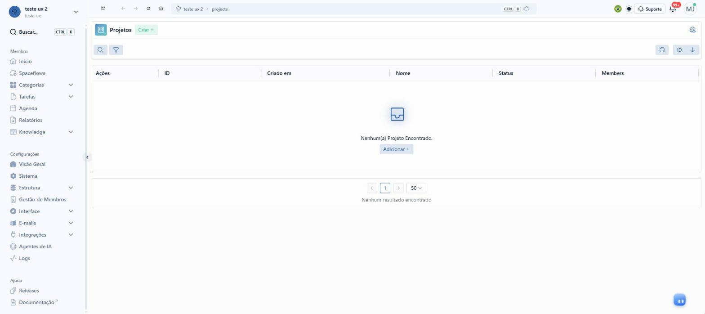
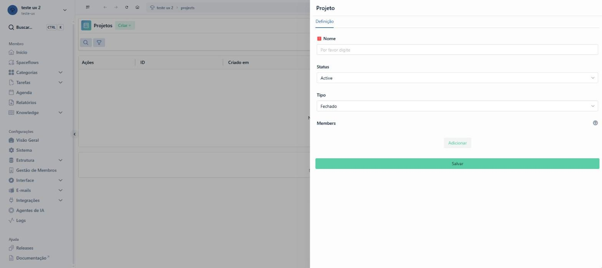
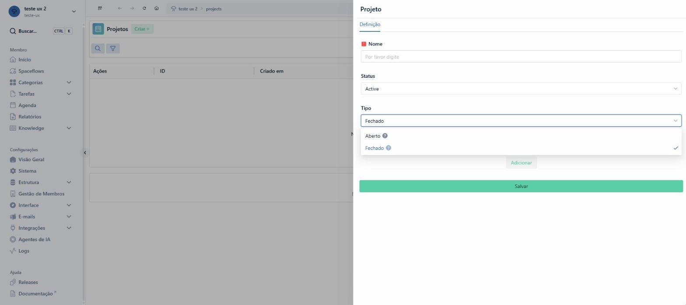
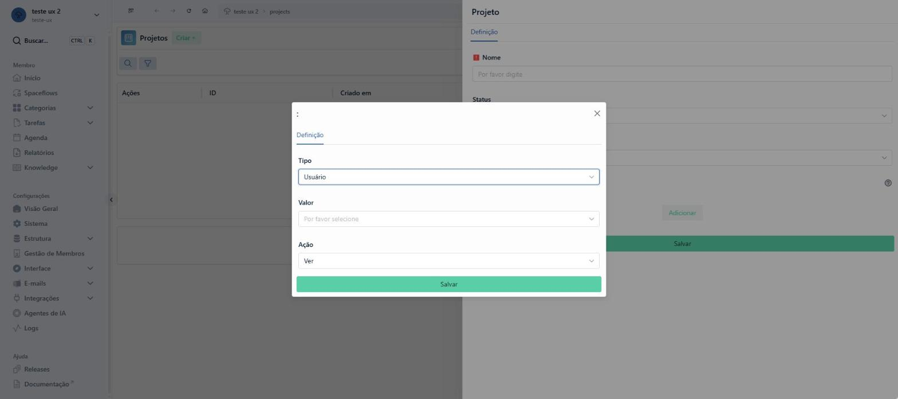
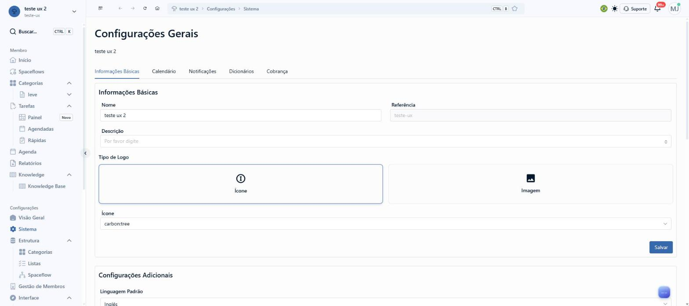
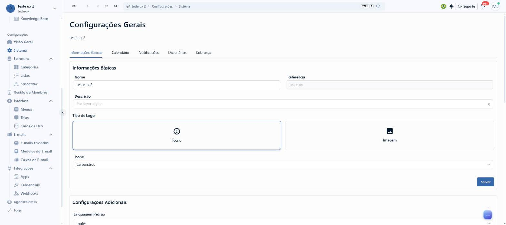

# Briefing · Projetos no workspace

## A demanda, nas palavras dela

> "a pesquisa que esta neste path fala sobre projetos. leia com atençao. voce deve reforça-la pesquisando
> interfaces de outros produtos e analisando o nosso codigo tambem. com base nisso, proponha como seria a
> usabilidade dos projetos no enspace, se criassemos essa organizaçao"

Depois do relatório "Usabilidade de projetos no ENSPACE", em 2026-11-25:

> "Sim, prototipar"

Escolhas dela antes de começar:
- base do menu: o menu novo (protótipo `menu-lateral`), com Projetos como ícone da trilha abaixo de Início;
- nome provisório: "Projetos", com a decisão em aberto no `DECISOES.md`;
- exploração das referências na conta dela.

E, no meio da rodada:

> "alem da minha conta, se voce achar outros produtos que trabalham com essa logica de projetos, tipo o
> github, pode explorar na minha conta em repositorios pessoais meus mesmo (depois só apagar os projetos) e
> se quiser testar em outros produtos pode criar conta temporaria sem problemas"

## O problema

Hoje o workspace tem 1 nível só: todas as categorias ficam lado a lado, e o acesso se recorta por cargo,
categoria por categoria. Uma área (Financeiro), um cliente (Obra Aurora) ou uma frente de trabalho não têm
onde morar. Quem precisa separar abre outro workspace e perde o cadastro comum (clientes, fornecedores).

O protótipo mostra 1 nível novo, o projeto, entre o workspace e as categorias:
- o projeto reúne categorias, telas e pessoas;
- a categoria continua do workspace: campos, formulários, fluxos e endereço não mudam;
- o projeto decide quem vê as categorias dele (aberto, fechado ou privado).

## Sucesso

- A pessoa acha o projeto em 1 clique pela trilha e vê só os projetos dela, mesmo com 57 no workspace.
- Quem não participa entende por que não entra e sabe pedir acesso, sem descobrir projeto privado.
- O administrador cria um projeto e move categorias para ele sabendo, antes de confirmar, quem perde acesso.
- Nada some: a categoria de projeto continua achável por "Ver todas as N categorias" e pela busca.

## O que a pesquisa de UX já dizia

Procurado em `enspace-ux-research` (`UX_REPORT.md` e `temas/README.md`) por "projeto", "menu", "categoria"
e "permissão". Não há auditoria sobre projetos. O que toca o assunto:

| Fricção | O que diz | Como o protótipo responde |
|---|---|---|
| S1-F3 | 2 itens "Categorias" no mesmo menu, com sentidos diferentes | Configurações do projeto abrem pelo próprio projeto, fora de Configurações do workspace |
| S1-F4 | A categoria criada com "Menu automático" desligado não aparece no menu | A categoria movida para o projeto aparece na hora no painel de quem participa |
| S1-F6 | "Nenhum(a) leve Encontrado.": template sem concordância | A página órfã `/projects` do develop repete o defeito ("Nenhum(a) Projeto Encontrado."); o diretório novo usa texto próprio |
| S3-F1 | Trocar de aba descarta a alteração em silêncio | As configurações do projeto têm 1 rascunho para todas as abas, a marca "Alterações não salvas" e 1 Salvar |
| S3-F7 | 3 convenções de botão de gravar na mesma tela | 1 rodapé com Descartar e Salvar |
| S3-P2 | Menu lateral a 4,36:1 de contraste | Fica para a casca (menu-lateral); este protótipo não mexe no contraste do menu |
| Síntese de 16/09 | "o default decide contra a visibilidade" | A visibilidade padrão é Fechado: o projeto aparece no diretório, e o conteúdo fica com os participantes |

## A tela do develop, como ela é hoje

Explorado em 2026-11-25, no workspace de exploração do develop, pelo Chrome da redatora. Nenhuma escrita.
Caminhos sem host.

### A página órfã de projetos

`/workspaces/<ws>/projects` existe e não está em nenhum menu: só se chega pela URL.
- Listagem no padrão das telas de configuração: título "Projetos" com "Criar +", busca, filtro, atualizar e
  a tabela Ações, ID, Criado em, Nome, Status, Members.
- Estado vazio: "Nenhum(a) Projeto Encontrado." e "Adicionar +".
- "Criar +" abre a gaveta "Projeto", aba "Definição":
  1. Nome (obrigatório);
  2. Status: Active, Inactive, Blocked, Completed, sem tradução;
  3. Tipo: Aberto ou Fechado (padrão Fechado), com "?" em cada opção;
  4. Members, com "Adicionar".
- "Adicionar" em Members abre um modal com o título ":", Tipo (Usuário, Grupo ou Cargo), Valor e Ação (Ver;
  Editar e Deletar desabilitadas).
- Nenhum campo liga o projeto a categorias. Não há Privado.

**O que isso diz:** o modelo de participante (pessoa, grupo ou cargo) e o Fechado como padrão já estavam no
código. O protótipo aproveita os dois e acrescenta Privado, o vínculo com categorias e o menu.

### O que já existe e o projeto usa

| Tela | Caminho | O que serve ao projeto | Print |
|---|---|---|---|
| Convite de membro | `/settings/access?tab=members` | Licença Full, Standard ou Visualizador e 1 cargo. O convite não pergunta projeto: o acesso é sempre ao workspace inteiro | `develop-membros-convite.png` |
| Permissões do cargo | `/settings/access/roles/<id>/permissions` | Árvore categoria > Criar, Ver, Atualizar, Excluir > formulário > campo. A permissão é por categoria, nunca por projeto | `develop-cargos-arvore.png` |
| Grupos de membros | `/settings/access?tab=groups` | Nome, ícone e descrição. O grupo entra no projeto como participante | `develop-grupos-vazio.png`, `develop-grupos-criar.png` |
| Categorias | `/settings/data/types` | Cartões em grade; a gaveta "Categoria" tem Nome, Descrição, Ícone, Cor, Menu automático e Versionamento. Não há campo de projeto | `develop-categorias-lista.png`, `develop-categorias-criar.png`, `develop-categoria-configuracao.png` |
| Campo de relacionamento | `/settings/data/types/<categoria>/fields` | A lista de Categoria do relacionamento mostra todas as categorias do workspace, sem projeto. O item aparece pelo modelo `{{reference}}` | `develop-campo-relacionamento-config.png` |

Sem evidência visual do item vinculado: nenhuma categoria do workspace de exploração tem campo de
relacionamento, e criar um seria escrita. O comportamento do campo de vínculo vem do código, lido no
relatório: o servidor guarda o texto do item (`display`) e mostra esse texto a quem não lê a categoria.

### O menu lateral de hoje

Ordem, de cima a baixo: o seletor do workspace e "Buscar... CTRL K"; **Membro** (Início, Spaceflows,
Categorias, Tarefas, Agenda, Relatórios, Knowledge); **Configurações** (Visão Geral, Sistema, Estrutura,
Gestão de Membros, Interface, E-mails, Integrações, Agentes de IA, Logs); **Ajuda** (Releases,
Documentação). Projetos não aparece.

## A casca da tela, item por item

A casca deste protótipo é o menu novo, porque a redatora escolheu prototipar sobre ele. Fonte: protótipo
`menu-lateral`, rodada 35 (2026-11-24), copiado em 2026-11-25 para `_CascaDoMenuNovo.vue`, com o comentário
"nada aqui é proposta".

| Peça | Como está na casca |
|---|---|
| Topo do menu | Botão do workspace (círculo com 2 letras, nome, referência, seta) e "Buscar..." com Ctrl K |
| Trilha | 4.5rem, fundo `bg-accented/40`; quadrado com a inicial do workspace; Início, Dados, Análise, Comercial (seção do workspace), Configurações, "Mais"; ajuda e "+" no pé |
| Rótulos | Ligados, 10px, abaixo do ícone, como o padrão da rodada 35 |
| Painel | 304px; cabeçalho de 48px com o título, a lupa, recolher e "+" |
| Painel Início | Início, Spaceflows, Tarefas (3), Agenda e Favoritos |
| Painel Dados | A lista de categorias e "Ver todas as N categorias" |
| Barra do topo | Recolher o menu, voltar, avançar, recarregar, início, a trilha do caminho com Ctrl B e a estrela, sigla do idioma, tema, Suporte, sino com 99+ e avatar |
| Lista da categoria | Abas de visualização, busca, "Criado em", "Todo o período", Exportar, Colunas, Filtros, Configurar e "Novo registro" sobre o `EnTable` (cópia de `comunicacao-no-workspace/_TelaItens.vue`) |

Resumido em relação ao `menu-lateral`: o painel Início não traz as seções pessoais, o arraste da trilha nem
Personalizar; Análise, Comercial, Configurações e "Mais" avisam que são maquete. A casca não ganhou melhoria
de passagem.

### A segunda casca: o menu de hoje do develop (rodada 2)

A chave "Menu" do andaime troca a casca. A do menu atual mora em `_CascaDoMenuAtual.vue`, com o comentário
"nada aqui é proposta", copiada em 2026-11-25 de `evidencias/develop-menu-lateral-topo.png` e
`evidencias/develop-menu-lateral-fim.png`.

| Peça | Como está na casca |
|---|---|
| Topo do menu | O mesmo da casca nova: botão do workspace e "Buscar..." com Ctrl K |
| Largura | 16.5rem aberto, 3.5rem recolhido; botão redondo de recolher na borda |
| Membro | Início, Spaceflows, Categorias (aberta), Tarefas (aberta: Painel com o selo "Novo", Agendadas, Rápidas), Agenda, Relatórios, Knowledge (Knowledge Base) |
| Configurações | Visão geral; Sistema; Estrutura (Categorias, Listas, Spaceflow); Gestão de membros; Interface (Menus, Telas, Casos de uso); E-mails (Enviados, Modelos, Caixas); Integrações (Apps, Credenciais, Webhooks, Agentes de IA); Logs |
| Ajuda | Releases e Documentação, com a seta de link externo |
| Item ativo | Fundo `primary/10`, texto `primary` |
| Barra do topo | A mesma da casca nova |

Resumido em relação ao develop: as categorias não abrem as visualizações delas; Início e Painel navegam, o
resto avisa que é maquete. O convidado vê Início e Tarefas, e Configurações aparece só para quem configura.

## O fluxo que o protótipo cobre

1. Rita (proprietária) abre Projetos na trilha e vê os 4 projetos do menu dela.
2. Abre Financeiro, vê as categorias, os participantes e as tarefas do projeto.
3. Cria o projeto "Obra Centro" com 2 categorias do workspace e o grupo Operações.
4. Move a categoria Contratos para o Jurídico e lê o que muda antes de confirmar.
5. Em "Ver como", troca para Marina (participante do Financeiro): Contas a pagar mostra "Item sem acesso" no
   vínculo com o processo do Jurídico, que é privado.
6. Marina abre o diretório, vê Obra Aurora (fechado) e pede acesso; não vê o Jurídico.
7. Beatriz (convidada da Aurora) vê só Início, Projetos e Ajuda, com 1 projeto.

## Rodada 3: o que o projeto guarda além das categorias

### O que a pesquisa trouxe
Fonte: `pesquisa-de-mercado/runs/2026-11-26-o-que-o-projeto-guarda-alem-de-categorias/`. Nos produtos
comparados, o projeto guarda mais que as listas: uma visão dos itens de todas elas, automações, um status com
data e texto, um painel e um modelo para começar o próximo.

### O que o código do ENSPACE diz (develop, 2026-11-26)
- A consulta de itens lê 1 categoria por vez: a visão cruzada é peça nova.
- O gatilho de item de um fluxo do Spaceflow escuta 1 categoria. A aba Automações lista esses fluxos; o gatilho
  do projeto inteiro fica fora.
- Os avisos de prazo já são por categoria.
- Cada widget de painel lê 1 categoria; somar categorias é novo.
- O importador de estrutura (o mesmo dos casos de uso) já copia categorias, campos, formulários, visualizações
  e fluxos, com os fluxos desligados e sem responsáveis nem credenciais.
- O menu personalizado (Interface, Menus) é a seção do workspace do menu novo.
- A página de projetos do develop é órfã: o back que a servia foi tirado.

### O fluxo da rodada 3
1. Lívia (administradora do Financeiro) abre o projeto e lê o status "No prazo".
2. Em Itens, vê os 11 itens das 3 categorias; Reembolsos mostra "Sem campo" no Prazo.
3. Nas Configurações, aba Campos comuns, escolhe o campo de cada categoria.
4. Em Automações, desliga um fluxo; em Painel, lê os 3 widgets e o de soma.
5. Rita (proprietária) cria "Obra Centro" a partir do modelo Obra: 2 categorias novas e 2 fluxos desligados.
6. Rita abre Comercial, a seção do workspace, e entra em Oportunidades pelo atalho. Marina vê só Oportunidades,
   porque não participa do Jurídico.
7. Marina (participante do Financeiro) abre as mesmas abas sem Configurações, sem "Novo fluxo" e com as chaves
   dos fluxos desabilitadas.

## Preparo

Nenhum preparo por API: a exploração só leu o workspace de exploração.
