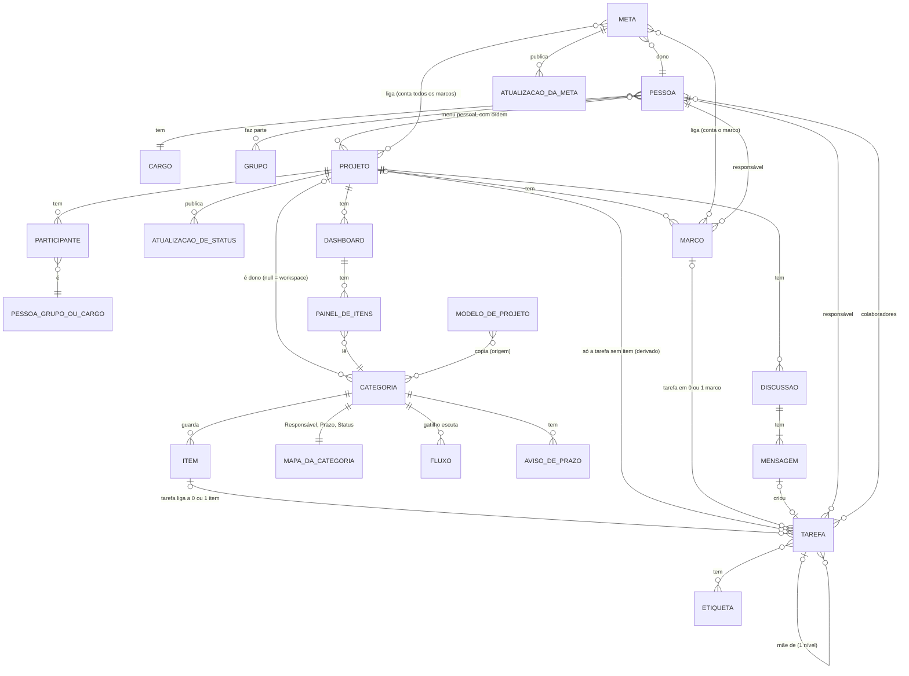
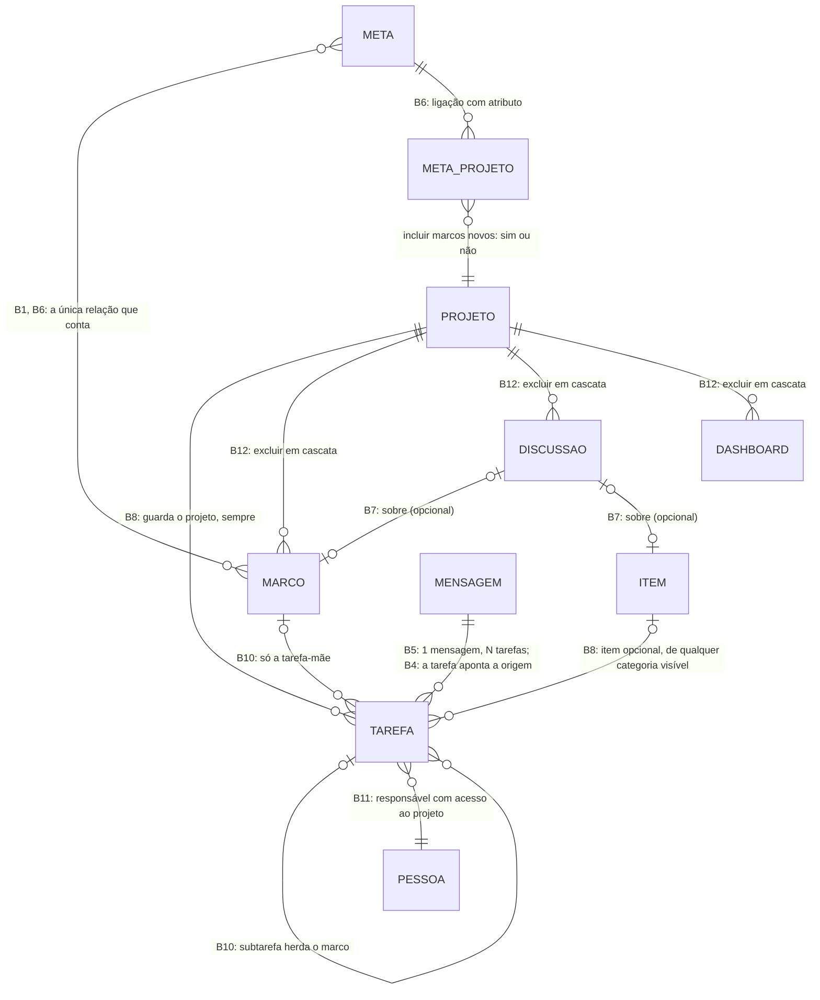

# Modelo de dados do protótipo Projetos

Levantado em 2026-11-27, na rodada 13, a partir do código do protótipo: os tipos em `mocks.ts` e
`metasEDiscussoes.ts`, as regras em `estado.ts` e as telas que editam cada ligação.

**Situação:** as 18 brechas estão no protótipo desde a rodada 14 (2026-11-27). Os requisitos, com a Relevância de
cada um, estão em `requisitos/relacoes-entre-entidades.md`; P1 a P4 viraram as suposições S1 a S4 de lá.

## Resumo

- 22 entidades: 9 do workspace, 13 do projeto.
- 18 brechas nas relações, em 5 tipos:

| Tipo | Brechas |
|---|---|
| Só se edita de um lado (unidirecional) | B1, B2, B3, B4 |
| Cardinalidade errada | B5, B6, B7 |
| Deveria depender de outra relação e não depende | B8, B9, B10, B11 |
| Apagar ou mover deixa ligação órfã | B12, B13, B14, B15 |
| Regra antiga ou relação sem efeito | B16, B17, B18 |

- As 5 que mais pesam:
  - **B9:** mover uma categoria leva as tarefas para outro projeto, mas o marco delas fica no projeto antigo;
  - **B10:** a subtarefa entra num marco diferente do da tarefa-mãe, e o marco conta as 2;
  - **B12:** excluir o projeto deixa marcos, discussões, painéis e tarefas sem dono;
  - **B1:** o marco só entra numa meta pela tela da meta (o caso que você achou);
  - **B6:** ligar um projeto à meta conta todos os marcos dele, sem como tirar um.

## Diagrama de hoje

Cardinalidade: `||` exatamente 1, `|o` 0 ou 1, `|{` 1 ou mais, `o{` 0 ou mais.

### Onde cada relação se edita hoje

| Relação | Cardinalidade | Edita-se de um lado | Edita-se do outro |
|---|---|---|---|
| Meta e Marco | N para N | painel da meta, "Adicionar marcos" | não: o marco só mostra "Contribui para" |
| Meta e Projeto | N para N | painel da meta, "Ligar projetos" | não: a Visão geral do projeto só lista as metas |
| Marco e Tarefa | 1 para N | formulário do marco, campo Tarefas | painel e tabela da tarefa, campo Marco |
| Tarefa e Item | N para 0 ou 1 | painel da tarefa, só itens das categorias do projeto | não: o painel do item não mostra tarefas |
| Tarefa e Tarefa (subtarefa) | 1 para N, 1 nível | painel da tarefa-mãe | painel da subtarefa ("Parte de") |
| Mensagem e Tarefa | 1 para 0 ou 1 | botão "Criar tarefa" na mensagem | não: a tarefa não mostra de onde veio |
| Categoria e Projeto | N para 0 ou 1 | configurações do projeto e "Mover categoria" | menu da categoria |
| Discussão e Projeto | N para 1 | só ao criar | não muda depois |
| Painel de itens e Categoria | N para 1 | edição do painel | não |

## Brechas

Relevância, como nos requisitos: **Obrigatório** quebra dado ou conta; **Desejável** deixa a pessoa sem caminho;
**Opcional** é ganho menor.

### Só se edita de um lado

| ID | Relação | Hoje | Proposta | Relevância |
|---|---|---|---|---|
| B1 | Marco e Meta | Criar ou editar o marco não tem campo de meta. O marco entra na meta só pelo painel da meta. | Campo "Metas", múltiplo, no formulário e no painel do marco, com as metas automáticas. Edita a mesma ligação do painel da meta. | Obrigatório |
| B2 | Projeto e Meta | A seção Metas da Visão geral só lista. Ligar o projeto a uma meta exige abrir Metas. | "Ligar a uma meta" na seção Metas do projeto e na sidebar de configurar. Quem pode ligar está em P1. | Desejável |
| B3 | Item e Tarefa | A tarefa aponta o item, mas o painel do item, em Itens do projeto, não mostra as tarefas dele nem cria tarefa. | Seção Tarefas no painel do item, com "Criar tarefa" que já vem com o item preenchido. | Desejável |
| B4 | Tarefa e Mensagem | A mensagem mostra "Tarefa ligada", mas a tarefa não diz de que discussão veio. | Linha "Criada em <discussão>" no painel da tarefa, com link para a mensagem. | Desejável |

### Cardinalidade errada

| ID | Relação | Hoje | Proposta | Relevância |
|---|---|---|---|---|
| B5 | Mensagem e Tarefa | 1 mensagem cria no máximo 1 tarefa. Uma decisão na discussão costuma virar várias. | 1 para N: a mensagem lista as tarefas criadas e mantém "Criar tarefa". | Desejável |
| B6 | Meta e Projeto | Ligar o projeto conta todos os marcos dele, até os criados depois. Não há como tirar 1 marco de um projeto ligado. Ligar um marco de projeto já ligado não muda nada. | A conta da meta passa a ter 1 relação só: Meta e Marco. Ligar o projeto vira um atalho que liga os marcos dele, com a escolha "Incluir os marcos novos deste projeto" (atributo da ligação Meta e Projeto). Tirar 1 marco passa a valer. | Obrigatório |
| B7 | Discussão e o resto | A discussão liga só ao projeto. Não dá para discutir um marco, um item ou uma meta. | Ligação opcional "Sobre", 0 ou 1, com marco ou item do mesmo projeto. A discussão de meta fica em P3. | Opcional |

### Deveria depender de outra relação e não depende

| ID | Relação | Hoje | Proposta | Relevância |
|---|---|---|---|---|
| B8 | Tarefa e Projeto | O projeto da tarefa com item vem da categoria do item. Item de categoria do workspace (Clientes, Contratos) não aparece no seletor da tarefa do projeto. Se aparecesse, a tarefa ficaria sem projeto. | A tarefa guarda o projeto, sempre, como campo próprio. O item fica opcional e pode ser de qualquer categoria que a pessoa vê. | Obrigatório |
| B9 | Tarefa, Marco e Categoria | Mover a categoria leva as tarefas dela para o outro projeto. O marco fica no projeto antigo, com tarefas de outro projeto, e a meta conta essas tarefas. | Com B8, mover a categoria não muda o projeto da tarefa. Se a decisão for mudar, a tarefa sai do marco, e a confirmação de "Mover categoria" diz quantas saem. | Obrigatório |
| B10 | Subtarefa e Marco | A subtarefa entra num marco diferente do da tarefa-mãe, ou no mesmo. O marco soma a mãe e cada subtarefa como tarefas separadas. | A subtarefa herda o marco da mãe, e o campo Marco fica só na mãe. O marco conta só as tarefas-mãe. A outra conta possível está em P2. | Obrigatório |
| B11 | Responsável e acesso ao projeto | O responsável do marco, o da tarefa e os colaboradores saem de todos os membros, sem olhar o acesso ao projeto. Dá para pôr como responsável quem não entra no projeto. | As opções mostram só quem entra no projeto. Escolher alguém de fora pede incluir a pessoa como participante, na mesma ação. | Obrigatório |

### Apagar ou mover deixa ligação órfã

| ID | Ação | Hoje | Proposta | Relevância |
|---|---|---|---|---|
| B12 | Excluir projeto | As categorias voltam para o workspace. Marcos, discussões, painéis, tarefas sem item e as ligações das metas ficam apontando para um projeto que não existe. | Excluir o projeto exclui marcos, discussões, painéis e tarefas sem item, e tira o projeto e os marcos dele das metas. A confirmação mostra a contagem de cada coisa. | Obrigatório |
| B13 | Mover categoria | O painel de itens do dashboard continua lendo a categoria que saiu do projeto. | A confirmação de "Mover categoria" avisa os painéis que leem a categoria, e eles saem do dashboard junto. | Desejável |
| B14 | Excluir tarefa | A mensagem continua com "Tarefa ligada", apontando para uma tarefa que não existe. | Excluir a tarefa limpa a ligação, e a mensagem volta a mostrar "Criar tarefa". | Obrigatório |
| B15 | Arquivar projeto | Os marcos do projeto arquivado continuam contando nas metas, sem aviso. | A meta mostra o projeto como arquivado. Os marcos param de contar, salvo os concluídos. A regra está em P4. | Desejável |

### Regra antiga ou relação sem efeito

| ID | Relação | Hoje | Proposta | Relevância |
|---|---|---|---|---|
| B16 | Mensagem e Tarefa | A tarefa criada da discussão exige categoria e não tem item nem marco. A regra é da rodada 8, de antes da tarefa sem item (rodada 10). | O mesmo formulário de tarefa do resto do projeto: item opcional, marco, prioridade. | Desejável |
| B17 | Meta por valor, Projeto e Marco | Na meta medida por valor, projetos e marcos ficam ligados e não entram na conta. A tela não diz isso. | Na meta por valor, a lista se chama "Acompanhando" e explica que não conta. | Opcional |
| B18 | Status do projeto e situação da meta | A meta tem situação própria, digitada à mão, mesmo com todos os projetos dela "Atrasado". | A meta mostra a situação mais recente de cada projeto ligado, só para leitura, ao lado da dela. As 2 continuam separadas. | Opcional |

## Diagrama proposto

Só as relações que mudam. O resto fica como no diagrama de hoje.

## Em aberto

| ID | Pergunta | Para quem |
|---|---|---|
| P1 | Quem liga o projeto a uma meta: o administrador do projeto, o dono da meta ou os 2? Hoje edita a meta quem é dono dela ou dono do workspace. | redatora |
| P2 | O marco conta só as tarefas-mãe (proposta em B10) ou só as subtarefas, quando a mãe tem subtarefas? | redatora |
| P3 | A meta, que mora no workspace, ganha discussão própria, ou a conversa fica nas atualizações dela? | redatora |
| P4 | Projeto arquivado: os marcos abertos param de contar na meta ou continuam? | redatora |
| P5 | O modelo de projeto passa a levar os marcos, com datas relativas à criação? Hoje leva categorias, fluxos, avisos e painel. | redatora |
