# Pesquisa · Projetos no workspace

Base: o relatório "Usabilidade de projetos no ENSPACE" (2026-11-25, 16 produtos, código da develop) e o
anterior, "Projetos dentro de workspaces" (2026-11-11). Nesta rodada, Notion e ClickUp foram explorados por
dentro, na conta da redatora, em 2026-11-25; o Twenty, pela documentação e pelo código. Os demais vêm da
documentação oficial lida para o relatório.

Os 2 testes criados na conta da redatora ("Teste protótipo ENSPACE" no Notion e no ClickUp) estão arquivados.
Ninguém foi convidado e nada foi comprado.

## Notion · teamspaces (explorado por dentro)

Passo a passo:
1. Na barra lateral, "..." do cabeçalho Teamspaces > New teamspace.
2. "Create a teamspace": ícone e nome, descrição e Security.
3. Security tem 4 opções, cada uma com 1 frase: Default (todos entram), Open (todos veem e entram), Closed
   (todos veem, ninguém entra sozinho), Private (só membros sabem que existe; plano Business).
4. "Create teamspace" abre o passo 2, "Invite people", com papel Teamspace member ou owner e "Skip for now".
5. Configurações: General (descrição, visibilidade, nível de acesso de membros e de "Everyone else"),
   Members (papel por linha; o único owner não se rebaixa), Security.
6. Arquivar pede o nome digitado.

URL: `notion.so` > Settings > Teamspaces; Library > aba Teamspaces.

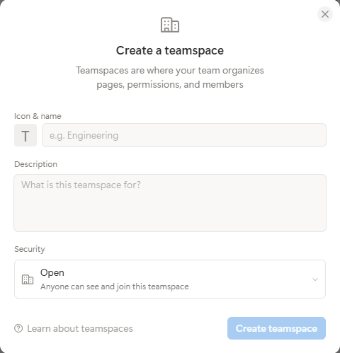

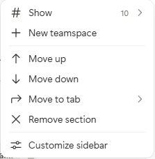
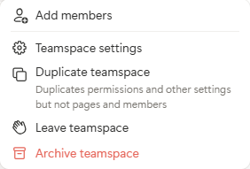
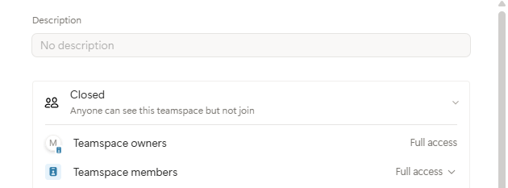
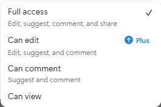
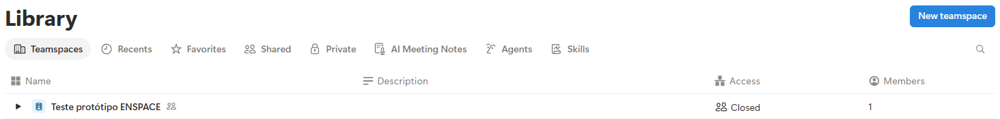
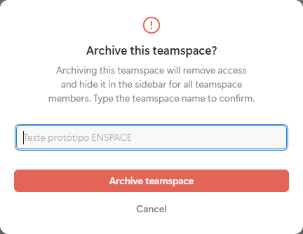

Mais prints: `ref-notion-icone-e-cor.png`, `ref-notion-convidar-papel.png`, `ref-notion-dia-1-teamspace-home.png`,
`ref-notion-config-members.png`, `ref-notion-config-security.png`, `ref-notion-arquivar-sair.png`.

**Serve:**
- 3 visibilidades com 1 frase de efeito: viram Aberto, Fechado e Privado;
- seção própria no menu, com limite de itens e "ver todos";
- diretório em tabela, com Acesso e Membros como colunas;
- confirmação forte para arquivar;
- trava do último administrador.

**Não serve:**
- "Default" (entrada obrigatória): o aberto do ENSPACE já cobre "todos veem";
- não há "ocultar": para tirar da barra, a pessoa sai do teamspace;
- permissão por página: no ENSPACE a permissão fina continua no cargo.

## ClickUp · Espaços (explorado por dentro)

Passo a passo:
1. "+ Novo Espaço" no fim da seção Espaços.
2. "Criar espaço": ícone e nome, descrição, Permissão padrão (Edição total, Editar, Comentário, Apenas
   exibição) e a chave "Tornar privado".
3. Ligar "Tornar privado" troca a Permissão padrão por "Compartilhar apenas com", na hora.
4. Passo 2, "Defina seu fluxo de trabalho": presets, status e ClickApps.
5. Menu do Espaço: Renomear, Copiar link, Cor e ícone, Ocultar espaço, Duplicar, Arquivar, Excluir e
   "Compartilhamento e permissões".
6. Arquivar vale na hora, sem confirmação, com "Desfazer".

URL: `app.clickup.com` > barra lateral > Espaços; Gerenciar espaços em `/spaces`.

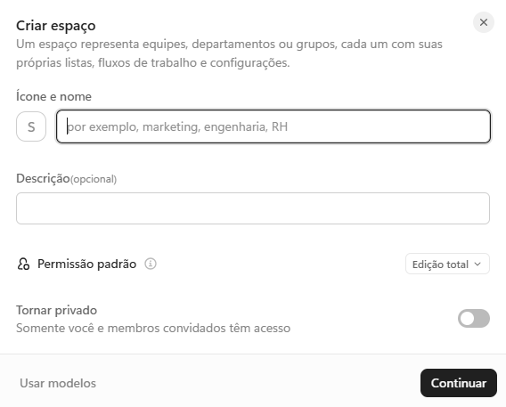
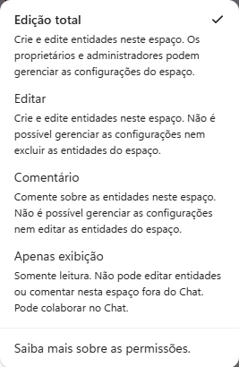
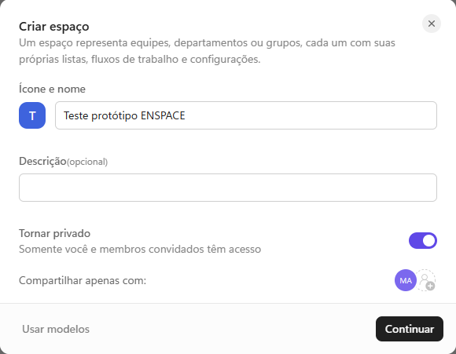
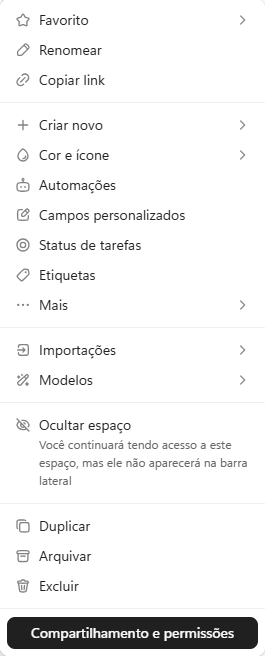
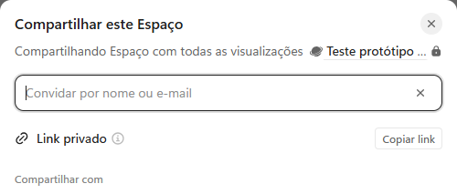
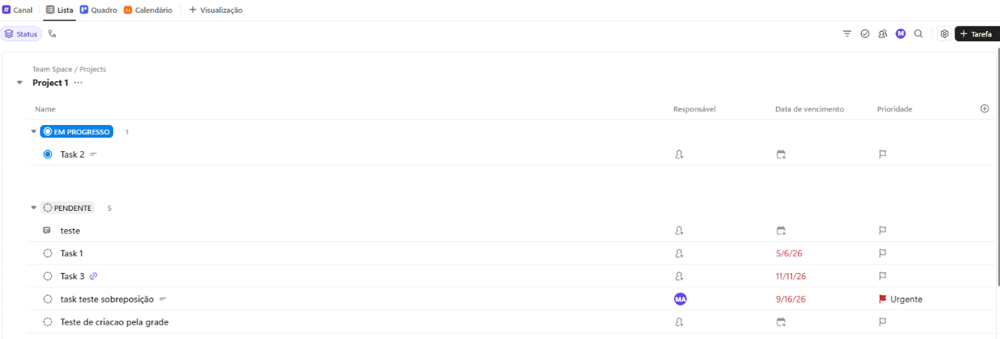
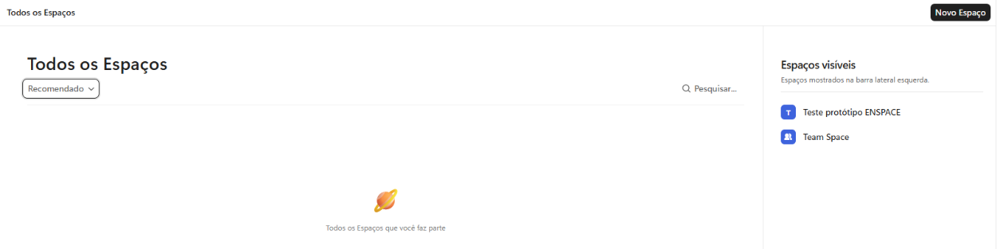

Mais prints: `ref-clickup-menu-secao-espacos.png`, `ref-clickup-barra-lateral-espaco.png`,
`ref-clickup-icone-e-cor.png`, `ref-clickup-modelos.png`, `ref-clickup-fluxo-de-trabalho.png`,
`ref-clickup-clickapps.png`, `ref-clickup-dia-1-espaco.png`, `ref-clickup-config-espaco.png`,
`ref-clickup-arquivar.png`.

**Serve:**
- "Ocultar espaço", separado de Sair e de Arquivar: vira "Ocultar do meu menu";
- o cadeado ao lado do nome em todo lugar;
- "Todas as tarefas" com a trilha do Espaço em cada linha: vira a coluna Projeto em Minhas tarefas;
- "Espaços visíveis" separa "de que participo" de "no meu menu";
- a permissão padrão do Espaço: vira a permissão padrão do projeto, em 4 caixas.

**Não serve:**
- o passo 2 de fluxo e recursos: no ENSPACE isso mora na categoria;
- arquivar sem confirmar, para algo que some para todos.

## Twenty CRM · navegação e permissão (documentação e código)

Passo a passo (pasta compartilhada no Workspace, barra sem a flag de abas):
1. Passar o mouse em Workspace e ligar "Edit navigation" (só com a permissão Layouts).
2. "+" > Folder.
3. Arrastar itens para a pasta ou usar "Move to folder".
4. Salvar na barra "Layout customization".

Fontes: [Navigation](https://docs.twenty.com/user-guide/layout/capabilities/navigation),
[Permissions](https://docs.twenty.com/user-guide/permissions-access/capabilities/permissions) e o código da
`main` no commit `22c8c3b` de 2026-11-25.

Sem evidência visual: a pesquisa leu doc e código, sem abrir a tela do Twenty.

**Serve:**
- o mesmo item de menu serve ao menu compartilhado e ao pessoal;
- editar a barra de todos é uma permissão própria, com modo de edição e Salvar;
- o registro relacionado que a pessoa não lê aparece como chip cinza com cadeado e "Not shared": vira
  "Item sem acesso";
- a exceção por objeto herda o padrão quando fica vazia.

**Não serve:**
- não existe nível de dado entre workspace e objeto: a pasta é só navegação;
- 1 papel global por pessoa: no ENSPACE o projeto é escopo de acesso;
- a pasta que aparece vazia a quem não lê nada dentro dela.

## monday.com · workspaces e boards (documentação)

Fonte: [monday Support](https://support.monday.com/hc/en-us/articles/360019180359), trecho de busca (o site
recusa leitura automatizada).

- Workspace Open ou Closed; o fechado aceita "request to join", aprovado pelo dono.
- Usuários confundem board e project ([monday Community](https://community.monday.com/t/what-the-difference-between-a-project-and-a-board/84965)).

Sem evidência visual: leitura de documentação; sem conta de teste nesta rodada.

**Serve:** o pedido de acesso aprovado pelo dono.
**Não serve:** 2 nomes para níveis parecidos; o ENSPACE fica com 1 nível novo só.

## Pipefy · pipes e grupos (documentação)

Fontes: [Pipe roles and permissions](https://help.pipefy.com/en/articles/614597-pipe-roles-and-permissions),
[Groups of users](https://help.pipefy.com/en/articles/8461497-groups-of-users-in-pipefy-easily-manage-permissions).

- O pipe tem admin próprio, e as permissões do pipe ficam separadas das da empresa.
- Grupos põem e tiram pessoas de vários pipes de uma vez.

Sem evidência visual: leitura de documentação.

**Serve:** administrador do projeto sem acesso às configurações do workspace; grupo de membros como
participante.
**Não serve:** o pipe é o próprio processo; no ENSPACE o projeto reúne várias categorias.

## Jira · spaces (documentação)

Fontes: [Manage access](https://support.atlassian.com/jira-software-cloud/docs/manage-how-people-access-your-team-managed-project),
[New navigation](https://support.atlassian.com/navigation/docs/what-is-the-new-navigation-in-jira/).

- Open, Limited e Private; o privado some do diretório e da busca de quem não tem acesso.
- For you, Recent e Starred acima de Spaces; personalizar a barra é pessoal.
- A troca de "projects" por "spaces" gerou queixa de colisão de nome.

Sem evidência visual: leitura de documentação.

**Serve:** o privado sai do diretório e da busca; Space admin com nome próprio.
**Não serve:** Limited (todos veem e comentam): no ENSPACE o cargo já decide ver e editar.

## Linear · teams (documentação)

Fonte: [Teams](https://linear.app/docs/teams).

- "Your teams" na barra; time visitado sem ser membro aparece em "Exploring".
- Arquivar time ("Retire team") tira da barra de todos.

Sem evidência visual: leitura de documentação.

**Serve:** a busca do painel acha também o que está fora do menu da pessoa ("Fora do seu menu").
**Não serve:** o time do Linear também é unidade de fluxo; o projeto do ENSPACE não muda fluxo.

## GitHub · Projects (não explorado)

A redatora liberou explorar nos repositórios pessoais dela. O Chrome abriu o GitHub deslogado e a tela de
login pede senha; o agente não digita senha. Nada foi criado.

Fonte lida: [GitHub Docs](https://docs.github.com/en/rest/using-the-rest-api/troubleshooting-the-rest-api):
o GitHub responde 404 a quem não tem acesso ao repositório privado, para não confirmar que ele existe.

Sem evidência visual: sem sessão do GitHub no Chrome.

**Serve:** a tela sem acesso do projeto privado é a mesma de endereço inexistente.

## O padrão que todos seguem

- O nível de projeto fica no menu abaixo de um bloco pessoal fixo (Início, tarefas, favoritos).
- O menu mostra os projetos da pessoa; o resto fica num diretório com busca.
- 3 visibilidades com nomes parecidos: aberto, fechado, privado. O privado some de quem não participa.
- O projeto tem administrador próprio, separado do dono do workspace.
- Arquivar vem antes de excluir.

## O que nenhum deles faz

- Nenhum separa o dado (a categoria, que continua do workspace) do acesso (o projeto) e mostra, antes de
  mover, quem perde acesso, com números.
- Nenhum nomeia o projeto na tela sem acesso do fechado e esconde o do privado na mesma regra.
- Nenhum mostra no campo de vínculo um estado "sem acesso" que esconde o nome do item vinculado: o Twenty
  chega perto com "Not shared".
