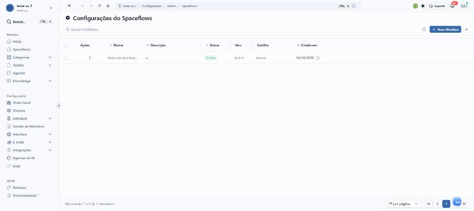
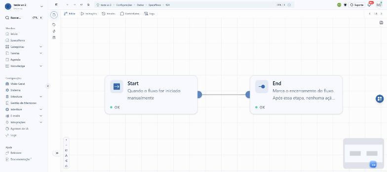
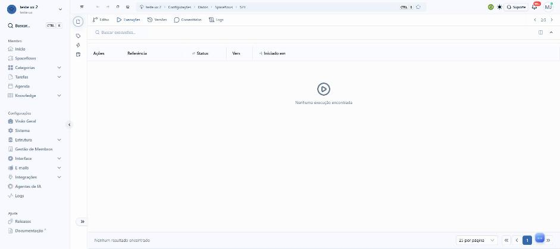
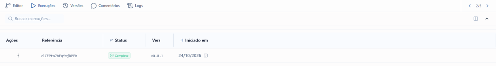

# Proteções do Spaceflow

## A demanda, como veio

> precisamos de uma aba nos fluxos do spaceflow para configurar PROTEÇOES/regras do fluxo.
>
> por exemplo: maximo de execuçoes por minuto, max de execuçoes em paralelo... basicamente, um trabalho de permitir
> configurar proteçoes.
>
> pesquise /deep-research como outros produtos fazem isso pra entender quais opçoes seriam interessantes. revise
> tambem seus conhecimentos sobre spaceflow e como ele funciona pra sugerir algo que faça sentido para o enspace.
>
> traga a ideia antes de prototipar. se eu validar, voce prototipa

Validação da ideia, em 24/10/2026:

> pode prototipar tudo, mas coloque uma aba de "mvp" com somente o essencial.
>
> e no fim, na hora de fazer os requsitos desse prototipo (doc de requisitos), saiba que o lider dos devs apontou uma
> dependencia pra essa funcionalidade poder ser feita:
>
> "entao, eu teria que fazer uma alteração antes / criando uma forma de otimizar o sistema de gatilho e verificação
> dos workflows, antes de ter algum bloqueio. eu preciso parar um tempo, em arquitetar algum tipo de cache / para
> fluxos disponíveis, sem ter que consultar no banco de dados"

- **Tela em jogo:** Configurações › Estrutura › Spaceflow › um fluxo › o editor, com as abas Editor, Execuções,
  Versões, Comentários e Logs. A proposta acrescenta a aba Proteções e muda o que a aba Execuções mostra quando uma
  proteção age.
- **Sucesso:** quem configura um fluxo decide, numa tela só e sem jargão, quanto o fluxo pode rodar, o que acontece
  com o que passar do limite e quem fica sabendo, e vê na própria tela o que a proteção já segurou.

## O que a pesquisa de UX já dizia

Procurei no `enspace-ux-research` (`temas/README.md`, as auditorias e o `UX_REPORT.md`) por proteção, limite,
execução, paralelo, loop, concorrência e en-credits. Não há auditoria sobre limite ou proteção de fluxo. O que há é
vizinho:

- **S3-F5 (`temas/configuracoes-do-sistema`):** a tela de cobrança fala em "en-credits" sem definir a unidade nem
  converter em algo que a pessoa entenda ("Saldo: 2801 en-credits ... quanto vale?"). Isso pesa no teto de custo de
  IA da proposta: o teto não pode ser só um número de en-credits solto. A proposta mostra o gasto médio por execução
  ao lado do campo.
- O briefing do protótipo `spaceflow` (15/10/2026) registra que o status do fluxo aparece em inglês cru ("active")
  e só no popover do trilho. A proposta não mexe nisso (é casca).

## O Spaceflow hoje (develop, 24/10/2026)

Explorado no workspace de exploração, pela tela, no fluxo de teste nº 524 ("Aviso de vencimento de contrato",
gatilho Manual). Para ver uma execução na lista, executei o fluxo 1 vez pela tela Spaceflows do menu de membro
(botão "Executar"). Nenhum preparo por API.

### O caminho

1. Configurações › Estrutura › Spaceflow (`/workspaces/<ws>/settings/data/workflows`): tabela "Configurações do
   Spaceflows" com Ações, Nome, Descrição, Status, Versão, Gatilho e Criado em.
2. Clique no fluxo (`/workspaces/<ws>/settings/data/workflows/524`): o editor abre na aba Editor.
3. Abas: Editor, Execuções, Versões, Comentários e Logs. À direita, as setas de versão ("2/5" nesta data).

### A aba Execuções

- Busca "Buscar execuções...", botão de colunas e recolher.
- Colunas: Ações, Referência, Status, Vers, Iniciado em. Estado vazio: "Nenhuma execução encontrada".
- O menu de 3 pontos da linha tem "Ver Detalhes" e "Abrir Execução". Não há cancelar nem reexecutar na lista.
- Status vistos: "Completo". O schema `WorkflowExecution` do SDK tem 4: `working`, `completed`, `error` e `deleted`.
  Nenhum status diz "esperando na fila", "ignorada" ou "retida".

Sem evidência visual: o menu "Ver Detalhes" e "Abrir Execução" só aparece com o ponteiro sobre os 3 pontos, e a
regra de captura não aceita ponteiro no print. Li os 2 rótulos na árvore de acessibilidade.

### O que a plataforma admite sobre volume e repetição

A documentação de suporte (`en-docs`, somente leitura) descreve 7 situações em que um fluxo roda mais do que
deveria, sem nenhuma trava para quem configura:

| Situação | O que a documentação diz | Onde |
|---|---|---|
| Rajada por item | "se 10 itens forem criados ao mesmo tempo, o fluxo será executado 10 vezes"; a importação com "ignorar fluxos" não ignora o Spaceflow | nó Início, Ações de Itens |
| Autodisparo | "Se o próprio fluxo gravar no campo monitorado o mesmo valor que a condicional observa, o evento é satisfeito outra vez e o fluxo dispara de novo" | nó Início, `changes` |
| E-mail que se realimenta | "duas automações que respondem uma à outra se realimentam sem parar" | nó Início, e-mail recebido |
| Ciclo entre fluxos | "Evite criar ciclos de disparo onde o fluxo A inicia o fluxo B e o fluxo B inicia o fluxo A"; a lista do Iniciar Fluxo oferece o próprio fluxo | nó Iniciar Fluxo |
| Timer sobreposto | "Se o agendamento seguinte chegar enquanto a execução anterior ainda estiver em andamento, uma nova execução é iniciada em paralelo" | nó Início, Timer |
| Webhook | "o fluxo é executado uma vez por requisição bem-sucedida"; o token "vale como senha do fluxo" | nó Início, Webhook |
| Custo de IA | "A execução de nós de I.A. consome en-credits" | Nós, I.A. |

E 1 traço que muda a conta das proteções: os nós de Formulário, Aprovação, Tarefa e Iniciar Fluxo manual pausam a
execução até uma pessoa concluir a tarefa, e o Atraso pausa por tempo. Uma execução pode ficar "em andamento" por
dias sem consumir nada.

### O que já existe e funciona (e fica)

- O campo `settings` do `Workflow` no `enspace-sdk-schemas` é um objeto livre (`z.ZodObject<{}, $loose>`). É o lugar
  natural para guardar as proteções sem mudar o formato do fluxo. No protótipo ele é tipado à parte.
- A retentativa manual de um nó já tem rota (`NodeExecutionsRetry`). A proposta não depende dela.
- A validação do editor e a contagem de erros no card ficam como estão.

### Onde trava

- Não existe lugar para dizer quanto um fluxo pode rodar. Toda proteção hoje é conselho na documentação.
- Quando algo dá errado em volume, a lista de execuções só mostra o resultado (Completo, Erro, Em andamento). Não diz
  que uma execução foi segurada, pulada ou cortada.

## Dependência técnica

O líder dos devs apontou, em 24/10/2026, que antes de qualquer bloqueio é preciso otimizar o sistema de gatilho e de
verificação dos fluxos, com um cache dos fluxos disponíveis que dispense a consulta ao banco a cada disparo. A
proposta assume essa base: toda proteção é conferida no momento do disparo, e sem o cache cada conferência seria mais
uma consulta. O documento de requisitos registra isso como pré-requisito.

## A casca da tela, item por item

Partiu da casca do protótipo `no-de-atraso` (cópia do develop em 14/10/2026), conferida de novo em 24/10/2026 no
fluxo 524. A única diferença vista é o contador de versões, que passou de "1/5" para "2/5" (o fluxo ganhou versão).

| Parte | Como é no develop | No protótipo |
|---|---|---|
| Menu lateral | Workspace no topo, Buscar com Ctrl K; Membro (Início, Spaceflows, Categorias, Tarefas, Agenda, Knowledge); Configurações (Visão Geral, Sistema, Estrutura aberta com Categorias, Listas e Spaceflow ativo, Gestão de Membros, Interface, E-mails, Integrações, Agentes de IA, Logs); Ajuda (Releases, Documentação) | igual |
| Barra do topo | Recolher, voltar, avançar, recarregar, início; trilha "workspace › Configurações › Dados › Spaceflows › 524"; Ctrl B e estrela; idioma, tema, Suporte, sino, avatar | igual |
| Abas do editor | Botão redondo de detalhes; Editor, Execuções, Versões, Comentários, Logs; setas de versão | igual, mais a aba Proteções depois de Execuções |
| Canvas | Trilho com 3 ícones, grade, cards Start e End, zoom, minimapa, botão redondo da paleta | igual, simplificado (o canvas não está em discussão) |
| Execuções | Busca, colunas Ações, Referência, Status, Vers, Iniciado em; paginação "25 por página" | igual, com 4 status novos e o filtro por status |
