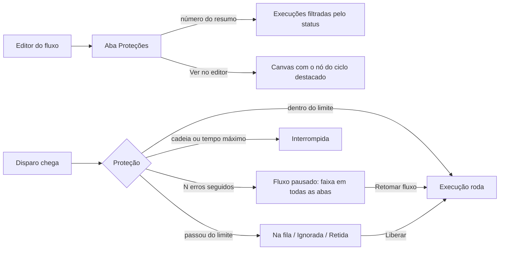

# Decisões: Proteções do Spaceflow

## A proposta em 1 parágrafo

Uma aba **Proteções** no editor do fluxo, depois de Execuções. Ela mostra no topo o que as proteções seguraram nas
últimas 24 horas e organiza as regras em cartões: Volume de disparos, Execuções ao mesmo tempo, Disparos repetidos,
Repetição sem fim, Tempo e erros, Custo de IA e Avisos. Cada regra tem chave, rótulo pelo efeito e o valor
recomendado escrito. O que passa do limite espera na fila por padrão; ignorar e reter são escolhas explícitas.
Salvar não cria versão do fluxo: vale a partir da próxima execução. A aba Execuções ganha 4 status (Na fila, Ignorada,
Retida, Interrompida) com o motivo escrito, filtro por status e a decisão em lote das retidas.

## A jornada

## Rodada 1 · 2026-10-24

- **Pedido (literal):** "pode prototipar tudo, mas coloque uma aba de "mvp" com somente o essencial."
- **Mudou:**
  - pasta nova `protecoes-do-spaceflow`, com a casca copiada do `no-de-atraso` e conferida no develop;
  - aba Proteções com as 7 seções (versão Completa) e com 5 seções e valores fixos (versão MVP), trocadas no andaime;
  - aba Execuções com os 4 status novos, motivo, "Esperando tarefa", filtro por status e liberar ou descartar retidas;
  - faixa "Fluxo pausado pela proteção" em todas as abas, com "Retomar fluxo" e "Ver erros";
  - aviso de ciclo no card do nó que pode disparar o próprio fluxo, ligado a "Ver no editor".
- **Fronteira:** muda a aba Proteções (nova), o que a aba Execuções mostra e o rodapé do card do nó que fecha um
  ciclo; não muda a casca, o canvas, as abas Versões, Comentários e Logs, nem o modal dos nós.
- **O que o MVP tem:** Volume (execuções por minuto; o excesso espera na fila), Execuções ao mesmo tempo (limite; a
  nova espera a vez; a espera por pessoa não conta), Repetição sem fim (ignorar mudanças feitas por fluxos e parar a
  cadeia), Tempo e erros (pausar depois de N erros; os disparos guardados rodam ao retomar) e Avisos (avisar o dono).
  Status novos no MVP: Na fila e Interrompida. Fica para depois: limite por dia, janela de horário, ignorar e reter,
  vaga por item, prazo na fila, Timer sobreposto, Disparos repetidos, aviso de ciclo no desenho, tempo máximo, Custo
  de IA, destinatários e frequência dos avisos.
- **Decisões que estavam em aberto** (ela validou sem responder; segui a recomendação):
  - as Proteções ficam fora das versões e valem ao salvar, com registro em Logs;
  - fluxo novo nasce com os valores recomendados; fluxo que já existia ganha ligadas só a Repetição sem fim e os
    Avisos (cenário "Fluxo que já existia"), para não mudar o comportamento de um fluxo em uso;
  - o nome da aba é "Proteções", como ela escreveu. Em inglês ficou "Safeguards", porque "Protections" soa estranho
    como rótulo de aba.
- **Por que assim:**
  - o excesso vai para a fila por padrão: é o padrão das 21 plataformas pesquisadas, e perder disparo sem aviso é o
    pior resultado (Power Automate);
  - rótulo pelo efeito ("Execuções ao mesmo tempo", "O que passar do limite"), não pelo termo técnico (concorrência,
    throttling): é o caminho do Make e do Zapier para usuário de negócio;
  - a espera por pessoa não ocupa vaga: no Spaceflow, Formulário, Aprovação e Tarefa seguram a execução por dias. Se
    contasse, 10 pedidos parados travariam o fluxo;
  - "Mudanças feitas por fluxos não disparam este fluxo" nasce ligado em fluxo novo: a documentação do ENSPACE admite
    o autodisparo, e o único jeito de evitar hoje é montar a condicional com `changes` à mão;
  - o teto de IA mostra a média e a maior execução ao lado do campo, porque "en-credits" sozinho não diz nada a quem
    configura (achado S3-F5 da pesquisa de UX);
  - escolhas com várias opções usam `USelect` com descrição por opção, não cartões (preferência registrada dela).
- **Descartado:**
  - aba "Regras de execução". Motivo: ela escreveu "Proteções";
  - presets ("Padrão", "Alto volume", "Uma de cada vez"). Motivo: escondem o que cada regra faz; o botão "Restaurar
    recomendadas" cobre o caso de voltar ao seguro;
  - retentativa automática por fluxo. Motivo: no mercado ela mora no nó, e o Spaceflow já tem retentativa manual de nó
    (`NodeExecutionsRetry`). Fica para uma demanda do modal dos nós.
- **Não deu:**
  - print das referências. Por quê: pesquisa documental; as telas de configuração de Make, Zapier, Power Automate e
    HubSpot pedem conta paga;
  - medir o limite que a plataforma já aplica hoje. Por quê: não está na documentação nem visível na tela; fica como
    pergunta no documento de requisitos;
  - prints do protótipo pelo `localhost`. Por quê: o Chrome não alcança o servidor local nesta máquina; os prints
    saíram do site publicado.
- **Maquete:**
  - salvar espera 900 ms e devolve sucesso (ou erro no cenário "Erro ao salvar"); nada persiste no reload;
  - os números do resumo e a lista de execuções vêm do `mocks.ts`; liberar, descartar e retomar mexem na lista em
    memória;
  - a análise de ciclo não lê o fluxo: o ciclo existe nos gatilhos Ações de Itens e E-mail recebido, que são os 2 casos
    que a documentação descreve;
  - o índice lateral, o canvas e as abas Versões, Comentários e Logs são estáticos.
- **Crítica e acessibilidade:**
  - corrigido: "Ver erros" e "Ver no editor" estavam em amarelo sobre amarelo; passaram a contorno neutro, e "Retomar
    fluxo" passou à cor primária;
  - corrigido: o valor fixo do MVP usava cadeado, que se confunde com "sem permissão"; passou ao ícone de informação;
  - corrigido: o índice lateral não acompanhava a rolagem e cortava o nome longo sem dica; agora acompanha, marca
    `aria-current` e mostra o nome inteiro no `title`;
  - corrigido: trocar de aba com alteração não salva descartava a alteração sem aviso; agora a alteração e a barra de
    salvar continuam ao voltar (RF085);
  - sem correção: a coluna de ações da aba Execuções fica no fim da linha, porque o `EnTable` põe o slot `#actions`
    na ponta direita; no develop ela é a primeira coluna. Decisão do front na implementação;
  - sem correção: no celular, a barra de abas do editor passa da largura da tela. É casca: o editor do develop não é
    pensado para celular;
  - o status da execução nunca depende só da cor: cada um tem ícone e o motivo escrito embaixo;
  - toda regra tem rótulo visível ligado à chave; os campos numéricos têm `aria-label` e a mensagem de erro com
    `role="alert"`.
- **CSS próprio:** nenhum (`<style>`, `:deep()` e `!important` não aparecem nos arquivos da pasta).
- **Ver:** https://pernalombr4.github.io/prototipos/protecoes-do-spaceflow/ · prints em `evidencias/`:
  - `proposta-01-aba-protecoes.jpg`: a aba Completa com o resumo das 24 horas;
  - `proposta-02-ciclo-encontrado.jpg` e `proposta-03-ciclo-resolvido-e-salvar.jpg`: o ciclo antes e depois de ligar a
    regra, com a barra de salvar;
  - `proposta-04-canvas-aviso-de-ciclo.jpg`: o aviso no card "Marcar para revisão";
  - `proposta-05-execucoes-status-novos.jpg` e `proposta-06-retidas.jpg`: os status novos e a decisão das retidas;
  - `proposta-07-fluxo-pausado.jpg`: a faixa do fluxo pausado;
  - `proposta-08-mvp.jpg`: o MVP;
  - `proposta-09-escuro-espanhol.png`: tema escuro em espanhol. Capturado sem os 20 px da direita: o detector de
    ponteiro lia a barra de rolagem clara do tema escuro como seta.
