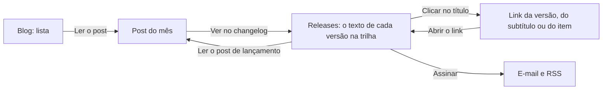

# Releases no docs: decisões

Proposta da pesquisa de mercado de 2026-11-24 (deploy contínuo e lançamento), seção 5: com deploy
contínuo, o número da versão deixa de marcar o lançamento. A aba Releases vira changelog por item, o
Blog fica com o post do mês, e "Próximas mudanças" reúne o que exige ação do cliente, com prazo.
Na rodada 5, "Próximas mudanças" sai: o que exige ação fica na trilha, com o prazo e as 3 fases.

## A fronteira (a partir da rodada 2)

- **Muda na aba Releases:** o texto de cada versão é lido na própria linha do tempo, como prosa
  (rodada 4), fechado por padrão com "Mostrar mais" (rodada 5); sem filtros (rodada 5); no máximo 2
  rótulos por versão; cada título (versão, subtítulo e item) copia o próprio link (rodada 5); a
  versão em breve no topo da trilha, com o que exige ação e as 3 fases no texto do item (rodada 5);
  "Assinar"; os patches como blocos curtos na mesma trilha. O
  banner sai da versão e fica no post.
- **Muda no Blog:** o post do mês no lugar do post por versão; o post só de changelog sai da lista
  (rodada 3); o banner mostra o mês e o ano (rodada 4).
- **Não muda:** a casca do docs, o topo "Versões do ENSPACE", a árvore e os `:ui` da página de
  releases, o título, o resumo e o quadro escuro de cada versão, e o filtro de categoria do Blog.

## A jornada

## Rodadas

### Rodada 5 · 2026-11-24
- **Pedido (literal):**
  - "tem que vir por padrao colapsado o texto, igual no changelog do nuxt."
  - "pode tirar os filtros dali. nenhum produto que vi tem isso."
  - "ao clicar no titulo da release deve copiar o link, como é na doc do changelog do notion. bem como acontece com docs .md renderizados no nuxt mesmo. cada titulo tem seu link."
  - "pode copiar igualzinho ao notion a questao dos links (o texto interno tambem tem copia de link nos subtitulos e tal)"
- **Conferido antes:** no código do template "Changelog" do Nuxt UI (`nuxt-ui-templates/changelog`, `app/pages/index.vue`) e da página de releases do Nuxt UI (`nuxt/ui`, `docs/app/pages/docs/releases/[[tag]].vue`), o texto não vem fechado: o template mostra o texto inteiro, e a página do Nuxt UI mostra 1 release por página. O texto fechado usa o componente pronto do Nuxt UI para isso, o `UCollapsible`. No Notion (notion.com/releases), cada título leva ao próprio endereço; a leitura sem navegador não mostrou o ícone ao passar o mouse
- **Mudou:**
  - o texto de cada versão vem fechado (`UCollapsible`). Fechada, a versão mostra a data, os rótulos, o título e o resumo curto ("Esta release apresenta 4 itens: 2 novidades e 2 melhorias."); em breve, a data prevista
  - "Mostrar mais" e "Mostrar menos" ficam no rodapé da versão, abaixo do texto; só esse botão abre e fecha
  - quem chega por link de item, de subtítulo ou pelo post do mês cai na versão já aberta, no ponto certo
  - sai a barra de filtros (tamanho e funcionalidade) e o código e os textos que só serviam a ela; sai também a contagem de versões, que sem filtro não diz nada. Fica "Assinar"
  - cada título tem link, como os títulos de markdown do Nuxt UI: o título da versão (`#v3-4-0`), os subtítulos Exige ação, Novidades, Melhorias e Correções (`ProseH3` com âncora, `#v3-4-0-novidades`) e o título em negrito de cada item (`#<id do item>`). Passar o mouse mostra o ícone `#` à esquerda (o mesmo ícone dos títulos do Nuxt UI, só em telas largas); clicar copia o endereço completo e mostra "Link copiado"
  - sai "Copiar link" do rodapé, porque o título faz isso
  - o link permanente passa a ser da página única: `docs.enspace.io/pt/releases#<âncora>`
- **Pedido seguinte (do coordenador):** "a página Próximas mudanças sai. A pesquisa não achou essa página em nenhum dos changelogs analisados, e a redatora pediu para tirar nesse caso."
- **Mudou com esse pedido:**
  - sai a página "Próximas mudanças", com o componente, os textos e as ações que só ela usava. Motivo: a pesquisa de changelogs (`pesquisa-de-mercado`, run 2026-11-24, `changelog-referencias.md`) não achou essa página em nenhum produto analisado, e a redatora pediu para tirar nesse caso
  - a versão em breve fica no topo da trilha, no mesmo padrão das outras (texto fechado, título que copia o link). É o equivalente ao "Unreleased" do Keep a Changelog
  - "Exige ação · Agir até <data>" fica como rótulo da versão e como a seção Exige ação no começo do texto dela
  - as 3 fases viram 1 frase no texto do item que exige ação, depois do prazo: "Opcional desde 08/12/2026; ligada para todos em 12/01/2027; obrigatória em 09/02/2027." Sem linha do tempo e sem cartão
  - sai o link para "Próximas mudanças" do topo da trilha; fica só "Assinar"
  - no post do mês, o aviso de ação leva ao item na trilha ("Ver no changelog"); sai o botão "Ver o que fazer"
  - os prints `rodada3-proximas-*` ficam em `evidencias/` como histórico
- **Print do ícone no subtítulo:** a captura sem janela não tem mouse; o estado de hover foi forçado pelo DevTools do Chrome (`CSS.forcePseudoState`) no link do subtítulo "Novidades". Não há ponteiro na imagem
- **Para a redatora decidir:**
  - o ícone ao passar o mouse é o `#` dos títulos do Nuxt UI; o Notion usa o ícone de corrente. Trocar o ícone muda todos os títulos de markdown do repositório, porque vem da configuração do app
  - os 2 pontos da rodada 4 seguem abertos (a 3.4.2 patch com novidade; nenhuma versão major no mock)
- **Commit:** nenhum nesta rodada; o commit sai pelo coordenador
- **Ver:** `http://localhost:3000/releases-no-docs` · `evidencias/rodada5-trilha-desktop-claro.jpg` · `evidencias/rodada5-trilha-desktop-escuro.jpg` · `evidencias/rodada5-trilha-mobile-claro.jpg` · `evidencias/rodada5-versao-aberta-desktop-claro.jpg` · `evidencias/rodada5-versao-aberta-mobile-escuro.jpg` · `evidencias/rodada5-em-breve-aberta-desktop-claro.jpg` · `evidencias/rodada5-item-pelo-link-desktop-claro.jpg` · `evidencias/rodada5-link-no-subtitulo-desktop-claro.jpg` · `evidencias/rodada5-link-copiado-desktop-claro.jpg`

### Rodada 4 · 2026-11-24
- **Pedido (literal):**
  - "ao abrir os itens da release nao é mais um blogpost. ta todo estilizado. nao dá pra ser simplesmente um texto? como é hoje mesmo. e produtos escreve o texto de modo direto. ta inventando muita moda... nao?"
  - "nao ha nenhum componente do nuxt já pronto pra isso? mais ou menos como o changelog do proprio nuxt talvez? e aí ficaria fácil de ler o texto ali mesmo, sem abrir"
  - "nas imagens de preview do blogpost, tem que caber nao só o mes, mas o ano tambem. cuide disso no prototipo"
- **Base:** a síntese da pesquisa, seção "Proposta para o protótipo": `C:\Users\JardimMikaela\Documents\Github\pesquisa-de-mercado\runs\2026-11-24-deploy-continuo-e-lancamento\evidencias\notas\changelog-referencias.md`. Referência pronta: o template oficial "Changelog" do Nuxt UI (`nuxt-ui-templates/changelog`), que põe o texto de cada versão no `#body` do `UChangelogVersion`
uns‚6-11-24-deploy-continuo-e-lancamento\evidencias
otas\changelog-referencias.md`. Referência pronta: o template oficial "Changelog" do Nuxt UI (`nuxt-ui-templates/changelog`), que põe o texto de cada versão no `#body` do `UChangelogVersion`
- **Mudou:**
  - sai a página da versão (`_PaginaDaVersao.vue`, da rodada 3). O texto de cada versão é lido na trilha, no `#body` do `UChangelogVersion`, com os componentes Prose do Nuxt UI (os do texto de um post): títulos pequenos (`ProseH4`), parágrafos e listas
  - ordem do texto: Exige ação (só quando há), Novidades, Melhorias, Correções
  - novidade e melhoria: 1 linha em negrito com a funcionalidade e o que muda ("Spaceflow: nó de espera por data."), 1 a 3 frases e "Saiba mais"; o item que exige ação traz "Agir até <data>" e "Ver o que fazer"; correção: 1 linha numa lista
  - Beta, Acesso antecipado, "liberando, para todos até <data>" e "liberado para alguns workspaces" vão entre parênteses no título do item, sem rótulo
  - no máximo 2 rótulos por versão: o tamanho (minor, patch) e "Exige ação · Agir até <data>"
  - sai o banner da versão; ele fica no post do Blog. A versão no ar não tem resumo: o texto vem logo abaixo do título
  - no rodapé da versão: "Copiar link" e, quando a versão faz parte do post do mês, "Ler o post de lançamento"
  - âncora por versão (`#v3-4-0`) e por item (o id do item no parágrafo dele). O post do mês e "Ver no changelog" de Próximas mudanças levam à âncora do item na trilha, com o fundo aceso por 2,6 s
  - os filtros da rodada 3 ficam (tamanho e funcionalidade); o de funcionalidade também filtra os itens dentro de cada versão
  - banner do Blog: o rótulo traz o mês e o ano ("Dezembro de 2026") e o canto, a data com o ano ("8 de dezembro de 2026"). O rótulo usa uma escala menor que a da versão e quebra em 2 linhas equilibradas quando falta largura, sem corte. Vale para a lista, o cartão, o post do mês e o modo Hoje
  - Próximas mudanças fica como na rodada 3; só o link "Ver no changelog" leva à âncora na trilha
- **Descartado:**
  - cartão por item e rótulo por item (rodada 3). Motivo: o pedido de texto simples, como hoje
  - página separada por versão. Motivo: o texto cabe na trilha ("ler o texto ali mesmo, sem abrir")
- **Maquete:** "Saiba mais" mostra o aviso "A documentação fica fora deste protótipo."
- **Para a redatora decidir:**
  - a 3.4.2 do mock é patch e tem 1 novidade e 1 melhoria; pelo filtro "Pequenas: correções e ajustes rápidos", ela seria minor. Manter o mock ou renumerar
  - "Grandes" continua vazio no mock (sem versão major)
- **Commit:** nenhum nesta rodada; o commit sai pelo coordenador
- **Ver:** `http://localhost:3000/releases-no-docs` · `evidencias/rodada4-trilha-desktop-claro.jpg` · `evidencias/rodada4-trilha-desktop-escuro.jpg` · `evidencias/rodada4-trilha-mobile-claro.jpg` · `evidencias/rodada4-versao-minor-desktop-claro.jpg` · `evidencias/rodada4-versao-minor-mobile-escuro.jpg` · `evidencias/rodada4-versao-patch-desktop-claro.jpg` · `evidencias/rodada4-item-pelo-link-desktop-claro.jpg` · `evidencias/rodada4-blog-desktop-claro.jpg` · `evidencias/rodada4-blog-mobile-claro.jpg` · `evidencias/rodada4-blog-post-mobile-claro.jpg`

### Rodada 3 · 2026-11-24
- **Pedido (literal), item a item:**
  - "nao use o termo 'modulos' ali no filtro. isso pro enspace é a outra coisa."
  - o filtro "Só o que exige ação" sai; o rótulo "Exige ação" fica na versão
  - o filtro por tipo (Novidades, Melhorias, Correções) sai; entra o filtro pelo tamanho da versão, com dica curta em cada opção
  - Próximas mudanças: "ta tudo torto e horrivel... fontes extremamente grandes junto de outras pequenas... muito feio mesmo. ajuste isso. preze pela ux."
  - clicar na versão abria o post do mês no Blog: "isso nao ta errado??"
  - "use 100% /nuxt-ui"
- **Mudou:**
  - o filtro e os rótulos dizem "Funcionalidade" ("Todas as funcionalidades"); nenhum texto da tela diz "módulo". O nome interno `modulos` ficou no código
  - sai "Só o que exige ação"; "Exige ação · Agir até <data>" segue no rótulo da versão
  - sai o filtro por tipo. Entra o tamanho da versão, num grupo de botões (`UFieldGroup` com `UButton` e `UTooltip`): Todas, Grandes, Médias, Pequenas. Dicas: "Grandes: mudam a forma de usar", "Médias: novidades e melhorias", "Pequenas: correções e ajustes rápidos". O rótulo técnico (minor, patch) segue discreto na versão
  - o tipo de cada item (Novidade, Melhoria, Correção) passa para a página da versão
  - página da versão, nova: clicar na versão (ou em "Ver os N itens") abre o changelog simples dela, com `UContainer`, `UPage`, `UPageHeader` e `UPageBody`. Os itens vêm em grupos por tipo (`USeparator`) e são `UPageCard` dentro de `UPageList`, com 1 a 3 linhas, rótulos (tipo, funcionalidade, Exige ação, Beta ou Acesso antecipado, Liberando, Liberado para alguns workspaces) e os links Documentação, Tutorial, Ver o que fazer e Copiar link
  - link permanente por item: `docs.enspace.io/pt/releases/3-4-0#<id do item>`. Abrir a página com `#<id do item>` rola até ele e acende o contorno; com `#v3-4-0`, abre a versão
  - quando a versão entra no post do mês (tem item Tier 1 ou 2), a página mostra 1 aviso discreto: "Ler o resumo do mês no Blog"
  - o item do post do mês e o "Ver na página da versão" de Próximas mudanças levam à página da versão, no item
  - Blog: sai o post "Versão 3.2.0" (categoria release) da lista da proposta; ficam os 2 posts do mês e o artigo
  - Próximas mudanças refeita só com componentes do Nuxt UI e 1 escala de texto: o título da página vai no topo da seção (no lugar de um 2º título); cada mudança tem o título no tamanho do título da versão; o prazo é 1 `UAlert` ("Agir até 15 de janeiro de 2027", com os dias que faltam); "Quem é afetado" e "O que fazer" são `UPageCard` com texto normal; as 3 fases são 1 `UTimeline` dentro de `UPageCard`. Saem os rótulos em maiúsculas, a data grande e os números em círculo. Mesma largura da trilha (`max-w-2xl`)
- **Descartado:**
  - abas (`UTabs`) para o tamanho da versão. Motivo: o grupo de botões ocupa 1 linha com o filtro de funcionalidade e aceita dica em cada opção
  - fases em linha horizontal. Motivo: no celular as 3 fases não cabem lado a lado; na vertical a leitura é a mesma nas 2 larguras
- **Maquete:** Documentação e Tutorial mostram o aviso "A documentação e o tutorial ficam fora deste protótipo."; o mock não tem versão grande (major), então "Grandes" mostra o estado sem resultado
- **Para a redatora decidir:**
  - "Grandes" fica vazio no mock: manter a opção (o filtro mostra "nenhuma versão") ou esconder enquanto não houver versão grande
  - o rótulo técnico "minor" ou "patch" na versão: manter, como hoje no mapeamento do `en-docs`, ou tirar, já que o filtro diz Médias e Pequenas
  - o destino de Documentação e Tutorial em cada item: a doc de suporte e o passo a passo no Tango, ou só a doc
- **Commit:** nenhum nesta rodada; o commit sai depois do ok da redatora
- **Ver:** `http://localhost:3000/releases-no-docs` (versão: `#v3-4-0`) · `evidencias/rodada3-trilha-desktop-claro.jpg` (a dica de cada tamanho está no código; sem evidência visual: a captura sem navegador visível não registrou a dica aberta) · `evidencias/rodada3-trilha-pequenas-desktop-claro.jpg` · `evidencias/rodada3-trilha-desktop-escuro.jpg` · `evidencias/rodada3-versao-minor-desktop-claro.jpg` · `evidencias/rodada3-versao-minor-desktop-escuro.jpg` · `evidencias/rodada3-versao-patch-desktop-claro.jpg` · `evidencias/rodada3-proximas-desktop-claro.jpg` · `evidencias/rodada3-proximas-desktop-escuro.jpg` · `evidencias/rodada3-blog-desktop-claro.jpg` · `evidencias/rodada3-trilha-mobile-claro.jpg` · `evidencias/rodada3-versao-minor-mobile-claro.jpg` · `evidencias/rodada3-versao-patch-mobile-escuro.jpg` · `evidencias/rodada3-proximas-mobile-claro.jpg` · `evidencias/rodada3-blog-mobile-claro.jpg`

### Rodada 2 · 2026-11-24
- **Pedido (literal):** "ta pessimo no local. a estetica ta nada a ver. preserve a estetica que ta na doc hoje e veja o que pode fazer sem alteraçoes absurdas. pode usar as tags e tal, mas nao tire a imagem nem nada. só a parte de releases está ruim. a de blog ta boa. até a largura ta estranha aqui, conforme print. ajuste isso." E, em seguida: "refaça olhando en-docs com /investigar-codigo e vendo os componentes utilizados nessa tela prezando pelo minimo de modificaçao possivel ok??"
- **Veio do `en-docs`** (`app/pages/releases/[section].vue` em origin/main 910960b4, só leitura):
  - a árvore `UPage` (`overflow-x-hidden`) > `EnPageHero` > `UPageBody` > `UContainer` > `UChangelogVersions indicator-motion` > `UChangelogVersion`
  - os mesmos `:ui`: gaps `gap-y-10 sm:gap-y-14 lg:gap-y-18`; container `max-w-2xl [content-visibility:auto] [contain-intrinsic-size:auto_520px]`; título `text-2xl font-bold text-highlighted`; descrição `text-base text-muted mt-2 leading-relaxed line-clamp-4`
  - o `ReleaseNotesBanner` no `#image`, com a cor da versão e a data; o estado vazio com o foguete em círculo
  - o badge do mapeamento (`post.badge?.label`), que a página de hoje calcula e não mostra, agora aparece: "minor" ou "patch"
  - as cópias `_HeroDaSecao.vue` (do `EnPageHero`) e `_BannerDaRelease.vue` (do `ReleaseNotesBanner`) já existiam desde a rodada 1
- **Mudou em relação à página de hoje:**
  - rótulos no `#badge` de cada versão: "minor" ou "patch", Exige ação com "Agir até", Em breve, Liberando, Beta ou Acesso antecipado, Liberado para alguns workspaces e os módulos da versão
  - 1 barra acima da lista, dentro do mesmo `UContainer` e da mesma coluna `max-w-2xl`: tipo, módulo e "Só o que exige ação"; embaixo, a contagem de versões e os links "Próximas mudanças" (com o número das abertas) e "Assinar"
  - o patch entra na linha do tempo como versão própria, com o banner compacto numa faixa de 4 por 1 (3 por 1 no celular)
  - a versão Em breve (3.5.0) abre a lista, sem banner e com o ponto apagado
  - abaixo do banner, "Copiar link" (âncora `#v3-4-0`) e, quando a versão pede ação, "Ver o que fazer"
  - o resumo da versão nasce dos itens: "Esta release apresenta 4 itens: 2 novidades e 2 melhorias. Inclui: ..."; o corte em 4 linhas é o de hoje
  - a data sai no dia certo e no formato do idioma, em números ("08/12/2026"); hoje o site mostra "Dec 7, 2026" para 8 de dezembro. Por extenso ("8 de dez. de 2026") ela não cabe na coluna da data e sai cortada
- **Cópia corrigida:** o banner das versões preenche a caixa 16 por 9 da imagem, como o original (`min-h-88 sm:min-h-104`, cortado pelo `overflow-hidden`); a cópia da rodada 1 deixava uma faixa branca abaixo dele. Vale também para o modo Hoje
  - clicar na versão que tem item em destaque abre o post do mês, no lugar do post da versão
- **Mudou em relação à rodada 1:**
  - sai a lista com 1 entrada por item, sem imagem; volta 1 entrada por versão, com título "<versão> está no ar", resumo e banner
  - saem as abas Changelog e Próximas mudanças e o aviso amarelo; o acesso a Próximas mudanças é um link na barra acima da lista, e a volta é o link "Versões do ENSPACE"
  - o topo volta a "Versões do ENSPACE", com o texto de hoje
  - a largura segue a da página de hoje: a coluna da versão (`max-w-2xl`) e a barra de filtros dividem a mesma coluna; a data e o ponto ficam à esquerda, como hoje
  - Próximas mudanças usa a mesma linha do tempo: o prazo no lugar da data, o "por que muda" como resumo, e o restante (prazo, quem, o que fazer, fases) no corpo, sem cartão
  - o item da versão 3.2.4 do mock passou para 3.3.1, para não criar uma versão 3.2 com 1 item só
- **Fronteira:** muda só o que está em "Mudou em relação à página de hoje"; não muda a árvore, os `:ui`, o topo, o título, o resumo em 4 linhas nem o banner das versões minor. O Blog fica como estava na rodada 1
- **Descartado:**
  - a lista de itens dentro de cada versão, abaixo do banner. Motivo: o pedido de mudança mínima; os itens aparecem no resumo ("Inclui: ...") e nos rótulos
  - o link permanente por item. Motivo: o item deixou de ser entrada da linha do tempo; o link é por versão, e o item do post do mês ou de Próximas mudanças leva à versão dele
  - estado "Disponível" como rótulo. Motivo: a versão "está no ar" já diz isso; o rótulo só aparece quando é Em breve ou Liberando
- **Maquete:** a mesma da rodada 1; a versão Em breve não tem post nem banner
- **Crítica e acessibilidade:**
  - o resumo em 4 linhas corta a lista "Inclui: ..." da 3.4.0; é o mesmo corte de hoje e foi mantido
  - a versão minor tem até 7 rótulos; numa tela de 375 px eles quebram em 2 ou 3 linhas acima do título
  - os achados da rodada 1 sobre contraste (cor da marca a 3,39 no botão "Todos") e alvo de toque dos botões `xs` continuam valendo
- **Commit:** nenhum nesta rodada; a redatora autoriza cada commit. A rodada 1 está no commit `6f68c9b`
- **Ver:** `http://localhost:3000/releases-no-docs` · `evidencias/rodada2-lado-a-lado-hoje-e-proposta.jpg` (o site de hoje à esquerda, a proposta à direita) · `evidencias/rodada2-releases-claro.jpg` · `evidencias/rodada2-releases-versao-minor.jpg` · `evidencias/rodada2-releases-patches.jpg` · `evidencias/rodada2-releases-escuro.jpg` · `evidencias/rodada2-proximas-mudancas.jpg` · `evidencias/rodada2-celular-releases.jpg` · `evidencias/rodada2-celular-proximas.jpg`

### Rodada 1 · 2026-11-24
- **Pedido (literal):** "Prototipe a nova comunicação das releases do ENSPACE no docs (docs.enspace.io), seguindo o agente de protótipos do ENSPACE." Itens do pedido: aba Releases como changelog por item, com estado, "Exige ação" com "agir até", Beta ou Acesso antecipado, "Liberado para alguns workspaces", filtros por tipo, módulo e "Exige ação", versão como dado técnico e link permanente; aba Blog com o post do mês, só Tier 1 e Tier 2 em destaque, com lugar para o passo a passo e a navegação guiada; página "Próximas mudanças" com data, prazo, o que fazer e as 3 fases; feed RSS e inscrição por e-mail só como interface.
- **Mudou:**
  - **Changelog por item:** 1 entrada por item, correções e patches inclusive. O título é o item ("Spaceflow: nó de espera por data"); a versão desce para o rodapé da entrada, em fonte mono
    - rótulos na ordem: Exige ação com o prazo, tipo, módulo, estado (Em breve, Liberando, Disponível), Beta ou Acesso antecipado, Liberado para alguns workspaces
    - Exige ação vem primeiro: é o rótulo que quem administra procura
    - Em breve mostra "Previsto para"; Liberando mostra "Para todos até"
    - Em breve abre a lista, acima do mês corrente; depois, 1 grupo por mês
  - **Filtros:** tipo (Todos, Novidades, Melhorias, Correções), módulo (vários de uma vez) e a chave "Só o que exige ação", com a contagem de entradas e o estado sem resultado com "Limpar filtros"
  - **Link permanente:** "Copiar link" copia `docs.enspace.io/<idioma>/releases/docs#<id>` e põe a âncora na barra; quem abre o link cai na entrada, com o contorno aceso. A âncora nasce do título em pt e não muda depois de publicada
  - **Aviso no topo do changelog:** "3 mudanças exigem ação. A mais próxima: até 12 de janeiro.", com o botão para Próximas mudanças
  - **Próximas mudanças:** aba ao lado do Changelog, com a contagem das abertas. Cada mudança é 1 cartão com o prazo em destaque ("Agir até", "Faltam N dias", a data anterior quando mudou), Por que muda, Quem é afetado, O que fazer em passos numerados e as 3 fases em linha do tempo, com "Agora" na fase atual
    - fases: Opcional (liga quem quiser), Ligada por padrão (quem não terminou desliga), Obrigatória (não desliga mais); o prazo é o início da fase obrigatória
    - "Mostrar encerradas" traz as que já viraram obrigatórias
  - **Post do mês:** "Novidades de dezembro" no lugar de "3.4.0 está no ar". O quadro escuro mostra o mês no lugar da versão
    - seções: aviso de Exige ação, Em destaque (Tier 1, com o passo a passo em grade e o lugar da navegação guiada), Também neste mês (Tier 2, com o passo a passo recolhido), Correções e outros itens (só a contagem e o botão para o changelog), e o convite para assinar
    - "Nesta página" à direita, como no post de hoje
  - **Blog:** a categoria "Releases" vira "Novidades do mês"; os posts por versão que já existem ficam nela, com o selo "Arquivo"
  - **Assinar:** janela com e-mail e 3 opções (o post do mês, o resumo semanal do changelog, só as mudanças que exigem ação) e 2 feeds RSS (changelog inteiro, só o que exige ação) com botão de copiar
  - **Andaime:** Versão Hoje e Proposta. Hoje reproduz a aba Releases por versão e o Blog com "<versão> está no ar"; Estado Cheio, Vazio e Carregando
- **Fronteira:** muda o conteúdo de Blog e Releases e o texto do topo de Releases; não muda a casca do docs nem os componentes que as 2 abas já usam
  - Próximas mudanças mora como aba dentro de Releases, e não como 5º link do topo: a barra do topo fica como é (regra 37)
  - a casca tem 4 diferenças do `SpaceNavigation`, todas de maquete: o menu do celular usa o ícone `i-lucide-menu` no lugar das barras animadas; o logo é o `enspace.svg` local; as estrelas do quadro escuro são pontos fixos; as cores da nebulosa usam `color-mix` com a paleta do tema
- **Descartado:**
  - versão no título da entrada. Motivo: com deploy contínuo, várias versões por mês viram ruído para o cliente; o número fica para o suporte
  - post por versão no Blog. Motivo: o pedido; o post do mês junta Tier 1 e Tier 2
  - 5º link "Próximas mudanças" no topo. Motivo: regra 37, a casca não muda
  - passo a passo dos itens Tier 2 aberto. Motivo: 4 itens com 4 imagens cada viram uma página longa; recolhido, o Tier 1 continua em destaque
  - correções no post do mês. Motivo: o pedido; ficam no changelog, com a contagem no post
- **Não deu:**
  - prints das referências (Notion, Twenty, ClickUp, Monday, Pipefy e os extras). Por quê: a pesquisa trouxe texto e endereço; o `PESQUISA.md` diz o padrão de cada uma
  - Fase 2 (ver a tela no develop). Por quê: o docs é público e não tem develop; a tela de hoje vem do `en-docs` lido e dos 2 prints da pesquisa (`evidencias/hoje-aba-blog.jpg`, `evidencias/hoje-aba-releases.jpg`)
  - link para a documentação de suporte em cada entrada. Por quê: o pedido não trouxe; é o próximo candidato, ao lado de "Ver no post do mês"
- **Maquete:**
  - todo o conteúdo vem do `mocks.ts`: 16 entradas, 4 mudanças, 4 posts na proposta e 4 em Hoje, com títulos e resumos inventados no estilo do ENSPACE, sem cliente
  - a data de referência é 2026-12-15: "Faltam N dias", "Agora" e "Em breve" se contam a partir dela
  - Assinar: o envio espera 900 ms e mostra "Falta confirmar"; nada sai do navegador. Os feeds RSS são endereços de exemplo
  - Copiar link usa a área de transferência do navegador; sem permissão, o aviso mostra o endereço
  - imagens do passo a passo e a navegação guiada do Tango são caixas vazias com o rótulo
  - artigos do Blog e os posts de Hoje não abrem; Docs e Dev do topo mostram o aviso "fora do protótipo"
  - Hoje reproduz 2 defeitos da aba Releases atual, de propósito: a data sai 1 dia antes e em inglês. A proposta formata a data em UTC, no idioma da página
  - campos que o frontmatter do `en-docs` não tem estão marcados `PROPOSTA:` no `mocks.ts`: `id` (âncora), `tipo`, `modulo`, `estado`, `publico`, `todosAte`, `acesso`, `mudanca`, `tier`, `category: mensal` e `mes` do post. `release.version` deixa de ser título e vira dado técnico
- **Crítica e acessibilidade:**
  - rótulos e botões em amarelo cheio ou fantasma mediam 1,8 a 1,9 de contraste. Corrigido: Exige ação virou contorno amarelo com fundo claro e texto escuro; as ações "Ver o que fazer" e "Ver em Próximas mudanças" ficaram neutras, com o ícone em amarelo. O aviso amarelo mede 4,65
  - sem correção: a aba ativa e o botão cheio "Todos" na cor da marca medem 3,39 no texto pequeno. É a cor primária que o docs já usa; mudar é decisão de marca, fora desta demanda
  - sem correção: os botões `xs` do rodapé da entrada (Copiar link, Ver o que fazer, Ver no post do mês) ficam abaixo de 44 px de altura de toque. Mantidos pequenos para a entrada não crescer
  - na tela estreita, o botão do aviso desce para baixo do texto
  - a contagem de entradas anuncia a mudança de filtro para leitor de tela (`aria-live`)
  - nenhum CSS próprio: `<style>`, `:deep()` e `!important` não aparecem na pasta
- **Ver:** `http://localhost:3000/releases-no-docs` · `evidencias/rodada1-releases-changelog.jpg` · `evidencias/rodada1-proximas-mudancas.jpg` · `evidencias/rodada1-post-de-dezembro.jpg` · `evidencias/rodada1-blog-lista.jpg` · `evidencias/rodada1-assinar.jpg` (os 14 prints da rodada estão em `evidencias/`, com o prefixo `rodada1-`)
