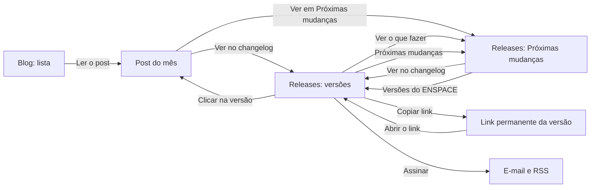

# Releases no docs: decisões

Proposta da pesquisa de mercado de 2026-11-24 (deploy contínuo e lançamento), seção 5: com deploy
contínuo, o número da versão deixa de marcar o lançamento. A aba Releases vira changelog por item, o
Blog fica com o post do mês, e "Próximas mudanças" reúne o que exige ação do cliente, com prazo.

## A fronteira (a partir da rodada 2)

- **Muda na aba Releases:** rótulos ao lado da data de cada versão, 1 barra de filtros acima da
  linha do tempo, o link permanente de cada versão, o acesso a "Próximas mudanças" e a "Assinar", e
  os patches como versões curtas na mesma linha do tempo.
- **Muda no Blog:** o post do mês no lugar do post por versão (rodada 1, sem mudança na rodada 2).
- **Não muda:** a casca do docs, o topo "Versões do ENSPACE", a árvore e os `:ui` da página de
  releases, o título, o resumo e o quadro escuro de cada versão, e o filtro de categoria do Blog.

## A jornada

## Rodadas

### Rodada 2 · 2026-11-24
- **Pedido (literal):** "ta pessimo no local. a estetica ta nada a ver. preserve a estetica que ta na doc hoje e veja o que pode fazer sem alteraçoes absurdas. pode usar as tags e tal, mas nao tire a imagem nem nada. só a parte de releases está ruim. a de blog ta boa. até a largura ta estranha aqui, conforme print. ajuste isso." E, em seguida: "refaça olhando en-docs com /investigar-codigo e vendo os componentes utilizados nessa tela prezando pelo minimo de modificaçao possivel ok??"
- **Veio do `en-docs`** (`app/pages/releases/[section].vue` em origin/main 910960b4, só leitura):
  - a árvore `UPage` (`overflow-x-hidden`) > `EnPageHero` > `UPageBody` > `UContainer` > `UChangelogVersions indicator-motion` > `UChangelogVersion`
  - os mesmos `:ui`: gaps `gap-y-10 sm:gap-y-14 lg:gap-y-18`; container `max-w-2xl [content-visibility:auto] [contain-intrinsic-size:auto_520px]`; título `text-2xl font-bold text-highlighted`; descrição `text-base text-muted mt-2 leading-relaxed line-clamp-4`
  - o `ReleaseNotesBanner` no `#image`, com a cor da versão e a data; o estado vazio com o foguete em círculo
  - o badge do mapeamento (`post.badge?.label`), que a página de hoje calcula e não mostra, agora aparece: "minor" ou "patch"
  - as cópias `_HeroDaSecao.vue` (do `EnPageHero`) e `_BannerDaRelease.vue` (do `ReleaseNotesBanner`) já existiam desde a rodada 1
- **Mudou em relação à página de hoje:**
  - rótulos no `#badge` de cada versão: "minor" ou "patch", Exige ação com "Agir até", Em breve, Liberando, Beta ou Acesso antecipado, Liberado para alguns workspaces e os módulos da versão
  - 1 barra acima da lista, dentro do mesmo `UContainer` e da mesma coluna `max-w-2xl`: tipo, módulo e "Só o que exige ação"; embaixo, a contagem de versões e os links "Próximas mudanças" (com o número das abertas) e "Assinar"
  - o patch entra na linha do tempo como versão própria, com o banner compacto numa faixa de 4 por 1 (3 por 1 no celular)
  - a versão Em breve (3.5.0) abre a lista, sem banner e com o ponto apagado
  - abaixo do banner, "Copiar link" (âncora `#v3-4-0`) e, quando a versão pede ação, "Ver o que fazer"
  - o resumo da versão nasce dos itens: "Esta release apresenta 4 itens: 2 novidades e 2 melhorias. Inclui: ..."; o corte em 4 linhas é o de hoje
  - a data sai no dia certo e no formato do idioma, em números ("08/12/2026"); hoje o site mostra "Dec 7, 2026" para 8 de dezembro. Por extenso ("8 de dez. de 2026") ela não cabe na coluna da data e sai cortada
- **Cópia corrigida:** o banner das versões preenche a caixa 16 por 9 da imagem, como o original (`min-h-88 sm:min-h-104`, cortado pelo `overflow-hidden`); a cópia da rodada 1 deixava uma faixa branca abaixo dele. Vale também para o modo Hoje
  - clicar na versão que tem item em destaque abre o post do mês, no lugar do post da versão
- **Mudou em relação à rodada 1:**
  - sai a lista com 1 entrada por item, sem imagem; volta 1 entrada por versão, com título "<versão> está no ar", resumo e banner
  - saem as abas Changelog e Próximas mudanças e o aviso amarelo; o acesso a Próximas mudanças é um link na barra acima da lista, e a volta é o link "Versões do ENSPACE"
  - o topo volta a "Versões do ENSPACE", com o texto de hoje
  - a largura segue a da página de hoje: a coluna da versão (`max-w-2xl`) e a barra de filtros dividem a mesma coluna; a data e o ponto ficam à esquerda, como hoje
  - Próximas mudanças usa a mesma linha do tempo: o prazo no lugar da data, o "por que muda" como resumo, e o restante (prazo, quem, o que fazer, fases) no corpo, sem cartão
  - o item da versão 3.2.4 do mock passou para 3.3.1, para não criar uma versão 3.2 com 1 item só
- **Fronteira:** muda só o que está em "Mudou em relação à página de hoje"; não muda a árvore, os `:ui`, o topo, o título, o resumo em 4 linhas nem o banner das versões minor. O Blog fica como estava na rodada 1
- **Descartado:**
  - a lista de itens dentro de cada versão, abaixo do banner. Motivo: o pedido de mudança mínima; os itens aparecem no resumo ("Inclui: ...") e nos rótulos
  - o link permanente por item. Motivo: o item deixou de ser entrada da linha do tempo; o link é por versão, e o item do post do mês ou de Próximas mudanças leva à versão dele
  - estado "Disponível" como rótulo. Motivo: a versão "está no ar" já diz isso; o rótulo só aparece quando é Em breve ou Liberando
- **Maquete:** a mesma da rodada 1; a versão Em breve não tem post nem banner
- **Crítica e acessibilidade:**
  - o resumo em 4 linhas corta a lista "Inclui: ..." da 3.4.0; é o mesmo corte de hoje e foi mantido
  - a versão minor tem até 7 rótulos; numa tela de 375 px eles quebram em 2 ou 3 linhas acima do título
  - os achados da rodada 1 sobre contraste (cor da marca a 3,39 no botão "Todos") e alvo de toque dos botões `xs` continuam valendo
- **Commit:** nenhum nesta rodada; a redatora autoriza cada commit. A rodada 1 está no commit `6f68c9b`
- **Ver:** `http://localhost:3000/releases-no-docs` · `evidencias/rodada2-lado-a-lado-hoje-e-proposta.jpg` (o site de hoje à esquerda, a proposta à direita) · `evidencias/rodada2-releases-claro.jpg` · `evidencias/rodada2-releases-versao-minor.jpg` · `evidencias/rodada2-releases-patches.jpg` · `evidencias/rodada2-releases-escuro.jpg` · `evidencias/rodada2-proximas-mudancas.jpg` · `evidencias/rodada2-celular-releases.jpg` · `evidencias/rodada2-celular-proximas.jpg`

### Rodada 1 · 2026-11-24
- **Pedido (literal):** "Prototipe a nova comunicação das releases do ENSPACE no docs (docs.enspace.io), seguindo o agente de protótipos do ENSPACE." Itens do pedido: aba Releases como changelog por item, com estado, "Exige ação" com "agir até", Beta ou Acesso antecipado, "Liberado para alguns workspaces", filtros por tipo, módulo e "Exige ação", versão como dado técnico e link permanente; aba Blog com o post do mês, só Tier 1 e Tier 2 em destaque, com lugar para o passo a passo e a navegação guiada; página "Próximas mudanças" com data, prazo, o que fazer e as 3 fases; feed RSS e inscrição por e-mail só como interface.
- **Mudou:**
  - **Changelog por item:** 1 entrada por item, correções e patches inclusive. O título é o item ("Spaceflow: nó de espera por data"); a versão desce para o rodapé da entrada, em fonte mono
    - rótulos na ordem: Exige ação com o prazo, tipo, módulo, estado (Em breve, Liberando, Disponível), Beta ou Acesso antecipado, Liberado para alguns workspaces
    - Exige ação vem primeiro: é o rótulo que quem administra procura
    - Em breve mostra "Previsto para"; Liberando mostra "Para todos até"
    - Em breve abre a lista, acima do mês corrente; depois, 1 grupo por mês
  - **Filtros:** tipo (Todos, Novidades, Melhorias, Correções), módulo (vários de uma vez) e a chave "Só o que exige ação", com a contagem de entradas e o estado sem resultado com "Limpar filtros"
  - **Link permanente:** "Copiar link" copia `docs.enspace.io/<idioma>/releases/docs#<id>` e põe a âncora na barra; quem abre o link cai na entrada, com o contorno aceso. A âncora nasce do título em pt e não muda depois de publicada
  - **Aviso no topo do changelog:** "3 mudanças exigem ação. A mais próxima: até 12 de janeiro.", com o botão para Próximas mudanças
  - **Próximas mudanças:** aba ao lado do Changelog, com a contagem das abertas. Cada mudança é 1 cartão com o prazo em destaque ("Agir até", "Faltam N dias", a data anterior quando mudou), Por que muda, Quem é afetado, O que fazer em passos numerados e as 3 fases em linha do tempo, com "Agora" na fase atual
    - fases: Opcional (liga quem quiser), Ligada por padrão (quem não terminou desliga), Obrigatória (não desliga mais); o prazo é o início da fase obrigatória
    - "Mostrar encerradas" traz as que já viraram obrigatórias
  - **Post do mês:** "Novidades de dezembro" no lugar de "3.4.0 está no ar". O quadro escuro mostra o mês no lugar da versão
    - seções: aviso de Exige ação, Em destaque (Tier 1, com o passo a passo em grade e o lugar da navegação guiada), Também neste mês (Tier 2, com o passo a passo recolhido), Correções e outros itens (só a contagem e o botão para o changelog), e o convite para assinar
    - "Nesta página" à direita, como no post de hoje
  - **Blog:** a categoria "Releases" vira "Novidades do mês"; os posts por versão que já existem ficam nela, com o selo "Arquivo"
  - **Assinar:** janela com e-mail e 3 opções (o post do mês, o resumo semanal do changelog, só as mudanças que exigem ação) e 2 feeds RSS (changelog inteiro, só o que exige ação) com botão de copiar
  - **Andaime:** Versão Hoje e Proposta. Hoje reproduz a aba Releases por versão e o Blog com "<versão> está no ar"; Estado Cheio, Vazio e Carregando
- **Fronteira:** muda o conteúdo de Blog e Releases e o texto do topo de Releases; não muda a casca do docs nem os componentes que as 2 abas já usam
  - Próximas mudanças mora como aba dentro de Releases, e não como 5º link do topo: a barra do topo fica como é (regra 37)
  - a casca tem 4 diferenças do `SpaceNavigation`, todas de maquete: o menu do celular usa o ícone `i-lucide-menu` no lugar das barras animadas; o logo é o `enspace.svg` local; as estrelas do quadro escuro são pontos fixos; as cores da nebulosa usam `color-mix` com a paleta do tema
- **Descartado:**
  - versão no título da entrada. Motivo: com deploy contínuo, várias versões por mês viram ruído para o cliente; o número fica para o suporte
  - post por versão no Blog. Motivo: o pedido; o post do mês junta Tier 1 e Tier 2
  - 5º link "Próximas mudanças" no topo. Motivo: regra 37, a casca não muda
  - passo a passo dos itens Tier 2 aberto. Motivo: 4 itens com 4 imagens cada viram uma página longa; recolhido, o Tier 1 continua em destaque
  - correções no post do mês. Motivo: o pedido; ficam no changelog, com a contagem no post
- **Não deu:**
  - prints das referências (Notion, Twenty, ClickUp, Monday, Pipefy e os extras). Por quê: a pesquisa trouxe texto e endereço; o `PESQUISA.md` diz o padrão de cada uma
  - Fase 2 (ver a tela no develop). Por quê: o docs é público e não tem develop; a tela de hoje vem do `en-docs` lido e dos 2 prints da pesquisa (`evidencias/hoje-aba-blog.jpg`, `evidencias/hoje-aba-releases.jpg`)
  - link para a documentação de suporte em cada entrada. Por quê: o pedido não trouxe; é o próximo candidato, ao lado de "Ver no post do mês"
- **Maquete:**
  - todo o conteúdo vem do `mocks.ts`: 16 entradas, 4 mudanças, 4 posts na proposta e 4 em Hoje, com títulos e resumos inventados no estilo do ENSPACE, sem cliente
  - a data de referência é 2026-12-15: "Faltam N dias", "Agora" e "Em breve" se contam a partir dela
  - Assinar: o envio espera 900 ms e mostra "Falta confirmar"; nada sai do navegador. Os feeds RSS são endereços de exemplo
  - Copiar link usa a área de transferência do navegador; sem permissão, o aviso mostra o endereço
  - imagens do passo a passo e a navegação guiada do Tango são caixas vazias com o rótulo
  - artigos do Blog e os posts de Hoje não abrem; Docs e Dev do topo mostram o aviso "fora do protótipo"
  - Hoje reproduz 2 defeitos da aba Releases atual, de propósito: a data sai 1 dia antes e em inglês. A proposta formata a data em UTC, no idioma da página
  - campos que o frontmatter do `en-docs` não tem estão marcados `PROPOSTA:` no `mocks.ts`: `id` (âncora), `tipo`, `modulo`, `estado`, `publico`, `todosAte`, `acesso`, `mudanca`, `tier`, `category: mensal` e `mes` do post. `release.version` deixa de ser título e vira dado técnico
- **Crítica e acessibilidade:**
  - rótulos e botões em amarelo cheio ou fantasma mediam 1,8 a 1,9 de contraste. Corrigido: Exige ação virou contorno amarelo com fundo claro e texto escuro; as ações "Ver o que fazer" e "Ver em Próximas mudanças" ficaram neutras, com o ícone em amarelo. O aviso amarelo mede 4,65
  - sem correção: a aba ativa e o botão cheio "Todos" na cor da marca medem 3,39 no texto pequeno. É a cor primária que o docs já usa; mudar é decisão de marca, fora desta demanda
  - sem correção: os botões `xs` do rodapé da entrada (Copiar link, Ver o que fazer, Ver no post do mês) ficam abaixo de 44 px de altura de toque. Mantidos pequenos para a entrada não crescer
  - na tela estreita, o botão do aviso desce para baixo do texto
  - a contagem de entradas anuncia a mudança de filtro para leitor de tela (`aria-live`)
  - nenhum CSS próprio: `<style>`, `:deep()` e `!important` não aparecem na pasta
- **Ver:** `http://localhost:3000/releases-no-docs` · `evidencias/rodada1-releases-changelog.jpg` · `evidencias/rodada1-proximas-mudancas.jpg` · `evidencias/rodada1-post-de-dezembro.jpg` · `evidencias/rodada1-blog-lista.jpg` · `evidencias/rodada1-assinar.jpg` (os 14 prints da rodada estão em `evidencias/`, com o prefixo `rodada1-`)
