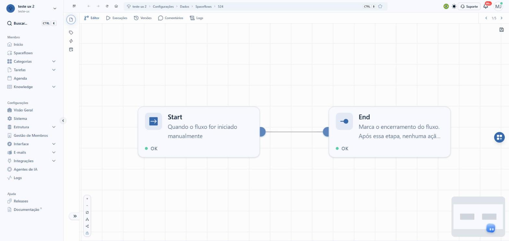
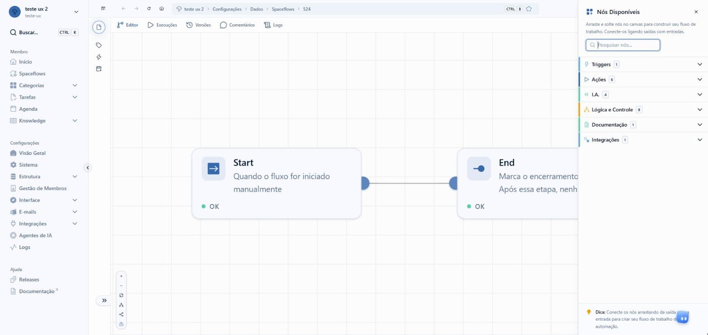
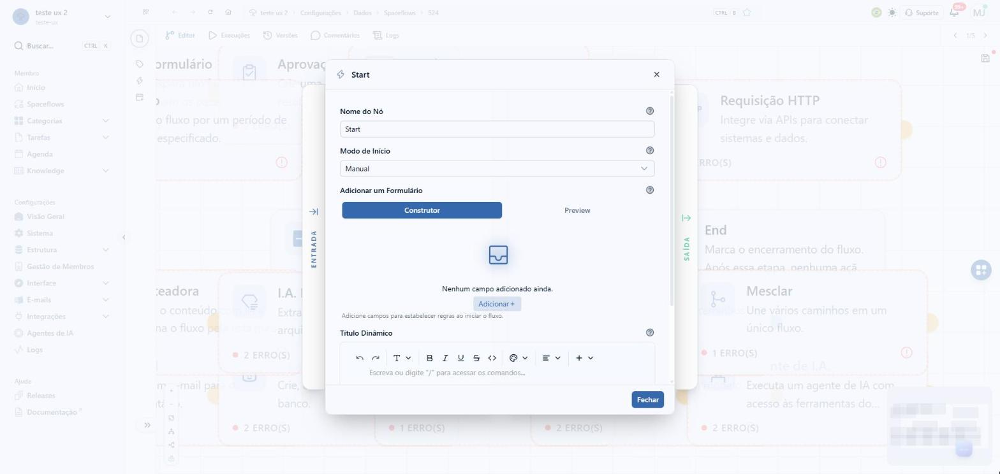
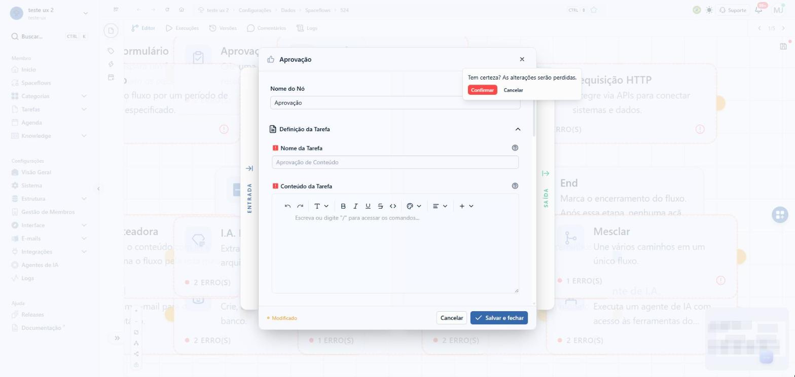
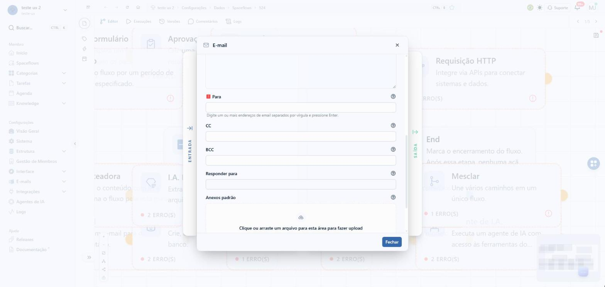
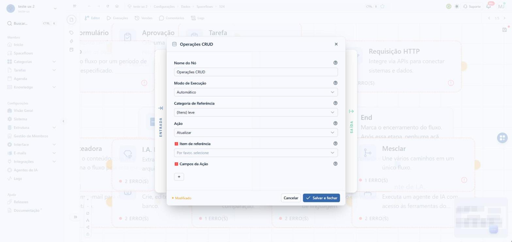
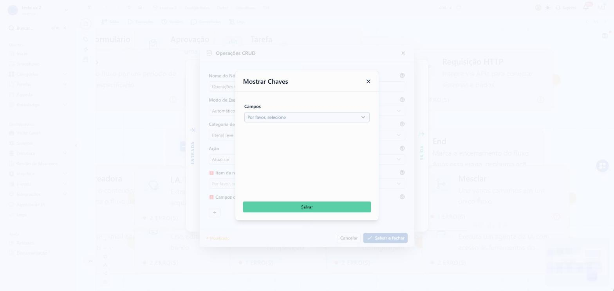
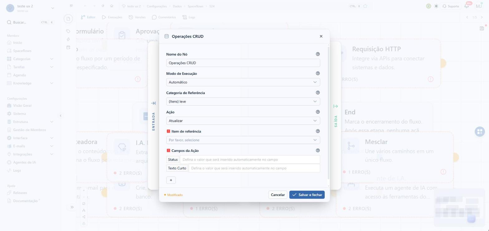
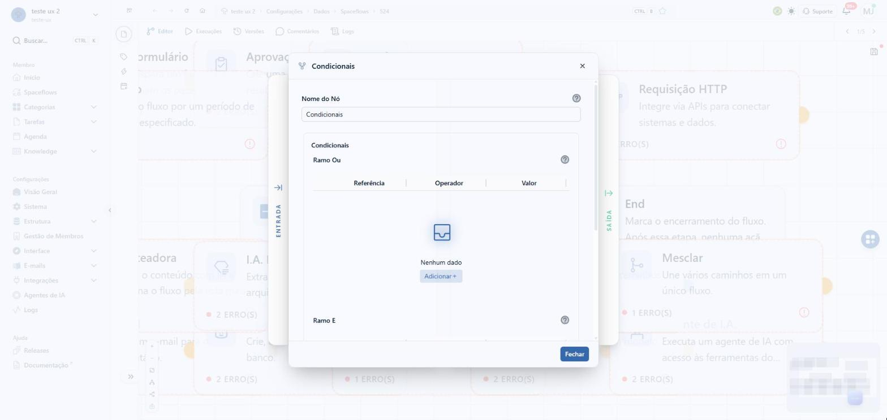
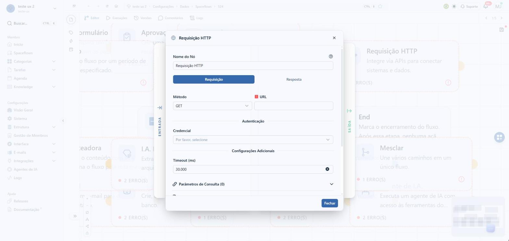

# Spaceflow: configuração dos nós

## A demanda, como veio

> no enspace temos um construtor de fluxos chamado spaceflow.
>
> ele precisa de uma repaginada geral de UX. alguns botoes sao quase invisiveis, ruins de o usuario achar, algumas informaçoes muito escondidas etc.
>
> tente nao mudar a estrutura em si. e nao pode mudar a logica de backend no construtor em si. foque em melhorar ux com /nuxt-ui
>
> alem da melhoria geral na aparencia, voce deve focar na melhoria de UX na configuraçao dos nós (os campos dentro dos nós). basicamente, dentro dos nós voce vê um formulario a ser preenchido. tem uma disposiçao melhor pros campos? mudança de label, mudança de help? adiçao de help? adiçao de instruction? campos a mais pra colocar pra ficar mais bem delimitada a configuraçao?
>
> SEM MUDAR A LOGICA. nao é pra criar novas configuraçoes que impliquem em novas FUNÇOES pros nós. o foco é sómente no uso pro usuario leigo que quer configurar.
>
> nao pode tambem deixar a linguagem tao leiga que um user tecnico nao saberia usar. meio-termo, assim como ta a linguagem no prototipo do nó de delay.
>
> e pro nó de delay pode copiar a config que ta no prototipo dele, inclusive.
>
> comece o trabalho, e nao esqueça de pesquisar como outros construtores de fluxos similares fazem o ux ser bom!
>
> NAO CRIE NOVAS FUNCIONALIDADES, REPITO. TRABALHE SOMENTE COM O QUE JA EXISTE HOJE LA.

- **Tela em jogo:** Configurações › Estrutura › Spaceflow › um fluxo › o editor (canvas) e o modal de cada nó
  (clique duas vezes no nó).
- **Sucesso:** quem configura acha cada botão sem procurar, entende cada campo sem abrir a documentação e vê no
  card o que o nó faz e o que falta, com os mesmos nós, campos e opções que o Spaceflow já tem.

## O que a pesquisa de UX já dizia

Procurei no `enspace-ux-research` (`temas/README.md`, as auditorias dos 6 temas e o `UX_REPORT.md`) por Spaceflow,
workflow, fluxo, nó, gatilho. Não há auditoria do construtor de fluxos. O que há é vizinho:

- **`temas/plataforma`:** a persona leiga não entende o rótulo "Spaceflows" no menu. Fora do escopo (é a casca).
- **S2-F4 (`UX_REPORT.md`):** o caminho de publicar na Base de Conhecimento fica a 6 níveis dentro do fluxo antigo
  de categoria (Types › Workflows › Stages › Tasks). É o fluxo antigo, não o Spaceflow.

O protótipo `no-de-atraso` (aprovado em 14/10/2026) é a referência de texto e de padrão de campo desta demanda,
por pedido dela.

## O Spaceflow hoje (develop, 15/10/2026)

Explorado no workspace de exploração, pela tela, no fluxo de teste nº 524 ("Aviso de vencimento de contrato").
Arrastei um nó de cada tipo da paleta para o canvas (simulei o arrasto por evento, porque a paleta só aceita
arrastar nativo), abri cada modal, li rótulos, ajudas e opções, e saí **sem salvar**: o fluxo continua com Start e
End. Nenhum preparo por API.

Fonte complementar: a documentação de suporte do `en-docs` (somente leitura) e o schema `WorkflowNode` do
`@be-enlighten/enspace-sdk-schemas`. O inventário campo a campo dos 18 tipos ficou na seção "Inventário" abaixo.

### O caminho

1. Configurações › Estrutura › Spaceflow › clique no fluxo.
2. O editor abre com as abas Editor, Execuções, Versões, Comentários e Logs.
3. Para adicionar nó: botão redondo à direita, só ícone, sem rótulo e sem `aria-label` › painel "Nós Disponíveis"
   › arrastar o nó para o canvas › ligar a saída de um nó à entrada do outro.
4. Para configurar: clique duas vezes no card. Nada na tela diz que é duplo clique.
5. Para valer: disquete no canto de cima, só ícone (`title="Salvar todas as alterações"`), abre "Salvar nova versão".

### O canvas

| Elemento | Como é | Problema |
|---|---|---|
| Adicionar nó | Botão redondo à direita, ícone de blocos | Sem texto, sem `aria-label` |
| Salvar | Disquete pequeno no canto, com ponto de alteração | Só ícone; não diz quantas alterações há |
| Trilho da esquerda | 4 ícones: detalhes, etiqueta, raio, calendário | Sem rótulo nem tooltip; o status do fluxo ("active", em inglês cru) e a versão só aparecem no popover do 1º ícone |
| Zoom | 6 botões de 26 px no canto: Aproximar, Distanciar, Ajustar visão, Auto-layout vertical, Auto-layout horizontal, Alternar minimapa | Pequenos; o nome só no `title` |
| Card do nó | Ícone, nome, descrição genérica do tipo ("Atrasa o fluxo por um período de tempo especificado.") e rodapé OK / MODIFICADO / "2 ERRO(S)" | Não diz o que o nó faz neste fluxo; o erro só se lê com o mouse em cima do "!" ("1. Nenhum alvo conectado"); a cor é o único sinal |
| Abrir o nó | Duplo clique | Gesto escondido |

### A paleta

- Título "Nós Disponíveis", texto "Arraste e solte nós no canvas para construir seu fluxo de trabalho.", busca.
- Grupos em acordeão de 1 aberto por vez: **Triggers** (1), **Ações** (6), **I.A.** (4), **Lógica e Controle** (8),
  **Documentação** (1), **Integrações** (1). Inglês e português misturados; "IA" escrita de 2 jeitos ("I.A.",
  "IA Geradora").
- Itens com descrição de 1 linha. Loop, Iterador, Agregador e Documentação marcados "Em Breve".
- Dica no rodapé: "Conecte os nós arrastando da saída para a entrada…".

### Os modais dos nós

Moldura comum: modal central, faixa ENTRADA à esquerda (abre "Variáveis de Entrada"), faixa SAÍDA à direita,
"Nome do Nó" primeiro, rodapé com "Modificado", Cancelar e Salvar e fechar (ou só Fechar).

Achados que valem para todos:

- **A ajuda mora só no "?" do rótulo.** Quase nenhum campo tem instrução visível. Exceções: "Prazo", com 2 frases
  sob o campo, e "Para", do E-mail.
- **Obrigatório é um quadrado vermelho com "!"** antes do rótulo, já ao abrir o modal, como se fosse erro.
- **Ajudas que repetem o rótulo:** "Assunto: Digite o assunto do email.", "Anexos: Adicione os anexos.",
  "Prioridade da tarefa: Selecione a prioridade da tarefa."
- **Ajudas trocadas:** em Aprovação, "Limitar acesso" mostra "Selecione a prioridade da tarefa."; em E-mail,
  "Layout Base" mostra "Selecione o provedor de email."
- **Ajuda que contradiz a descrição:** "Tempo de Conclusão em dias úteis" diz "apenas durante o horário comercial";
  a frase sob o campo diz "apenas os dias úteis".
- **Abre como Modificado sem mudança.** Aprovação, Tarefa, Formulário, IA Geradora, Agente, IA Roteadora e Requisição HTTP abrem com
  "Modificado"; fechar pede "Tem certeza? As alterações serão perdidas." O título do modal da Aprovação diz "Tarefa".

- **Rótulo em inglês ou técnico:** "Timeout (ms)", "Search..." (no submodal do CRUD), "Thinking (raciocínio)" na
  ajuda do Agente, "BCC", "Empty" como opção de layout.
- **Ordem por implementação, não por tarefa:** no E-mail, Provedor, Layout e Modelo vêm antes do Assunto, e o
  destinatário (Para) só aparece depois do corpo.

- **Botão que não parece botão:** "Campos da Ação" do CRUD é um "+" solto. Ele abre um segundo modal, "Mostrar
  Chaves", com botão verde fora da paleta do tema e busca em inglês. Os campos escolhidos viram linhas de texto sem
  tipo e sem botão de remover.

- **Condicionais:** "Ramo Ou" vem antes de "Ramo E"; como os 2 se combinam (todas do E e pelo menos uma do OU) só
  está no "?". "Separar Ramos" tem ajuda que pede releitura.

- **HTTP:** só "Nome do Nó" tem ajuda. O tipo da credencial não aparece. Corpo em 4 formatos ("JSON Fields",
  "JSON Body", "JSON Builder", "JSON Parameters") sem explicação.

- **Variáveis:** a chave crua (`{{nodes.trig.data.cnpj}}`) é o que fica no campo. O painel Variáveis de Entrada
  diz "Nenhuma variável disponível" quando o nó ainda não está ligado, sem dizer por quê.

Sem evidência visual: o tooltip de erro do card ("1. Nenhum alvo conectado - Conecte um nó de ação para
continuar") só aparece com o ponteiro em cima, e a regra de captura não aceita ponteiro no print.

### O que já existe e funciona (e fica)

- A moldura do modal com ENTRADA e SAÍDA, o arrasto de variável, o salvar por versão, as abas do editor, a paleta
  com busca e grupos, o minimapa, o auto-layout.
- Todos os campos e opções listados no inventário. Nenhum some na proposta, nenhum novo entra.

## Inventário dos 17 modais (o que cada nó tem hoje)

Lido na tela em 15/10/2026, com as ajudas do "?" coletadas por hover. "→" separa o rótulo do texto da ajuda.

| Nó (tela) | Campos, na ordem do modal |
|---|---|
| **Start** (`trigger`) | Nome do Nó · Modo de Início (Manual, Ações de Itens, Webhook, Timer, Caixa de Entrada; Timer sem "?") · por modo: Formulário (Manual), Categoria de Referência + Ação de Gatilho + Condicionais (Ramo Ou, Ramo E, Separar Ramos) (Ações de Itens), Credencial + Cabeçalhos + Formulário (Webhook), Periodicidade + mês, dia, hora + Correspondência exata + Fuso (Timer), Caixas de e-mail (Caixa de Entrada) · Título Dinâmico → "Defina títulos automáticos utilizando as variáveis de entrada disponíveis.(Caso Aplicável)" |
| **Formulário** (`form`) | Nome do Nó · Definição da Tarefa (Nome da Tarefa, Conteúdo da Tarefa) · Tempo de conclusão (Tipo de prazo, Cálculo, Valor, dias úteis, notificações) · Classificação (Pontos, Prioridade) · Permissões e Responsabilidade (Limitar acesso, Vincular um item a esta tarefa?, Criador, Colaboradores, Atribuir a, Responsável alternativo) · Habilitar Tarefa Externa · Construa o formulário (Construtor, Preview) |
| **Aprovação** (`approval`) | O mesmo bloco de tarefa do Formulário, sem construtor. Saídas Aprovado e Rejeitado |
| **Tarefa** (`task`) | O mesmo bloco de tarefa |
| **E-mail** (`email`) | Nome do Nó · Provedor → "Selecione o provedor de email." · Layout Base (Enspace, Sem Layout Predefinido) → a mesma ajuda do Provedor · Templates de E-mail · Assunto · Corpo · Para → "Digite o email do destinatário." · CC · BCC · Responder para · Anexos padrão · Anexos |
| **Operações CRUD** (`crud`) | Nome do Nó · Modo de Execução (Automático, Manual) · Categoria de Referência · Ação (Criar, Ler um item, Ler vários itens (desativado), Atualizar, Excluir) · Item de referência · Campos da Ação (+ › "Mostrar Chaves") |
| **Notificação de Comparação** | Nome do Nó · Comparação · Provedor · Assunto · Layout Base (Enspace, Empty) · Corpo |
| **IA Geradora** | Nome do Nó · Modelo · Criatividade da resposta → "(0 = determinístico, 2 = criativo)" · Instrução de sistema → "(opcional)" · Prompt → "Suporta referências com {{ }}" |
| **Agente de I.A.** | Nome do Nó · Agente · Prompt · Máximo de passos · Raciocínio → "Thinking (raciocínio) do modelo neste nó. Vazio = padrão do provedor." · Filtro de ferramentas |
| **IA Roteadora** | Nome do Nó · Modelo · Criatividade da resposta → "(0 = determinístico, 1 = criativo)", com o mesmo controle de 0 a 2 da Geradora · Prompt · Rotas → "Defina pelo menos 2 rotas para classificação" |
| **I.A. Extrair** | Nome do Nó · Modelo · Campos a extrair (Construtor, Preview) · Importar arquivos · URLs de arquivos · Dados de contexto · Instrução adicional |
| **Condicionais** | Nome do Nó · Ramo Ou · Ramo E (Referência, Operador, Valor) · Separar Ramos |
| **Rotas** | Nome do Nó · Definição de Rota › Condições de Rota → "Defina as condições para as rotas saírem deste nó." · Adicionar Rota. O fallback dispara sempre (documentação) |
| **Mesclar** | Nome do Nó · Rótulo para as linhas agregadas (Rótulo, Obrigatório) → "Adicione no mínimo 2 itens para prosseguir" |
| **Atraso** | Nome do Nó · Quantidade de Tempo · Unidade (ver o protótipo `no-de-atraso`) |
| **End** | Nome do Nó |
| **Requisição HTTP** | Nome do Nó · abas Requisição e Resposta · Método · URL · Autenticação › Credencial · Configurações Adicionais › Timeout (ms) · Parâmetros de Consulta · Cabeçalhos · (corpo em POST, PUT, PATCH) · Resposta: Chave do campo, Nome do campo, Tipo, Caminho de origem |

O 18º tipo do schema, `start` ("Iniciar Fluxo", o 2º Início do canvas), não está na paleta e não foi aberto.

## A casca da tela, item por item

A casca é a mesma do protótipo `no-de-atraso`, importada de lá (`../no-de-atraso/_CascaDasConfiguracoes.vue`),
copiada do develop em 14/10/2026 e conferida de novo em 15/10/2026 no mesmo fluxo 524: menu lateral com
Estrutura aberta e Spaceflow ativo, barra do topo com a trilha "workspace › Configurações › Dados › Spaceflows ›
524". Item por item no `BRIEFING.md` do `no-de-atraso`.

O editor (abas, trilho, canvas, zoom, minimapa, botão de adicionar nó, disquete) é desenhado de novo em
`_EditorProposto.vue`, porque ele é objeto da demanda; as posições são as do develop.
