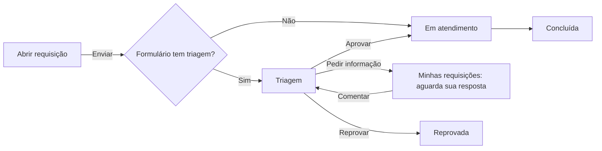

# Decisões: tipos de tela

## A proposta em 1 parágrafo

Os 13 tipos de Interface › Telas misturam 3 eixos: a forma de exibição, o recorte (todos, meus, do meu grupo) e a função (enviar, aprovar, executar em lote). Separados os eixos, sobram 5 tipos de menu (Lista de itens, Fila de tarefas, Painel, Documentos e Página externa) e 1 módulo fixo no menu de todo membro (Requisições, com Abrir requisição, Minhas requisições e Triagem). O tipo Customizado sai. Tudo cabe no "o menu é a tela" do protótipo `menu-lateral`: cada tipo aqui é uma opção do campo Tipo de menu de lá.

## Fronteira

- **Muda:** o conteúdo das 8 telas; a seção Membro ganha o módulo Requisições; o menu ganha a seção "Tipos de menu"; Interface perde a tela Telas.
- **Não muda:** o resto da casca (topo, busca, Configurações, Ajuda, barra do topo, trilha).

## O que cada tela mostra

| Tela | O que funciona de verdade no protótipo |
|---|---|
| Lista de itens | Recorte Todos, Só os meus e Do meu grupo, com contagem; várias categorias juntas; visualização salva de partida; busca; paginação; coluna de expressão "Dias para vencer"; o recorte escrito na tela; aviso para quem não tem grupo; visualização rápida no clique |
| Fila de tarefas | Recorte Aguardando minha ação, Do meu grupo e Todas (só para quem gerencia); etapa, situação e período; aviso de quantas tarefas o período esconde; lote com trava de etapa entre páginas; confirmação com comentário (obrigatório para reprovar); progresso e resultado por tarefa (a 3ª do lote falha de propósito); gaveta com aprovar, reprovar, atribuir a outra pessoa, pular etapa (só quem gerencia, com justificativa) e reabrir |
| Painel | Filtro do painel (período, categoria, responsável) e filtro de 1 widget por cima; o widget de Chamados avisa que não segue o filtro de categoria; clique no número ou na barra abre os itens; edição em 1 painel lateral sem sobreposição, que liga e desliga widgets ao vivo |
| Documentos | Grade (padrão) e lista com alternador; tipo, categoria e busca; item de origem e fluxo em cada arquivo; prévia; baixar com carregando |
| Página externa | Moldura com domínio e "Abrir em nova aba"; 3 casos no andaime: embutida, site que recusa e configurada para abrir em nova aba |
| Abrir requisição | Catálogo por área com busca sem acento; formulário restrito some para quem não é de Compras; validação dos obrigatórios; enviando, enviado com número e falhou com o preenchido preservado; o pedido entra em Minhas requisições e, se for do Jurídico com triagem, na Triagem |
| Minhas requisições | Abas por situação com contagem; área e origem; o que aguarda a pessoa sobe para o topo e ganha aviso; gaveta com respostas, histórico, comentar (responder volta a requisição para a fila), duplicar e cancelar com confirmação |
| Triagem | Lista e detalhe; J e K, setas, A, R e I; aprovar; reprovar e pedir informação com justificativa obrigatória; desfazer no aviso; lote com trava por formulário; mensagem de e-mail e respostas de formulário |

## A jornada do módulo Requisições

## Rodadas

### Rodada 2 · 2026-10-22
- **Pedido (literal):** "voce deve indicar no prototipo quais viram fixas do menu lateral pra todo e qualquer usuario (menu nativo do enspace) com uma badge pra ser facil de identificar"
- **Mudou:** a badge de andaime "Nativo" marca o que vira menu nativo do ENSPACE, fixo no menu de todo membro
  - no menu lateral, na linha Requisições: as 3 telas do módulo são nativas; o tooltip diz que Abrir requisição e Minhas requisições são para todo membro e a Triagem para quem responde por um formulário com triagem
  - a seção "Tipos de menu" ganha a badge "Criado pelo admin", para o contraste
  - no topo de cada tela, a faixa de andaime abre com "Menu nativo: fixo para todo membro", "Menu nativo: fixo para quem responde" ou "Tipo de menu: criado pelo admin"
  - o mapa "De onde veio cada tela" mostra a mesma badge em cada tipo legado
- **Fronteira:** muda só o andaime; não muda nenhuma tela
- **Maquete:** o menu lateral passou de 56 para 64 de largura só para caber a badge; no produto a largura é a do develop
- **Ver:** `evidencias/rodada2-badge-nativo-no-menu.jpg` · `evidencias/rodada2-mapa-com-nativo.jpg`

### Rodada 1 · 2026-10-21
- **Pedido (literal):** "voce deve prototipar agora os tipos de tela. só fazer um menuzinho do enspace simulando os tipos de tela com seus nomes mesmo (tela de requisiçoes), dai o dev consegue entrar e ver como seria na realidade."
- **Mudou:** protótipo novo, 8 telas navegáveis pelo menu lateral, cada uma com a faixa de andaime "Substitui os tipos legados"
  - andaime com troca de tela (para o celular, onde o menu lateral some), cenário, perfil, variações por tela e o mapa "De onde veio cada tela"
  - os textos nos 3 idiomas; o dado do workspace (categoria, formulário, assunto) fica em português, como no produto
- **Fronteira:** muda o menu e as 8 telas; não muda o resto da casca
- **Não deu:** a Fase 2 no develop. Por quê: a demanda pediu para começar na hora, e a auditoria de 14 e 15/09/2026 já cobre os 13 tipos. Os prints de referência da Fase 3 também ficaram de fora: a pesquisa foi por documentação oficial
- **Maquete:**
  - "Abrir item", "Novo item" e "Ver os fluxos" mostram um aviso: a tela dedicada do item e o formulário de criação não fazem parte deste protótipo
  - a página embutida em Página externa é um desenho, não um iframe (regra 4)
  - a prévia do documento é um desenho de página
  - o "Baixar" e o "Exportar" só mostram o aviso
  - a edição do painel não salva entre recargas; tudo volta ao começo no reload
- **Crítica e acessibilidade:** na seção "Crítica" abaixo
- **Ver:** `evidencias/rodada1-lista-de-itens.jpg` · `rodada1-fila-de-tarefas-lote.jpg` · `rodada1-painel.jpg` · `rodada1-triagem.jpg` · `rodada1-abrir-requisicao.jpg`

## Crítica

As skills `design:design-critique` e `design:accessibility-review` não rodaram nesta rodada. A conferência foi feita à mão, no Chrome, em claro, escuro, português, inglês e espanhol:

- **Conferido:** as 8 telas abrem sem erro no console; o lote trava a etapa e mostra o resultado; o envio da requisição mostra o carregando e o número e aparece em Minhas requisições e na Triagem; a Triagem aprova pelo teclado e passa para a próxima; nenhum texto de interface tem travessão; nenhum `<style>`, `:deep()`, `!important` ou cor crua.
- **Acessibilidade:** as barras do Painel são botões com rótulo e recebem foco; a lista da Triagem é `listbox` com `aria-selected`; os atalhos não disparam dentro de campo de texto nem com janela aberta; os cartões do catálogo e dos documentos usam o stretched link da regra 25.
- **Fica sem correção:** a coluna Título da tabela trunca cedo na largura de 1.568 px, porque o `EnTable` divide as colunas por igual; o tooltip de "Todas" na Fila de tarefas (só quem gerencia) aparece sobre o grupo de abas inteiro, não só na aba.

## Achado do SDK (para o time de front)

O `EnTable` guarda a seleção num `Set` por referência e o checkbox da linha pergunta `selectedSet.has(row.original)`. A célula recebe `row.original` como proxy reativo do Vue; com linhas em objeto cru, o `Set` não acha a linha e o checkbox da linha nunca acende (o do cabeçalho acende). Contorno neste protótipo: as linhas passam por `reactive()` antes de ir para o `EnTable` (`_TelaFilaDeTarefas.vue` e `_TelaListaDeItens.vue`). Correção no SDK: comparar por `toRaw` ou por uma chave da linha (`rowKey`).

## O que falta medir antes de implementar

- O uso real de cada tipo em produção, por cliente (o Clarity agrupa tudo em `/pages/:page`).
- Se o N4 ainda acontece com um formulário com campos.
- A diferença entre Triagem e Minhas Requisições com dados reais, e se "fila de entrada" e "aprovação antes de gravar" são 1 ou 2 abas.
- Se a regra de grupo da 3.1.0 e o filtro "Em Grupos" devolvem as mesmas linhas.
- Qual campo de pessoa vale para "Só os meus": criador (`isOwner`) ou responsável.
- Se uma visualização salva pode virar item de menu, e se ela cobre mais de 1 categoria.
- O destino da USE9B515BAD (descontinuar Tarefas Agendadas): a Fila de tarefas lê o modelo de tarefa que ficar.
